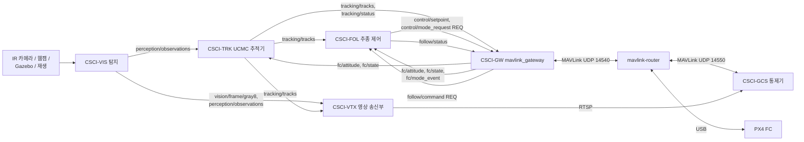

# SDD — 소프트웨어 설계기술서

| 항목 | 내용 |
|---|---|
| 문서 버전 | 0.2 |
| 상위 문서 | `docs/design/ssdd.md` (SSDD) |
| 관련 문서 | `docs/requirements/srs.md` (SRS), `docs/spec/icd.md` (ICD), `docs/verification/std.md` (STD), `docs/spec/process_interfaces.md`, `docs/spec/video.md`, `docs/design/uml/` (클래스·상태·배치 다이어그램) |
| 범위 | CSCI 별 설계 요약과 CSC 식별. 클래스의 상세 책임과 contract 는 각 `class_*.md` 가 기준이며, 이 문서와 다르면 `class_*.md` 가 맞다 |

## 1. 설계 결정 (CSCI 수준)

| ID | 결정 | 근거 |
|---|---|---|
| DD-01 | 탐지, UCMC 추적기, 추종 제어, mavlink_gateway, 영상 송신부를 별도 프로세스로 두고 각자 독립 주기로 동작한다 (`process_interfaces.md` 2.1 안 B). | 추론 지연이 제어 주기를 막지 않게 하고, 한 프로세스의 장애가 다른 프로세스를 멈추지 않게 함. 담당별 독립 빌드·배포 |
| DD-02 | 프로세스 사이 통신은 주기 값은 ZeroMQ 토픽(발행·구독), 수락 확인이 필요한 요청은 요청-응답으로 하고, 메시지는 protobuf 로 직렬화한다 (`process_interfaces.md` 3장). | 브로커 없는 경량 구조, C++/Python 양쪽 지원. 요청-응답으로 중복·오래된 명령 실행 방지 |
| DD-03 | 장비·통신 의존 부분은 인터페이스(`IPreprocessor`, `IDetector`, `IVehicleTelemetry`, `IVelocitySetpointSink`, `IFlightModeControlClient`, `IMavlinkConnection`, `bus::IBus`) 뒤에 두고, 테스트는 `Fake*` 구현으로 한다. | NPU·카메라 교체(CHG-01, CHG-06)를 구현 교체만으로 흡수, SITL·기체 없이 gtest 검증 |
| DD-04 | 환경 프로파일(SITL_POSE / SITL_IMAGE / REAL_IR / REPLAY)에 맞는 구현을 조립한다 (`system_architecture.md`). | 같은 코드로 시뮬레이션·실기체·로그 재생 시험 |
| DD-05 | FC 링크는 mavlink_gateway 하나만 사용하고, FC로 나가는 명령은 모두 `FcControl` 을 거친다. | 명령 충돌 방지, 안전 검사 일원화 |
| DD-06 | 통제기 영상은 RTSP 세션의 영상 트랙과 ONVIF 메타데이터 트랙으로 보내고, 송수신 모두 GStreamer 를 쓴다 (`video.md`). | 표준 프로토콜, 프레임과 박스의 동기화, 코덱 교체가 파이프라인 요소 교체로 끝남 |
| DD-07 | 온보드 본체는 C++, AI·전처리는 Python을 쓴다. | 팀 협업상 언어 통일 |

## 2. 전체 구조

체계 수준 구성요소와 HW 배치는 SSDD 4장을 따르며, 본 절은 SW 관점의 구조를 기술한다. 온보드(RPi5 + Hailo-8)의 5개 CSCI와 통제기 CSCI(CSCI-GCS)로 구성된다.

### 2.1 임무 상태 천이

임무 상태(`ARGUS_MISSION_STATE`)와 표적 상태(`ARGUS_TARGET_STATE`)는 추종 제어가 정하고 `follow/status` 로 mavlink_gateway 에 주며, mavlink_gateway 가 `ARGUS_STATUS` 로 통제기에 옮긴다. 천이의 event·guard·effect 는 `docs/design/uml/state_machine.md` 를 따른다.

| 임무 상태 | 뜻 | FC 모드 |
|---|---|---|
| IDLE | 추종·Scan 없음. 표적 선택 대기 | 임의 |
| PREPARING | TRACK_START 수락 뒤 Offboard 진입·확인 중 | → Offboard |
| FOLLOW_ACTIVE | 추종 중, setpoint 20 Hz | Offboard |
| HOLD_TRANSITION | 추종·Scan 을 끝내고 Hold 로 전환 중 | → Hold |
| HOLD_WAIT | FC Hold 확인 후 대기. 자동으로 추종을 재개하지 않음 | Hold |
| SCAN_ACTIVE | yaw 스캔 중 | Hold 또는 Offboard |
| MANUAL | 조종사(RC) 또는 통제기가 모드를 바꿔 추종이 끝남 | 조종사·통제기가 정한 모드 |
| FAULT | FC 두절, 추종 제어 두절, Offboard 진입 실패 등으로 멈춤 | FC failsafe 에 따름 |

표적 상태는 NONE → CONFIRMED ↔ PREDICTED → LOST 이며, LOST 가 되면 추종 제어가 Hold 로 전환한다.

## 3. CSC 상세 설계

CSC 는 각 CSCI 의 주요 클래스(또는 클래스 묶음)이다. 클래스 이름과 책임은 `docs/design/uml/class_*.md` 와 같다.

### 3.1 CSCI-VIS 탐지 (`class_vision.md`)

| CSC ID | 클래스 | 책임 | 입력 → 출력 |
|---|---|---|---|
| CSC-VIS-01 | `I3SdkFrameSource` | IR 카메라(i3system, USB 2.0) 수신, frame_id·수신 시각 부여 | 카메라 → RAW14 640×480 |
| CSC-VIS-02 | `PythonVisionAdapter` | RAW14 를 ipc 요청으로 Python 작업자에 보내고 탐지 결과·미리보기를 받음. 대기 프레임이 쌓이면 오래된 프레임 폐기 | RAW14 → 탐지 결과, 미리보기 |
| CSC-VIS-03 | `IPreprocessor` / `DoublePlateauPreprocessor` | RAW14 → 원본 크기 8 비트 흑백(Double Plateau adaptive) | RAW14 → `Gray8Frame` |
| CSC-VIS-04 | `IDetector` / `HailoDetector` | HailoRT 추론, HEF 의 NMS 출력 해석, 원본 픽셀 좌표로 되돌림 | `Gray8Frame` → `Detection` 목록 |
| CSC-VIS-05 | `PerceptionWorker` | 추론한 프레임마다 탐지 결과 발행 | 탐지 결과 → `perception/observations` |
| CSC-VIS-06 | `IPreviewSink` / `ZmqPreviewSink` | 영상 송신부용 비압축 흑백 프레임 등 미리보기 발행 | `Gray8Frame` → `vision/frame/gray8` |

### 3.2 CSCI-TRK UCMC 추적기 (`class_tracker.md`)

| CSC ID | 클래스 | 책임 | 입력 → 출력 |
|---|---|---|---|
| CSC-TRK-01 | `ObservationSubscriber` | 탐지 결과 수신 (frame_id 는 건너뛸 수 있음) | `perception/observations` → 관측 |
| CSC-TRK-02 | `VehicleStateSubscriber` | FC 자세·local NED 위치·하향 거리와 값마다의 수신 시각 보관 | `fc/attitude`, `fc/state` → 프레임 시각의 기체 상태 |
| CSC-TRK-03 | `UcmcTracker` | 프레임 사이 객체 연결, 카메라 운동 보상(CMC), track_id·generation 부여 | 관측 + 기체 상태 → 트랙 |
| CSC-TRK-04 | `TracksPublisher` | 탐지 결과 프레임마다 추적 결과 발행 | 트랙 → `tracking/tracks` |
| CSC-TRK-05 | `TrackingStatusPublisher` | 추적기 상태 1 Hz 발행 | → `tracking/status` |

### 3.3 CSCI-FOL 추종 제어 (`class_follow.md`)

| CSC ID | 클래스 | 책임 | 입력 → 출력 |
|---|---|---|---|
| CSC-FOL-01 | `IVehicleTelemetry` | 기체 상태 스냅샷, 프레임 시각에 맞춘 자세·위치·하향 거리 조회 | `fc/attitude`, `fc/state` → 기체 상태 |
| CSC-FOL-02 | `FollowController` | 임무·표적 상태 관리(`state_machine.md`), 지정 표적 유지, 속도 setpoint 계산(설정 한도 적용) | 추적 결과 + 기체 상태 + 명령 → setpoint, 상태 |
| CSC-FOL-03 | `IVelocitySetpointSink`, `IFlightModeControlClient` | FRD 속도·yaw 속도·유효 시간 송신, Offboard 진입·Hold 요청 | setpoint → `control/setpoint`, `control/mode_request` |
| CSC-FOL-04 | `IFollowControl` / `ZmqFollowControlServer` | 추종 시작·종료·Scan 요청 처리, 결과 응답 | `follow/command` → `follow/result` |
| CSC-FOL-05 | `FollowStatusPublisher` | 임무·표적 상태와 명령 결과 발행 (1 Hz + 변경 시) | 상태 → `follow/status` |

### 3.4 CSCI-GW mavlink_gateway (`class_mavlink_gateway.md`)

| CSC ID | 클래스 | 책임 | 입력 → 출력 |
|---|---|---|---|
| CSC-GW-01 | `FcTelemetryReceiver`, `FcLinkTracker`, `TimeSync`, `BusVehicleTelemetryPublisher` | FC 메시지 수신과 수신 시각 기록, 두절 판단, FC 시각 변환 | MAVLink → `fc/attitude`, `fc/state` |
| CSC-GW-02 | `FcControl` | FC 로 명령을 보내는 유일한 클래스. 요청과 20 Hz 주기 작업마다 `fc_command_policy` 의 판단을 실행하고, FC 의 응답(COMMAND_ACK)과 실제 모드 변경을 전달 | 모드 요청, setpoint → DO_SET_MODE, SET_POSITION_TARGET_LOCAL_NED |
| CSC-GW-03 | `BusVelocitySetpointSubscriber`, `BusFlightModeControlServer` | 추종 제어의 setpoint 와 모드 요청을 bus 에서 받아 `FcControl` 에 전달하고 요청에 응답 | `control/setpoint`, `control/mode_request` → `FcControl`, 응답 |
| CSC-GW-04 | `fc_command_policy`, `FcCommandState` | 추종 제어의 보고와 관계없이 FC 상태로 판단한다: FC 제어 명령 송신권, FC 연결 두절과 비행 상태의 최신 여부, FC 가 요청 없이 Offboard 를 벗어난 경우(조종사, failsafe)의 송신 중단, 유효 시간이 지난 setpoint 대신 제자리 유지 | FC 상태, 요청 → 다음 상태, 보낼 setpoint, 거부 원인 |
| CSC-GW-05 | `MavlinkCommandReceiver`, `TrackStartHandler`, `TrackStopHandler`, `ScanStartHandler`, `ControlAuthority` | 통제기 COMMAND_LONG(compid 195) 수신, 제어권·조건 검사, 추종 제어에 요청 | COMMAND_LONG → `follow/command`, COMMAND_ACK |
| CSC-GW-06 | `ArgusStatusReporter`, `ArgusSensorStatusReporter` | `follow/status`·`tracking/status` 를 통제기 보고 메시지로 변환 | → `ARGUS_STATUS`, `ARGUS_SENSOR_STATUS` |
| CSC-GW-07 | `GcsLinkMonitor` | 통제기 HEARTBEAT 3 s 두절 판단, 추종·Scan 중이면 TRACK_STOP 과 같은 절차 | HEARTBEAT → 두절 처리 |

### 3.5 CSCI-VTX 영상 송신부 (`class_video.md` 1절)

| CSC ID | 클래스 | 책임 | 입력 → 출력 |
|---|---|---|---|
| CSC-VTX-01 | `FrameCollector` | 프레임·탐지 결과·추적 결과를 `(source, session_id, frame_id)` 로 묶음 | 세 토픽 → `CollectedFrame` |
| CSC-VTX-02 | `OnvifMetadataSerializer`, `MetadataRtpPacketizer` | 추적 결과를 ONVIF XML 로 변환, RTP 패킷으로 분할 | `CollectedFrame` → 메타데이터 RTP |
| CSC-VTX-03 | `RtspServer`, `VideoSender` | gst-rtsp-server 에 영상·메타데이터 트랙 등록, 프레임마다 영상 먼저 메타데이터 다음으로 송신 | → RTSP 세션 |

### 3.6 CSCI-GCS 통제기 (`class_gcs.md`, `class_video.md` 2절)

| CSC ID | 클래스 | 책임 |
|---|---|---|
| CSC-GCS-01 | `UdpMavlinkConnection`, `CommandSender` | UDP 14550 MAVLink 연결(sysid 250), COMMAND_LONG 송신과 응답 대기·재전송 |
| CSC-GCS-02 | `FlightCommands`, `FollowCommands` | 비행 명령(FC, compid 1), 추종 명령 TRACK_START·TRACK_STOP·SCAN_START(mavlink_gateway, compid 195) |
| CSC-GCS-03 | `TelemetryModel`, `ArgusStatusModel` | FC 텔레메트리, 임무·표적 상태와 센서 상태 표시값 |
| CSC-GCS-04 | `RtspReceiver`, `OnvifMetadataDeserializer`, `FrameSynchronizer` | RTSP 두 트랙 수신, 메타데이터 해석, 프레임과 박스 동기화 |
| CSC-GCS-05 | `VideoView` | 영상·박스 표시, 클릭한 박스로 TRACK_START |

### 3.7 공통

| CSC ID | 명칭 | 책임 |
|---|---|---|
| CSC-COM-01 | `IClock` | 공통 시각(RPi `CLOCK_MONOTONIC`, ns) |
| CSC-COM-02 | Recorder / Evaluator | t_frame·t_att·t_cmd, 트랙·상태 비동기 기록, FPS·E2E·유지율 산출 (`system_architecture.md`) |
| CSC-COM-03 | 환경 프로파일 조립 | 환경 프로파일 로드, 호환성 검사, 구현 조립 (`system_architecture.md`) |

## 4. 인터페이스 설계

인터페이스 식별은 SSDD 4.4절을 따른다. 데이터 항목과 처리 규칙의 상세는 프로세스 사이는 `process_interfaces.md`, FC·통제기 MAVLink 는 `icd.md`, 영상은 `video.md` 를 따른다.

### 4.1 내부 토픽과 요청 (ZeroMQ, `process_interfaces.md` 5장)

| 이름 | 방식 | 발행 → 구독 | 내용 |
|---|---|---|---|
| `perception/observations` | 토픽 | CSC-VIS-05 → CSC-TRK-01, CSC-VTX-01 | 프레임마다의 탐지 결과 |
| `vision/frame/gray8` | 토픽 | CSC-VIS-06 → CSC-VTX-01 | 비압축 8 비트 흑백 프레임 640×480 |
| `tracking/tracks` | 토픽 | CSC-TRK-04 → CSC-FOL-02, CSC-GW-05, CSC-VTX-01 | track_id·generation·상태·박스·지면 투영 |
| `tracking/status` | 토픽 | CSC-TRK-05 → CSC-GW-06 | generation, fc_fresh, cmc_valid, fps |
| `fc/attitude`, `fc/state` | 토픽 | CSC-GW-01 → CSC-TRK-02, CSC-FOL-01 | 자세·각속도, local NED 위치·속도, 하향 거리, 비행 모드 |
| `control/setpoint` | 토픽 | CSC-FOL-03 → CSC-GW-03 | FRD 속도·yaw 속도·유효 시간 |
| `control/mode_request` | 요청-응답 | CSC-FOL-03 → CSC-GW-03 | Offboard 진입, Hold, heading |
| `follow/command` | 요청-응답 | CSC-GW-05 → CSC-FOL-04 | 추종 시작·종료·Scan |
| `follow/status` | 토픽 | CSC-FOL-05 → CSC-GW-06 | 임무·표적 상태, 선택 표적, 명령 결과 |

### 4.2 FC 인터페이스 (MAVLink, `icd.md` 1·2장)

- 물리 계층: USB(실기체), UDP(PX4 SITL). UART는 탑재 보드 핀 손상으로 사용하지 않는다(CHG-05). RPi 쪽은 mavlink-router 가 FC 장치를 열고, mavlink_gateway 와는 UDP `127.0.0.1:14540` 으로 주고받는다.
- 메시지는 생성 C 헤더(`common/mavlink`)로 인코드·디코드한다. MAVSDK 는 사용하지 않는다.
- 수신: ATTITUDE, LOCAL_POSITION_NED, GLOBAL_POSITION_INT, DISTANCE_SENSOR, HEARTBEAT, TIMESYNC.
- 송신: SET_POSITION_TARGET_LOCAL_NED(추종 setpoint, 제자리 유지), DO_SET_MODE(Offboard 진입). 모두 `FcControl` 이 보낸다. 정지는 Hold 로 바꾸지 않고 Offboard 를 유지한 채 제자리 유지 setpoint 로 한다 (`icd.md` 4.2).

### 4.3 통제기 인터페이스 (`icd.md` 3·4장, `video.md`)

- MAVLink: 통제기는 UDP 14550(mavlink-router 경유)으로 HEARTBEAT, COMMAND_LONG(TRACK_START·TRACK_STOP·SCAN_START 는 compid 195, 비행 명령은 compid 1)을 보내고, `ARGUS_STATUS`·`ARGUS_SENSOR_STATUS`·FC 텔레메트리·COMMAND_ACK 를 받는다.
- 영상: RTSP 세션 하나에 영상 트랙(RTP/JPEG)과 메타데이터 트랙(ONVIF XML)을 둔다. 통제기는 RTCP Sender Report 로 두 트랙의 시각을 맞춘다.

### 4.4 하드웨어 인터페이스

| 연결 | 방식 |
|---|---|
| RPi5 ↔ Hailo-8 | AI HAT+, PCIe Gen3(8GT/s), HailoRT PCIe 드라이버(DKMS) |
| RPi5 ↔ 카메라 | USB 2.0 (i3system IR 카메라, i3 SDK / 웹캠) |
| RPi5 ↔ FC | USB 케이블 |
| 배터리 → RPi5 | 3S 2200mAh → UBEC-8A(DC-DC) |
| 온보드 ↔ 통제기 | Wi-Fi 네트워크 (MAVLink UDP, RTSP) |

## 5. 배포 설계

체계 배치도(Deployment Diagram)는 SSDD 4.2절과 `docs/design/uml/deployment.md` 를 따른다.

| 노드 | 구성 | 역할 |
|---|---|---|
| 메인 RPi5 | Ubuntu 24.04, HailoRT, Hailo-8 | 통합 코드 개발·성능 시험(공용, SSH 접속) |
| 탑재 RPi5 | 동일 OS, Hailo-8 장착, FC USB 연결 | 드론 탑재 운용 (온보드 CSCI 5개, mavlink-router) |
| 시뮬레이션 PC | WSL + Docker, Ubuntu, PX4 SITL + Gazebo | SITL_POSE / SITL_IMAGE 시험 |
| 통제기 | Windows 노트북 | CSCI-GCS |

형상관리: GitHub(argus-edge-vision), Git Flow 브랜치, Conventional Commits, PR 리뷰. 보드 공통 코드와 보드별 설정을 분리 관리한다.

## 6. 요구사항 추적

CSC별 담당 요구사항은 SRS 6장 추적표를 따른다. 모든 SRS-FUN·IF·SAF 요구사항은 하나 이상의 CSC에 할당되어 있다.

## 변경 이력

| 버전 | 날짜 | 내용 |
|---|---|---|
| 0.1 | 2026-11-22 | 초안 (docx, #84) |
| 0.2 | 2026-11-23 | Markdown 으로 전환 (#85 리뷰). CSCI 를 기존 프로세스 구성으로, CSC 를 `class_*.md` 의 클래스로 변경(추적기 UCMC, FC 명령 `FcCommandGate`·`IVelocitySetpointSink`·`IFlightModeControlClient`), 임무 상태를 `ARGUS_MISSION_STATE` 8개로, FC 인터페이스에서 MAVSDK 제거, 통제기 인터페이스를 MAVLink + RTSP 로 수정 |
