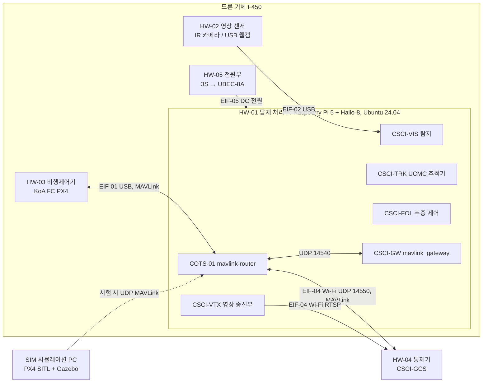

# SSDD — 체계/부체계 설계기술서

| 항목 | 내용 |
|---|---|
| 문서 버전 | 0.2 |
| 상위 문서 | `docs/requirements/sss.md` (SSS) |
| 관련 문서 | `docs/requirements/srs.md` (SRS), `docs/spec/icd.md` (ICD), `docs/spec/process_interfaces.md` (프로세스 구성), `docs/spec/video.md` (영상 전송), `docs/design/uml/deployment.md` (배치) |

## 1. 범위

본 문서는 SSS의 체계 요구사항을 만족하기 위한 체계 수준 설계를 기술한다. 체계를 하드웨어 구성품(HW)과 소프트웨어 구성품(CSCI)으로 나누고, 각 구성품에 체계 요구사항을 할당한다. CSCI는 RPi 프로세스 구성(`process_interfaces.md` 2.1)의 프로세스 하나를 하나로 삼는다. CSCI별 소프트웨어 요구사항은 SRS에서 정의한다.

## 2. 참조문서

- `docs/requirements/sss.md` (SSS 체계/부체계 규격서)
- `docs/requirements/srs.md` (SRS), `docs/spec/icd.md` (ICD)
- 방위사업청, 「무기체계 소프트웨어 기술문서 작성가이드」, 2020
- MIL-STD-498, System/Subsystem Design Description (SSDD) DID

## 3. 체계 전반 설계 결정

| ID | 결정 | 관련 SSS | 근거 |
|---|---|---|---|
| SD-01 | 탐지·추적·추종 판단을 모두 드론 온보드에서 수행한다. | SSS-01, 04 | 지휘부 통신 단절 상황에서 임무 지속 |
| SD-02 | 온보드 처리부는 Raspberry Pi 5 + Hailo-8(AI HAT+ 26 TOPS)로 구성한다. | SSS-01, 12 | NPU 추론 성능·저전력. 계획서 DeepX 대비 변경(SRS CHG-01) |
| SD-03 | 온보드 SW를 탐지, UCMC 추적기, 추종 제어, mavlink_gateway, 영상 송신부의 5개 프로세스(CSCI)로 나누고, 프로세스 사이 데이터는 ZeroMQ 토픽과 요청-응답으로만 교환한다 (`process_interfaces.md` 2.1, 3장). | SSS-04, 05 | 추론 지연이 제어를 막지 않고, 한 프로세스의 장애가 다른 프로세스를 멈추지 않음. 담당별 독립 빌드·배포 |
| SD-04 | 운용자 기능은 통제기의 별도 CSCI(CSCI-GCS)로 분리한다. | SSS-06 | 통제기 링크 단절과 온보드 임무 분리 |
| SD-05 | 비행체는 F450 + KoA FC(PX4)를 쓰고, 처리부와 FC는 USB로 연결한다. RPi 쪽은 mavlink-router 만 FC 장치를 열고, 온보드 프로세스와 통제기에는 UDP로 중계한다. | SSS-03, 07 | 탑재 여유·안정성, 탑재 보드 UART 핀 손상(SRS CHG-03~05) |
| SD-06 | FC 링크와 FC 명령 송신은 mavlink_gateway 하나만 맡고, FC로 나가는 명령은 모두 FC 명령 송신 클래스(`FcControl`)를 거친다. | SSS-09, 10 | 명령 충돌 방지, 안전 검사 일원화 |
| SD-07 | 통제기로 가는 영상과 추적 결과는 RTSP 세션 하나의 영상 트랙과 메타데이터 트랙(ONVIF XML)으로 보낸다 (`video.md`). | SSS-06 | 표준 프로토콜, 프레임과 박스의 동기화 |
| SD-08 | 온보드 전원은 3S 배터리에서 UBEC로 분리 공급한다. | SSS-12 | 처리부 전원 안정화 |
| SD-09 | 실내 위치 유지는 옵티컬플로우·거리센서로 한다. | SSS-13 | 실내 GPS 사용 불가(SRS CHG-09) |
| SD-10 | 시험은 재생·SITL → 보드 통합 → 실내 비행 → 실외 비행 순서로 하고, 환경 프로파일 4종으로 같은 코드를 사용한다 (`system_architecture.md`). | SSS-14 | 기체 파손 위험 최소화 |

## 4. 체계 아키텍처 설계

### 4.1 체계 구성요소

| ID | 구분 | 명칭 | 목적 | 할당 SSS |
|---|---|---|---|---|
| HW-01 | HW | 탑재 처리부 (Raspberry Pi 5 + Hailo-8) | 온보드 SW 실행, NPU 추론 | SSS-01, 11, 12 |
| HW-02 | HW | 영상 센서 (IR 카메라 / USB 웹캠) | 표적 영상 획득 | SSS-08, 11 |
| HW-03 | HW | 비행체 (F450, KoA FC/PX4, 옵티컬플로우·거리센서) | 비행·자세 제어, 실내 위치 유지 | SSS-03, 07, 13 |
| HW-04 | HW | 통제기 (Windows 노트북) | 운용자 표시·명령 | SSS-06 |
| HW-05 | HW | 전원부 (3S 2200mAh → UBEC-8A) | 처리부 분리 전원 | SSS-11, 12 |
| CSCI-VIS | SW | 탐지 | 카메라 입력, 전처리, NPU 추론, 탐지 결과·영상 프레임 발행 | SSS-01, 04, 05, 08, 14, 15, 16 |
| CSCI-TRK | SW | UCMC 추적기 | 프레임 사이 객체 연결, FC 자세 기반 카메라 운동 보상, track_id·generation 부여 | SSS-02, 04, 05, 14, 15, 16 |
| CSCI-FOL | SW | 추종 제어 | 추종·Scan 판단, 속도 setpoint 계산, 임무·표적 상태 관리 | SSS-02, 03, 05, 09, 14, 15, 16 |
| CSCI-GW | SW | mavlink_gateway | FC 통신(단일 소유), 통제기 통신, FC 명령 검사 | SSS-03, 05, 06, 07, 09, 10, 14, 15, 16 |
| CSCI-VTX | SW | 영상 송신부 | RTSP 영상·메타데이터 송신 | SSS-06, 16 |
| CSCI-GCS | SW | 통제기 SW | 영상·추적 결과·상태 표시, 운용자 명령 | SSS-06 |
| COTS-01 | SW (상용) | mavlink-router | FC 장치와 로컬·통제기 UDP 중계 (설정만 관리) | SSS-07 |
| SIM | 시험 지원 | 시뮬레이션 PC (PX4 SITL + Gazebo, WSL + Docker) | 실기체 전 기능 검증 | SSS-14 |

### 4.2 배치 설계 (Deployment Diagram)

장비, 실행 환경, artifact 의 상세는 `docs/design/uml/deployment.md` 를 따른다. 아래 그림은 체계 구성요소와 외부 인터페이스(4.4)의 배치만 나타낸다.

| 노드 | 구성 | 역할 |
|---|---|---|
| 탑재 RPi5 (HW-01) | Ubuntu 24.04, HailoRT, Hailo-8, FC USB 연결 | 온보드 CSCI 5개와 mavlink-router 실행 (드론 탑재) |
| 메인 RPi5 | 탑재 보드와 동일 구성 | 통합 코드 개발·성능 시험 (공용, SSH 접속) |
| 통제기 (HW-04) | Windows 노트북 | CSCI-GCS 실행 |
| 시뮬레이션 PC (SIM) | WSL + Docker, Ubuntu, PX4 SITL + Gazebo | SITL_POSE / SITL_IMAGE 시험 |

### 4.3 실행 개념

- HW-02가 영상을 획득하면 CSCI-VIS가 HW-01의 NPU로 탐지하여 탐지 결과(`perception/observations`)와 영상 프레임(`vision/frame/gray8`)을 발행한다.
- CSCI-TRK는 탐지 결과와 FC 자세(`fc/attitude`, `fc/state`)로 카메라 운동을 보상하며 객체를 연결하고 추적 결과(`tracking/tracks`)를 발행한다.
- CSCI-FOL은 추적 결과와 기체 상태로 지정 대상의 속도 setpoint(`control/setpoint`)를 만들고, CSCI-GW는 FC 명령 검사를 통과한 명령만 HW-03(FC)에 송신한다.
- CSCI-VTX는 영상 프레임과 추적 결과를 묶어 RTSP 로 CSCI-GCS에 보낸다. CSCI-GCS는 영상과 박스, 임무 상태(`ARGUS_STATUS`)를 표시하고, 운용자의 표적 지정·추종 시작·중단 명령을 MAVLink 로 CSCI-GW에 보낸다.
- 대상 소실·stale 데이터·RC 오버라이드 시 추종을 멈추고 정지(Hold) 또는 조종자 제어로 넘긴다. 임무 상태 천이는 `docs/design/uml/state_machine.md` 를 따른다.

### 4.4 인터페이스 설계

외부 인터페이스(EIF)의 필드·규칙 상세는 `docs/spec/icd.md`(MAVLink)와 `docs/spec/video.md`(영상)에서, 내부 인터페이스(IIF)는 `docs/spec/process_interfaces.md` 에서 정의한다.

| ID | 연결 | 방식 | 내용 |
|---|---|---|---|
| EIF-01 | HW-03 (FC) ↔ HW-01 | USB, MAVLink 2. RPi 쪽은 mavlink-router 가 열고 CSCI-GW와는 UDP `127.0.0.1:14540` / SITL: UDP | 텔레메트리 수신, 추종 명령 송신 |
| EIF-02 | HW-02 → HW-01 | USB 2.0 (i3 SDK) | 영상 프레임 |
| EIF-03 | HW-01 내부 (RPi5 ↔ Hailo-8) | PCIe Gen3, HailoRT | HEF 모델 추론 |
| EIF-04 | HW-01 ↔ HW-04 | Wi-Fi. MAVLink UDP 14550 (mavlink-router 경유), RTSP + RTP/UDP | 상태(`ARGUS_STATUS` 등)·운용자 명령, 영상·메타데이터 |
| EIF-05 | HW-05 → HW-01 | DC 전원 (UBEC-8A) | 처리부 전원 |
| IIF-01 | CSCI-VIS → CSCI-TRK, CSCI-VTX | ZeroMQ 토픽 | `perception/observations`, `vision/frame/gray8` |
| IIF-02 | CSCI-TRK → CSCI-FOL, CSCI-GW, CSCI-VTX | ZeroMQ 토픽 | `tracking/tracks`, `tracking/status` |
| IIF-03 | CSCI-GW → CSCI-TRK, CSCI-FOL | ZeroMQ 토픽 | `fc/attitude`, `fc/state`, `fc/mode_event` |
| IIF-04 | CSCI-FOL → CSCI-GW | ZeroMQ 토픽, 요청-응답 | `control/setpoint`, `control/mode_request` |
| IIF-05 | CSCI-GW ↔ CSCI-FOL | ZeroMQ 요청-응답, 토픽 | `follow/command`, `follow/status` |

- EIF-01 의 FC 연결은 USB 다. 현행 `docs/spec/icd.md` 1.2 와 `docs/design/uml/deployment.md` 는 UART(TELEM2, `/dev/ttyAMA0`)를 전제로 하므로, 기체 구성(USB, `/dev/ttyACM0`)에 맞춘 수정을 요청한다 (#85 리뷰).

## 5. 요구사항 추적

SSS 요구사항의 구성요소 할당은 4.1절 표와 같다. 모든 SSS 요구사항은 하나 이상의 구성요소에 할당되었으며, CSCI에 할당된 요구사항은 SRS에서 소프트웨어 요구사항으로 분해된다(추적은 SSS 5장).

## 변경 이력

| 버전 | 날짜 | 내용 |
|---|---|---|
| 0.1 | 2026-11-22 | 초안 (docx, #84) |
| 0.2 | 2026-11-23 | Markdown 으로 전환 (#85 리뷰). CSCI를 기존 프로세스 구성(탐지, UCMC 추적기, 추종 제어, mavlink_gateway, 영상 송신부)으로 변경, FC 연결을 USB + mavlink-router 경유 UDP(MAVSDK 미사용)로, 통제기 연결을 MAVLink UDP 14550 + RTSP 로 수정, 배치도를 Mermaid 로 교체 |
