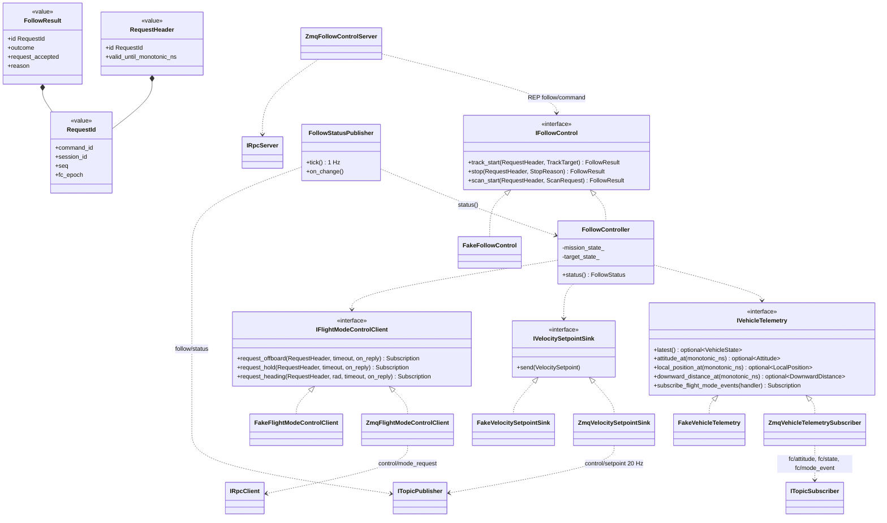

# Class Diagram — 추종 제어의 외부 인터페이스

| 항목 | 내용 |
|---|---|
| 참조 문서 | `docs/spec/process_interfaces.md` 4장 (C++ 인터페이스), 5.1·5.2 (토픽·REQ/REP), 6장 (두절) |
| 표기 | Mermaid `classDiagram`. `<\|..` 구현, `..>` 사용 |
| 범위 | 추종 제어가 다른 프로세스와 주고받는 인터페이스와 그 ZeroMQ 어댑터만. `FollowController` 내부(추종·Scan 판단, setpoint 계산)는 추적·추종 담당이 채운다 |
| 코드 | 인터페이스와 값 타입 `onboard/libs/vehicle_api`, 테스트용 Fake `onboard/libs/vehicle_api_testing` (#39, #40) |

| 클래스 | 구현 담당 | 책임 | 출처 |
|---|---|---|---|
| `IVehicleTelemetry` | 인터페이스: 통신 | 기체 상태 스냅샷(값마다 수신 시각과 fc_epoch), 프레임 시각에 맞춘 자세, local 위치, 하향 거리 조회(조회 시점 기준 200 ms 이내인 값 중 프레임 시각에 가장 가까운 것, 그 차가 50 ms 이내. 보간하지 않는다. 최근 값의 보관과 조회 시점은 구현 `ZmqVehicleTelemetrySubscriber` 가 맡는다), 비행 모드 이벤트 구독(`Subscription` 반환, handler 는 `process_events()` 안에서) | pi 4장, 5.1, `class_tracker.md` |
| `IVelocitySetpointSink` | 인터페이스: 통신 | FRD 속도·yaw 속도·유효 시간. 매 주기 호출, 즉시 반환. onboard 쪽 구현은 `MavlinkVelocitySetpointSink`(`class_onboard.md` 2절) | pi 4장 |
| `IFlightModeControlClient` | 인터페이스: 통신 | Offboard 진입, Hold, Hold 중 heading 요청. 호출은 바로 반환하고 응답(`FlightModeReply`: command_id, 수락 여부, 원인)은 `on_reply` 로, 시간 초과는 nullopt. 실제 전환은 `IVehicleTelemetry` 의 모드 이벤트로. onboard 쪽 짝은 `IFlightModeControl`(동기, `MavlinkFlightModeControl` 구현) | pi 4장, 5.2 |
| `IFollowControl` | 인터페이스: 통신, 구현: 추적·추종 | 추종 시작·종료·Scan. 요청을 받은 시점에 정해지는 결과(IN_PROGRESS 또는 REJECTED)를 바로 반환. 표적 존재·상태·FC 조건 검사는 구현이 한다. onboard 쪽 짝은 `IFollowControlClient`(비동기, `ZmqFollowControlClient` 구현) | pi 4장, icd 4.1 |
| `Zmq*` 어댑터 | 통신 | 위 인터페이스를 `process_interfaces.md` 5장 토픽·REQ/REP 로 구현. 받기만 하면 `…Subscriber`, 응답하면 `…Server` | pi 2장 |
| (CMake 타깃) | 통신 | 인터페이스 넷은 `argus::vehicle_api`(`core` 의 `Subscription` 에만 의존), `Zmq*` 어댑터는 `argus::vehicle_api_zmq`(`vehicle_api`·`bus` 링크)로 나눈다. `FollowController` 와 그 단위 테스트는 `vehicle_api`·`vehicle_api_testing` 만 링크해 ZeroMQ·MessagePack 에 의존하지 않는다 (#35 리뷰) | — |
| `ZmqFollowControlServer` | 통신 | `follow/command` REP 를 받아 `IFollowControl` 호출, `FollowResult` 를 `follow/result` 로 응답 | pi 5.2 |
| `FollowStatusPublisher` | 통신 | `follow/status` 1 Hz + 변경 시, `command_results` 포함 | pi 5.1.2 |
| `FollowController` | 추적·추종 | 임무·표적 상태(`state_machine.md`), setpoint 계산. 내부 구조는 담당자가 `class_follow.md` 에 추가 | pi 2장 |
| `Fake*` | 통신 | 테스트용. SITL·기체 없이 `FollowController` 를 gtest 로 검사. `argus::vehicle_api_testing` 에 두고 제품 실행 파일은 링크하지 않는다. Client Fake(`FakeFlightModeControlClient`, onboard 용 `FakeFollowControlClient`)는 `FakePoller` 를 받아 테스트가 넣은 응답을 `process_events()` 안에서 전달한다 | pi 4장 |

## SOLID 대응

| 원칙 | 어디에 | 어떻게 |
|---|---|---|
| S | 어댑터 하나 = 토픽(요청) 하나 | `ZmqVehicleTelemetrySubscriber` 는 구독만, `ZmqVelocitySetpointSink` 는 발행만 |
| O | `IFollowControl` | 새 행동(예: Scan 변형)은 메서드 추가로, FC 통신 코드는 바꾸지 않음 (pi 4장) |
| L | `Zmq*` ↔ `Fake*` | 같은 계약(즉시 반환, 유효 시간, 응답 코드, handler 는 `process_events()` 안에서) |
| I | 인터페이스 넷으로 분리, 구현용·호출용 분리 | 추적기는 `IVehicleTelemetry` 만, 추종 제어는 넷 모두 (pi 4장 "인터페이스 분리"). RPC 는 구현하는 쪽(동기)과 호출하는 쪽(비동기)이 다른 인터페이스를 봄 |
| D | `FollowController`, CMake 타깃 | 인터페이스에만 의존하고, 빌드에서도 `vehicle_api`(인터페이스)만 링크한다. 프로세스 배치를 바꿔도(onboard 안으로 합쳐도) 추종 제어 코드는 그대로 (pi 2.1 "의존 역전") |

## 검토 필요 사항

1. 해소 (0.5): `IVehicleTelemetry` 의 프레임 시각에 맞는 값을 찾는 조회(`*_at`)는 보간하지 않고 가장 가까운 값 하나를 쓴다 (#39 리뷰: 추적기의 현재 선택 순서). 최근 값의 보관은 구현이 맡고, 추적기의 `VehicleStateSubscriber` 와 `ZmqVehicleTelemetrySubscriber` 는 같은 구현이다 (`class_tracker.md`).
2. 해소 (0.7): `FollowResult` 는 `follow/result` 의 outcome(IN_PROGRESS·SUCCEEDED·REJECTED·FAILED)·request_accepted·reason (pi 5.2.1). `FlightModeReply` 는 요청의 `RequestId`(맞출 수 없으면 없음)·accepted·reason. `fc/mode_event` 의 Offboard 이탈 원인 값은 pi 미결 1.
3. `FollowController` 내부 Class Diagram — 추적·추종 담당.

## 변경 이력

| 버전 | 날짜 | 내용 |
|---|---|---|
| 0.1 | 2026-10-16 | 초안 (#31) |
| 0.2 | 2026-10-19 | 제목 "경계" → "외부 인터페이스". 인터페이스(`argus::vehicle_api`)와 ZeroMQ 어댑터(`argus::vehicle_api_zmq`)를 CMake 타깃으로 분리 (#35 리뷰) |
| 0.3 | 2026-10-19 | 결과 형을 `FollowResult`(outcome·request_accepted)와 `ModeReply` 로 나눔 (#33 리뷰), "FC 표본" 을 "fc/attitude 메시지" 로 |
| 0.4 | 2026-10-21 | 메서드 이름을 snake_case 로 (onboard C++ 이름 규칙), 인터페이스 인자를 `vehicle_api` 값 타입(`RequestMeta`·`TrackTarget`·`ScanRequest`·`VelocitySetpoint`)으로, `latest()` 는 optional, `Fake*` 를 `argus::vehicle_api_testing` 에 (#39), `IVelocitySetpoint` → `IVelocitySetpointSender`(값 타입 `VelocitySetpoint` 와 구분), `search` → `scan_start`, `RequestMeta` → `RequestHeader` |
| 0.5 | 2026-10-29 | #39 리뷰 반영: `IVehicleState` 에 `local_position_at`, `downward_distance_at` 추가, 조회 선택 순서(200 ms 이내 → 최근접 → 50 ms)와 보관 책임 확정, 보간하지 않음, 검토 1 해소 |
| 0.6 | 2026-10-29 | 요청 식별 필드(command_id, session_id, seq, fc_epoch)를 값 타입 `RequestId` 로 묶고 `RequestHeader` 와 `FollowResult` 가 포함(#39 리뷰 3항의 "헤더 보존" 을 한 멤버 복사로). 값 타입 셋을 그림에 추가 |
| 0.7 | 2026-10-25 | 코드와 이름 맞춤(#40): `IVehicleState`→`IVehicleTelemetry`(`on_mode_event`→`subscribe_flight_mode_events`), `IVelocitySetpointSender`→`IVelocitySetpointSink`, `IModeControl`→`IFlightModeControl`(onboard 구현용)과 `IFlightModeControlClient`(추종 제어 호출용, 비동기), `IFollowCommand`→`IFollowControl`, `ModeReply`→`FlightModeReply`(+command_id), 어댑터·Fake 이름, `vehicle_api` 가 `core` 에 의존 |
