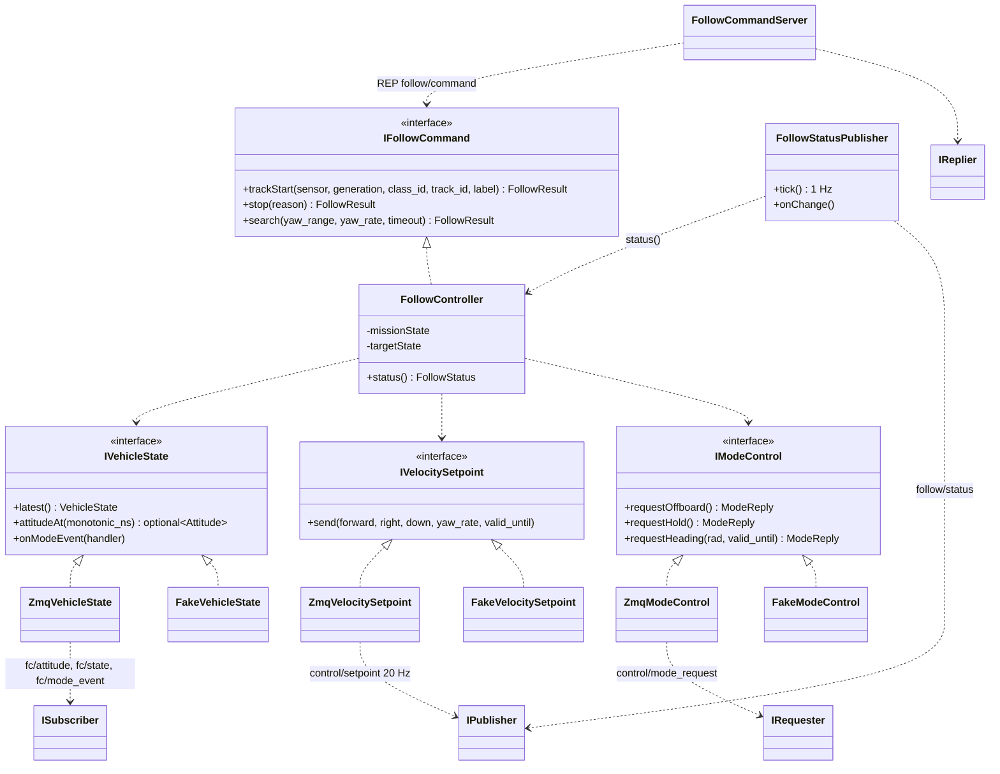

# Class Diagram — 추종 제어의 외부 인터페이스

| 항목 | 내용 |
|---|---|
| 참조 문서 | `docs/spec/process_interfaces.md` 4장 (C++ 인터페이스), 5.1·5.2 (토픽·REQ/REP), 6장 (두절) |
| 표기 | Mermaid `classDiagram`. `<\|..` 구현, `..>` 사용 |
| 범위 | 추종 제어가 다른 프로세스와 주고받는 인터페이스와 그 ZeroMQ 어댑터만. `FollowController` 내부(추종·Scan 판단, setpoint 계산)는 추적·추종 담당이 채운다 |

| 클래스 | 구현 담당 | 책임 | 출처 |
|---|---|---|---|
| `IVehicleState` | 인터페이스: 통신 | 기체 상태 스냅샷, 프레임 시각에 맞춘 자세 표본(보간용 이력은 구현이 보관), 모드 이벤트 | pi 4장, 5.1 |
| `IVelocitySetpoint` | 인터페이스: 통신 | FRD 속도·yaw 속도·유효 시간. 매 주기 호출, 즉시 반환 | pi 4장 |
| `IModeControl` | 인터페이스: 통신 | Offboard 진입, Hold, Hold 중 heading. 수락은 동기 응답, 완료는 이벤트 | pi 4장, 5.2 |
| `IFollowCommand` | 인터페이스: 통신, 구현: 추적·추종 | 추종 시작·종료·Scan. 표적 존재·상태·FC 조건 검사는 구현이 한다 | pi 4장, icd 4.1 |
| `Zmq*` 어댑터 | 통신 | 위 인터페이스를 `process_interfaces.md` 5장 토픽·REQ/REP 로 구현 | pi 2장 |
| (CMake 타깃) | 통신 | 인터페이스 넷은 `argus::vehicle_api`(의존성 없음), `Zmq*` 어댑터는 `argus::vehicle_api_zmq`(`vehicle_api`·`bus` 링크)로 나눈다. `FollowController` 와 `Fake*` 단위 테스트는 `vehicle_api` 만 링크해 ZeroMQ·MessagePack 에 의존하지 않는다 (#35 리뷰) | — |
| `FollowCommandServer` | 통신 | `follow/command` REP 를 받아 `IFollowCommand` 호출, result·reason 응답 | pi 5.2 |
| `FollowStatusPublisher` | 통신 | `follow/status` 1 Hz + 변경 시, `command_results` 포함 | pi 5.1.2 |
| `FollowController` | 추적·추종 | 임무·표적 상태(`state_machine.md`), setpoint 계산. 내부 구조는 담당자가 `class_follow.md` 에 추가 | pi 2장 |
| `Fake*` | 통신 | 테스트용. SITL·기체 없이 `FollowController` 를 gtest 로 검사 | pi 4장 |

## SOLID 대응

| 원칙 | 어디에 | 어떻게 |
|---|---|---|
| S | 어댑터 하나 = 토픽(요청) 하나 | `ZmqVehicleState` 는 구독만, `ZmqVelocitySetpoint` 는 발행만 |
| O | `IFollowCommand` | 새 행동(예: Scan 변형)은 메서드 추가로, FC 통신 코드는 바꾸지 않음 (pi 4장) |
| L | `Zmq*` ↔ `Fake*` | 같은 계약(즉시 반환, 유효 시간, 응답 코드) |
| I | 인터페이스 넷으로 분리 | 추적기는 `IVehicleState` 만, 추종 제어는 넷 모두 (pi 4장 "인터페이스 분리") |
| D | `FollowController`, CMake 타깃 | 인터페이스에만 의존하고, 빌드에서도 `vehicle_api`(인터페이스)만 링크한다. 프로세스 배치를 바꿔도(onboard 안으로 합쳐도) 추종 제어 코드는 그대로 (pi 2.1 "의존 역전") |

## 검토 필요 사항

1. `IVehicleState.attitudeAt` 의 보간 방식과 이력 길이 — 추적기와 공용으로 둘지 (`class_tracker.md` 의 `VehicleStateSubscriber` 와 같은 구현을 공유할 수 있다).
2. 해소 (0.3): `FollowResult` 는 `follow/result` 의 outcome(IN_PROGRESS·SUCCEEDED·REJECTED·FAILED)·request_accepted·reason (pi 5.2.1). `ModeReply` 는 `control/mode_request` 의 응답으로, 필드는 pi 미결 1.
3. `FollowController` 내부 Class Diagram — 추적·추종 담당.

## 변경 이력

| 버전 | 날짜 | 내용 |
|---|---|---|
| 0.1 | 2026-10-16 | 초안 (#31) |
| 0.2 | 2026-10-19 | 제목 "경계" → "외부 인터페이스". 인터페이스(`argus::vehicle_api`)와 ZeroMQ 어댑터(`argus::vehicle_api_zmq`)를 CMake 타깃으로 분리 (#35 리뷰) |
| 0.3 | 2026-10-19 | 결과 형을 `FollowResult`(outcome·request_accepted)와 `ModeReply` 로 나눔 (#33 리뷰) |
