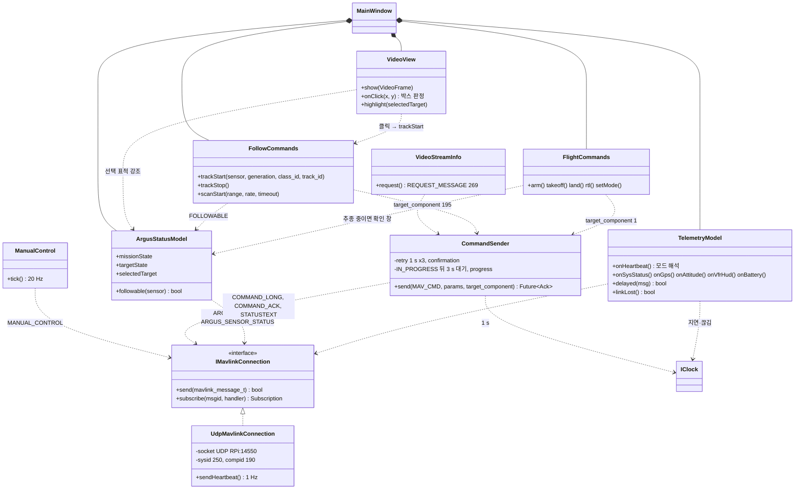

# Class Diagram — 통제기 (gcs)

| 항목 | 내용 |
|---|---|
| 참조 문서 | `docs/spec/icd.md` 2·3·4·5·6장, 부록 A·B, `docs/spec/video.md` 6·7장 |
| 표기 | Mermaid `classDiagram`. Qt: `QObject` 파생은 적지 않고 signal 은 `..>` 로 |
| 범위 | 통제기 프로그램. 영상 수신·동기화는 `class_video.md` 2절 |

| 클래스 | 책임 | 출처 |
|---|---|---|
| `UdpMavlinkConnection` | `IMavlinkConnection` 구현. UDP 14550, sysid 250 / compid 190, HEARTBEAT 1 Hz 송신, `seq` 관리. 통제기가 먼저 보내야 라우터가 응답. onboard 의 같은 이름 클래스와 역할이 같다 | icd 1.1, 1.2, 5장 |
| `TelemetryModel` | HEARTBEAT `custom_mode` → PX4 모드(부록 A), SYS_STATUS·GPS·ATTITUDE·VFR_HUD·BATTERY 표시값. 기대 주기의 2 배 늦으면 "지연", FC HEARTBEAT 3 s 없으면 "연결 끊김" | icd 2장, 6장 |
| `ArgusStatusModel` | `ARGUS_STATUS`(임무·표적 상태, 선택 표적, health, control_sysid), `ARGUS_SENSOR_STATUS`(센서별 flags, FOLLOWABLE) | icd 3.1, 부록 B |
| `CommandSender` | COMMAND_LONG 송신, ACK 1 s 없으면 재전송(`confirmation` 증가) 3 회, 뒤에도 없으면 "응답 없음". IN_PROGRESS 를 받으면 재전송을 멈추고 `progress` 를 진행 막대로 표시, 마지막 IN_PROGRESS 뒤 3 s 안에 다음 ACK 가 없으면 "응답 없음". TEMPORARILY_REJECTED 뒤 같은 명령의 IN_PROGRESS 가 오면 진행 중으로 표시. DENIED·FAILED 의 원인은 STATUSTEXT 와 묶어 표시 | icd 4.1 |
| `FlightCommands` | ARM/DISARM·TAKEOFF·LAND·RTL·DO_SET_MODE 를 FC(compid 1)로. Position 모드에서 위치 추정 없으면 ARM 안 보냄. 추종 중 모드 변경은 확인 창 | icd 4.3 |
| `FollowCommands` | TRACK_START·TRACK_STOP·SCAN_START 를 onboard(compid 195)로. 매개변수 범위(2^24−1, rad) | icd 4.2 |
| `ManualControl` | MANUAL_CONTROL 20 Hz, 켜져 있는 동안만 | icd 2장 |
| `VideoStreamInfo` | `MAV_CMD_REQUEST_MESSAGE`(269) 로 RTSP 주소·해상도·fps 받음 | video 7장 |
| `VideoView` | `VideoFrame` 표시, 박스 그리기, 클릭 → 정규화 좌표 → 포함 박스(여럿이면 가장 작은 것) → `trackStart`. 판정은 클릭 시점에 표시된 프레임. 선택 표적(`target_id`·`target_generation`) 강조, 영상 정지 표시 | video 6장 |
| `MainWindow` | 조립과 화면 배치 | — |

## SOLID 대응

| 원칙 | 어디에 | 어떻게 |
|---|---|---|
| S | 모델·명령·표시 분리 | `TelemetryModel`(FC 상태), `ArgusStatusModel`(onboard 상태), `CommandSender`(재전송 규칙), `VideoView`(표시·클릭) |
| O | `CommandSender` + `FlightCommands`·`FollowCommands` | 명령 추가 = 호출 메서드 추가. 재전송 규칙은 한 곳 |
| L | `IMavlinkConnection`, `IClock` | Qt Test 에서 `Fake*` 로 UDP·시간 없이 검사 |
| I | `VideoView` 는 `VideoFrame` 과 `FollowCommands` 만 봄 | MAVLink·GStreamer 를 모름 |
| D | 모델·명령 클래스 | `IMavlinkConnection`·`IClock` 에만 의존. `UdpMavlinkConnection` 은 `main` 에서 주입 |

## 검토 필요 사항

1. `TelemetryModel` 의 "지연" 기준(기대 주기의 2 배)에 쓸 기대 주기 표 — icd 2장 값, 미결 D5.
2. 통제기 두 대 동시 접속은 지원하지 않음 (icd 미결 D2). `UdpMavlinkConnection` 은 sysid 250 고정.
3. `gcs/` 폴더 구조(모듈·`include/src/test`)는 별도 이슈.

## 변경 이력

| 버전 | 날짜 | 내용 |
|---|---|---|
| 0.1 | 2026-10-16 | 초안 (#31) |
| 0.2 | 2026-10-25 | onboard 와 이름 맞춤(#40): `IMavlinkIo`→`IMavlinkConnection`, `MavlinkClient`→`UdpMavlinkConnection`. `CommandSender` 에 IN_PROGRESS 뒤 3 s 대기, `progress` 표시, TEMPORARILY_REJECTED 뒤 처리 |
