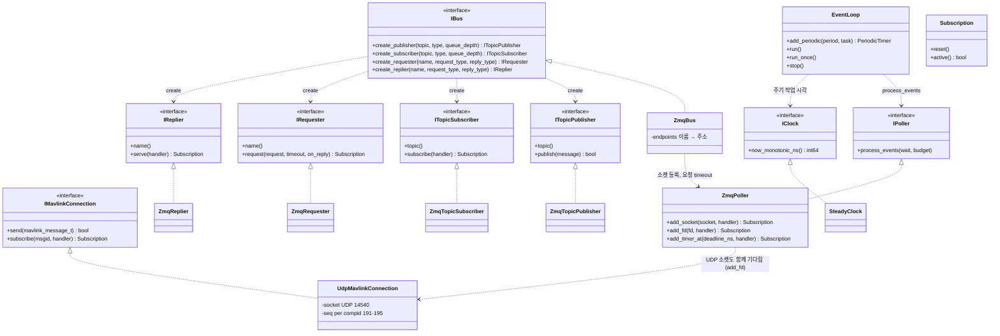
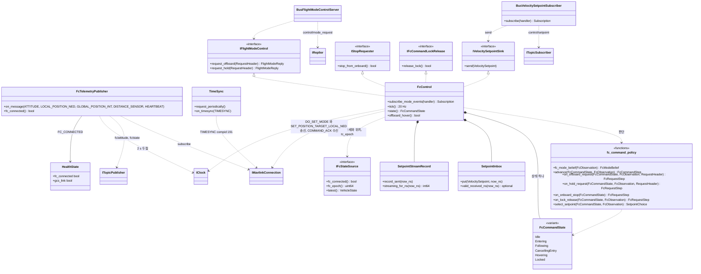
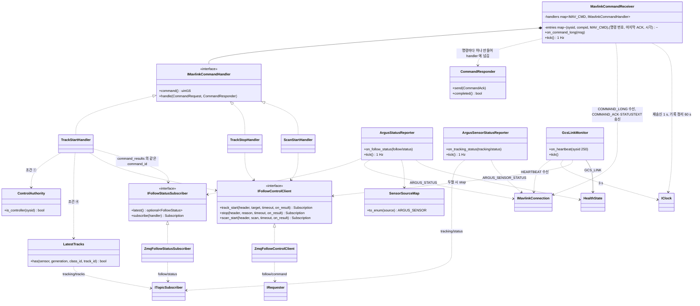

# Class Diagram — mavlink_gateway

| 항목 | 내용 |
|---|---|
| 참조 문서 | `docs/spec/icd.md` 1·2·3·4·5·6장, `docs/spec/process_interfaces.md` 3·5·6장 |
| 표기 | Mermaid `classDiagram`. `<<interface>>` 는 순수 가상 클래스. `<\|..` 구현, `*--` 소유, `..>` 사용. 멤버는 책임을 보이는 것만 적고 전체 목록이 아니다 |
| 범위 | mavlink_gateway 프로세스 하나. 추종 제어 쪽 어댑터는 `class_follow.md`, 영상 송신부는 `class_video.md` |
| 코드 | `onboard/libs/core`(시계, 루프, Subscription), `onboard/libs/bus`(통신 인터페이스), `onboard/libs/bus_zmq`(통신 인터페이스의 ZeroMQ 구현), `onboard/libs/protocol`(토픽·요청-응답 이름, queue_depth, ZeroMQ 기본 엔드포인트), `onboard/libs/vehicle_api`(프로세스 사이 인터페이스), `onboard/apps/mavlink_gateway`(이 문서의 2·3절) |

## 1. 공통 인터페이스 (MAVLink, bus, 시계, 실행 루프)

- `IMavlinkConnection` 은 UDP 를 숨긴다. 메시지는 `msgid` 로 등록해 받으므로 같은 메시지(HEARTBEAT)를 여러 클래스(`FcTelemetryPublisher`, `GcsLinkMonitor`)가 함께 받는다. 테스트용 `FakeMavlinkConnection` 은 mavlink_gateway 만 쓰므로 `apps/mavlink_gateway/test/` 에 있다.
- `IBus` 는 프로세스가 붙는 메시지 통로이며 토픽 발행자, 구독자, 요청하는 쪽, 응답하는 쪽을 만든다 (ROS 2 rmw 의 node, DDS 의 DomainParticipant 에 해당). main 에서 하나를 만들어 주입하고, 통신 구현(ZeroMQ, Fast DDS 등)을 교체해도 `IBus` 와 넷은 바뀌지 않는다. 구현별 설정(주소, QoS 프로파일)은 구현 클래스의 생성자 인자다. bus 는 타입 있는 값을 받고, 값을 전송 형식으로 바꾸는 일은 통신 구현이 한다 (`ZmqBus` 는 생성자에 받은 변환 표의 함수로 직렬화한다). 생성 함수는 메시지 타입의 식별(`MessageType`: 이름, C++ 타입)을 필수 인자로 받으며, 구현이 변환 방법을 모르는 타입이면 nullptr 를 반환한다. 인터페이스는 타입을 지운 값(`const void*`)을 전달하고, 호출하는 코드는 `bus/typed.hpp` 의 래퍼(`Publisher<T>`, `Subscriber<T>`, `Requester<Request, Reply>`, `Replier<Request, Reply>`)를 쓴다. 구독 handler 는 값과 함께 발행자가 붙인 순번(`MessageInfo::sequence`)을 받는다. 메시지 정의(`.proto`)와 생성 코드는 `protocol` 모듈에 있다. `publish` 는 기다리지 않으며 보내지 못했을 때만 false 를 반환한다. true 가 모든 구독자의 수신을 뜻하지는 않는다. `request` 는 응답을 기다리지 않고 바로 반환하며 응답은 `on_reply` 로 받는다. 모든 구현이 따라야 하는 contract 는 `bus/bus.hpp` 파일 상단 주석.
- 모든 handler(토픽 구독, 요청-응답, MAVLink 메시지, 주기 작업)는 `IPoller::process_events()` 안에서, 그 함수를 부른 스레드에서만 불린다. mavlink_gateway 프로세스는 스레드 하나로 돈다 (다른 프로세스는 handler 를 소유 스레드에서 부르는 규칙만 따른다. CONTRIBUTING 0.4). `EventLoop` 가 `main()` 의 반복(소켓 이벤트, 주기 작업, 정지 신호)을 맡는다.
- `ZmqBus`, `ZmqPoller` 는 `onboard/libs/bus_zmq` 에 있다 (ZeroMQ 로 통신하는 실행 파일만 링크). `ZmqBus` 는 이름(토픽 또는 요청-응답 이름)마다 엔드포인트 하나를 주소표로 받아, 발행자와 응답하는 쪽은 bind 하고 구독자와 요청하는 쪽은 connect 한다. 한 엔드포인트의 발행자들은 PUB 소켓 하나를 함께 쓴다. `ZmqPoller` 는 ZeroMQ 소켓(`add_socket`)과 file descriptor(`add_fd`)를 함께 기다리고, 정한 시각에 한 번 부르는 타이머(`add_timer_at`)로 요청의 timeout 을 판정한다. 규칙은 `bus_zmq/zmq_bus.hpp`, `zmq_poller.hpp` 파일 상단 주석.
- `Subscription` 은 모든 등록 함수(`subscribe`, `serve`, `request`, `add_periodic`)가 반환하는 RAII handle 이다. 객체가 사라지면 등록이 해제된다.
- `IClock` 은 두절·유효 시간 판정(2 s, 3 s, `valid_until_monotonic_ns`)을 테스트에서 기다리지 않고 검사하기 위한 것이다. 테스트용 `FakeClock`, `FakePoller` 는 `core_testing`, `FakeBus` 는 `bus_testing` 에 있다.
- 토픽·RPC 이름과 기본 포트는 문자열을 직접 쓰지 않고 `protocol` 모듈의 상수를 쓴다.

## 2. FC 통신 (compid 191·195)

| 클래스 | 책임 | 출처 |
|---|---|---|
| `FcTelemetryPublisher` | FC 메시지를 받아 수신 시각(`received_monotonic_ns`)을 붙여 `fc/attitude`·`fc/state` 로 발행. HEARTBEAT 포함 telemetry 가 2 s 없으면 `FC_CONNECTED = 0` | icd 2장, 6.2, pi 5.1 |
| `TimeSync` | compid 191 로 TIMESYNC 요청·응답 대조, `fc_time_monotonic_ns` 변환값 제공 | icd 1.1, 2장 |
| `IFcStateSource` | FC 의 최신 상태(연결 여부, `fc_epoch`, 자세와 위치와 비행 상태)를 읽는 인터페이스. `fc_epoch` 가 바뀌면 이전 `fc_epoch` 의 값은 삭제되어 새로 받기 전까지 값이 없다. FC 로 명령을 보내는 클래스들은 telemetry 수신 클래스를 직접 참조하지 않고 이 인터페이스만 참조한다. 구현은 `main` 이 telemetry 수신 클래스와 연결한다. 테스트용 `FakeFcStateSource` 는 `apps/mavlink_gateway/test/` | icd 6.2, pi 3장 |
| `BusVelocitySetpointSubscriber` | `control/setpoint` 를 구독해 `VelocitySetpoint` 로 바꿔 등록된 handler 에 전달 (`vehicle_api_bus` 모듈). `main` 이 `FcControl` 의 `IVelocitySetpointSink::send` 를 등록한다 | pi 5.1 |
| `BusFlightModeControlServer` | `control/mode_request` 요청을 받아 `IFlightModeControl` 을 부르고 `FlightModeReply` 로 응답 (`vehicle_api_bus` 모듈) | pi 5.2 |
| `FcCommandState` | mavlink_gateway 가 FC 로 보내는 명령의 상태. 여섯 중 하나이며 상태마다 그 상태의 값만 가진다: `Idle`(FC 를 제어하지 않음), `Entering`(Offboard 진입 명령을 보내고 FC 의 전환을 기다림. 송신권을 가진 세션, command_id, 진입 기한, FC 의 응답 여부), `Following`(FC 가 Offboard 이고 송신권을 가진 세션이 제어), `CancellingEntry`(진입을 취소했으나 FC 가 Offboard 로 바뀌었을 수 있어 속도 0 을 보내며 확인을 기다림. 취소한 진입의 기한), `Hovering`(FC 가 Offboard 이고 mavlink_gateway 가 제자리 유지. 목표 위치와 yaw), `Locked`(FC 가 요청 없이 Offboard 를 벗어남. 해제 전까지 송신하지 않음). FC 제어 명령 송신권은 `Entering` 과 `Following` 의 세션이고, 외부의 모드 변경 기록은 `Locked` 이다 | icd 4.2, 5장, 6.6 |
| `fc_command_policy` (함수) | 판단 세 가지를 각각 한 곳에서 한다. ① `fc_mode_belief`: mavlink_gateway 가 판단한 FC 의 모드 넷(Offboard, Offboard 아님, 아직 모름, 받지 못함). 비행 상태는 1 Hz 로 오므로 "아직 모름" 은 정상이고, "받지 못함" 은 FC 연결 두절이거나 비행 상태를 받은 지 2 s 초과다. ② 전환: 요청 없이 일어나는 전환(`advance`: `fc_epoch` 변경, FC 의 모드, 진입 기한, setpoint 의 유효 시간, 제자리 유지 목표의 결정)과 요청별 전환(`on_offboard_request`, `on_hold_request`, `on_onboard_stop`, `on_entry_command_answered`, `on_entry_command_send_failed`, `on_lock_release`). 결과는 다음 상태, 실행할 일(`FcCommandEffects`), 거부 원인(`FcCommandDenial`)이다. ③ `select_setpoint`: 주기마다 보낼 setpoint 하나(없음, 추종 제어의 값, 속도 0, 제자리 유지의 목표). 모든 함수는 입력(`FcObservation`: 시각, `fc_epoch`, FC 연결 여부, 비행 상태, 최신 위치, 유효한 setpoint 를 받은 시각, 연속 송신 시간)만으로 결과를 정하며 MAVLink 와 시계를 쓰지 않는다 | icd 4.2, 5장, 6.2, 6.4, 6.6, pi 6장 |
| `FcControl` | `IFlightModeControl`, `IVelocitySetpointSink`, `IStopRequester`, `IFcCommandLockRelease` 구현. `FcCommandState` 하나를 보관하고, 요청과 주기 작업(20 Hz)마다 입력을 모아 `fc_command_policy` 를 부른 뒤 결과를 실행한다: Offboard 진입 명령(DO_SET_MODE)과 setpoint(SET_POSITION_TARGET_LOCAL_NED)의 인코드와 송신, FC 의 응답(COMMAND_ACK) 수신, `subscribe_mode_events` 로 FC 의 모드 변경 전달. 입력은 주기 작업과 요청 처리의 시작에서 새로 읽는다 (요청을 지난 주기의 FC 모드로 판단하지 않음). 주기마다 setpoint 를 하나만 보내며, `Entering`, `Following`, `CancellingEntry`, `Hovering` 에서는 반드시 하나를 보낸다. `offboard_hover()` 는 `Hovering` 에서 위치 setpoint 를 보낸 주기에만 true 다 (`fc/state` 의 `offboard_hover`) | icd 4.2, 4.3, 부록 A, pi 3장, 5.1, 5.2 |
| `IStopRequester` | mavlink_gateway 가 스스로 정지를 요청하는 인터페이스 (통제기의 TRACK_STOP, 통제기 두절, 추종 제어 상태 보고 두절). 세션과 `fc_epoch` 값이 없고 송신권을 확인하지 않는다. bus 로는 호출할 수 없다 | icd 6.1, 6.4 |
| `IFcCommandLockRelease` | `Locked` 를 해제하는 인터페이스. 운용자의 명시적 TRACK_STOP 을 처리하는 통제기 명령 handler 가 호출한다. FC 의 비행 상태가 최신일 때만 해제한다 | icd 4.2, 6장 |
| `SetpointInbox` | 추종 제어가 보낸 가장 최근의 setpoint 하나를 보관. 유효 시간이 지난 값과 유한하지 않은 값은 받지 않고, `valid_until_monotonic_ns` 가 1 s 보다 먼 값은 1 s 로 줄인다 | pi 5.1, icd 6.4 ⓐ |
| `SetpointStreamRecord` | 추종 제어의 setpoint 를 FC 로 끊기지 않고 송신해 온 시간. 송신 간격이 0.2 s 를 넘으면 끊긴 것으로 본다. Offboard 진입 요청의 조건(1 s 이상 연속 송신)에 쓴다 | icd 4.2 |
| `HealthState` | `ARGUS_STATUS.health` 비트의 현재 값 | icd 3.1 |

- `IVelocitySetpointSink`, `IFlightModeControl` 은 `vehicle_api` 의 인터페이스다(`class_follow.md`). 추종 제어 쪽에서는 같은 인터페이스를 bus 로 보내는 어댑터가 구현하고, mavlink_gateway 에서는 `FcControl` 이 구현한다.
- `request_hold` 는 FC 의 Hold 모드가 아니라 정지 요청을 뜻한다. 정지는 Offboard 를 유지한 채 `Hovering` 의 setpoint 로 한다 (`icd.md` 4.2 정지 상태).
- SET_POSITION_TARGET_LOCAL_NED 를 송신하는 곳은 `FcControl::tick` 하나다. 주기마다 `select_setpoint` 가 고른 하나만 보내므로 추종 제어의 속도와 정지 setpoint 가 같은 주기에 함께 나가지 않고, 주기 작업의 등록 순서에 따라 결과가 달라지지 않는다.
- setpoint 의 송신을 끝내는 전환은 둘뿐이다: `CancellingEntry` → `Idle`(진입 기한 후에 받은 비행 상태가 Offboard 가 아님), `Following` 또는 `Hovering` → `Locked`(FC 가 Offboard 를 벗어남). 수신이 끊기거나 FC 연결이 다시 된 것만으로는 끝내지 않는다.
- 호출하는 쪽은 `FcControl` 을 인터페이스 넷 중 필요한 것으로만 참조한다: bus 어댑터는 `IFlightModeControl` 과 `IVelocitySetpointSink`, 통제기 명령 handler 는 `IStopRequester` 와 `IFcCommandLockRelease`.
- 전환표와 선택표는 `onboard/apps/mavlink_gateway/test/fc_command_policy_test.cpp` 의 표가 행마다 확인한다. 상태 그림은 `state_machine.md` 3절.

## 3. 통제기 통신 (compid 195)

| 클래스 | 책임 | 출처 |
|---|---|---|
| `IMavlinkCommandHandler` | MAV_CMD 하나를 처리. `handle(request, responder)` 로 받고, 결과는 반환값이 아니라 `responder.send()` 로 보낸다. 통제기에 보내는 첫 응답(IN_PROGRESS 또는 DENIED)도 추종 제어의 응답 뒤에 정해지므로 비동기 | icd 4.1·4.2 |
| `CommandResponder` | 명령 하나의 응답 통로. IN_PROGRESS 는 여러 번(진행률이 바뀔 때), 그 외 결과는 최종으로 한 번만 보내고 그 뒤 `send()` 는 무시. 최종을 보내지 않고 사라지면 소멸자가 FAILED 를 보낸다. 이동만 가능하며, 콜백 여러 개가 함께 들 때는 `shared_ptr` 로 싼다 | icd 4.1 |
| `MavlinkCommandReceiver` | `target_system = 1`, `target_component = 195` 인 COMMAND_LONG 만 받아(그 밖은 응답 없이 폐기) MAV_CMD 로 handler 에 넘기고, `CommandResponder` 가 보낸 결과를 COMMAND_ACK(`progress`, 보낸 쪽 sysid 와 compid 포함)로, DENIED·FAILED 의 원인을 STATUSTEXT 로 보낸다. 모르는 명령은 UNSUPPORTED, COMMAND_INT 는 COMMAND_LONG_ONLY. 표에 (sysid, compid, MAV_CMD) 마다 명령 번호(`param7`)와 마지막 ACK, 시각을 두고: 번호가 같은 재전송에는 handler 를 부르지 않고 진행 중이면 IN_PROGRESS, 완료 뒤면 보관한 최종 ACK 를 재송신. (sysid, compid, MAV_CMD) 마다 마지막 번호와 최종 ACK 를 다음 명령까지 보관하고, 더 오래된 번호는 폐기(24 비트 순환 비교). 명령은 동시에 하나만 처리하며 진행 중에 같은 MAV_CMD 나 다른 시작 명령이 오면 TEMPORARILY_REJECTED, TRACK_STOP 이 오면 진행 중 명령을 CANCELLED 로 끝내고 처리. 진행 중인 명령은 1 s 마다 IN_PROGRESS 재송신 | icd 4.1 |
| `TrackStartHandler` | 조건 ①(제어권) ③(FOLLOWABLE) ④(최신 추적 결과) ⑤(`mission_state`) 와 매개변수 범위 검사 → DENIED 또는 `IFollowControlClient::track_start`. 응답(`FollowResult`)으로 첫 ACK, 이후 `follow/status.command_results` 의 같은 command_id 로 최종 ACK. MAVLink param 을 `TrackTarget` 으로 바꾸는 함수와 조건 판정 함수를 나눠 둔다 | icd 4.2 |
| `TrackStopHandler`, `ScanStartHandler` | 같은 방식. Scan 은 NaN 을 설정 기본값으로 바꾸고 범위 검사. IN_PROGRESS 의 `progress` 는 `follow/status` 의 `scan_progress_deg / scan_config.sweep_rad` | icd 4.2 |
| `ControlAuthority` | 제어권 sysid(250) 판정, `control_sysid` 값 | icd 5장 |
| `LatestTracks` | 센서별 최신 `tracking/tracks` 보관 (최신 기준 시간은 아키텍처 문서 2.3) | icd 4.2 ④ |
| `ZmqFollowControlClient` | `IFollowControlClient` 구현. `follow/command` 요청에 `RequestHeader`(`RequestId` 와 유효 기한)를 넣어 `IRequester::request` 로 보내고, REP 의 `follow/result` 를 `FollowResult` 로 바꿔 handler 에 전달. 응답 시간 초과는 nullopt | pi 5.2.1, 6장 |
| `IFollowStatusSubscriber`, `ZmqFollowStatusSubscriber` | `follow/status` 를 한 번 구독해 최신 값을 두고(`latest()`), 바뀔 때 등록된 handler(`ArgusStatusReporter`, 명령 handler)에 전달(`subscribe()` → `Subscription`). `IVehicleTelemetry` 와 같은 모양(한 번 받아 나눔: MAVSDK `Telemetry`). 테스트용 `FakeFollowStatusSubscriber` 는 `apps/mavlink_gateway/test/` 에 두고 테스트가 `FollowStatus` 값을 바로 넣는다 | pi 5.1.2 |
| `ArgusStatusReporter` | `follow/status` 의 `mission_state`·`target_state`·`selected`·스캔 진행을 ARGUS_STATUS 로 1 Hz + 변경 시 1회. `follow/status` 3 s 두절 → FAULT 보고와 Hold 요청 | icd 3.1, 6.4 |
| `ArgusSensorStatusReporter` | `tracking/status` 를 ARGUS_SENSOR_STATUS 로 센서마다 1 Hz + flags 변경 시 | icd 3.1 |
| `SensorSourceMap` | `source` 문자열 ↔ `ARGUS_SENSOR` 대응표 (mavlink_gateway 설정) | pi 3장 |
| `GcsLinkMonitor` | 통제기 HEARTBEAT 3 s 두절 → `GCS_LINK = 0`, 추종·Scan 중이면 TRACK_STOP 과 같은 절차 | icd 6.1 |

- 받는 쪽 이름: 받아서 다른 곳으로 넘기면 `…Receiver`(`MavlinkCommandReceiver`), 최신 값을 들고 나눠 주면 `…Subscriber`(`ZmqFollowStatusSubscriber`, `ZmqVehicleTelemetrySubscriber`), 응답하면 `…Server`.
- 응답 규칙의 근거: MAVLink command protocol(IN_PROGRESS 뒤 최종 한 번, `progress`, 진행 중 같은 명령은 TEMPORARILY_REJECTED)과 `icd.md` 4장. 구조의 근거: ROS 2 action server 의 goal handle(응답 객체로 나중에 결과를 보내고, 끝내지 않고 사라지면 실패로 종료).

## 4. SOLID 대응

| 원칙 | 어디에 | 어떻게 |
|---|---|---|
| S 단일 책임 | 2·3절 모든 클래스 | FC 명령 송신은 판단(`fc_command_policy`), 실행(`FcControl`), 메시지 구성(인코딩 함수), 값 보관(`SetpointInbox`, `SetpointStreamRecord`)으로 나눈다. 규약의 판단 조건이 바뀌면 `fc_command_policy` 만, 메시지 형식이 바뀌면 인코딩 함수만 고친다. 응답 규칙은 `MavlinkCommandReceiver` |
| O 개방-폐쇄 | `MavlinkCommandReceiver` + `IMavlinkCommandHandler` | 명령 추가 = handler 클래스 추가·등록. Receiver 수정 없음. FC 명령 송신의 상태나 사건을 추가하면 `fc_command_policy` 를 고쳐야 한다 (상태가 열 개를 넘으면 5절 4번) |
| L 치환 | `IMavlinkConnection`, `IClock`, `IPoller`, bus 넷, `IFcStateSource`, `IFollowControlClient`, `IFollowStatusSubscriber` | `Fake*` 가 같은 contract(handler 는 `process_events()` 안에서, 시간 제한, 거부 원인)을 지켜 테스트에서 교체 |
| I 인터페이스 분리 | bus 넷, `FcControl` 의 인터페이스 넷 | 발행만 하는 클래스가 구독 API 를 보지 않음. 정지만 요청하는 클래스는 `IStopRequester` 만 보고 진입 요청과 setpoint 송신 API 를 보지 않음 |
| D 의존 역전 | 2·3절 전부 | 구체 `UdpMavlinkConnection`·`Zmq*`·`SteadyClock` 은 조립 지점(`main`)에서만 보이고, 나머지는 인터페이스에만 의존. `fc_command_policy` 는 `vehicle_api` 값과 `FcObservation` 만 받아 MAVLink 와 시계를 모르고, `FcControl` 은 `IMavlinkConnection`, `IFcStateSource`, `IClock` 에만 의존한다 |

## 5. 검토 필요 사항

1. 해소 (0.5): `ZmqFollowControlClient` 의 응답 시간 초과는 `IFollowControlClient` 호출마다 `timeout` 인자로 준다. 값은 실행 파일 PR 에서 설정으로.
2. `LatestTracks` 의 "최신" 기준 시간 (아키텍처 문서 2.3 값).
3. 해소 (0.5): 모듈은 `core`·`bus`·`protocol`·`vehicle_api`·`vehicle_api_testing`·`apps/mavlink_gateway` 로 나눴다(위 "코드" 행). `vehicle_api_zmq` 와 실행 파일은 다음 PR.
4. `FcCommandState` 의 상태가 열 개를 넘으면(Position 모드에서 조종을 넘겨받는 절차, 착륙을 mavlink_gateway 가 맡는 경우) 전환 함수 하나로 두지 않고 상태별 클래스나 계층 상태로 나눈다. 속도·yaw rate 절대 한계는 규약에 생기면 `select_setpoint` 다음 단계에 둔다.
5. `MavlinkCommandReceiver` 의 IN_PROGRESS 재송신 최소 간격(progress 가 자주 바뀔 때)과 `CommandResponder` 가 Receiver 보다 오래 살 때의 처리(생성 순서 또는 weak 참조)는 구현 PR 에서 정한다.

## 변경 이력

| 버전 | 날짜 | 내용 |
|---|---|---|
| 0.1 | 2026-10-16 | 초안 (#31) |
| 0.2 | 2026-10-19 | 1절 제목 "공통 경계" → "공통 인터페이스" |
| 0.3 | 2026-10-19 | 추적·추종 담당 리뷰 반영(#33): `FcWriteAuthority`(FC 제어 명령 송신권)와 `OnboardWatchdog`(onboard 독립 감시) 추가, `FollowCommandClient` 의 결과를 outcome·request_accepted 로 |
| 0.4 | 2026-10-21 | 메서드·멤버 이름을 snake_case 로 (onboard C++ 이름 규칙, #39), `FollowCommandClient.search` → `scan_start` |
| 0.5 | 2026-10-25 | 코드와 이름 맞춤(#40): 1절에 `IPoller`·`EventLoop`·`Subscription`, `IMavlinkIo`→`IMavlinkConnection`(subscribe), bus 넷 이름, `IClock.now_monotonic_ns`. 2절 `FcTelemetry`→`FcTelemetryPublisher`, `SetpointRelay`→`ZmqVelocitySetpointReceiver`+`MavlinkVelocitySetpointSink`, `ModeRequestServer`→`ZmqFlightModeControlServer`+`MavlinkFlightModeControl`, `FcWriteAuthority`→`FcCommandAuthority`, 송신 전 확인을 `IFcCommandGate` 한 곳으로. 3절 `ICommandHandler`→`IMavlinkCommandHandler`(응답은 `CommandResponder`), `CommandDispatcher`→`MavlinkCommandReceiver`(재전송·재송신 규칙), `FollowCommandClient`→`ZmqFollowControlClient`(`IFollowControlClient` 구현, 비동기), `IFollowStatusSubscriber`·`ZmqFollowStatusSubscriber` 추가, `SensorStatusReporter`→`ArgusSensorStatusReporter`, `SensorMap`→`SensorSourceMap`. 검토 1·3 해소, 4·5 추가 |
| 0.6 | 2026-10-29 | 1절 한 스레드 규칙의 범위를 onboard 프로세스로 한정(#40 리뷰), `IMavlinkCommandHandler` 의 "첫 결과" 를 "통제기에 보내는 첫 응답" 으로, `ZmqFollowControlClient` 의 `RequestHeader` 구성을 `RequestId` 로 |
| 0.7 | 2026-11-06 | 1절 직렬화를 MessagePack 에서 protobuf 로, 메시지 정의는 `protocol` 모듈 (#56) |
| 0.8 | 2026-11-07 | 1절에 `IBus`(넷을 생성, 구현 `ZmqBus`), `IRpcClient`→`IRequester`, `IRpcServer`→`IReplier`, `call`→`request`, `BusMessage{topic, body, binary}`, `publish` 반환 bool, "ZeroMQ 인터페이스"→"통신 인터페이스", "계약"→contract (#60) |
| 0.9 | 2026-11-07 | `MavlinkCommandReceiver` 의 표에 명령 번호(`param7`), 재전송 판단을 번호 기준으로(진행 중 재전송은 IN_PROGRESS 재송신), 동시에 하나 처리, target 불일치 폐기, COMMAND_INT 응답 (#61) |
| 0.10 | 2026-11-08 | `MavlinkCommandReceiver` 의 보관을 번호 기준으로, 값 비교 삭제, 진행 중 TRACK_STOP 과 CANCELLED (#62 리뷰) |
