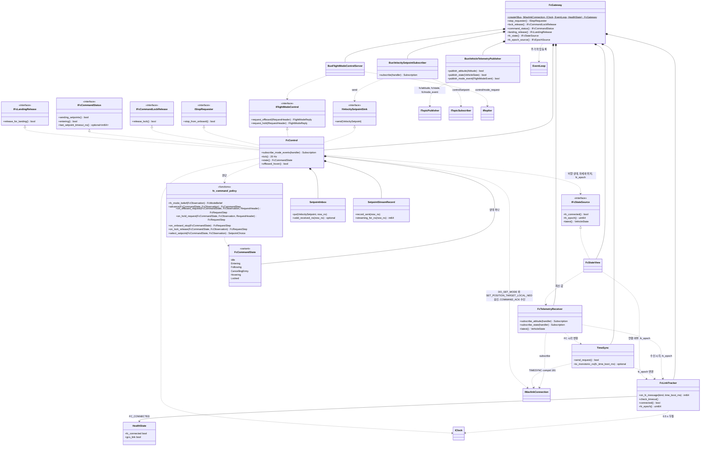

# Class Diagram — mavlink_gateway

| 항목 | 내용 |
|---|---|
| 참조 문서 | `docs/spec/icd.md` 1·2·3·4·5·6장, `docs/spec/process_interfaces.md` 3·5·6장 |
| 표기 | Mermaid `classDiagram`. `<<interface>>` 는 순수 가상 클래스. `<\|..` 구현, `*--` 소유, `..>` 사용. 멤버는 책임을 보이는 것만 적고 전체 목록이 아니다 |
| 범위 | mavlink_gateway 프로세스 하나. 추종 제어 쪽 어댑터는 `class_follow.md`, 영상 송신부는 `class_video.md` |
| 코드 | `onboard/libs/core`(시계, 루프, Subscription), `onboard/libs/bus`(통신 인터페이스), `onboard/libs/bus_zmq`(통신 인터페이스의 ZeroMQ 구현), `onboard/libs/protocol`(토픽·요청-응답 이름, queue_depth, ZeroMQ 기본 엔드포인트), `onboard/libs/vehicle_api`(프로세스 사이 인터페이스), `onboard/apps/mavlink_gateway`(이 문서의 2·3절) |

## 1. 공통 인터페이스 (MAVLink, bus, 시계, 실행 루프)

```mermaid
classDiagram
    class IMavlinkConnection {
        <<interface>>
        +send(mavlink_message_t) bool
        +subscribe(msgid, handler) Subscription
    }
    class UdpMavlinkConnection {
        -socket UDP 14540
        -seq per compid 191·195
    }
    class IGcsLink {
        <<interface>>
        +broadcast(mavlink_message_t) bool
        +send_to(GcsPeer, mavlink_message_t) bool
        +subscribe(msgid, handler) Subscription
        +local_address(GcsPeer) optional~string~
    }
    class UdpGcsLink {
        -socket UDP 14550
        -peers (IP, 포트)마다 조립 상태와 자기 주소
    }
    class GcsPeer {
        +sysid, compid, address, port
    }
    class IBus {
        <<interface>>
        +create_publisher(topic, type, queue_depth) ITopicPublisher
        +create_subscriber(topic, type, queue_depth) ITopicSubscriber
        +create_requester(name, request_type, reply_type) IRequester
        +create_replier(name, request_type, reply_type) IReplier
    }
    class ITopicPublisher {
        <<interface>>
        +topic()
        +publish(message) bool
    }
    class ITopicSubscriber {
        <<interface>>
        +topic()
        +subscribe(handler) Subscription
    }
    class IRequester {
        <<interface>>
        +name()
        +request(request, timeout, on_reply) Subscription
    }
    class IReplier {
        <<interface>>
        +name()
        +serve(handler) Subscription
    }
    class DdsBus {
        +create(IFdWatcher, ITimerScheduler, IClock, domain_id, DdsTypeTable)$ DdsBus
    }
    class ZmqBus {
        -endpoints 이름 → 주소
    }
    class ZmqTopicPublisher
    class ZmqTopicSubscriber
    class ZmqRequester
    class ZmqReplier
    class IClock {
        <<interface>>
        +now_monotonic_ns() int64
    }
    class SteadyClock
    class IPoller {
        <<interface>>
        +process_events(wait, budget)
    }
    class IFdWatcher {
        <<interface>>
        +add_fd(fd, handler) Subscription
    }
    class ITimerScheduler {
        <<interface>>
        +add_timer_at(deadline_ns, handler) Subscription
    }
    class ZmqPoller {
        +add_socket(socket, handler) Subscription
    }
    class PollPoller
    class EventLoop {
        +add_periodic(period, task) PeriodicTimer
        +run()
        +run_once()
        +stop()
    }
    class Subscription {
        +reset()
        +active() bool
    }

    IMavlinkConnection <|.. UdpMavlinkConnection
    IGcsLink <|.. UdpGcsLink
    IGcsLink ..> GcsPeer : 보낸 통제기
    IBus <|.. ZmqBus
    IBus <|.. DdsBus
    DdsBus ..> IFdWatcher : 수신 알림 pipe
    DdsBus ..> ITimerScheduler : 요청 timeout
    IBus ..> ITopicPublisher : create
    IBus ..> ITopicSubscriber : create
    IBus ..> IRequester : create
    IBus ..> IReplier : create
    ITopicPublisher <|.. ZmqTopicPublisher
    ITopicSubscriber <|.. ZmqTopicSubscriber
    IRequester <|.. ZmqRequester
    IReplier <|.. ZmqReplier
    IClock <|.. SteadyClock
    IPoller <|.. ZmqPoller
    IFdWatcher <|.. ZmqPoller
    ITimerScheduler <|.. ZmqPoller
    IPoller <|.. PollPoller
    IFdWatcher <|.. PollPoller
    ITimerScheduler <|.. PollPoller
    EventLoop ..> IPoller : process_events
    EventLoop ..> IClock : 주기 작업 시각
    UdpMavlinkConnection ..> IFdWatcher : UDP 소켓 등록
    UdpGcsLink ..> IFdWatcher : UDP 소켓 등록
    ZmqBus ..> ZmqPoller : 소켓 등록, 요청 timeout
```

- `DdsBus`(`bus_dds` 모듈)는 `IBus` 의 Fast DDS 구현이다. 토픽은 IDL 타입 토픽(RELIABLE, VOLATILE, KEEP_LAST)이고, 요청-응답은 이름마다 토픽 `<이름>_Request` 와 `<이름>_Reply` 를 쓰며 응답에 요청 표본의 식별자를 붙여 짝을 맞춘다 (Fast DDS 3.6 의 요청-응답 API 는 미지원). C++ 값과 IDL 표본 사이의 변환은 생성할 때 받는 `DdsTypeTable` 의 함수로 한다. Fast DDS 스레드의 수신 알림은 pipe 를 깨우기만 하고, `IFdWatcher` 에 등록한 handler 가 `process_events()` 안에서 표본을 꺼내 전달한다. Fast DDS 고유 기능(Data Sharing 끄기, 표본 식별자)은 `bus_dds/src/fastdds_specific` 한 곳에 모은다.
- poller 는 실행 파일이 쓰는 통신 구현에 맞춰 `main` 이 하나를 고른다. ZeroMQ 를 쓰면 ZeroMQ 소켓도 함께 기다리는 `ZmqPoller`, 쓰지 않으면 `poll()` 로 fd 와 타이머만 기다리는 `PollPoller`(`core` 모듈)다. 소켓을 여는 클래스는 `IFdWatcher` 로 fd 를, 요청의 시간 초과를 판정하는 통신 구현은 `ITimerScheduler` 로 타이머를 등록하므로 어느 poller 인지 모른다. `PollPoller` 를 `core` 에 두는 이유: ZeroMQ 를 쓰지 않는 실행 파일이 fd 와 타이머를 기다리려고 `bus_zmq` 와 libzmq 를 링크하지 않도록 한다.
- `IMavlinkConnection` 은 mavlink-router 를 거쳐 FC 와 주고받는 UDP 연결(127.0.0.1:14540)을 숨긴다. 메시지는 `msgid` 로 등록해 받으므로 같은 메시지(HEARTBEAT)를 여러 클래스가 함께 받는다. 테스트용 `FakeMavlinkConnection` 은 mavlink_gateway 만 쓰므로 `apps/mavlink_gateway/test/` 에 있다.
- `IGcsLink` 는 통제기 여러 대와의 UDP 연결(14550)을 숨긴다. 받은 메시지는 보낸 통제기(`GcsPeer`: sysid, compid, IP 주소, UDP 포트)와 함께 handler 에 전달한다. 송신은 모든 통제기(`broadcast`)와 한 통제기(`send_to`) 둘이다. 통제기 인정(icd 5.1)은 하지 않고 받은 메시지를 모두 넘긴다 (인정은 3절 `GcsRegistry`). `UdpGcsLink` 는 통제기의 (IP, 포트)마다 메시지 조립 상태를 따로 두고, 각 통제기에 응답할 때 사용하는 자기 주소(`local_address`)를 기록한다 (`VIDEO_STREAM_INFORMATION.uri` 의 호스트). 테스트용 `FakeGcsLink` 는 `apps/mavlink_gateway/test/`.
- `IGcsLink` 를 `IMavlinkConnection` 과 나누는 이유: 송신 대상이 하나(mavlink-router)인 연결과 여럿(통제기)인 연결은 송신 API 가 다르다. 한 인터페이스로 두면 FC 쪽 클래스가 쓰지 않는 `send_to` 를 보게 된다 (인터페이스 분리).
- `IBus` 는 프로세스가 붙는 메시지 통로이며 토픽 발행자, 구독자, 요청하는 쪽, 응답하는 쪽을 만든다 (ROS 2 rmw 의 node, DDS 의 DomainParticipant 에 해당). main 에서 하나를 만들어 주입하고, 통신 구현(ZeroMQ, Fast DDS 등)을 교체해도 `IBus` 와 넷은 바뀌지 않는다. 구현별 설정(주소, QoS 프로파일)은 구현 클래스의 생성자 인자다. bus 는 타입 있는 값을 받고, 값을 전송 형식으로 바꾸는 일은 통신 구현이 한다 (`ZmqBus` 는 생성자에 받은 변환 표의 함수로 직렬화한다). 생성 함수는 메시지 타입의 식별(`MessageType`: 이름, C++ 타입)을 필수 인자로 받으며, 구현이 변환 방법을 모르는 타입이면 nullptr 를 반환한다. 인터페이스는 타입을 지운 값(`const void*`)을 전달하고, 호출하는 코드는 `bus/typed.hpp` 의 래퍼(`Publisher<T>`, `Subscriber<T>`, `Requester<Request, Reply>`, `Replier<Request, Reply>`)를 쓴다. 구독 handler 는 값과 함께 발행자가 붙인 순번(`MessageInfo::sequence`)을 받는다. 메시지 정의(`.proto`)와 생성 코드는 `protocol` 모듈에 있다. `publish` 는 기다리지 않으며 보내지 못했을 때만 false 를 반환한다. true 가 모든 구독자의 수신을 뜻하지는 않는다. `request` 는 응답을 기다리지 않고 바로 반환하며 응답은 `on_reply` 로 받는다. 모든 구현이 따라야 하는 contract 는 `bus/bus.hpp` 파일 상단 주석.
- 모든 handler(토픽 구독, 요청-응답, MAVLink 메시지, 주기 작업)는 `IPoller::process_events()` 안에서, 그 함수를 부른 스레드에서만 불린다. mavlink_gateway 프로세스는 스레드 하나로 돈다 (다른 프로세스는 handler 를 소유 스레드에서 부르는 규칙만 따른다. CONTRIBUTING 0.4). `EventLoop` 가 `main()` 의 반복(소켓 이벤트, 주기 작업, 정지 신호)을 맡는다.
- `ZmqBus`, `ZmqPoller` 는 `onboard/libs/bus_zmq` 에 있다 (ZeroMQ 로 통신하는 실행 파일만 링크). `ZmqBus` 는 이름(토픽 또는 요청-응답 이름)마다 엔드포인트 하나를 주소표로 받아, 발행자와 응답하는 쪽은 bind 하고 구독자와 요청하는 쪽은 connect 한다. 한 엔드포인트의 발행자들은 PUB 소켓 하나를 함께 쓴다. `ZmqPoller` 는 ZeroMQ 소켓(`add_socket`)과 file descriptor(`add_fd`)를 함께 기다리고, 정한 시각에 한 번 부르는 타이머(`add_timer_at`)로 요청의 timeout 을 판정한다. 규칙은 `bus_zmq/zmq_bus.hpp`, `zmq_poller.hpp` 파일 상단 주석.
- `Subscription` 은 모든 등록 함수(`subscribe`, `serve`, `request`, `add_periodic`)가 반환하는 RAII handle 이다. 객체가 사라지면 등록이 해제된다.
- `IClock` 은 두절·유효 시간 판정(0.5 s, 3 s, `valid_until_monotonic_ns`)을 테스트에서 기다리지 않고 검사하기 위한 것이다. 테스트용 `FakeClock`, `FakePoller` 는 `core_testing`, `FakeBus` 는 `bus_testing` 에 있다.
- 토픽·RPC 이름과 기본 포트는 문자열을 직접 쓰지 않고 `protocol` 모듈의 상수를 쓴다.

## 2. FC 통신 (compid 191·195)

| 클래스 | 책임 | 출처 |
|---|---|---|
| `FcGateway` | FC 쪽 객체(`FcLinkTracker`, `TimeSync`, `FcTelemetryReceiver`, `FcStateView`, `FcControl`)를 생성해 서로 연결하고, bus 어댑터 셋과 연결한다. `FcControl::tick` 은 50 ms, `FcLinkTracker::check_timeout` 은 50 ms, `TimeSync::send_request` 는 100 ms 주기로 `EventLoop` 에 등록한다. `fc/state` 의 `offboard_hover` 는 `FcControl::offboard_hover()` 로 채운다. 통제기 쪽 객체가 쓰도록 `IStopRequester`, `IFcCommandLockRelease`, `IFcCommandStatus`, `IFcStateSource`, `IFcEpochSource` 를 내보낸다. 통신 구현과 실제 시계는 알지 못하며 `main` 이 생성해 넘긴다 | pi 5.1, 5.2 |
| `FcLinkTracker` | FC 메시지의 수신 시각과 `fc_epoch` 를 정한다. ATTITUDE 가 0.5 s 없으면 FC 연결 두절로 보고 `FC_CONNECTED = 0`. 두절 뒤 다시 받은 ATTITUDE 와 FC 재부팅(`time_boot_ms` 감소)에서 `fc_epoch` 를 1 올린다 | icd 6.2, pi 3장 |
| `FcTelemetryReceiver` | FC 메시지(ATTITUDE, LOCAL_POSITION_NED, GLOBAL_POSITION_INT, DISTANCE_SENSOR, HEARTBEAT)를 `vehicle_api` 값으로 바꾸고 수신 시각과 `fc_epoch` 를 붙여 등록된 handler 에 전달한다. 최신 값을 보관한다 | icd 2장, pi 5.1 |
| `FcStateView` | `FcLinkTracker` 의 연결 여부와 `fc_epoch`, `FcTelemetryReceiver` 의 최신 값을 `IFcStateSource` 로 제공한다. 값을 보관하지 않는다 | icd 6.2, pi 3장 |
| `TimeSync` | compid 191 로 TIMESYNC 요청·응답 대조, `fc_time_monotonic_ns` 변환값 제공 | icd 1.1, 2장 |
| `BusVehicleTelemetryPublisher` | `vehicle_api` 값을 `fc/attitude`, `fc/state`, `fc/mode_event` 로 발행 (`vehicle_api_bus` 모듈) | pi 5.1 |
| `IFcStateSource` | FC 의 최신 상태(연결 여부, `fc_epoch`, 자세와 위치와 비행 상태)를 읽는 인터페이스. `fc_epoch` 가 바뀌면 이전 `fc_epoch` 의 값은 삭제되어 새로 받기 전까지 값이 없다. FC 로 명령을 보내는 클래스들은 telemetry 수신 클래스를 직접 참조하지 않고 이 인터페이스만 참조한다. 구현은 `FcStateView`. 테스트용 `FakeFcStateSource` 는 `apps/mavlink_gateway/test/` | icd 6.2, pi 3장 |
| `BusVelocitySetpointSubscriber` | `control/setpoint` 를 구독해 `VelocitySetpoint` 로 바꿔 등록된 handler 에 전달 (`vehicle_api_bus` 모듈). `FcGateway` 가 `FcControl` 의 `IVelocitySetpointSink::send` 를 등록한다 | pi 5.1 |
| `BusFlightModeControlServer` | `control/mode_request` 요청을 받아 `IFlightModeControl` 을 부르고 `FlightModeReply` 로 응답 (`vehicle_api_bus` 모듈) | pi 5.2 |
| `FcCommandState` | mavlink_gateway 가 FC 로 보내는 명령의 상태. 여섯 중 하나이며 상태마다 그 상태의 값만 가진다: `Idle`(FC 를 제어하지 않음), `Entering`(Offboard 진입 명령을 보내고 FC 의 전환을 기다림. 송신권을 가진 세션, command_id, 진입 기한, FC 의 응답 여부), `Following`(FC 가 Offboard 이고 송신권을 가진 세션이 제어), `CancellingEntry`(진입을 취소했으나 FC 가 Offboard 로 바뀌었을 수 있어 속도 0 을 보내며 확인을 기다림. 취소한 진입의 기한), `Hovering`(FC 가 Offboard 이고 mavlink_gateway 가 제자리 유지. 목표 위치와 yaw), `Locked`(FC 가 요청 없이 Offboard 를 벗어남. 해제 전까지 송신하지 않음). FC 제어 명령 송신권은 `Entering` 과 `Following` 의 세션이고, 외부의 모드 변경 기록은 `Locked` 이다 | icd 4.2, 5장, 6.6 |
| `fc_command_policy` (함수) | 판단 세 가지를 각각 한 곳에서 한다. ① `fc_mode_belief`: mavlink_gateway 가 판단한 FC 의 모드 넷(Offboard, Offboard 아님, 아직 모름, 받지 못함). 비행 상태는 1 Hz 로 오므로 "아직 모름" 은 정상이고, "받지 못함" 은 FC 연결 두절이거나 비행 상태를 받은 지 3 s 초과다. ② 전환: 요청 없이 일어나는 전환(`advance`: `fc_epoch` 변경, FC 의 모드, 진입 기한, setpoint 의 유효 시간, 제자리 유지 목표의 결정)과 요청별 전환(`on_offboard_request`, `on_hold_request`, `on_onboard_stop`, `on_entry_command_answered`, `on_entry_command_send_failed`, `on_lock_release`). 결과는 다음 상태, 실행할 일(`FcCommandEffects`), 거부 원인(`FcCommandDenial`)이다. ③ `select_setpoint`: 주기마다 보낼 setpoint 하나(없음, 추종 제어의 값, 속도 0, 제자리 유지의 목표). 모든 함수는 입력(`FcObservation`: 시각, `fc_epoch`, FC 연결 여부, 비행 상태, 최신 위치, 유효한 setpoint 를 받은 시각, 연속 송신 시간)만으로 결과를 정하며 MAVLink 와 시계를 쓰지 않는다 | icd 4.2, 5장, 6.2, 6.4, 6.6, pi 6장 |
| `FcControl` | `IFlightModeControl`, `IVelocitySetpointSink`, `IStopRequester`, `IFcCommandLockRelease`, `IFcCommandStatus` 구현. `FcCommandState` 하나를 보관하고, 요청과 주기 작업(20 Hz)마다 입력을 모아 `fc_command_policy` 를 부른 뒤 결과를 실행한다: Offboard 진입 명령(DO_SET_MODE)과 setpoint(SET_POSITION_TARGET_LOCAL_NED)의 인코드와 송신, FC 의 응답(COMMAND_ACK) 수신, `subscribe_mode_events` 로 FC 의 모드 변경 전달. 입력은 주기 작업과 요청 처리의 시작에서 새로 읽는다 (요청을 지난 주기의 FC 모드로 판단하지 않음). 주기마다 setpoint 를 하나만 보내며, `Entering`, `Following`, `CancellingEntry`, `Hovering` 에서는 반드시 하나를 보낸다. `offboard_hover()` 는 `Hovering` 에서 위치 setpoint 를 보낸 주기에만 true 다 (`fc/state` 의 `offboard_hover`) | icd 4.2, 4.3, 부록 A, pi 3장, 5.1, 5.2 |
| `IStopRequester` | mavlink_gateway 가 스스로 정지를 요청하는 인터페이스 (통제기의 TRACK_STOP, 추종 제어 상태 보고 두절). 통제기 두절은 추종 제어에 정지를 요청한다 (3절 `GcsLinkMonitor`). 세션과 `fc_epoch` 값이 없고 송신권을 확인하지 않는다. bus 로는 호출할 수 없다 | icd 6.1, 6.4 |
| `IFcCommandLockRelease` | `Locked` 를 해제하는 인터페이스. 운용자의 명시적 TRACK_STOP 을 처리하는 통제기 명령 handler 가 호출한다. FC 의 비행 상태가 최신일 때만 해제한다 | icd 4.2, 6장 |
| `IFcCommandStatus` | mavlink_gateway 가 FC 로 setpoint 를 보내는 중인지(마지막 주기 작업이 setpoint 를 골랐는지. Offboard 진입 전의 사전 송신 포함), Offboard 진입 중인지, 추종 중 setpoint 유효 시간 경과로 마지막에 정지한 시각(icd 6.4 ⓐ)을 조회하는 인터페이스. 통제기 쪽 판단(제어권 부여, FC 전달 조건)이 `FcControl` 의 구체 클래스를 알지 않고 상태만 읽는다 | icd 5.1, 5.2 |
| `IFcLandingRelease` | 통제기의 착륙 명령을 FC 로 전달할 때 진행 중인 명령을 취소하고 setpoint 송신을 멈추는 인터페이스. `LandingLock`(3절)이 호출한다. `FcCommandState` 에 이 요청의 전환을 추가한다 | icd 5.3 |
| `SetpointInbox` | 추종 제어가 보낸 가장 최근의 setpoint 하나를 보관. 유효 시간이 지난 값과 유한하지 않은 값은 받지 않고, `valid_until_monotonic_ns` 가 1 s 보다 먼 값은 1 s 로 줄인다 | pi 5.1, icd 6.4 ⓐ |
| `SetpointStreamRecord` | 추종 제어의 setpoint 를 FC 로 끊기지 않고 송신해 온 시간. 송신 간격이 0.2 s 를 넘으면 끊긴 것으로 본다. Offboard 진입 요청의 조건(1 s 이상 연속 송신)에 쓴다 | icd 4.2 |
| `HealthState` | `ARGUS_STATUS.health` 비트의 현재 값 | icd 3.1 |

- `IVelocitySetpointSink`, `IFlightModeControl` 은 `vehicle_api` 의 인터페이스다(`class_follow.md`). 추종 제어 쪽에서는 같은 인터페이스를 bus 로 보내는 어댑터가 구현하고, mavlink_gateway 에서는 `FcControl` 이 구현한다.
- `request_hold` 는 FC 의 Hold 모드가 아니라 정지 요청을 뜻한다. 정지는 Offboard 를 유지한 채 `Hovering` 의 setpoint 로 한다 (`icd.md` 4.2 정지 상태).
- SET_POSITION_TARGET_LOCAL_NED 를 송신하는 곳은 `FcControl::tick` 하나다. 주기마다 `select_setpoint` 가 고른 하나만 보내므로 추종 제어의 속도와 정지 setpoint 가 같은 주기에 함께 나가지 않고, 주기 작업의 등록 순서에 따라 결과가 달라지지 않는다.
- setpoint 의 송신을 끝내는 전환은 둘뿐이다: `CancellingEntry` → `Idle`(진입 기한 후에 받은 비행 상태가 Offboard 가 아님), `Following` 또는 `Hovering` → `Locked`(FC 가 Offboard 를 벗어남). 수신이 끊기거나 FC 연결이 다시 된 것만으로는 끝내지 않는다.
- 호출하는 쪽은 `FcControl` 을 인터페이스 중 필요한 것으로만 참조한다: bus 어댑터는 `IFlightModeControl` 과 `IVelocitySetpointSink`, 통제기 명령 handler 는 `IStopRequester` 와 `IFcCommandLockRelease`, `ControlAuthority` 와 `ArgusStatusReporter` 는 `IFcCommandStatus`.
- 전환표와 선택표는 `onboard/apps/mavlink_gateway/test/fc_command_policy_test.cpp` 의 표가 행마다 확인한다. 상태 그림은 `state_machine.md` 3절.

## 3. 통제기 통신 (UDP 14550, compid 195)

```mermaid
classDiagram
    class IGcsMessageSource {
        <<interface>>
        +subscribe(msgid, handler) Subscription
    }
    class IGcsPresence {
        <<interface>>
        +last_heartbeat_ns(sysid) optional~int64~
        +peer(sysid) optional~GcsPeer~
    }
    class GcsRegistry
    class IControlAuthority {
        <<interface>>
        +controller() optional~uint8~
        +is_controller(sysid) bool
    }
    class IControlRequests {
        <<interface>>
        +request(GcsPeer, action) MAV_RESULT
    }
    class ControlAuthority
    class control_authority_policy {
        <<function>>
        +decide_control(ControlObservation, ControlEvent) ControlDecision
    }
    class ICommandActivity {
        <<interface>>
        +command_in_progress() bool
    }
    class CommandActivity
    class ILandingLockState {
        <<interface>>
        +active() bool
    }
    class MavlinkCommandReceiver {
        +add_handler(handler, CommandRules) bool
        +tick() 1 Hz
        -records map~(sysid, compid, MAV_CMD), (명령 번호, 실행, 시각)~
    }
    class CommandRules {
        +numbered bool
        +requires_control bool
        +kind Start, Stop, Other
    }
    class RequestHeaderFactory {
        +next(valid_for) RequestHeader
    }
    class IMavlinkCommandHandler {
        <<interface>>
        +command() uint16
        +handle(CommandRequest, CommandResponder)
    }
    class CommandResponder {
        +send(CommandAck)
        +completed() bool
    }
    class RequestOperatorControlHandler
    class TrackStartHandler
    class TrackStopHandler
    class ScanStartHandler
    class RequestMessageHandler {
        -responders map~message id, 응답 함수~
    }
    class EndRcOverrideHandler
    class GcsLinkMonitor {
        +tick()
    }
    class ArgusStatusReporter {
        +tick() 100 ms
    }
    class argus_status_policy {
        <<function>>
        +follow_fault(StatusObservation) FollowFault
        +compose_argus_status(StatusObservation) ARGUS_STATUS
    }
    class HeartbeatSender {
        +tick() 1 Hz
    }
    class ICpuTemperature {
        <<interface>>
        +celsius() optional~double~
    }
    class SysfsCpuTemperature
    class ArgusSensorStatusReporter {
        +tick() 100 ms
    }
    class SensorSourceMap
    class sensor_status_policy {
        <<function>>
        +compose_sensor_status(SensorObservation) ARGUS_SENSOR_STATUS
    }
    class ITrackingStatusSource {
        <<interface>>
        +latest(source) optional~ReceivedTrackingStatus~
    }
    class IVisionStatusSource {
        <<interface>>
        +latest(source) optional~ReceivedVisionStatus~
    }
    class LatestTracks
    class IVideoStreamInfoSource {
        <<interface>>
        +latest() optional~VideoStreamInfo~
    }
    class IFollowStatusSource {
        <<interface>>
        +latest() optional~ReceivedFollowStatus~
    }
    class IFollowStatusEvents {
        <<interface>>
        +subscribe(handler) Subscription
    }
    class gcs_forward_policy {
        <<function>>
        +decide_forward(ForwardObservation, GcsMessageRequest) ForwardDecision
    }
    class GcsFcForwarder
    class IForwardedCommandEvents {
        <<interface>>
        +subscribe(handler) Subscription
    }
    class IRcOverrideState {
        <<interface>>
        +pilot_in_control() bool
    }
    class FcTelemetryRelay
    class landing_lock_policy {
        <<function>>
    }
    class LandingLock {
        +active() bool
    }
    class rc_override_policy {
        <<function>>
    }
    class RcOverrideMonitor {
        +pilot_in_control() bool
    }

    IGcsMessageSource <|.. GcsRegistry
    IGcsPresence <|.. GcsRegistry
    GcsRegistry ..> IGcsLink : 수신, 겹침 경고 송신
    IControlAuthority <|.. ControlAuthority
    IControlRequests <|.. ControlAuthority
    ControlAuthority ..> control_authority_policy : 판단
    ControlAuthority ..> IGcsMessageSource : HEARTBEAT
    ControlAuthority ..> IGcsPresence : 주인의 HEARTBEAT 시각
    ControlAuthority ..> IFcStateSource : 비행 중
    ControlAuthority ..> IFcCommandStatus : setpoint 송신
    ControlAuthority ..> ICommandActivity : 진행 중인 명령
    ControlAuthority ..> IFollowStatusSource : 추종, 스캔 중
    ControlAuthority ..> ILandingLockState : 착륙 잠금
    ICommandActivity <|.. CommandActivity
    ILandingLockState <|.. LandingLock
    MavlinkCommandReceiver ..> IGcsMessageSource : COMMAND_LONG, COMMAND_INT 수신
    MavlinkCommandReceiver ..> IGcsLink : COMMAND_ACK, STATUSTEXT 를 보낸 통제기에만
    MavlinkCommandReceiver ..> IControlAuthority : 제어권 확인
    MavlinkCommandReceiver --> CommandActivity : 진행 중인 명령
    MavlinkCommandReceiver ..> CommandRules : handler 마다
    MavlinkCommandReceiver *-- IMavlinkCommandHandler
    MavlinkCommandReceiver ..> CommandResponder : 명령마다 하나
    IMavlinkCommandHandler <|.. RequestOperatorControlHandler
    IMavlinkCommandHandler <|.. TrackStartHandler
    IMavlinkCommandHandler <|.. TrackStopHandler
    IMavlinkCommandHandler <|.. ScanStartHandler
    IMavlinkCommandHandler <|.. RequestMessageHandler
    IMavlinkCommandHandler <|.. EndRcOverrideHandler
    RequestOperatorControlHandler ..> IControlRequests
    TrackStartHandler ..> LatestTracks : 조건 ④
    TrackStartHandler ..> IFollowControlClient
    TrackStartHandler ..> RequestHeaderFactory
    TrackStopHandler ..> IFollowControlClient
    ScanStartHandler ..> IFollowControlClient
    RequestMessageHandler ..> IVideoStreamInfoSource : 269
    EndRcOverrideHandler ..> rc_override_policy : 복귀 조건
    EndRcOverrideHandler ..> IStopRequester : 제자리 유지
    GcsLinkMonitor ..> IGcsPresence : 주인의 HEARTBEAT 시각
    GcsLinkMonitor ..> IControlAuthority : 주인
    GcsLinkMonitor ..> IFollowControlClient : 두절 시 정지 (LinkLoss)
    GcsLinkMonitor ..> RequestHeaderFactory
    GcsLinkMonitor ..> IFollowStatusSource : 추종, 스캔 중
    GcsLinkMonitor --> HealthState : GCS_LINK
    ArgusStatusReporter ..> argus_status_policy : 값 구성, 두절 판단
    ArgusStatusReporter ..> IControlAuthority : control_sysid
    ArgusStatusReporter ..> IFollowStatusSource : 임무 상태, 표적, 스캔
    ArgusStatusReporter ..> IFollowStatusEvents : 받을 때 변경 확인
    ArgusStatusReporter ..> IFcCommandStatus : setpoint 유효 시간 경과 정지
    ArgusStatusReporter ..> IStopRequester : follow/status 두절 시 정지
    ArgusStatusReporter ..> ICpuTemperature : cpu_temp
    ArgusStatusReporter ..> IGcsLink : ARGUS_STATUS broadcast
    ICpuTemperature <|.. SysfsCpuTemperature
    HeartbeatSender ..> IGcsLink : HEARTBEAT broadcast
    HeartbeatSender ..> IMavlinkConnection : HEARTBEAT 를 FC 로
    HeartbeatSender ..> HealthState : FC 연결
    ArgusSensorStatusReporter ..> sensor_status_policy : 값 구성
    ArgusSensorStatusReporter ..> ITrackingStatusSource : TRACKING
    ArgusSensorStatusReporter ..> IVisionStatusSource : 카메라, 추론, 모델, 영상 크기
    ArgusSensorStatusReporter ..> IGcsLink : ARGUS_SENSOR_STATUS broadcast
    ArgusSensorStatusReporter ..> SensorSourceMap
    GcsFcForwarder ..> gcs_forward_policy : 판단
    GcsFcForwarder ..> IControlAuthority
    GcsFcForwarder ..> ILandingLockState
    GcsFcForwarder ..> IRcOverrideState : 조종사 개입
    GcsFcForwarder ..> IGcsMessageSource : 통제기 메시지 수신
    GcsFcForwarder ..> IMavlinkConnection : FC 로 전달, FC 의 COMMAND_ACK 수신
    GcsFcForwarder ..> IGcsLink : 직접 응답, FC 의 COMMAND_ACK 를 보낸 통제기에만
    GcsFcForwarder ..> IStopRequester : HOLD
    IForwardedCommandEvents <|.. GcsFcForwarder
    IRcOverrideState <|.. RcOverrideMonitor
    LandingLock ..> IForwardedCommandEvents : NAV_LAND 전달과 응답
    RcOverrideMonitor ..> IForwardedCommandEvents : DO_SET_MODE 전달
    FcTelemetryRelay ..> IMavlinkConnection : FC telemetry 수신
    FcTelemetryRelay ..> IGcsLink : broadcast
    LandingLock ..> landing_lock_policy : 판단
    LandingLock ..> IFcLandingRelease
    RcOverrideMonitor ..> rc_override_policy : 판단
```

| 클래스 | 책임 | 단계 | 출처 |
|---|---|---|---|
| `GcsRegistry`, `IGcsMessageSource`, `IGcsPresence` | 통제기 인정(sysid 250~253, compid 190, HEARTBEAT 의 type 이 MAV_TYPE_GCS)과 통제기별 마지막 HEARTBEAT 시각, 주소 기록. 인정한 통제기의 메시지만 넘긴다(`IGcsMessageSource`, `MavlinkCommandReceiver` 와 `ControlAuthority` 가 사용). HEARTBEAT 시각과 주소 조회는 `IGcsPresence`(`ControlAuthority`, `GcsLinkMonitor` 가 사용). 같은 sysid 를 다른 주소에서 받으면 두 주소에 STATUSTEXT 경고 | B | icd 5.1 |
| `control_authority_policy` (함수) | 제어권의 판단만 한다: 부여(제어권 없음, 진행 중 명령과 추종, 스캔, setpoint 송신 없음, 처음 HEARTBEAT), 요청(45010 의 거부 조건), 해제(주인이 아니면 DENIED). 입력은 `ControlObservation`(시각, 현재 주인과 그 마지막 HEARTBEAT 시각, 비행 중, 진행 중 명령, 추종 또는 스캔 중, setpoint 송신 중, 착륙 잠금)이고 결과는 다음 주인과 응답 결과. MAVLink 송수신과 시계를 모른다. 두절은 제어권을 바꾸지 않으므로 이 함수가 다루지 않는다 (`GcsLinkMonitor`) | B | icd 4.4, 5.1 |
| `ControlAuthority`, `IControlAuthority`, `IControlRequests` | 주인 sysid 하나를 보관하고, HEARTBEAT 와 45010 마다 입력을 모아 `control_authority_policy` 를 부른 뒤 결과를 반영한다. 조회(`IControlAuthority`: `controller()`, `is_controller(sysid)`)와 요청(`IControlRequests`: `request(GcsPeer, action)`)을 나눠, 조회만 하는 `MavlinkCommandReceiver`, `GcsLinkMonitor`, `GcsFcForwarder`, `ArgusStatusReporter` 는 요청에 의존하지 않는다. 진행 중인 명령은 `ICommandActivity`(`CommandActivity`, `MavlinkCommandReceiver` 가 갱신)로 읽는다. `MavlinkCommandReceiver` 와 서로를 생성 인자로 받지 않도록 값을 두 객체 밖에 둔다. 착륙 잠금은 `ILandingLockState` 로 읽으며 F 단계 전에는 항상 false 인 `InactiveLandingLock` 을 연결한다 | B | icd 5.1 |
| `MavlinkCommandReceiver`, `CommandRules` | `target_system = 1`, `target_component = 195` 인 COMMAND_LONG 을 받아 공통 규칙을 적용한 뒤 MAV_CMD 로 handler 에 넘긴다. 순서: 명령 번호 확인과 재전송 판단 (sysid, compid, MAV_CMD), 제어권 확인 (없으면 TEMPORARILY_REJECTED 와 STATUSTEXT "제어권 없음"), 동시 처리 규칙. 제어권을 동시 처리보다 먼저 확인하므로 제어권 없는 통제기의 TRACK_STOP 은 진행 중인 명령을 취소하지 않는다. handler 는 등록할 때 `CommandRules`(명령 번호 규칙 적용, 제어권 필요, 시작, 정지, 그 밖의 명령)를 함께 알린다 (`MAV_CMD_REQUEST_MESSAGE` 는 param7 이 응답 대상이므로 명령 번호 규칙을 적용하지 않음). 응답(COMMAND_ACK, 원인이 있으면 STATUSTEXT)은 명령을 보낸 통제기에만 보낸다. IN_PROGRESS 1 s 재송신. 모르는 명령은 UNSUPPORTED, COMMAND_INT 는 COMMAND_LONG_ONLY | B | icd 4.1, 5.1 |
| `IMavlinkCommandHandler`, `CommandResponder` | MAV_CMD 하나를 처리. `handle(request, responder)` 로 받고 결과는 `responder.send()` 로 보낸다 (비동기). `CommandRequest` 는 보낸 통제기(`GcsPeer`)를 가진다. 공통 규칙(재전송, 제어권, 동시 처리)은 `MavlinkCommandReceiver` 가 handler 를 부르기 전에 처리한다. `CommandResponder` 는 IN_PROGRESS 는 여러 번, 그 외 결과는 최종으로 한 번만 보내며, 최종을 보내지 않고 사라지면 소멸자가 FAILED 를 보낸다 | B | icd 4.1 |
| `RequestOperatorControlHandler` | 45010. p1(0 해제, 1 요청)과 p4(0 또는 보낸 통제기의 sysid) 검사 뒤 `IControlRequests` 에 요청 또는 해제를 넘긴다. 제어권이 없는 통제기도 보낼 수 있도록 제어권 필요 없음으로 등록한다 | B | icd 4.4 |
| `GcsLinkMonitor`, `RequestHeaderFactory` | 주인의 HEARTBEAT 3 s 두절 → `GCS_LINK = 0`. 두절이 시작될 때 추종 또는 스캔 중이면 `IFollowControlClient::stop(LinkLoss)` 로 추종 제어에 정지를 요청한다 (TRACK_STOP 과 같은 절차). 다시 받으면 비트만 복구. 두절 판단의 시각은 `IGcsPresence`. 추종 제어에 보내는 요청의 공통 필드(command_id, session_id, seq, fc_epoch, valid_until)는 `RequestHeaderFactory` 가 만든다 (D 단계의 명령 handler 도 사용) | B | icd 6.1, pi 3장 |
| `ArgusStatusReporter`, `argus_status_policy` (함수), `ICpuTemperature`, `SysfsCpuTemperature` | ARGUS_STATUS 를 모든 통제기에 1 Hz 와 `mission_state`, `target_state`, `health`, `active_sensor` 가 바뀔 때 송신. 값은 `argus_status_policy` 가 `follow/status`(`IFollowStatusSource`), `IControlAuthority::controller()`(→ `control_sysid`), `HealthState`, `ICpuTemperature`(Linux thermal zone 파일)로 구성한다. `active_sensor` 는 PREPARING, FOLLOW_ACTIVE 일 때만 선택 표적의 센서. 추종 제어 두절: `follow/status` 3 s 없음(icd 6.4 ⓑ) → FAULT, 마지막 값이 추종 또는 스캔 중이었으면 `IStopRequester` 로 정지, 두절 뒤 새로 받은 값으로 풀림. setpoint 유효 시간 경과 정지(ⓐ, `IFcCommandStatus::last_setpoint_timeout_ns()`) → 그 뒤의 `follow/status` 가 FOLLOW_ACTIVE, SCAN_ACTIVE 가 아니게 될 때까지 FAULT. 해석하지 못한 `mission_state` 도 FAULT | C | icd 3.1, 6.4, pi 6장 |
| `HeartbeatSender` | mavlink_gateway(compid 195)의 HEARTBEAT 를 1 Hz 로 모든 통제기에 broadcast 하고 FC 로 보낸다(mavlink-router 경유). `type` MAV_TYPE_ONBOARD_CONTROLLER, `system_status` 는 `HealthState` 의 `ARGUS_HEALTH_FC_CONNECTED` 가 1 이면 ACTIVE, 0 이면 CRITICAL. 통제기는 이 HEARTBEAT 의 3 s 두절로 mavlink_gateway 연결 끊김을 표시한다 | C | icd 2장, 6.7 |
| `ArgusSensorStatusReporter`, `sensor_status_policy` (함수), `SensorSourceMap` | ARGUS_SENSOR_STATUS 를 `SensorSourceMap` 의 센서마다 1 Hz 와 그 센서의 `flags` 가 바뀔 때 송신 (받은 값이 없어도 flags 0 으로 송신). 값은 `sensor_status_policy` 가 `vision/status`(`IVisionStatusSource`: CAMERA_OK, INFERENCE_OK, infer_fps, model_ver, img_w, img_h)와 `tracking/status`(`ITrackingStatusSource`: TRACKING)로 구성하며 3 s 안에 받은 값만 쓴다. FOLLOWABLE 은 TRACKING 이고 `SensorSourceMap` 이 허용할 때. `SensorSourceMap` 은 `source` 문자열 ↔ `ARGUS_SENSOR` 대응과 FOLLOWABLE 허용(기본값 `camera-ir` → IR, `camera-eo` → EO, 둘 다 허용. 설정 파일 전까지 코드 기본값) | C | icd 3.1, 6.3, pi 5.1.3, 5.1.7 |
| `IFollowStatusSource`, `IFollowStatusEvents`, `BusFollowStatusSubscriber` | `follow/status` 를 구독해 최신 값과 받은 시각(mavlink_gateway 의 시계) 보관(`IFollowStatusSource::latest()`), 받을 때마다 handler 호출(`IFollowStatusEvents::subscribe()`). 조회와 알림을 인터페이스 둘로 나눠, 최신 값만 조회하는 `ControlAuthority`, `GcsLinkMonitor`(추종, 스캔 중 판단)는 알림에 의존하지 않는다 (`vehicle_api`, `vehicle_api_bus` 모듈) | B | pi 5.1.2 |
| `ITrackingStatusSource`, `ITrackingStatusEvents`, `BusTrackingStatusSubscriber`, `IVisionStatusSource`, `BusVisionStatusSubscriber` | `tracking/status`, `vision/status` 를 구독해 카메라(`source`)마다 최신 값과 받은 시각 보관 (`perception_api`, `perception_api_bus` 모듈) | C | pi 5.1.3, 5.1.7 |
| `TrackStartHandler`, `TrackStopHandler`, `ScanStartHandler` | 조건 ③④⑤ 와 범위 검사 → DENIED, TEMPORARILY_REJECTED 또는 `IFollowControlClient`(`BusFollowControlClient`) 호출. MAVLink param 변환 함수와 조건 판정 함수를 나눈다. IN_PROGRESS 의 `progress` 는 `follow/status` 의 스캔 진행 | D | icd 4.2 |
| `LatestTracks` | 센서별 최신 `tracking/tracks` 보관 (최신 기준 시간은 아키텍처 문서 2.3) | D | icd 4.2 ④ |
| `gcs_forward_policy` (함수) | 통제기가 FC 로 보낸 메시지 하나의 처리를 정한다: FC 로 전달, 직접 응답(MAV_RESULT 와 STATUSTEXT 이유), 응답 없이 폐기, 정지(HOLD). 입력은 `ForwardObservation`(보낸 통제기의 제어권, FC 상태를 아는지와 모드, armed, setpoint 송신 또는 Offboard 진입 대기, 추종 또는 스캔 중, 진행 중인 명령, 착륙 잠금, 조종사 개입 중)와 `GcsMessageRequest`(메시지 종류, MAV_CMD, param1~3). icd 5.2 표를 이 함수 하나에 둔다. DO_SET_MODE 의 요청 모드는 `set_mode_request()` 로 읽는다 | E | icd 4.1, 5.2 |
| `GcsFcForwarder` | 통제기의 HEARTBEAT, COMMAND_LONG, COMMAND_INT, MANUAL_CONTROL, PARAM_REQUEST_READ, PARAM_SET 중 FC 가 대상인 것을 받아 `gcs_forward_policy` 의 결과를 실행한다: 받은 그대로(통제기의 sysid, compid 유지) FC 로 전달(`IMavlinkConnection`), COMMAND_ACK 와 STATUSTEXT 직접 응답(송신 compid 195, 보낸 통제기에만), HOLD 의 `IStopRequester` 호출. FC 의 COMMAND_ACK 중 대상이 통제기인 것을 그 통제기의 마지막 주소(`IGcsPresence`)로만 전달한다. 전달한 명령과 FC 의 응답을 `IForwardedCommandEvents` 로 알린다 | E | icd 4.1, 4.3, 5.2 |
| `IForwardedCommandEvents`, `ForwardedCommandEvent` | FC 로 전달한 COMMAND_LONG 마다 보낸 직후 Forwarded, 대상이 통제기인 FC 의 COMMAND_ACK 마다 Answered 를 알린다. 값은 보낸 통제기, MAV_CMD, 단계, FC 의 결과(Answered), 요청 모드(DO_SET_MODE). `LandingLock` 은 NAV_LAND 로 잠금의 시작과 해제를, `RcOverrideMonitor` 는 DO_SET_MODE 로 통제기의 모드 변경을 안다. 전달하는 쪽이 받는 쪽을 모르도록 인터페이스로 둔다 (`IFollowStatusEvents` 와 같은 모양) | E | icd 5.3, 5.4 |
| `IRcOverrideState`, `InactiveRcOverride` | 조종사 개입 중인지 조회(`pilot_in_control()`). 구현은 F 단계의 `RcOverrideMonitor` 이며, 그 전에는 항상 false 인 `InactiveRcOverride` 를 연결한다 | E | icd 5.4 |
| `FcTelemetryRelay` | FC(sysid 1, compid 1)가 보낸 메시지 중 icd 2장의 "FC → 전체" 메시지만 받은 그대로 모든 통제기에 broadcast 한다 (허용 목록 `kRelayedFcMessages`). 주기는 줄이지 않는다 | E | icd 1.2, 2장 |
| `RequestMessageHandler` | `MAV_CMD_REQUEST_MESSAGE`. 메시지 번호별 응답 함수를 등록받는 표를 두고, 처음 등록하는 것은 `VIDEO_STREAM_INFORMATION`(269, `build_video_stream_information`). 없는 번호와 아직 받지 못한 값은 DENIED. COMMAND_ACK 를 먼저 보내고 요청한 메시지는 요청한 통제기에만 보낸다 (param7 의 응답 대상은 보지 않음: RTSP 주소의 호스트가 요청한 통제기에 맞춘 값). 제어권이 없는 통제기도 요청할 수 있다 (`CommandRules` 의 제어권 필요 없음, 기체를 움직이지 않는 조회) | E | icd 4.1, video 7장 |
| `IVideoStreamInfoSource`, `BusVideoStreamInfoSubscriber` | 영상 송신부가 발행한 `video/stream_info` 의 최신 값 조회 (`onboard/libs/video_api`, `onboard/libs/video_api_bus`). RTSP 주소의 호스트는 `IGcsLink::local_address()` 로 정한다 | E | video 7장, pi 5.1 |
| `landing_lock_policy` (함수), `LandingLock` | `ILandingLockState` 구현. 착륙 잠금의 시작(착륙 명령 전달)과 해제(지상이고 시동 꺼짐, 조종사 개입 뒤 복귀 완료) 판단과 상태 보관. 시작할 때 `IFcLandingRelease` 로 진행 중 명령 취소와 setpoint 송신 중지 | F | icd 5.3 |
| `rc_override_policy` (함수), `RcOverrideMonitor` | 조종사 개입 판정(FC 의 STATUSTEXT, Offboard 이탈)과 복귀 조건(FC 모드 Hold 또는 Position, 스틱 4축 중립 유지 시간, RC 수신기 정상, 추정 유효, 진행 중 명령 없음) 판단과 상태 보관. `pilot_in_control()` 제공 | F | icd 5.4 |
| `EndRcOverrideHandler` | 45011. `rc_override_policy` 의 복귀 조건 확인 뒤 `IStopRequester` 로 제자리 유지 시작 | F | icd 4.4, 5.4 |

- 단계: 구현 순서. B 통제기 연결과 제어권, 명령 처리. C 상태 송신. D 추종 명령. E FC 전달과 요청 메시지 (router 설정에서 통제기 엔드포인트 삭제 포함). F 착륙 잠금과 조종사 개입.
- 판단 함수 넷(`control_authority_policy`, `gcs_forward_policy`, `landing_lock_policy`, `rc_override_policy`)은 입력 구조체만 받고 MAVLink, 시계, bus 를 모른다. 규약의 조건이 바뀌면 이 함수만 바꾼다. 실행 클래스(`ControlAuthority`, `GcsFcForwarder`, `LandingLock`, `RcOverrideMonitor`)는 입력을 모으고 결과를 실행만 한다 (2절 `fc_command_policy` 와 `FcControl` 의 구조와 같음).
- 통제기로 보내는 MAVLink 인코딩은 실행 클래스 안의 인코딩 함수로 나눈다 (2절 `setpoint_encoding` 과 같음).
- 받는 쪽 이름: 받아서 다른 곳으로 넘기면 `…Receiver`(`MavlinkCommandReceiver`), 최신 값을 들고 나눠 주면 `…Subscriber`(`BusFollowStatusSubscriber`), 응답하면 `…Server`.
- 응답 규칙의 근거: MAVLink command protocol(IN_PROGRESS 뒤 최종 한 번, `progress`, 진행 중 같은 명령은 TEMPORARILY_REJECTED)과 `icd.md` 4장. 구조의 근거: ROS 2 action server 의 goal handle(응답 객체로 나중에 결과를 보내고, 끝내지 않고 사라지면 실패로 종료).
- 영상 스트림 정보: 영상 송신부가 값의 원천이며 `video/stream_info` 로 발행하고, mavlink_gateway 는 MAVLink 로 바꾸기만 한다. 기능 모듈이 내부 토픽에 발행하고 MAVLink 모듈 한 곳이 MAVLink 로 바꾸는 구조 (PX4 의 uORB 와 mavlink 모듈).

## 4. SOLID 대응

| 원칙 | 어디에 | 어떻게 |
|---|---|---|
| S 단일 책임 | 2·3절 모든 클래스 | 판단과 실행을 나눈다. FC 명령 송신은 판단(`fc_command_policy`), 실행(`FcControl`), 메시지 구성(인코딩 함수), 값 보관(`SetpointInbox`, `SetpointStreamRecord`). 통제기 쪽은 제어권, 전달 조건, 착륙 잠금, 조종사 개입의 판단 함수와 실행 클래스. 통제기 인정은 `GcsRegistry`, 응답 규칙은 `MavlinkCommandReceiver` |
| O 개방-폐쇄 | `MavlinkCommandReceiver` + `IMavlinkCommandHandler`, `RequestMessageHandler` 의 응답 표 | 명령 추가 = handler 추가와 등록, 요청 메시지 추가 = 응답 함수 등록. Receiver 수정 없음. FC 명령 송신의 상태나 사건을 추가하면 `fc_command_policy` 를 고쳐야 한다 (상태가 열 개를 넘으면 5절 4번) |
| L 치환 | `IMavlinkConnection`, `IGcsLink`, `IClock`, `IPoller`, bus 넷, `IFcStateSource`, `IFcCommandStatus`, `IControlAuthority`, `IVideoStreamInfoSource`, `IFollowControlClient` | `Fake*` 가 같은 contract(handler 는 `process_events()` 안에서, 시간 제한, 거부 원인)를 지켜 테스트에서 교체 |
| I 인터페이스 분리 | bus 넷, `IGcsLink` 와 `IMavlinkConnection`, `FcControl` 의 인터페이스 다섯, `IControlAuthority`(조회만) | 발행만 하는 클래스가 구독 API 를 보지 않음. FC 쪽 클래스는 통제기별 송신 API 를 보지 않음. 정지만 요청하는 클래스는 `IStopRequester` 만 봄. 제어권을 조회만 하는 handler 는 요청과 해제 API 를 보지 않음 |
| D 의존 역전 | 2·3절 전부 | 구체 `UdpMavlinkConnection`, `UdpGcsLink`, bus 구현, `SteadyClock` 은 조립 지점(`main`)에서만 보이고, 나머지는 인터페이스에만 의존. 판단 함수는 `vehicle_api` 값과 관측 구조체만 받아 MAVLink 와 시계를 모른다. 영상 스트림 정보는 영상 송신부가 bus 로 발행하고 mavlink_gateway 는 `IVideoStreamInfoSource` 로만 읽는다 (영상 설정 값을 mavlink_gateway 가 알지 않음) |

## 5. 검토 필요 사항

1. 해소 (0.5): `BusFollowControlClient` 의 응답 시간 초과는 `IFollowControlClient` 호출마다 `timeout` 인자로 준다. 값은 실행 파일 PR 에서 설정으로.
2. `LatestTracks` 의 "최신" 기준 시간 (아키텍처 문서 2.3 값).
3. 해소 (0.5): 모듈은 `core`·`bus`·`protocol`·`vehicle_api`·`vehicle_api_testing`·`apps/mavlink_gateway` 로 나눴다(위 "코드" 행). bus 어댑터(`vehicle_api_bus`)와 실행 파일은 다음 PR.
4. `FcCommandState` 의 상태가 열 개를 넘으면(Position 모드에서 조종을 넘겨받는 절차, 착륙을 mavlink_gateway 가 맡는 경우) 전환 함수 하나로 두지 않고 상태별 클래스나 계층 상태로 나눈다. 속도·yaw rate 절대 한계는 규약에 생기면 `select_setpoint` 다음 단계에 둔다.
5. `MavlinkCommandReceiver` 의 IN_PROGRESS 재송신 최소 간격(progress 가 자주 바뀔 때)과 `CommandResponder` 가 Receiver 보다 오래 살 때의 처리(생성 순서 또는 weak 참조)는 구현 PR 에서 정한다.
6. 스틱 중립 유지 시간과 판정 범위(`RCn_TRIM`, `RCn_DZ`)의 값은 기체 시험으로 정한다 (icd 5.4, F 단계).
7. sysid 겹침 경고의 반복 간격 (icd 5.1 은 "발견할 때마다").

## 변경 이력

| 버전 | 날짜 | 내용 |
|---|---|---|
| 0.1 | 2026-10-16 | 초안 (#31) |
| 0.2 | 2026-10-19 | 1절 제목 "공통 경계" → "공통 인터페이스" |
| 0.3 | 2026-10-19 | 추적·추종 담당 리뷰 반영(#33): `FcWriteAuthority`(FC 제어 명령 송신권)와 `OnboardWatchdog`(onboard 독립 감시) 추가, `FollowCommandClient` 의 결과를 outcome·request_accepted 로 |
| 0.4 | 2026-10-21 | 메서드·멤버 이름을 snake_case 로 (onboard C++ 이름 규칙, #39), `FollowCommandClient.search` → `scan_start` |
| 0.5 | 2026-10-25 | 코드와 이름 맞춤(#40): 1절에 `IPoller`·`EventLoop`·`Subscription`, `IMavlinkIo`→`IMavlinkConnection`(subscribe), bus 넷 이름, `IClock.now_monotonic_ns`. 2절 `FcTelemetry`→`FcTelemetryPublisher`, `SetpointRelay`→`ZmqVelocitySetpointReceiver`+`MavlinkVelocitySetpointSink`, `ModeRequestServer`→`ZmqFlightModeControlServer`+`MavlinkFlightModeControl`, `FcWriteAuthority`→`FcCommandAuthority`, 송신 전 확인을 `IFcCommandGate` 한 곳으로. 3절 `ICommandHandler`→`IMavlinkCommandHandler`(응답은 `CommandResponder`), `CommandDispatcher`→`MavlinkCommandReceiver`(재전송·재송신 규칙), `FollowCommandClient`→`ZmqFollowControlClient`(`IFollowControlClient` 구현, 비동기), `IFollowStatusSubscriber`·`ZmqFollowStatusSubscriber` 추가, `SensorStatusReporter`→`ArgusSensorStatusReporter`, `SensorMap`→`SensorSourceMap`. 검토 1·3 해소, 4·5 추가 |
| 0.6 | 2026-10-29 | 1절 한 스레드 규칙의 범위를 onboard 프로세스로 한정(#40 리뷰), `IMavlinkCommandHandler` 의 "첫 결과" 를 "통제기에 보내는 첫 응답" 으로, `ZmqFollowControlClient` 의 `RequestHeader` 구성을 `RequestId` 로 |
| 0.7 | 2026-11-06 | 1절 직렬화를 MessagePack 에서 protobuf 로, 메시지 정의는 `protocol` 모듈 (#56) |
| 0.8 | 2026-11-07 | 1절에 `IBus`(넷을 생성, 구현 `ZmqBus`), `IRpcClient`→`IRequester`, `IRpcServer`→`IReplier`, `call`→`request`, `BusMessage{topic, body, binary}`, `publish` 반환 bool, "ZeroMQ 인터페이스"→"통신 인터페이스", "계약"→contract (#60) |
| 0.9 | 2026-11-07 | `MavlinkCommandReceiver` 의 표에 명령 번호(`param7`), 재전송 판단을 번호 기준으로(진행 중 재전송은 IN_PROGRESS 재송신), 동시에 하나 처리, target 불일치 폐기, COMMAND_INT 응답 (#61) |
| 0.10 | 2026-11-08 | `MavlinkCommandReceiver` 의 보관을 번호 기준으로, 값 비교 삭제, 진행 중 TRACK_STOP 과 CANCELLED (#62 리뷰) |
