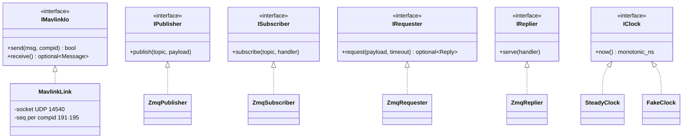
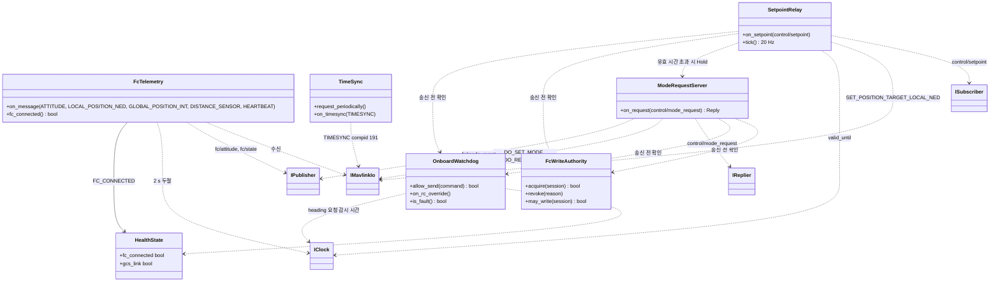
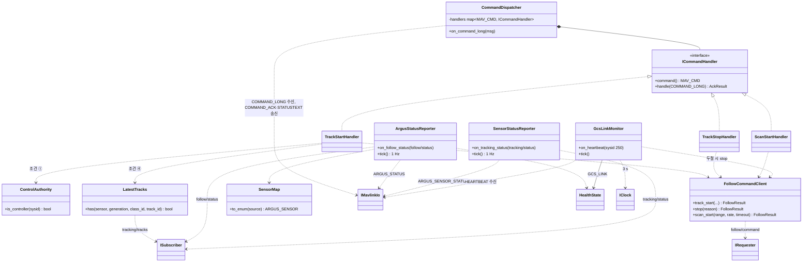

# Class Diagram — onboard

| 항목 | 내용 |
|---|---|
| 참조 문서 | `docs/spec/icd.md` 1·2·3·4·5·6장, `docs/spec/process_interfaces.md` 3·5·6장 |
| 표기 | Mermaid `classDiagram`. `<<interface>>` 는 순수 가상 클래스. `<\|..` 구현, `*--` 소유, `..>` 사용. 멤버는 책임을 보이는 것만 적고 전체 목록이 아니다 |
| 범위 | onboard 프로세스 하나. 추종 제어 쪽 어댑터는 `class_follow.md`, 영상 송신부는 `class_video.md` |

## 1. 공통 인터페이스 (MAVLink, ZeroMQ, 시계)

- `IMavlinkIo` 는 UDP 를 숨긴다. 테스트는 `FakeMavlinkIo` 로 메시지를 넣고 꺼낸다.
- ZeroMQ 넷은 `process_interfaces.md` 3장의 PUB/SUB·REQ/REP 를 그대로 옮긴 것이다. 직렬화(MessagePack)는 구현 안에 둔다.
- `IClock` 은 두절·유효 시간 판정(2 s, 3 s, `valid_until_monotonic_ns`)을 테스트에서 기다리지 않고 검사하기 위한 것이다.

## 2. FC 통신 (compid 191·195)

| 클래스 | 책임 | 출처 |
|---|---|---|
| `FcTelemetry` | FC 메시지를 받아 수신 시각(`received_monotonic_ns`)을 붙여 `fc/attitude`·`fc/state` 로 발행. HEARTBEAT 포함 telemetry 가 2 s 없으면 `FC_CONNECTED = 0` | icd 2장, 6.2, pi 5.1 |
| `TimeSync` | compid 191 로 TIMESYNC 요청·응답 대조, `fc_time_monotonic_ns` 변환값 제공 | icd 1.1, 2장 |
| `SetpointRelay` | `control/setpoint` 를 SET_POSITION_TARGET_LOCAL_NED 로 20 Hz 송신. `valid_until_monotonic_ns` 가 지나면 속도 0 을 보내고 Hold 요청 | icd 2장, pi 6장 |
| `ModeRequestServer` | `control/mode_request`(OFFBOARD·HOLD·heading) 를 DO_SET_MODE·DO_REPOSITION 으로 보내고 수락·거부 응답. 실제 전환·Offboard 이탈 원인은 `fc/mode_event` 로 발행 | pi 5.2, icd 4.3 |
| `HealthState` | `ARGUS_STATUS.health` 비트의 현재 값 | icd 3.1 |
| `FcWriteAuthority` | FC 제어 명령 송신권. 통제기 제어권(sysid 250)과 별개. 다른 소유자가 있으면 시작 요청을 거부하고, 세션 변경·RC 개입·폐기 뒤에는 이전 권한으로 보내지 못하게 함 | icd 5장, pi 6장 |
| `OnboardWatchdog` | 추종 제어의 보고와 관계없이 FC 상태·RC 개입·유효 시간을 스스로 확인해 위험한 송신을 막음. RC 개입 우선, 오래된 정상 상태 보고로 FAULT 를 덮어쓰지 않음. Scan 회전 중 감시 시간 안에 새 heading 요청이 없으면 회전을 멈춤 | icd 6.6, 6.4 ⓒ, pi 6장 |

## 3. 통제기 통신 (compid 195)

| 클래스 | 책임 | 출처 |
|---|---|---|
| `CommandDispatcher` | `target_component = 195` 인 COMMAND_LONG 을 `MAV_CMD` 로 핸들러에 넘기고 결과를 COMMAND_ACK 로, DENIED·FAILED 이유를 STATUSTEXT 로 보낸다. 모르는 명령은 UNSUPPORTED | icd 4.1 |
| `TrackStartHandler` | 조건 ①(제어권) ③(FOLLOWABLE) ④(최신 추적 결과) ⑤(`mission_state`) 와 매개변수 범위 검사 → `FollowCommandClient.track_start` → IN_PROGRESS, 이후 `command_results` 로 ACCEPTED·FAILED | icd 4.2 |
| `TrackStopHandler`, `ScanStartHandler` | 같은 방식. Scan 은 NaN 을 설정 기본값으로 바꾸고 범위 검사 | icd 4.2 |
| `ControlAuthority` | 제어권 sysid(250) 판정, `control_sysid` 값 | icd 5장 |
| `LatestTracks` | 센서별 최신 `tracking/tracks` 보관 (최신 기준 시간은 아키텍처 문서 2.3) | icd 4.2 ④ |
| `FollowCommandClient` | `follow/command` REQ. `command_id`·세션·`fc_epoch`·유효 기한을 넣어 보냄. 요청을 받은 시점에 정해지는 결과(IN_PROGRESS 또는 REJECTED)는 REP 의 `follow/result`(outcome·request_accepted)에서, 이후 진행(SUCCEEDED, FAILED)은 `follow/status.command_results` 에서 같은 command_id 로 찾음. 통제기 재전송은 같은 command_id·같은 내용으로. 응답 시간 초과 → FAILED | pi 5.2.1, 6장 |
| `ArgusStatusReporter` | `follow/status` 의 `mission_state`·`target_state`·`selected` 를 ARGUS_STATUS 로 1 Hz + 변경 시 1회. `follow/status` 3 s 두절 → FAULT 보고와 Hold 요청 | icd 3.1, 6.4 |
| `SensorStatusReporter` | `tracking/status` 를 ARGUS_SENSOR_STATUS 로 센서마다 1 Hz + flags 변경 시 | icd 3.1 |
| `SensorMap` | `source` 문자열 ↔ `ARGUS_SENSOR` 대응표 (onboard 설정) | pi 3장 |
| `GcsLinkMonitor` | 통제기 HEARTBEAT 3 s 두절 → `GCS_LINK = 0`, 추종·Scan 중이면 TRACK_STOP 과 같은 절차 | icd 6.1 |

## 4. SOLID 대응

| 원칙 | 어디에 | 어떻게 |
|---|---|---|
| S 단일 책임 | 2·3절 모든 클래스 | 규약의 한 항목(메시지 하나·판정 하나)에 클래스 하나. ARGUS_STATUS 와 ARGUS_SENSOR_STATUS 도 분리 |
| O 개방-폐쇄 | `CommandDispatcher` + `ICommandHandler` | 명령 추가 = 핸들러 클래스 추가·등록. 디스패처 수정 없음 |
| L 치환 | `IMavlinkIo`, `IClock`, ZeroMQ 넷 | `Fake*` 가 같은 계약(순서·시간 제한)을 지켜 테스트에서 교체 |
| I 인터페이스 분리 | `IPublisher`·`ISubscriber`·`IRequester`·`IReplier` | 발행만 하는 클래스가 구독 API 를 보지 않음 |
| D 의존 역전 | 2·3절 전부 | 구체 `MavlinkLink`·`Zmq*`·`SteadyClock` 은 조립 지점(main)에서만 보이고, 나머지는 인터페이스에만 의존 |

## 5. 검토 필요 사항

1. `FollowCommandClient` 의 응답 시간 초과 값 (pi 미결 1).
2. `LatestTracks` 의 "최신" 기준 시간 (아키텍처 문서 2.3 값).
3. `onboard/` 폴더 구조가 정해지면 1·2·3절을 모듈(폴더)로 나눈다.

## 변경 이력

| 버전 | 날짜 | 내용 |
|---|---|---|
| 0.1 | 2026-10-16 | 초안 (#31) |
| 0.2 | 2026-10-19 | 1절 제목 "공통 경계" → "공통 인터페이스" |
| 0.3 | 2026-10-19 | 추적·추종 담당 리뷰 반영(#33): `FcWriteAuthority`(FC 제어 명령 송신권)와 `OnboardWatchdog`(onboard 독립 감시) 추가, `FollowCommandClient` 의 결과를 outcome·request_accepted 로 |
| 0.4 | 2026-10-21 | 메서드·멤버 이름을 snake_case 로 (onboard C++ 이름 규칙, #39), `FollowCommandClient.search` → `scan_start` |
| 0.5 | 2026-10-29 | `FollowCommandClient` 의 "첫 결과" 를 "요청을 받은 시점에 정해지는 결과(IN_PROGRESS 또는 REJECTED)" 로 (#39 리뷰 반영과 함께) |
