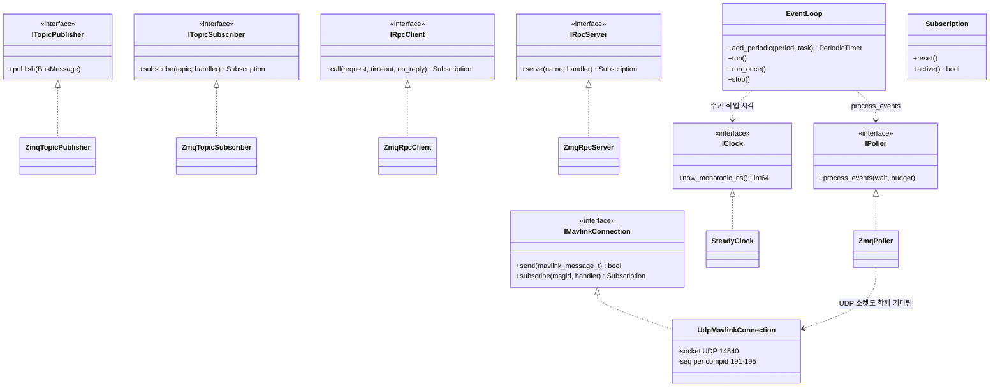
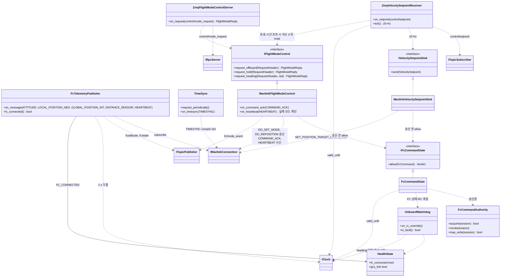
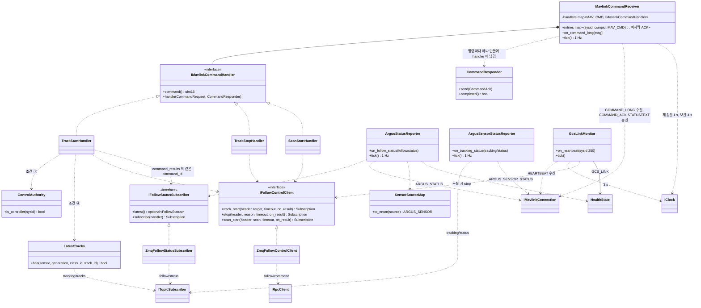

# Class Diagram — onboard

| 항목 | 내용 |
|---|---|
| 참조 문서 | `docs/spec/icd.md` 1·2·3·4·5·6장, `docs/spec/process_interfaces.md` 3·5·6장 |
| 표기 | Mermaid `classDiagram`. `<<interface>>` 는 순수 가상 클래스. `<\|..` 구현, `*--` 소유, `..>` 사용. 멤버는 책임을 보이는 것만 적고 전체 목록이 아니다 |
| 범위 | onboard 프로세스 하나. 추종 제어 쪽 어댑터는 `class_follow.md`, 영상 송신부는 `class_video.md` |
| 코드 | `onboard/libs/core`(시계, 루프, Subscription), `onboard/libs/bus`(ZeroMQ 인터페이스), `onboard/libs/protocol`(토픽·RPC 이름, 기본 엔드포인트), `onboard/libs/vehicle_api`(프로세스 사이 인터페이스), `onboard/apps/onboard`(이 문서의 2·3절) |

## 1. 공통 인터페이스 (MAVLink, ZeroMQ, 시계, 실행 루프)

- `IMavlinkConnection` 은 UDP 를 숨긴다. 메시지는 `msgid` 로 등록해 받으므로 같은 메시지(HEARTBEAT)를 여러 클래스(`FcTelemetryPublisher`, `GcsLinkMonitor`)가 함께 받는다. 테스트용 `FakeMavlinkConnection` 은 onboard 만 쓰므로 `apps/onboard/test/` 에 있다.
- bus 넷은 `process_interfaces.md` 3장의 PUB/SUB·REQ/REP 를 옮긴 것이다. bus 는 바이트(`BusMessage{topic, parts}`)만 나르고, MessagePack ↔ 구조체 변환은 어댑터(`vehicle_api_zmq`)가 한다. RPC 호출 `call` 은 응답을 기다리지 않고 바로 반환하며 응답은 `on_reply` 로 받는다.
- 모든 handler(토픽 구독, RPC 응답, MAVLink 메시지, 주기 작업)는 `IPoller::process_events()` 안에서, 그 함수를 부른 스레드에서만 불린다. onboard 프로세스는 스레드 하나로 돈다 (다른 프로세스는 handler 를 소유 스레드에서 부르는 규칙만 따른다. CONTRIBUTING 0.4). `EventLoop` 가 `main()` 의 반복(소켓 이벤트, 주기 작업, 정지 신호)을 맡는다.
- `Subscription` 은 모든 등록 함수(`subscribe`, `serve`, `call`, `add_periodic`)가 반환하는 RAII handle 이다. 객체가 사라지면 등록이 해제된다.
- `IClock` 은 두절·유효 시간 판정(2 s, 3 s, `valid_until_monotonic_ns`)을 테스트에서 기다리지 않고 검사하기 위한 것이다. 테스트용 `FakeClock`, `FakePoller` 는 `core_testing`, `FakeBus` 는 `bus_testing` 에 있다.
- 토픽·RPC 이름과 기본 포트는 문자열을 직접 쓰지 않고 `protocol` 모듈의 상수를 쓴다.

## 2. FC 통신 (compid 191·195)

| 클래스 | 책임 | 출처 |
|---|---|---|
| `FcTelemetryPublisher` | FC 메시지를 받아 수신 시각(`received_monotonic_ns`)을 붙여 `fc/attitude`·`fc/state` 로 발행. HEARTBEAT 포함 telemetry 가 2 s 없으면 `FC_CONNECTED = 0` | icd 2장, 6.2, pi 5.1 |
| `TimeSync` | compid 191 로 TIMESYNC 요청·응답 대조, `fc_time_monotonic_ns` 변환값 제공 | icd 1.1, 2장 |
| `ZmqVelocitySetpointReceiver` | `control/setpoint` 를 받아 최신 값을 20 Hz 로 `IVelocitySetpointSink` 에 넘김. `valid_until_monotonic_ns` 가 지나면 속도 0 을 넘기고 `IFlightModeControl` 로 Hold 요청 | icd 2장, pi 6장 |
| `MavlinkVelocitySetpointSink` | `IVelocitySetpointSink` 구현. `IFcCommandGate::allow` 가 허용하면 SET_POSITION_TARGET_LOCAL_NED 로 인코드해 송신. 거부면 보내지 않는다 (거부 뒤 안전 동작은 받는 쪽 규약, pi 6장) | icd 2장 |
| `ZmqFlightModeControlServer` | `control/mode_request` REQ 를 받아 `IFlightModeControl` 을 부르고 `FlightModeReply` 를 REP 로 보냄 | pi 5.2 |
| `MavlinkFlightModeControl` | `IFlightModeControl` 구현. allow 가 허용하면 DO_SET_MODE·DO_REPOSITION 송신, 응답은 수락 여부. COMMAND_ACK 와 HEARTBEAT 의 실제 모드를 확인해 `fc/mode_event`(실제 모드, 요청 command_id, Offboard 이탈 원인) 발행 | pi 5.2, icd 4.2·4.3 |
| `IFcCommandGate`, `FcCommandGate` | FC 로 나가는 명령이 반드시 거치는 한 곳. `FcCommand`(종류, 세션, `valid_until_monotonic_ns`, 모두 `vehicle_api` 값)를 받아 송신권(`FcCommandAuthority`), FC 상태·RC 개입(`OnboardWatchdog`), 유효 시간 순서로 확인하고 `Verdict`(허용, 거부 원인)를 돌려준다. MAVLink 를 모른다. 테스트용 `FakeFcCommandGate` 는 `apps/onboard/test/` | icd 5장, 6.6, pi 6장 |
| `FcCommandAuthority` | FC 제어 명령 송신권. 통제기 제어권(sysid 250)과 별개. 다른 소유자가 있으면 시작 요청을 거부하고, 세션 변경·RC 개입·폐기 뒤에는 이전 권한으로 보내지 못하게 함 | icd 5장, pi 6장 |
| `OnboardWatchdog` | 추종 제어의 보고와 관계없이 FC 상태·RC 개입을 스스로 확인. RC 개입 우선, 오래된 정상 상태 보고로 FAULT 를 덮어쓰지 않음. Scan 회전 중 감시 시간 안에 새 heading 요청이 없으면 회전을 멈춤 | icd 6.6, 6.4 ⓒ, pi 6장 |
| `HealthState` | `ARGUS_STATUS.health` 비트의 현재 값 | icd 3.1 |

- `IVelocitySetpointSink`, `IFlightModeControl` 은 `vehicle_api` 의 인터페이스다(`class_follow.md`). 추종 제어 쪽에서는 같은 인터페이스를 ZeroMQ 로 보내는 어댑터가 구현하고, onboard 에서는 MAVLink 로 보내는 클래스가 구현한다.
- gate 의 근거: Autoware `vehicle_cmd_gate`(차량으로 나가는 명령이 거치는 한 노드), Apollo `guardian`(통과 또는 차단). 판정은 내부 값으로 하고 전송 형식은 바깥 클래스에서만 다루는 것은 두 사례와 PX4(`mavlink_receiver` 가 받는 즉시 uORB 값으로)가 같다.

## 3. 통제기 통신 (compid 195)

| 클래스 | 책임 | 출처 |
|---|---|---|
| `IMavlinkCommandHandler` | MAV_CMD 하나를 처리. `handle(request, responder)` 로 받고, 결과는 반환값이 아니라 `responder.send()` 로 보낸다. 통제기에 보내는 첫 응답(IN_PROGRESS 또는 DENIED)도 추종 제어의 응답 뒤에 정해지므로 비동기 | icd 4.1·4.2 |
| `CommandResponder` | 명령 하나의 응답 통로. IN_PROGRESS 는 여러 번(진행률이 바뀔 때), 그 외 결과는 최종으로 한 번만 보내고 그 뒤 `send()` 는 무시. 최종을 보내지 않고 사라지면 소멸자가 FAILED 를 보낸다. 이동만 가능하며, 콜백 여러 개가 함께 들 때는 `shared_ptr` 로 싼다 | icd 4.1 |
| `MavlinkCommandReceiver` | `target_component = 195` 인 COMMAND_LONG 을 MAV_CMD 로 handler 에 넘기고, `CommandResponder` 가 보낸 결과를 COMMAND_ACK(`progress` 포함)로, DENIED·FAILED 의 원인을 STATUSTEXT 로 보낸다. 모르는 명령은 UNSUPPORTED. 표에 (sysid, compid, MAV_CMD) 마다 마지막 ACK 를 두고: 같은 명령이 진행 중에 다시 오면 handler 를 부르지 않고 TEMPORARILY_REJECTED, 완료 뒤 4 s 안의 재전송에는 마지막 최종 ACK 재송신, 진행 중인 명령은 1 s 마다 IN_PROGRESS 재송신 | icd 4.1 |
| `TrackStartHandler` | 조건 ①(제어권) ③(FOLLOWABLE) ④(최신 추적 결과) ⑤(`mission_state`) 와 매개변수 범위 검사 → DENIED 또는 `IFollowControlClient::track_start`. 응답(`FollowResult`)으로 첫 ACK, 이후 `follow/status.command_results` 의 같은 command_id 로 최종 ACK. MAVLink param 을 `TrackTarget` 으로 바꾸는 함수와 조건 판정 함수를 나눠 둔다 | icd 4.2 |
| `TrackStopHandler`, `ScanStartHandler` | 같은 방식. Scan 은 NaN 을 설정 기본값으로 바꾸고 범위 검사. IN_PROGRESS 의 `progress` 는 `follow/status` 의 `scan_progress_deg / scan_config.sweep_rad` | icd 4.2 |
| `ControlAuthority` | 제어권 sysid(250) 판정, `control_sysid` 값 | icd 5장 |
| `LatestTracks` | 센서별 최신 `tracking/tracks` 보관 (최신 기준 시간은 아키텍처 문서 2.3) | icd 4.2 ④ |
| `ZmqFollowControlClient` | `IFollowControlClient` 구현. `follow/command` REQ 에 `RequestHeader`(`RequestId` 와 유효 기한)를 넣어 `IRpcClient::call` 로 보내고, REP 의 `follow/result` 를 `FollowResult` 로 바꿔 handler 에 전달. 응답 시간 초과는 nullopt | pi 5.2.1, 6장 |
| `IFollowStatusSubscriber`, `ZmqFollowStatusSubscriber` | `follow/status` 를 한 번 구독해 최신 값을 두고(`latest()`), 바뀔 때 등록된 handler(`ArgusStatusReporter`, 명령 handler)에 전달(`subscribe()` → `Subscription`). `IVehicleTelemetry` 와 같은 모양(한 번 받아 나눔: MAVSDK `Telemetry`). 테스트용 `FakeFollowStatusSubscriber` 는 `apps/onboard/test/` 에 두고 테스트가 `FollowStatus` 값을 바로 넣는다 | pi 5.1.2 |
| `ArgusStatusReporter` | `follow/status` 의 `mission_state`·`target_state`·`selected`·스캔 진행을 ARGUS_STATUS 로 1 Hz + 변경 시 1회. `follow/status` 3 s 두절 → FAULT 보고와 Hold 요청 | icd 3.1, 6.4 |
| `ArgusSensorStatusReporter` | `tracking/status` 를 ARGUS_SENSOR_STATUS 로 센서마다 1 Hz + flags 변경 시 | icd 3.1 |
| `SensorSourceMap` | `source` 문자열 ↔ `ARGUS_SENSOR` 대응표 (onboard 설정) | pi 3장 |
| `GcsLinkMonitor` | 통제기 HEARTBEAT 3 s 두절 → `GCS_LINK = 0`, 추종·Scan 중이면 TRACK_STOP 과 같은 절차 | icd 6.1 |

- 받는 쪽 이름: 받아서 다른 곳으로 넘기면 `…Receiver`(`ZmqVelocitySetpointReceiver`), 최신 값을 들고 나눠 주면 `…Subscriber`(`ZmqFollowStatusSubscriber`, `ZmqVehicleTelemetrySubscriber`), 응답하면 `…Server`.
- 응답 규칙의 근거: MAVLink command protocol(IN_PROGRESS 뒤 최종 한 번, `progress`, 진행 중 같은 명령은 TEMPORARILY_REJECTED)과 `icd.md` 4장. 구조의 근거: ROS 2 action server 의 goal handle(응답 객체로 나중에 결과를 보내고, 끝내지 않고 사라지면 실패로 종료).

## 4. SOLID 대응

| 원칙 | 어디에 | 어떻게 |
|---|---|---|
| S 단일 책임 | 2·3절 모든 클래스 | 규약의 한 항목(메시지 하나·판정 하나)에 클래스 하나. 보내는 클래스(`Mavlink…`)는 인코드와 송신만, 판정은 `FcCommandGate`, 응답 규칙은 `MavlinkCommandReceiver` |
| O 개방-폐쇄 | `MavlinkCommandReceiver` + `IMavlinkCommandHandler` | 명령 추가 = handler 클래스 추가·등록. Receiver 수정 없음 |
| L 치환 | `IMavlinkConnection`, `IClock`, `IPoller`, bus 넷, `IFcCommandGate`, `IFollowControlClient`, `IFollowStatusSubscriber` | `Fake*` 가 같은 계약(handler 는 `process_events()` 안에서, 시간 제한, 거부 원인)을 지켜 테스트에서 교체 |
| I 인터페이스 분리 | bus 넷, `IFcCommandGate` | 발행만 하는 클래스가 구독 API 를 보지 않음. 보내는 클래스는 gate 의 `allow` 만 보고 송신권 관리 API 를 보지 않음 |
| D 의존 역전 | 2·3절 전부 | 구체 `UdpMavlinkConnection`·`Zmq*`·`SteadyClock` 은 조립 지점(`main`)에서만 보이고, 나머지는 인터페이스에만 의존. gate 는 `vehicle_api` 값만 받아 MAVLink 를 모른다 |

## 5. 검토 필요 사항

1. 해소 (0.5): `ZmqFollowControlClient` 의 응답 시간 초과는 `IFollowControlClient` 호출마다 `timeout` 인자로 준다. 값은 실행 파일 PR 에서 설정으로.
2. `LatestTracks` 의 "최신" 기준 시간 (아키텍처 문서 2.3 값).
3. 해소 (0.5): 모듈은 `core`·`bus`·`protocol`·`vehicle_api`·`vehicle_api_testing`·`apps/onboard` 로 나눴다(위 "코드" 행). `vehicle_api_zmq` 와 실행 파일은 다음 PR.
4. `FcCommandGate` 의 검사가 넷 이상이 되면 검사 클래스 목록(`IFcCommandCheck` 배열, PX4 `commander/HealthAndArmingChecks` 방식)으로 바꾼다. 속도·yaw rate 절대 한계(Autoware final guard)는 규약에 생기면 gate 에 둔다.
5. `MavlinkCommandReceiver` 의 IN_PROGRESS 재송신 최소 간격(progress 가 자주 바뀔 때)과 `CommandResponder` 가 Receiver 보다 오래 살 때의 처리(생성 순서 또는 weak 참조)는 구현 PR 에서 정한다.

## 변경 이력

| 버전 | 날짜 | 내용 |
|---|---|---|
| 0.1 | 2026-10-16 | 초안 (#31) |
| 0.2 | 2026-10-19 | 1절 제목 "공통 경계" → "공통 인터페이스" |
| 0.3 | 2026-10-19 | 추적·추종 담당 리뷰 반영(#33): `FcWriteAuthority`(FC 제어 명령 송신권)와 `OnboardWatchdog`(onboard 독립 감시) 추가, `FollowCommandClient` 의 결과를 outcome·request_accepted 로 |
| 0.4 | 2026-10-21 | 메서드·멤버 이름을 snake_case 로 (onboard C++ 이름 규칙, #39), `FollowCommandClient.search` → `scan_start` |
| 0.5 | 2026-10-25 | 코드와 이름 맞춤(#40): 1절에 `IPoller`·`EventLoop`·`Subscription`, `IMavlinkIo`→`IMavlinkConnection`(subscribe), bus 넷 이름, `IClock.now_monotonic_ns`. 2절 `FcTelemetry`→`FcTelemetryPublisher`, `SetpointRelay`→`ZmqVelocitySetpointReceiver`+`MavlinkVelocitySetpointSink`, `ModeRequestServer`→`ZmqFlightModeControlServer`+`MavlinkFlightModeControl`, `FcWriteAuthority`→`FcCommandAuthority`, 송신 전 확인을 `IFcCommandGate` 한 곳으로. 3절 `ICommandHandler`→`IMavlinkCommandHandler`(응답은 `CommandResponder`), `CommandDispatcher`→`MavlinkCommandReceiver`(재전송·재송신 규칙), `FollowCommandClient`→`ZmqFollowControlClient`(`IFollowControlClient` 구현, 비동기), `IFollowStatusSubscriber`·`ZmqFollowStatusSubscriber` 추가, `SensorStatusReporter`→`ArgusSensorStatusReporter`, `SensorMap`→`SensorSourceMap`. 검토 1·3 해소, 4·5 추가 |
| 0.6 | 2026-10-29 | 1절 한 스레드 규칙의 범위를 onboard 프로세스로 한정(#40 리뷰), `IMavlinkCommandHandler` 의 "첫 결과" 를 "통제기에 보내는 첫 응답" 으로, `ZmqFollowControlClient` 의 `RequestHeader` 구성을 `RequestId` 로 |
