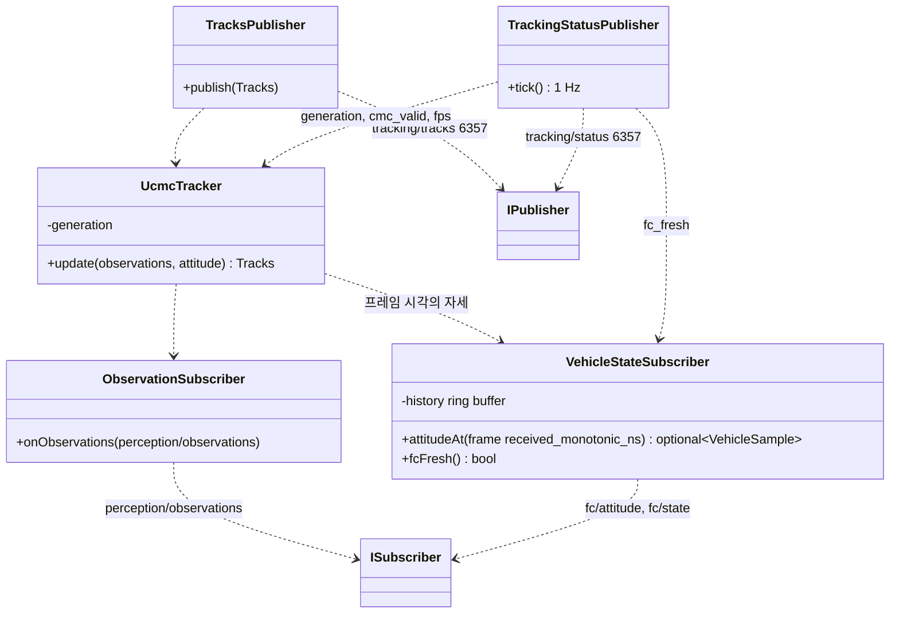

# Class Diagram — UCMC 추적기의 외부 인터페이스

| 항목 | 내용 |
|---|---|
| 참조 문서 | `docs/spec/process_interfaces.md` 2장, 5.1 (`perception/observations`, `tracking/tracks` v5, `tracking/status`, `fc/attitude`·`fc/state`) |
| 표기 | Mermaid `classDiagram` |
| 범위 | 추적기가 다른 프로세스와 주고받는 토픽만. `UcmcTracker` 내부(객체 연결, CMC)는 추적·추종 담당이 채운다 |

| 클래스 | 구현 담당 | 책임 | 출처 |
|---|---|---|---|
| `ObservationSubscriber` | 추적·추종 | 탐지 결과 수신. frame_id 가 건너뛸 수 있음 | pi 5.1 |
| `VehicleStateSubscriber` | 추적·추종 (통신과 공유 가능) | `fc/attitude`·`fc/state` 메시지 이력 보관. 보관하는 값은 자세, local NED 위치, 하향 거리, 메시지 원수신 시각(`received_monotonic_ns`), 각 값의 유효성. 프레임 수신 시각(RPi monotonic clock, `received_monotonic_ns`)에 가장 가까운 메시지를 주되, 시각 차 50 ms 이내이고 쓰는 시점의 수신 후 경과 시간 200 ms 이내여야 한다. 없으면 `fc_fresh = false`. `unix_ns` 는 wall clock(`CLOCK_REALTIME`) 이라 NTP 등의 시각 보정으로 값이 뛸 수 있어 monotonic clock(`CLOCK_MONOTONIC`) 값과 비교할 수 없으므로 쓰지 않는다 | pi 5.1, icd 2장 |
| `UcmcTracker` | 추적·추종 | 프레임 사이 객체 연결, track_id·generation(재시작마다 증가), CMC → `cmc_valid` | pi 2장 |
| `TracksPublisher` | 추적·추종 | `tracking/tracks` v5. 탐지 결과 프레임마다 | pi 5.1.1 |
| `TrackingStatusPublisher` | 추적·추종 | `tracking/status` 1 Hz | pi 5.1.3 |

- 추적기는 FC 로 아무것도 보내지 않는다. `IVehicleState` 중 읽기만 쓴다 (`class_follow.md`).

## 검토 필요 사항

1. `VehicleStateSubscriber` 를 추종 제어의 `ZmqVehicleState` 와 같은 코드로 둘지 (통신 담당이 제공, 두 프로세스가 링크).
2. `UcmcTracker` 내부 Class Diagram — 추적·추종 담당.

## 변경 이력

| 버전 | 날짜 | 내용 |
|---|---|---|
| 0.1 | 2026-10-16 | 초안 (#31) |
| 0.2 | 2026-10-19 | 제목 "경계" → "외부 인터페이스" |
| 0.3 | 2026-10-19 | 추적·추종 담당 리뷰 반영(#33): FC 표본 입력 항목과 유효성, 프레임의 호스트 단조 시각으로 표본 선택, "FC 표본" 을 "fc/attitude·fc/state 메시지" 로, "단조 시각" 을 monotonic clock 으로 |
