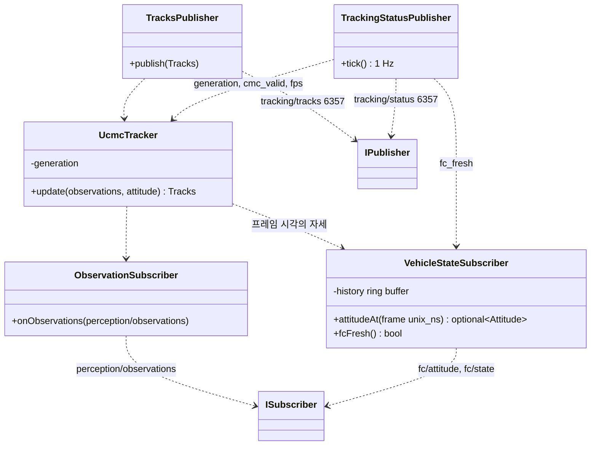

# Class Diagram — UCMC 추적기 경계

| 항목 | 내용 |
|---|---|
| 참조 문서 | `docs/spec/process_interfaces.md` 2장, 5.1 (`perception/observations`, `tracking/tracks` v5, `tracking/status`, `fc/attitude`·`fc/state`) |
| 표기 | Mermaid `classDiagram` |
| 범위 | 추적기가 바깥과 만나는 경계만. `UcmcTracker` 내부(객체 연결, CMC)는 추적·추종 담당이 채운다 |

| 클래스 | 구현 담당 | 책임 | 출처 |
|---|---|---|---|
| `ObservationSubscriber` | 추적·추종 | 탐지 결과 수신. frame_id 가 건너뛸 수 있음 | pi 5.1 |
| `VehicleStateSubscriber` | 추적·추종 (통신과 공유 가능) | FC 표본 이력 보관, 프레임 시각에 가장 가까운 표본(차 50 ms 이내)을 줌. 없으면 `fc_fresh = false` | pi 5.1, icd 2장 |
| `UcmcTracker` | 추적·추종 | 프레임 사이 객체 연결, track_id·generation(재시작마다 증가), CMC → `cmc_valid` | pi 2장 |
| `TracksPublisher` | 추적·추종 | `tracking/tracks` v5. 탐지 결과 프레임마다 | pi 5.1.1 |
| `TrackingStatusPublisher` | 추적·추종 | `tracking/status` 1 Hz | pi 5.1.3 |

- 추적기는 FC 로 아무것도 보내지 않는다. `IVehicleState` 중 읽기만 쓴다 (`class_follow.md`).

## 검토 필요 사항

1. `VehicleStateSubscriber` 를 추종 제어의 `ZmqVehicleState` 와 같은 코드로 둘지 (통신 담당이 제공, 두 프로세스가 링크).
2. `UcmcTracker` 내부 Class Diagram — 추적·추종 담당.

## 변경 이력

| 버전 | 날짜 | 내용 |
|---|---|---|
| 0.1 | 2026-10-16 | 초안 (#31) |
