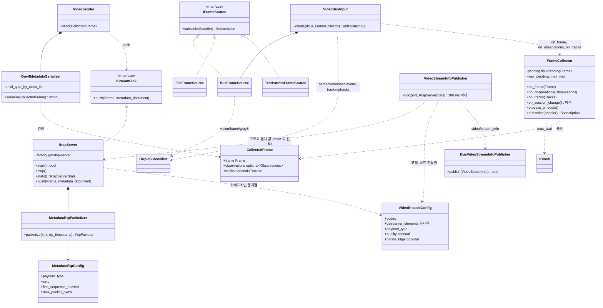
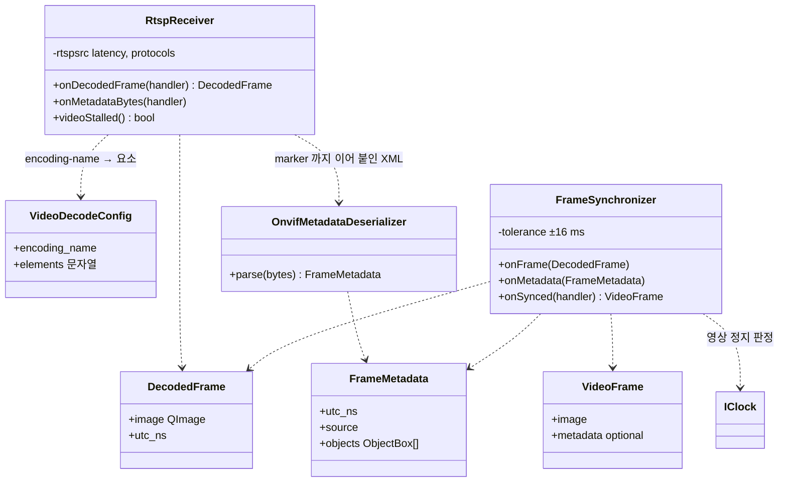

# Class Diagram — 영상 송신부와 통제기 영상 수신

| 항목 | 내용 |
|---|---|
| 참조 문서 | `docs/spec/video.md` 1~6장, `docs/spec/process_interfaces.md` 5.3 |
| 표기 | Mermaid `classDiagram`. `<\|..` 구현, `*--` 소유, `..>` 사용 |
| 범위 | RPi 영상 송신부 프로세스(1절)와 통제기의 영상 수신·동기화(2절). 화면 표시는 `class_gcs.md` 의 `VideoView` |
| 코드 | 값 타입 `onboard/libs/perception_api`(프레임, 탐지 결과, 추적 결과), `onboard/libs/video_api`(영상 스트림 정보), bus 어댑터 `onboard/libs/perception_api_bus`, `onboard/libs/video_api_bus`, 영상 송신부 `onboard/apps/video_sender` |

## 1. 영상 송신부 (RPi)

| 클래스 | 책임 | 출처 |
|---|---|---|
| `IFrameSource` / `BusFrameSource` / `FileFrameSource` | 비압축 프레임 공급. `BusFrameSource` 는 bus 의 `vision/frame/gray8` 을 구독한다 (통신 구현을 모름). `subscribe(handler)` 가 `Subscription` 을 반환하고 handler 는 `process_events()` 안에서 불린다. 구현 교체로 토픽·녹화 파일(테스트·재현) 전환. 테스트용 `FakeFrameSource` 는 `apps/video_sender/test/`. 카메라와 탐지 프로세스 없이 송신을 확인하는 시험용 구현 `TestPatternFrameSource` 는 실행 파일의 `--test-pattern` 옵션으로 사용한다 | pi 5.3 |
| `FrameCollector` | 세 토픽을 `(source, session_id, frame_id)` 로 모은다 (`session_id` 가 없는 메시지는 `(source, frame_id)`, `process_interfaces.md` 7장). 보관 개수·대기 시간 제한, 대기 시간 안에 다 오지 않으면 모인 것만으로 `CollectedFrame` 을 만들고, 짝 없는 탐지·추적 결과는 버림, `session_id` 변경 시 비움. 영상 프레임 없는 추적 결과는 보내지 않음. 입력은 `on_frame()`, `on_observations()`, `on_tracks()` 호출로 받는다. `IFrameSource` 와 bus 를 구독해 이 함수를 호출하는 연결은 `VideoBusInput`(bus 입력)과 `main`(`--test-pattern`)이 담당한다. 대기 시간이 지난 프레임은 `process_timeouts()` 가 처리하며, 이후 메시지가 도착하지 않아도 마지막 프레임이 출력되도록 `EventLoop::add_periodic()` 에 등록해 호출한다. 같은 `source` 의 출력 순서는 도착 순서다. 기본값은 대기 시간 100 ms, 보관 개수 8 (`FrameCollectorConfig`) | pi 5.3 |
| `VideoBusInput` | bus 의 `vision/frame/gray8`(`BusFrameSource`), `perception/observations`, `tracking/tracks` 를 구독해 `FrameCollector` 에 넣는다. 구독자는 `perception_api_bus` 모듈이 만들고, 받는 메시지는 protobuf 정의(`argus_msg/*.proto`)만 해석한다. `bus::IBus` 로만 구독하며 통신 구현(`ZmqBus`)은 `main` 이 만든다. 실행 파일을 인자 없이 실행하면 이 입력을 쓴다 | pi 5.1, 5.3 |
| `CollectedFrame` | 프레임(항상 있음) + 탐지 결과·추적 결과(optional). `OnvifMetadataSerializer`·`RtspServer` 의 입력 | pi 5.3, video 3.2 |
| `OnvifMetadataSerializer` | `CollectedFrame` 의 `tracks` → ONVIF XML (`tt:Frame`, `tt:Object`, `argus:` 확장, 좌표 변환). 추적 결과 없는 프레임은 빈 `tt:Frame`. 구체 클래스다: 구현이 ONVIF XML 하나이고(video 1장), 상태가 없고 입력만으로 출력이 정해지므로 테스트에서 대체할 이유가 없다. `class_id` 를 `tt:Type` 의 ONVIF 분류명으로 변환하는 대응(video 8장)은 생성자 인자로 받는다 | video 3장 |
| `MetadataRtpPacketizer` | XML → RTP 패킷(헤더 12 B, 조각, 마지막 marker=1, 타임스탬프는 `packetize()` 의 인자로 받는다). payload type 과 SSRC 는 기본값 없이 `MetadataRtpConfig` 로 받는다 | video 3.1, 4장 |
| `VideoEncodeConfig` | 코덱별 GStreamer 요소 문자열·pt·품질. 기본 코덱 H.264: `videoconvert ! video/x-raw,format=I420 ! x264enc tune=zerolatency speed-preset=ultrafast key-int-max=30 ! rtph264pay aggregate-mode=zero-latency config-interval=-1`, pt 96, 비트레이트(`bitrate_kbps`). 선택 코덱 JPEG: `videoconvert ! video/x-raw,format=I420 ! jpegenc ! rtpjpegpay`, pt 26, 품질(`quality`). 코덱별 값은 `make_video_encode_config(codec)` 가 반환한다. 통제기 `VideoDecodeConfig` 와 짝 | video 2장, 5장 |
| `IStreamSink` | 프레임 하나의 영상과 메타데이터 문서(XML)를 함께 받아 송신하는 인터페이스. 한 호출로 받는 이유는 두 트랙에 같은 시각을 부여해야 하고 같은 프레임의 것이어야 하기 때문이다. 테스트용 `FakeStreamSink` 는 `apps/video_sender/test/` | video 5장 |
| `RtspServer` | gst-rtsp-server 에 두 트랙 등록, `appsrc` 둘에 push. `IStreamSink` 구현이다. 메타데이터 문서를 `MetadataRtpPacketizer` 로 나누어 송신하며, payload type 을 패킷의 헤더와 SDP 에 `RtspServerConfig` 한 곳의 값으로 지정한다. 두 버퍼에 같은 PTS(프레임을 RPi 가 수신한 시각에 해당하는 running time)를 부여한다. 클라이언트가 없는 동안에도 서버는 유지하고 받은 프레임은 폐기한다. 폐기 횟수는 `stats()` 로 원인별로 제공한다. NUC 공백은 아무것도 보내지 않음 | video 5장 |
| `VideoSender` | `CollectedFrame` 하나마다 메타데이터 문서를 생성해 `IStreamSink::push()` 를 한 번 호출한다. `FrameCollector` 의 출력을 `send()` 에 연결하는 조립은 `main` 이 담당한다 | video 5장 |
| `VideoStreamInfoPublisher` | RTSP 서버가 실제로 연 포트와 경로, 해상도, FPS, 코덱, 비트 전송률, 송신 중 여부, 센서(IR/EO)를 `video/stream_info` 로 1 Hz 와 값이 바뀔 때 발행한다. 영상 송신부가 스트림 정보의 원천이며, mavlink_gateway 는 이 값으로 `VIDEO_STREAM_INFORMATION` 을 응답한다 (`class_mavlink_gateway.md` 3절). bus 로만 발행하며 MAVLink 를 모른다. `main` 이 100 ms 마다 `tick()` 에 `RtspServer` 의 포트와 `stats()` 값을 넘긴다. `RtspServer` 객체를 받지 않는 이유는 발행 판단을 GStreamer 없이 테스트하기 위해서다. 송신 중 여부는 크기가 맞는 프레임의 수가 최근 1 s 안에 늘었는지로 정한다. 해상도, FPS, 센서, 이름은 `main` 이 `VideoStreamDescription` 으로 준다 | pi 5.1, video 7장 |
| `BusVideoStreamInfoPublisher` | `video/stream_info` 의 발행 클래스. 값 타입과 구독 클래스(`BusVideoStreamInfoSubscriber`, `IVideoStreamInfoSource` 구현)는 `onboard/libs/video_api`, `onboard/libs/video_api_bus` 에 있다. 영상 송신부와 mavlink_gateway 가 함께 쓰는 타입이라 어느 실행 파일에도 두지 않는다 | pi 5.1.6 |

- `FrameCollector` 의 근거: Autoware `image_projection_based_fusion` 의 `FusionCollector`(입력 여러 개를 키로 모으고, 시간 제한이 지나면 모인 것으로 처리).

## 2. 통제기 영상 수신 (gcs)

| 클래스 | 책임 | 출처 |
|---|---|---|
| `VideoDecodeConfig` | SDP `encoding-name` → 디코드 요소 (H264: `rtph264depay ! avdec_h264`, JPEG: `rtpjpegdepay ! jpegdec`) | video 6장 |
| `RtspReceiver` | `rtspsrc` 두 트랙, 지터 버퍼·RTCP·TCP 전환은 GStreamer 에 맡김. 영상은 `appsink` 로 `QImage` + RTCP SR 로 변환한 UTC, 메타데이터는 `rtponvifmetadatadepay` 또는 `appsink` 재조립 (video 미결 1) | video 6장 |
| `OnvifMetadataDeserializer` | XML → `FrameMetadata` (정규화 좌표 → 픽셀, `argus:` 확장). 구체 클래스 (1절 `OnvifMetadataSerializer` 와 같은 이유) | video 3장 |
| `FrameSynchronizer` | UTC 가 ±반 프레임 안인 메타데이터를 프레임에 붙임. 아직 안 온 프레임은 박스 없이, 늦게 온 메타데이터는 버림. 새 프레임이 1 s(미결 7) 없으면 영상 정지 | video 4장, 6장 |
| `VideoFrame` | 표시 단위. `VideoView` 가 받는다 | video 6장 |

## 3. SOLID 대응

| 원칙 | 어디에 | 어떻게 |
|---|---|---|
| S | 1·2절 | 모으기·XML 생성·RTP 패킷화·RTSP·수신·파싱·동기화가 각각 한 클래스 |
| O | `VideoEncodeConfig`, `VideoDecodeConfig` | 코덱 추가 = 설정 항목 추가. `RtspServer`·`RtspReceiver` 수정 없음 (video 5·6장 "요소만 바꾼다") |
| L | `BusFrameSource` ↔ `FileFrameSource` ↔ `FakeFrameSource` | 같은 `Frame` contract(unix_ns, frame_id, stride)과 같은 호출 규칙(handler 는 `process_events()` 안에서). 녹화 파일로 송신부를 재현 테스트 |
| I | `IFrameSource`, `IStreamSink` | 메서드 하나짜리 인터페이스 |
| D | `VideoSender`, `FrameSynchronizer` | GStreamer 는 `RtspServer`·`RtspReceiver` 안에만. `VideoSender` 는 `IStreamSink` 에만 의존한다. 모으기·동기화 로직은 GStreamer 없이 gtest·Qt Test. 인터페이스는 구현 교체(`IFrameSource`)나 테스트 대체가 필요한 곳에만 두고, 구현이 하나이고 대체할 이유가 없는 직렬화는 구체 클래스로 둔다 |

## 4. 검토 필요 사항

1. `RtspReceiver` 의 메타데이터 경로 — `rtponvifmetadatadepay` 가 Windows 배포에 있는지 (video 미결 1).
2. 해소: 대기 시간 100 ms, 보관 개수 8 을 `FrameCollectorConfig` 의 기본값으로 정했다. 100 ms 는 카메라 수신부터 `tracking/tracks` 도착까지의 측정값 p50 26.3 ms (pi 7장 3) 의 약 4배이며 p99 측정 후 조정한다.
3. 녹화(`FileFrameSource` 입력 파일 형식)는 별도 결정.
4. `RtspServer` 는 해소: `VideoSender` 의 테스트를 위해 `IStreamSink` 와 `FakeStreamSink` 를 두었다. `RtspReceiver` 의 인터페이스는 통제기 구현 PR 에서 결정한다.
5. `perception/observations` v2 의 필드 표가 `process_interfaces.md` 5.1 에 없다. 탐지 담당의 표를 받으면 `perception_api::Observations` 를 맞춘다.

## 변경 이력

| 버전 | 날짜 | 내용 |
|---|---|---|
| 0.1 | 2026-10-16 | 초안 (#31) |
| 0.2 | 2026-10-21 | 1절(영상 송신부) 메서드 이름을 snake_case 로 (onboard C++ 이름 규칙, #39). 2절 통제기는 Qt camelCase 그대로 |
| 0.3 | 2026-10-25 | `MessageJoiner`→`FrameJoiner` (#40), bus 인터페이스 이름 `IPublisher`·`ISubscriber`→`ITopicPublisher`·`ITopicSubscriber` (#40) |
| 0.4 | 2026-10-26 | 코드(#41)와 맞춤: `IFrameSource.subscribe(handler)` 가 `Subscription` 반환, `FrameJoiner`→`FrameCollector`, `JoinedFrame`→`CollectedFrame`(클래스로 추가), `IMetadataEncoder`/`OnvifXmlEncoder`→구체 클래스 `OnvifMetadataSerializer`, `IMetadataParser`/`OnvifMetadataParser`→`OnvifMetadataDeserializer`, `VideoTrackConfig`→`VideoEncodeConfig`. SOLID 표, 검토 4·5 추가 |
| 0.5 | 2026-11-04 | `FrameCollector` 가 세 메시지를 한 프레임으로 묶는 기준을 `(source, session_id, frame_id)` 로, `Tracks.session_id` 와 `GroundAnchor.anchor_y_ratio` 반영 (#41 리뷰) |
| 0.6 | 2026-11-07 | "계약"→contract (#60) |
