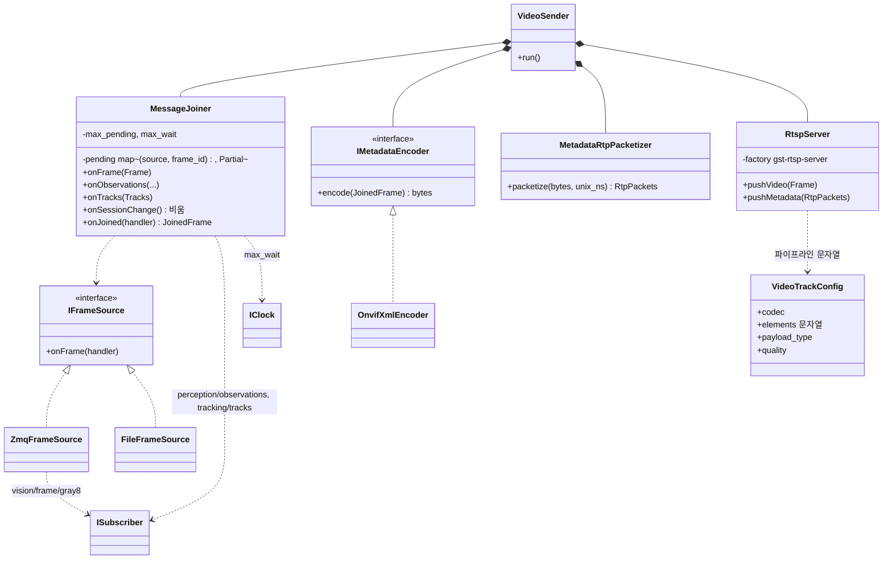
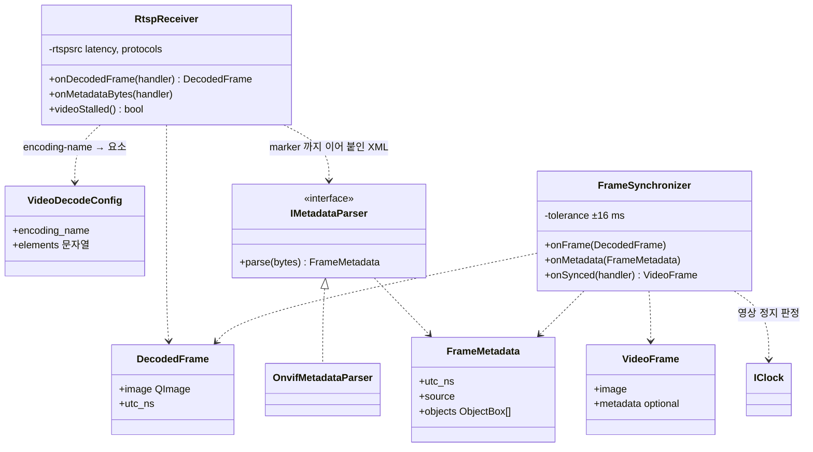

# Class Diagram — 영상 송신부와 통제기 영상 수신

| 항목 | 내용 |
|---|---|
| 참조 문서 | `docs/spec/video.md` 1~6장, `docs/spec/process_interfaces.md` 5.3 |
| 표기 | Mermaid `classDiagram`. `<\|..` 구현, `*--` 소유, `..>` 사용 |
| 범위 | RPi 영상 송신부 프로세스(1절)와 통제기의 영상 수신·동기화(2절). 화면 표시는 `class_gcs.md` 의 `VideoView` |

## 1. 영상 송신부 (RPi)

| 클래스 | 책임 | 출처 |
|---|---|---|
| `IFrameSource` / `ZmqFrameSource` / `FileFrameSource` | 비압축 프레임 공급. 구현 교체로 토픽·파일(테스트) 전환 | pi 5.3 |
| `MessageJoiner` | 세 토픽을 `(source, frame_id)` 로 결합. 보관 개수·대기 시간 제한, 짝 없는 탐지·추적 결과는 버림, `session_id` 변경 시 비움. 영상 프레임 없는 추적 결과는 보내지 않음 | pi 5.3 |
| `IMetadataEncoder` / `OnvifXmlEncoder` | `tracking/tracks` → ONVIF XML (`tt:Frame`, `tt:Object`, `argus:` 확장, 좌표 변환). 추적 결과 없는 프레임은 빈 `tt:Frame` | video 3장 |
| `MetadataRtpPacketizer` | XML → RTP 패킷(헤더 12 B, 조각, 마지막 marker=1, 타임스탬프 = unix_ns × 90000 / 10^9) | video 3.1, 4장 |
| `VideoTrackConfig` | 코덱별 GStreamer 요소 문자열·pt·품질. JPEG: `videoconvert ! video/x-raw,format=I420 ! jpegenc ! rtpjpegpay pt=26` | video 2장, 5장 |
| `RtspServer` | gst-rtsp-server 에 두 트랙 등록, `appsrc` 둘에 push. 클라이언트 없어도 유지, NUC 공백은 아무것도 보내지 않음 | video 5장 |
| `VideoSender` | 조립과 주기: 결합된 프레임마다 영상 push 먼저, 메타데이터 push 다음 | video 5장 |

## 2. 통제기 영상 수신 (gcs)

| 클래스 | 책임 | 출처 |
|---|---|---|
| `VideoDecodeConfig` | SDP `encoding-name` → 디코드 요소 (JPEG: `rtpjpegdepay ! jpegdec`, H264: `rtph264depay ! avdec_h264`) | video 6장 |
| `RtspReceiver` | `rtspsrc` 두 트랙, 지터 버퍼·RTCP·TCP 전환은 GStreamer 에 맡김. 영상은 `appsink` 로 `QImage` + RTCP SR 로 변환한 UTC, 메타데이터는 `rtponvifmetadatadepay` 또는 `appsink` 재조립 (video 미결 1) | video 6장 |
| `IMetadataParser` / `OnvifMetadataParser` | XML → `FrameMetadata` (정규화 좌표 → 픽셀, `argus:` 확장) | video 3장 |
| `FrameSynchronizer` | UTC 가 ±반 프레임 안인 메타데이터를 프레임에 붙임. 아직 안 온 프레임은 박스 없이, 늦게 온 메타데이터는 버림. 새 프레임이 1 s(미결 7) 없으면 영상 정지 | video 4장, 6장 |
| `VideoFrame` | 표시 단위. `VideoView` 가 받는다 | video 6장 |

## 3. SOLID 대응

| 원칙 | 어디에 | 어떻게 |
|---|---|---|
| S | 1·2절 | 결합·XML 생성·RTP 패킷화·RTSP·수신·파싱·동기화가 각각 한 클래스 |
| O | `VideoTrackConfig`, `VideoDecodeConfig` | 코덱 추가 = 설정 항목 추가. `RtspServer`·`RtspReceiver` 수정 없음 (video 5·6장 "요소만 바꾼다") |
| L | `ZmqFrameSource` ↔ `FileFrameSource` | 같은 `Frame` 계약(unix_ns, frame_id, stride). 녹화 파일로 송신부를 재현 테스트 |
| I | `IFrameSource`, `IMetadataEncoder`, `IMetadataParser` | 메서드 하나짜리 인터페이스 |
| D | `VideoSender`, `FrameSynchronizer` | GStreamer 는 `RtspServer`·`RtspReceiver` 안에만. 결합·동기화 로직은 GStreamer 없이 gtest·Qt Test |

## 4. 검토 필요 사항

1. `RtspReceiver` 의 메타데이터 경로 — `rtponvifmetadatadepay` 가 Windows 배포에 있는지 (video 미결 1).
2. `MessageJoiner` 의 보관 개수·대기 시간 값 (pi 5.3).
3. 녹화(`FileFrameSource` 입력 파일 형식)는 별도 결정.

## 변경 이력

| 버전 | 날짜 | 내용 |
|---|---|---|
| 0.1 | 2026-10-16 | 초안 (#31) |
