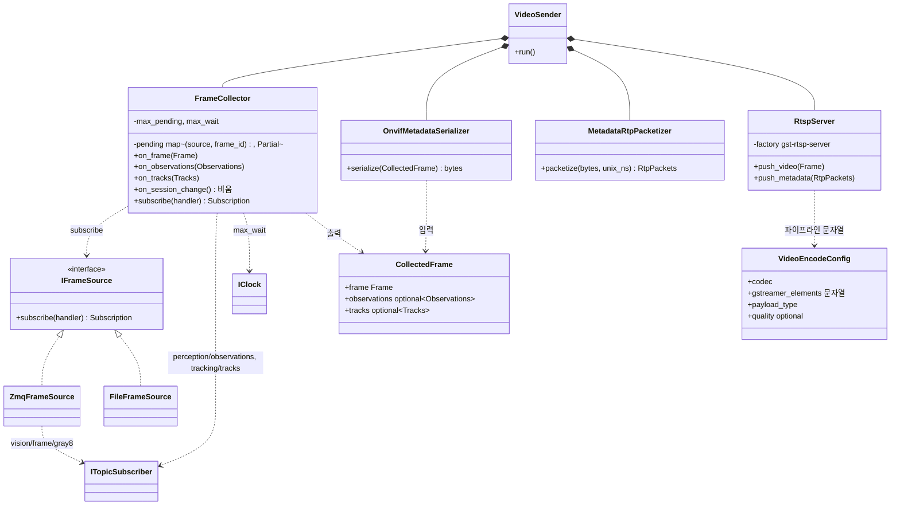
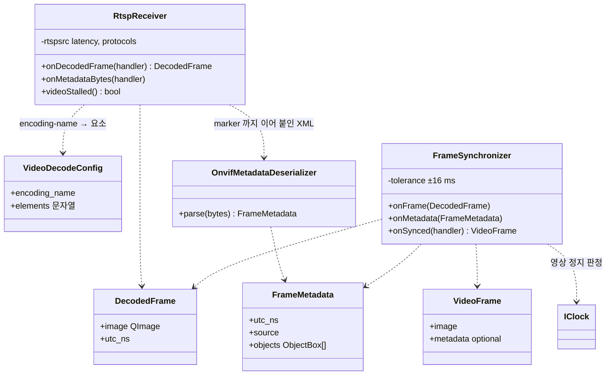

# Class Diagram — 영상 송신부와 통제기 영상 수신

| 항목 | 내용 |
|---|---|
| 참조 문서 | `docs/spec/video.md` 1~6장, `docs/spec/process_interfaces.md` 5.3 |
| 표기 | Mermaid `classDiagram`. `<\|..` 구현, `*--` 소유, `..>` 사용 |
| 범위 | RPi 영상 송신부 프로세스(1절)와 통제기의 영상 수신·동기화(2절). 화면 표시는 `class_gcs.md` 의 `VideoView` |
| 코드 | 값 타입 `onboard/libs/perception_api`(프레임, 탐지·추적 결과), 인터페이스 `onboard/apps/video_sender/include`(#41). 구현은 다음 PR |

## 1. 영상 송신부 (RPi)

| 클래스 | 책임 | 출처 |
|---|---|---|
| `IFrameSource` / `ZmqFrameSource` / `FileFrameSource` | 비압축 프레임 공급. `subscribe(handler)` 가 `Subscription` 을 반환하고 handler 는 `process_events()` 안에서 불린다. 구현 교체로 토픽·녹화 파일(테스트·재현) 전환. 테스트용 `FakeFrameSource` 는 `apps/video_sender/test/` | pi 5.3 |
| `FrameCollector` | 세 토픽을 `(source, frame_id)` 로 모은다. 보관 개수·대기 시간 제한, 대기 시간 안에 다 오지 않으면 모인 것만으로 `CollectedFrame` 을 만들고, 짝 없는 탐지·추적 결과는 버림, `session_id` 변경 시 비움. 영상 프레임 없는 추적 결과는 보내지 않음 | pi 5.3 |
| `CollectedFrame` | 프레임(항상 있음) + 탐지 결과·추적 결과(optional). `OnvifMetadataSerializer`·`RtspServer` 의 입력 | pi 5.3, video 3.2 |
| `OnvifMetadataSerializer` | `CollectedFrame` 의 `tracks` → ONVIF XML (`tt:Frame`, `tt:Object`, `argus:` 확장, 좌표 변환). 추적 결과 없는 프레임은 빈 `tt:Frame`. 구체 클래스다: 구현이 ONVIF XML 하나이고(video 1장) 테스트에서 대체할 이유가 없다(순수 함수) | video 3장 |
| `MetadataRtpPacketizer` | XML → RTP 패킷(헤더 12 B, 조각, 마지막 marker=1, 타임스탬프 = unix_ns × 90000 / 10^9) | video 3.1, 4장 |
| `VideoEncodeConfig` | 코덱별 GStreamer 요소 문자열·pt·품질. JPEG: `videoconvert ! video/x-raw,format=I420 ! jpegenc ! rtpjpegpay`, pt 26. 통제기 `VideoDecodeConfig` 와 짝 | video 2장, 5장 |
| `RtspServer` | gst-rtsp-server 에 두 트랙 등록, `appsrc` 둘에 push. 클라이언트 없어도 유지, NUC 공백은 아무것도 보내지 않음 | video 5장 |
| `VideoSender` | 조립과 주기: 모인 프레임마다 영상 push 먼저, 메타데이터 push 다음 | video 5장 |

- `FrameCollector` 의 근거: Autoware `image_projection_based_fusion` 의 `FusionCollector`(입력 여러 개를 키로 모으고, 시간 제한이 지나면 모인 것으로 처리).

## 2. 통제기 영상 수신 (gcs)

| 클래스 | 책임 | 출처 |
|---|---|---|
| `VideoDecodeConfig` | SDP `encoding-name` → 디코드 요소 (JPEG: `rtpjpegdepay ! jpegdec`, H264: `rtph264depay ! avdec_h264`) | video 6장 |
| `RtspReceiver` | `rtspsrc` 두 트랙, 지터 버퍼·RTCP·TCP 전환은 GStreamer 에 맡김. 영상은 `appsink` 로 `QImage` + RTCP SR 로 변환한 UTC, 메타데이터는 `rtponvifmetadatadepay` 또는 `appsink` 재조립 (video 미결 1) | video 6장 |
| `OnvifMetadataDeserializer` | XML → `FrameMetadata` (정규화 좌표 → 픽셀, `argus:` 확장). 구체 클래스 (1절 `OnvifMetadataSerializer` 와 같은 이유) | video 3장 |
| `FrameSynchronizer` | UTC 가 ±반 프레임 안인 메타데이터를 프레임에 붙임. 아직 안 온 프레임은 박스 없이, 늦게 온 메타데이터는 버림. 새 프레임이 1 s(미결 7) 없으면 영상 정지 | video 4장, 6장 |
| `VideoFrame` | 표시 단위. `VideoView` 가 받는다 | video 6장 |

## 3. SOLID 대응

| 원칙 | 어디에 | 어떻게 |
|---|---|---|
| S | 1·2절 | 모으기·XML 생성·RTP 패킷화·RTSP·수신·파싱·동기화가 각각 한 클래스 |
| O | `VideoEncodeConfig`, `VideoDecodeConfig` | 코덱 추가 = 설정 항목 추가. `RtspServer`·`RtspReceiver` 수정 없음 (video 5·6장 "요소만 바꾼다") |
| L | `ZmqFrameSource` ↔ `FileFrameSource` ↔ `FakeFrameSource` | 같은 `Frame` 계약(unix_ns, frame_id, stride)과 같은 호출 규칙(handler 는 `process_events()` 안에서). 녹화 파일로 송신부를 재현 테스트 |
| I | `IFrameSource` | 메서드 하나짜리 인터페이스 |
| D | `VideoSender`, `FrameSynchronizer` | GStreamer 는 `RtspServer`·`RtspReceiver` 안에만. 모으기·동기화 로직은 GStreamer 없이 gtest·Qt Test. 인터페이스는 구현 교체(`IFrameSource`)나 테스트 대체가 필요한 곳에만 두고, 구현이 하나이고 대체할 이유가 없는 직렬화는 구체 클래스로 둔다 |

## 4. 검토 필요 사항

1. `RtspReceiver` 의 메타데이터 경로 — `rtponvifmetadatadepay` 가 Windows 배포에 있는지 (video 미결 1).
2. `FrameCollector` 의 보관 개수·대기 시간 값 (pi 5.3).
3. 녹화(`FileFrameSource` 입력 파일 형식)는 별도 결정.
4. `RtspServer`·`RtspReceiver` 의 인터페이스: `VideoSender`·`FrameSynchronizer` 테스트에 GStreamer 없는 Fake 가 필요하면 구현 PR 에서 둔다.
5. `perception/observations` v2 의 필드 표가 `process_interfaces.md` 5.1 에 없다. 탐지 담당의 표를 받으면 `perception_api::Observations` 를 맞춘다.

## 변경 이력

| 버전 | 날짜 | 내용 |
|---|---|---|
| 0.1 | 2026-10-16 | 초안 (#31) |
| 0.2 | 2026-10-21 | 1절(영상 송신부) 메서드 이름을 snake_case 로 (onboard C++ 이름 규칙, #39). 2절 통제기는 Qt camelCase 그대로 |
| 0.3 | 2026-10-25 | `MessageJoiner`→`FrameJoiner` (#40), bus 인터페이스 이름 `IPublisher`·`ISubscriber`→`ITopicPublisher`·`ITopicSubscriber` (#40) |
| 0.4 | 2026-10-26 | 코드(#41)와 맞춤: `IFrameSource.subscribe(handler)` 가 `Subscription` 반환, `FrameJoiner`→`FrameCollector`, `JoinedFrame`→`CollectedFrame`(클래스로 추가), `IMetadataEncoder`/`OnvifXmlEncoder`→구체 클래스 `OnvifMetadataSerializer`, `IMetadataParser`/`OnvifMetadataParser`→`OnvifMetadataDeserializer`, `VideoTrackConfig`→`VideoEncodeConfig`. SOLID 표, 검토 4·5 추가 |
