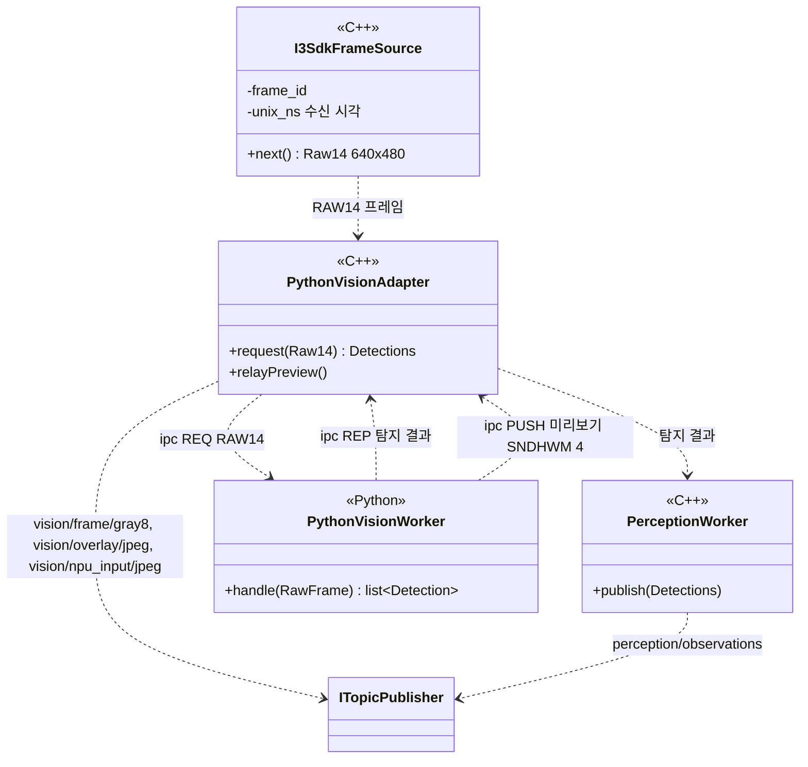
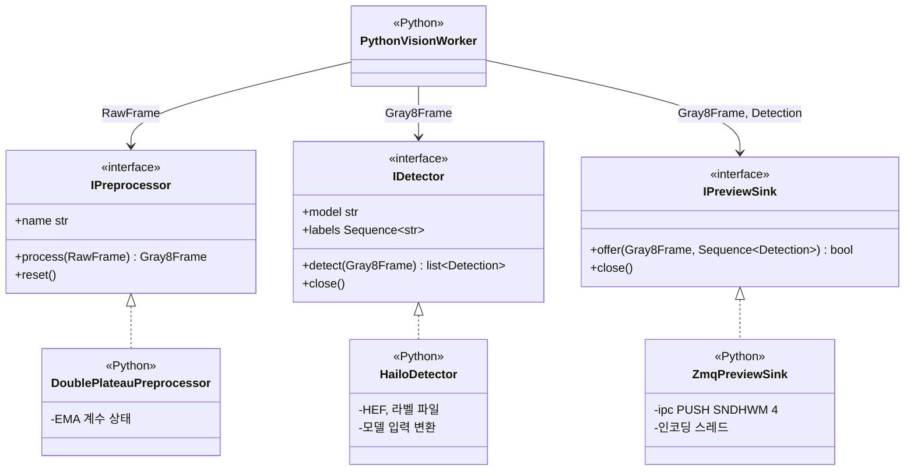

# Class Diagram — 탐지 프로세스의 외부 인터페이스

| 항목 | 내용 |
|---|---|
| 참조 문서 | `docs/spec/process_interfaces.md` 2장, 5.1 (`vision/frame/gray8`, `perception/observations`, `vision/overlay/jpeg`, `vision/npu_input/jpeg`), 7장 3, `docs/spec/video.md` 4장 (시각), 8장 (모델·class_id) |
| 표기 | Mermaid `classDiagram`. `<<C++>>`·`<<Python>>` 은 그 클래스가 어느 언어 코드인지 나타낸다 |
| 범위 | 탐지 프로세스가 다른 프로세스와 주고받는 토픽, C++ 과 Python 이 맡는 처리, Python 쪽 내부 인터페이스(2절) |
| 기준 | 실기체 RPi 의 현재 탐지 코드 (탐지 담당 확인, #33 리뷰) |

## 1. 외부 인터페이스

| 클래스 | 언어 | 책임 | 출처 |
|---|---|---|---|
| `I3SdkFrameSource` | C++ | IR 카메라(i3system, USB 2.0) 수신. 커널 드라이버 없이 i3 SDK 가 usbfs 로 RAW14(LE16) 640×480 을 읽음. frame_id 부여, `unix_ns` 는 RPi 수신 시각(노출 시각 아님) | video 4장, #33 리뷰 |
| `PythonVisionAdapter` | C++ | RAW14 를 ipc REQ 로 Python 쪽에 보내고 탐지 결과를 받음. Python 이 PUSH 한 미리보기 영상 3개를 받아 버스로 발행. 미리보기 수신 rcvhwm 4 | pi 5.1, 7장 3 |
| `PerceptionWorker` | C++ | `perception/observations` v2 발행 (pi 5.1.4). 추론한 프레임마다, 객체 없으면 `detections: []` | pi 5.1 |
| `PythonVisionWorker` | Python | ipc 요청 한 건마다 2절의 전처리 → 추론 → 미리보기를 차례로 부르고 탐지 결과를 응답 | pi 5.1 |

- 발행 토픽은 4개다: `perception/observations`(`PerceptionWorker`), `vision/frame/gray8`·`vision/overlay/jpeg`·`vision/npu_input/jpeg`(`PythonVisionAdapter`). `vision/frame/gray8` 은 설정으로 켜고 끄며 기본은 꺼짐.
- 미리보기 소켓이 막히면 프레임을 버리므로, 모든 탐지 결과에 같은 frame_id 의 gray8 프레임이 있지는 않다.
- 탐지 프로세스는 전송 코덱을 모른다. RTSP 영상 트랙의 JPEG 인코딩은 영상 송신부가 한다 (pi 5.3, 단일 책임). 미리보기 JPEG 는 RTSP 에 쓰지 않는다.
- 실행 환경: C++ 실행 파일 + Python 3.12 venv(OpenCV, pyzmq, HailoRT Python). Hailo-8 은 PCIe Gen3 x1, `/dev/hailo0`, hailort 4.23.0 (`deployment.md`).

## 2. Python 쪽 내부 인터페이스

인터페이스와 값 타입은 `onboard/vision/python/argus_vision/`, 테스트용 구현은 `onboard/vision/python/argus_vision_testing/` 에 있다 (#35: C++ 은 `onboard/vision/` 모듈, Python 은 `onboard/vision/python/`). 인터페이스와 값 타입은 numpy, OpenCV, HailoRT, ZeroMQ 에 의존하지 않는다.

| 클래스 | 책임 | 출처 |
|---|---|---|
| `IPreprocessor` | RAW14 → 원본 크기 8 비트 흑백 `Gray8Frame`. 크기, 좌표계, frame_id, 시각을 바꾸지 않는다. 스트림이 새로 시작되면 `reset()` | pi 5.1 (`vision/frame/gray8`) |
| `DoublePlateauPreprocessor` | Double Plateau adaptive. 프레임마다 상한, 하한 계수를 EMA 로 갱신 (상태 있음). `name` 은 `double_plateau_adaptive` | 현재 RPi 코드 |
| `IDetector` | `Gray8Frame` → 원본 영상 픽셀 좌표의 `Detection` 목록. 모델 입력 만들기(채널, 크기, 레터박스)와 좌표 되돌리기는 구현 안에서 한다 | pi 5.1.4 |
| `HailoDetector` | HailoRT 비동기 추론, HEF 의 NMS 출력 해석. 입력 모양은 HEF 가 정한다: 지금 실기체는 640×480 1채널 HEF(레터박스 없음), 이전 v7.3 은 640×640 3채널(레터박스). 신뢰도 경계값 0.7 | video 8장, 현재 RPi 코드 |
| `IPreviewSink` | 한 프레임의 gray8, overlay(박스를 그린 JPEG, 최대 15 FPS), npu_input(모델 입력 영상 JPEG, 진단용) 중 켜진 것을 C++ 어댑터로 내보낸다. 기다리지 않고, 자리가 없으면 버린다 | pi 5.1, 7장 3 |
| `ZmqPreviewSink` | ipc PUSH(SNDHWM 4). 한 프레임에 최대 3개가 연달아 나가므로 최소 3, 여유 1칸 | pi 5.1, 7장 3 |
| `Fake…` (`FakePreprocessor`, `FakeDetector`, `FakePreviewSink`) | 카메라, NPU, ZeroMQ 없이 작업자와 사용자 코드를 시험 | CONTRIBUTING 0.2 |

| SOLID | 대응 |
|---|---|
| 단일 책임 | 전처리, 추론, 미리보기 송신을 인터페이스 셋으로 나눔. 작업자는 순서만 맡음 |
| 개방 폐쇄 | 새 HEF(입력 모양이 다른 모델)는 `IDetector` 구현 안에서 처리하고 작업자와 전처리는 바꾸지 않음 |
| 의존 역전 | 작업자는 인터페이스에만 의존하고, 구현은 시작할 때 넣어 줌 |

## 검토 필요 사항

1. 해소 (0.4): Python 쪽 내부 Class Diagram 을 2절에 추가함.
2. C++ 코드를 `onboard/vision/` 로 옮길 때 카메라 수신(`I3SdkFrameSource`)과 RAW14 녹화 파일을 읽는 클래스가 같은 인터페이스를 구현하게 해, i3 SDK 가 없는 CI 에서도 빌드·테스트한다 (#35).
3. 구현(`DoublePlateauPreprocessor`, `HailoDetector`, `ZmqPreviewSink`, `PythonVisionWorker`)을 RPi 코드에서 옮겨 오는 것은 다음 이슈. RPi 의 HailoRT Python 과 OpenCV 는 저장소 CI 에 없으므로, 구현 파일의 mypy 예외(`[[tool.mypy.overrides]]`)를 그때 함께 정한다.

## 변경 이력

| 버전 | 날짜 | 내용 |
|---|---|---|
| 0.1 | 2026-10-16 | 초안 (#31) |
| 0.2 | 2026-10-19 | 탐지 담당 리뷰 반영(#33): 실제 C++ 클래스(`I3SdkFrameSource`, `PythonVisionAdapter`, `PerceptionWorker`)와 Python 처리로 나눠 다시 그림, 발행 토픽 4개, 전처리 순서, RAW14 640×480, 미리보기 SNDHWM 4·rcvhwm 4. 제목 "경계" → "외부 인터페이스" |
| 0.3 | 2026-10-25 | bus 인터페이스 이름 `IPublisher`→`ITopicPublisher` (#40) |
| 0.4 | 2026-10-29 | 2절 Python 쪽 내부 인터페이스(`IPreprocessor`, `IDetector`, `IPreviewSink`와 구현, Fake) 추가. 1절의 Python 처리 셋(`Preprocessor`, `HailoInference`, `OverlayEncoder`)을 `PythonVisionWorker` 하나로 묶고 세부는 2절로. 모델 입력 변환(레터박스)을 전처리에서 탐지기 구현으로 옮김. 지금 실기체 HEF 입력 640×480 1채널 반영 |
