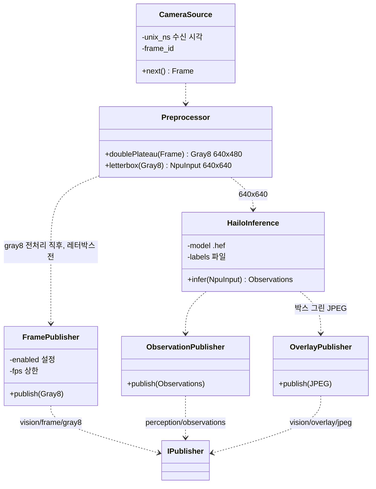

# Class Diagram — 탐지 프로세스 경계

| 항목 | 내용 |
|---|---|
| 참조 문서 | `docs/spec/process_interfaces.md` 2장, 5.1 (`vision/frame/gray8`, `perception/observations`, `vision/overlay/jpeg`, `vision/npu_input/jpeg`), 7장 미결 3, `docs/spec/video.md` 4장 (시각), 8장 (모델·class_id) |
| 표기 | Mermaid `classDiagram` |
| 범위 | 탐지 프로세스가 바깥과 만나는 경계만. `HailoInference` 내부는 탐지 담당이 채운다 |

| 클래스 | 책임 | 출처 |
|---|---|---|
| `CameraSource` | IR 카메라 SDK 입력. `unix_ns` 는 RPi 수신 시각(노출 시각 아님), frame_id 부여 | video 4장, pi 5.1 |
| `Preprocessor` | Double Plateau → 640×480 gray8. 이 지점의 프레임이 `vision/frame/gray8` 이다(박스 좌표계와 같음). 레터박스 640×640 → NPU 입력 | pi 5.1 |
| `HailoInference` | 모델 `yolox_s_leaky_v7.3.hef`, class_id ↔ 라벨 파일 | video 8장 |
| `FramePublisher` | `vision/frame/gray8`. 설정으로 켜고 끔(기본 꺼짐), FPS 상한. 송신 경로 큐 크기가 1 이라 막히면 프레임을 버린다 → 모든 탐지 결과에 같은 frame_id 의 프레임이 있지는 않다 | pi 5.1, 미결 3 |
| `ObservationPublisher` | `perception/observations` v2. 추론한 프레임마다, 객체 없으면 `detections: []` | pi 5.1 |
| `OverlayPublisher` | `vision/overlay/jpeg` 지상 미리보기. RTSP 로 바뀐 뒤 끈다 | pi 5.1 |

- 탐지 프로세스는 전송 코덱을 모른다. JPEG 인코딩은 영상 송신부가 한다 (pi 5.3, 단일 책임).
- 추론(Python) → C++ 어댑터 → 버스 경로와 `vision/frame/gray8` 전송 경로는 pi 미결 3. 그림에는 프로세스 안 경계를 그리지 않았다.

## 검토 필요 사항

1. `CameraSource` 의 카메라 연결 방식과 SDK (`deployment.md` 검토 필요 사항 2).
2. `HailoInference` 내부 Class Diagram, Python·C++ 경계 — 탐지 담당.

## 변경 이력

| 버전 | 날짜 | 내용 |
|---|---|---|
| 0.1 | 2026-10-16 | 초안 (#31) |
