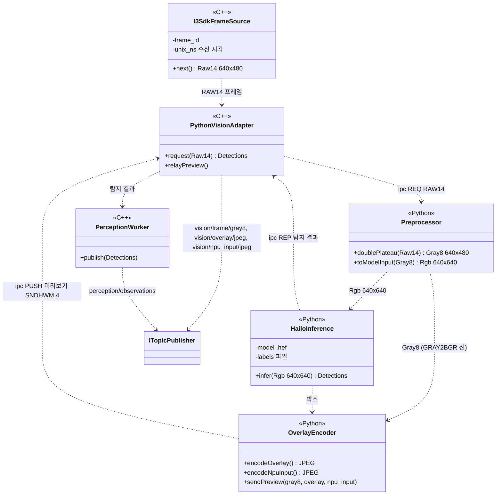

# Class Diagram — 탐지 프로세스의 외부 인터페이스

| 항목 | 내용 |
|---|---|
| 참조 문서 | `docs/spec/process_interfaces.md` 2장, 5.1 (`vision/frame/gray8`, `perception/observations`, `vision/overlay/jpeg`, `vision/npu_input/jpeg`), 7장 3, `docs/spec/video.md` 4장 (시각), 8장 (모델·class_id) |
| 표기 | Mermaid `classDiagram`. `<<C++>>`·`<<Python>>` 은 그 클래스가 어느 언어 코드인지 나타낸다 |
| 범위 | 탐지 프로세스가 다른 프로세스와 주고받는 토픽, 그리고 C++ 과 Python 이 맡는 처리. Python 쪽 내부(전처리·추론 세부)는 탐지 담당이 채운다 |
| 기준 | drone Pi 의 현재 탐지 코드 (탐지 담당 확인, #33 리뷰) |

| 클래스 | 언어 | 책임 | 출처 |
|---|---|---|---|
| `I3SdkFrameSource` | C++ | IR 카메라(i3system, USB 2.0) 수신. 커널 드라이버 없이 i3 SDK 가 usbfs 로 RAW14(LE16) 640×480 을 읽음. frame_id 부여, `unix_ns` 는 RPi 수신 시각(노출 시각 아님) | video 4장, #33 리뷰 |
| `PythonVisionAdapter` | C++ | RAW14 를 ipc REQ 로 Python 쪽에 보내고 탐지 결과를 받음. Python 이 PUSH 한 미리보기 영상 3개를 받아 버스로 발행. 미리보기 수신 rcvhwm 4 | pi 5.1, 7장 3 |
| `PerceptionWorker` | C++ | `perception/observations` v2 발행. 추론한 프레임마다, 객체 없으면 `detections: []` | pi 5.1 |
| `Preprocessor` | Python | RAW14 → Double Plateau(adaptive) → Gray8 640×480 → GRAY2BGR → 레터박스 + RGB 640×640. `vision/frame/gray8` 은 Double Plateau 출력(GRAY2BGR 전)이며 박스 좌표계와 같음 | pi 5.1, #33 리뷰 |
| `HailoInference` | Python | 모델 `yolox_s_leaky_v7.3.hef`, class_id ↔ 라벨 파일 | video 8장 |
| `OverlayEncoder` | Python | overlay(박스 그린 JPEG, 최대 15 FPS)·npu_input(640×640 레터박스 JPEG, 진단용) 인코딩. gray8 과 함께 같은 미리보기 소켓(SNDHWM 4)으로 PUSH. 한 프레임에 최대 3개가 연달아 나가므로 최소 3, 여유 1칸 | pi 5.1, 7장 3 |

- 발행 토픽은 4개다: `perception/observations`(`PerceptionWorker`), `vision/frame/gray8`·`vision/overlay/jpeg`·`vision/npu_input/jpeg`(`PythonVisionAdapter`). `vision/frame/gray8` 은 설정으로 켜고 끄며 기본은 꺼짐.
- 미리보기 소켓이 막히면 프레임을 버리므로, 모든 탐지 결과에 같은 frame_id 의 gray8 프레임이 있지는 않다.
- 탐지 프로세스는 전송 코덱을 모른다. RTSP 영상 트랙의 JPEG 인코딩은 영상 송신부가 한다 (pi 5.3, 단일 책임). `OverlayEncoder` 의 JPEG 는 미리보기용이며 RTSP 에 쓰지 않는다.
- 실행 환경: C++ 실행 파일 + Python 3.12 venv(OpenCV, pyzmq, HailoRT Python). Hailo-8 은 PCIe Gen3 x1, `/dev/hailo0`, hailort 4.23.0 (`deployment.md`).

## 검토 필요 사항

1. Python 쪽 내부 Class Diagram(전처리·추론 세부) — 탐지 담당.
2. C++ 코드를 `onboard/vision/` 로 옮길 때 카메라 수신(`I3SdkFrameSource`)과 RAW14 녹화 파일을 읽는 클래스가 같은 인터페이스를 구현하게 해, i3 SDK 가 없는 CI 에서도 빌드·테스트한다 (#35).

## 변경 이력

| 버전 | 날짜 | 내용 |
|---|---|---|
| 0.1 | 2026-10-16 | 초안 (#31) |
| 0.2 | 2026-10-19 | 탐지 담당 리뷰 반영(#33): 실제 C++ 클래스(`I3SdkFrameSource`, `PythonVisionAdapter`, `PerceptionWorker`)와 Python 처리로 나눠 다시 그림, 발행 토픽 4개, 전처리 순서, RAW14 640×480, 미리보기 SNDHWM 4·rcvhwm 4. 제목 "경계" → "외부 인터페이스" |
| 0.3 | 2026-10-25 | bus 인터페이스 이름 `IPublisher`→`ITopicPublisher` (#40) |
