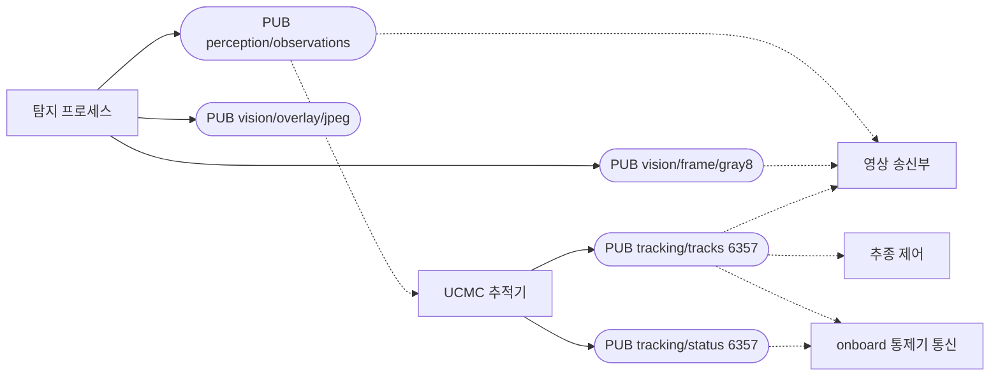
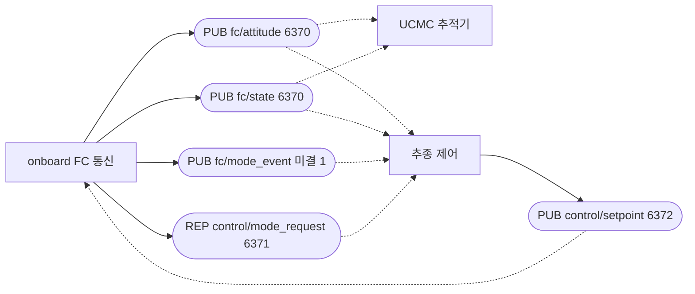
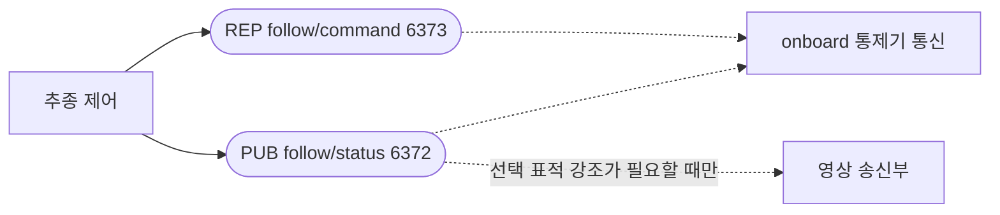
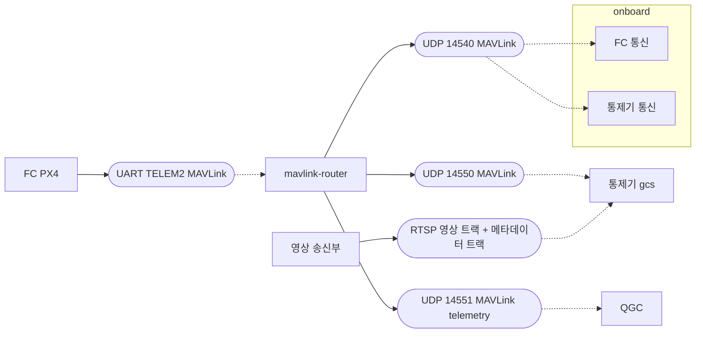

# Component diagram — 프로세스와 인터페이스

| 항목 | 내용 |
|---|---|
| 참조 문서 | `docs/spec/process_interfaces.md` 2·5장 (ZeroMQ 토픽·REQ/REP, 엔드포인트), `docs/spec/icd.md` 1장 (MAVLink 링크), `docs/spec/video.md` 1장 (RTSP) |
| 표기 | 네모 = 컴포넌트(프로세스 또는 프로그램). 둥근 네모 = 인터페이스. 실선 = provided (발행·응답·서비스하는 쪽), 점선 = required (구독·요청·클라이언트 쪽). 포트 번호는 기본값 |
| 읽는 법 | 인터페이스 하나에 실선이 하나(provided), 점선이 하나 이상(required). 점선이 없는 인터페이스는 현재 쓰는 쪽이 없는 것이다 |

## 1. RPi 안 (ZeroMQ)

토픽이 많아 다이어그램 3개로 나눠 그린다. 같은 컴포넌트가 여러 다이어그램에 나온다.

### 1.1 탐지 → 추적 → 영상 송신

### 1.2 FC 상태와 제어 (onboard FC 통신 ↔ 추적기·추종 제어)

### 1.3 추종 명령과 추종 상태 (onboard 통제기 통신 ↔ 추종 제어)

| 인터페이스 | provided | required | 비고 |
|---|---|---|---|
| `vision/frame/gray8` | 탐지 | 영상 송신부 | 박스 없는 비압축 프레임. 기본 꺼짐, 설정으로 켬 |
| `perception/observations` | 탐지 | 추적기, 영상 송신부 | |
| `vision/overlay/jpeg` | 탐지 | (지상 미리보기) | RTSP 로 바뀐 뒤 끌 수 있게 유지. RPi 안 사용자는 없다 |
| `tracking/tracks` | 추적기 | 추종 제어, onboard 통제기 통신, 영상 송신부 | |
| `tracking/status` | 추적기 | onboard 통제기 통신 | `ARGUS_SENSOR_STATUS` 보고에 사용 |
| `fc/attitude`, `fc/state` | onboard FC 통신 | 추적기, 추종 제어 | 30 Hz 이상 |
| `fc/mode_event` | onboard FC 통신 | 추종 제어 | 엔드포인트 **[미결 1]** (`process_interfaces.md` 7장) |
| `control/setpoint` | 추종 제어 | onboard FC 통신 | 20 Hz, 유효 시간 포함 |
| `follow/status` | 추종 제어 | onboard 통제기 통신, (영상 송신부) | 영상 송신부 구독은 선택 표적 강조가 필요할 때만 (`process_interfaces.md` 5.3) |
| `follow/command` (REQ/REP) | 추종 제어 | onboard 통제기 통신 | track_start·stop·search |
| `control/mode_request` (REQ/REP) | onboard FC 통신 | 추종 제어 | OFFBOARD·HOLD, Hold 중 heading |

## 2. RPi 밖 (MAVLink, RTSP)

| 인터페이스 | provided | required | 내용 |
|---|---|---|---|
| UART TELEM2 | FC | mavlink-router | 모든 MAVLink. RPi 쪽은 라우터만 연다 (`icd.md` 1.2) |
| UDP 14540 | mavlink-router | onboard FC 통신 (telemetry 수신, setpoint·모드 송신), onboard 통제기 통신 (`ARGUS_*` 송신, `COMMAND_LONG` 수신) | onboard 가 compid 191·195 로 나눠 쓴다 (`icd.md` 1.1) |
| UDP 14550 | mavlink-router | 통제기 | telemetry·`ARGUS_STATUS`·`ARGUS_SENSOR_STATUS`·`COMMAND_ACK` 수신, `HEARTBEAT`·`COMMAND_LONG`·비행 명령 송신 |
| UDP 14551 | mavlink-router | QGC | telemetry 만. QGC 명령은 라우터가 FC 로 보내지 않는다 |
| RTSP | 영상 송신부 | 통제기 | RTP/JPEG 영상 트랙 + ONVIF XML 메타데이터 트랙 (`docs/spec/video.md`) |

## 3. 검토 필요 사항

- `follow/status` → 영상 송신부: 규약이 "필요하면 구독" 이라 점선에 조건을 적었다. 선택 표적 강조를 통제기가 `ARGUS_STATUS.target_id` 로 하므로(`video.md` 6장) 영상 송신부 구독은 없어도 된다. 확정되면 선을 지운다.
- `vision/overlay/jpeg` 는 RPi 안 사용자가 없다. 통제기가 RTSP 로 바뀌면 발행을 끈다.
- `fc/mode_event` 의 엔드포인트가 정해지지 않았다 (`process_interfaces.md` 미결 1).

## 변경 이력

| 버전 | 날짜 | 내용 |
|---|---|---|
| 0.1 | 2026-10-16 | 초안 (#31) |
