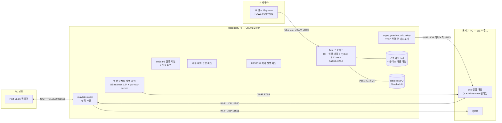

# Deployment Diagram — 장비, 실행 환경, 산출물

| 항목 | 내용 |
|---|---|
| 참조 문서 | `docs/spec/icd.md` 1장 (노드·링크), `docs/spec/video.md` 1장 (GStreamer, Ubuntu 24.04)·8장 (모델 파일), `docs/spec/process_interfaces.md` 2장 (프로세스), 5.1 (Hailo 입력) |
| 표기 | Mermaid 에 deployment 전용 문법이 없어 flowchart 로 그린다. 상자 = 장비(node)와 그 OS, 네모 = 그 위에 설치되는 산출물(실행 파일·설정·모델. 둘째 줄은 실행 환경·런타임), 원통 = 파일·장치. 선 = 통신 경로(프로토콜). `~~~` 는 선 없이 배치 순서만 정하는 Mermaid 표기 |
| 범위 | 설치 대상만 적는다. 빌드에만 쓰는 것(`argus.xml` 생성 헤더, CMake)은 적지 않는다 |

## 산출물

| 장비 | 실행 환경 | 산출물 | 담당 | 비고 |
|---|---|---|---|---|
| FC 보드 | — | PX4 v1.16 펌웨어, 파라미터 | 통신 (설정) | 펌웨어 업데이트는 하지 않는다. 파라미터 변경은 배포 문서에 기록 |
| Raspberry Pi | Ubuntu 24.04 | mavlink-router 와 설정 파일 (UART ↔ UDP 14540·14550·14551, QGC 명령 필터) | 통신 | `icd.md` 1.2 |
| Raspberry Pi | Ubuntu 24.04 | onboard 실행 파일, 설정 파일 (`source` ↔ `ARGUS_SENSOR` 대응, Scan 기본값, 두절 시간) | 통신 | `process_interfaces.md` 3장, `icd.md` 4.2 |
| Raspberry Pi | Ubuntu 24.04 | 추종 제어 실행 파일 | 추적·추종 | |
| Raspberry Pi | Ubuntu 24.04 | UCMC 추적기 실행 파일 | 추적·추종 | |
| Raspberry Pi | Ubuntu 24.04, Python 3.12 venv(OpenCV, pyzmq, HailoRT Python), hailort 4.23.0 + hailort-pcie-driver 4.23.0, i3 SDK(수동 설치) | 탐지 프로세스(C++ 실행 파일 + Python 코드), 모델 파일 `yolox_s_leaky_v7.3.hef`, 클래스 라벨 파일 | 탐지 | `video.md` 8장, `class_vision.md`. 모델 파일과 i3 SDK 는 저장소에 두지 않는다 (`models/` 는 목록만) |
| Raspberry Pi | Ubuntu 24.04 | `argus_preview_udp_relay` 실행 파일: `vision/overlay/jpeg` 를 구독해 JPEG 를 UDP 로 지상 미리보기에 보냄 | 확인 필요 | RTSP 전환 전까지 쓰는 지금의 통제기 미리보기 경로. 전환 뒤 처리는 검토 필요 사항 4 |
| Raspberry Pi | GStreamer 1.24 + gst-rtsp-server (apt) | 영상 송신부 실행 파일, 파이프라인·품질 설정 | 통신 | `video.md` 5장 |
| 통제기 PC | OS **[미결 1]**, Qt, GStreamer 런타임 | gcs 실행 파일과 GStreamer 플러그인 묶음 | 통제기 | `video.md` 미결 1·2 (Windows 배포 구성, Qt 연결) |
| 통제기 PC | — | QGC | — | 설치만. 라우터가 QGC 명령을 FC 로 보내지 않는다 |

## 통신 경로

| 경로 | 매체 | 프로토콜 | 출처 |
|---|---|---|---|
| FC ↔ RPi | UART (TELEM2), 921600 bps | MAVLink 2 | `icd.md` 1.2 |
| IR 카메라 → RPi | USB 2.0 (i3system HYUNY, USB ID 0547:0080) | i3 SDK 가 usbfs 로 직접 읽음 (커널 드라이버 없음) | #33 리뷰 (탐지 담당) |
| RPi 안 | PCIe Gen3 x1 (8 GT/s), `/dev/hailo0` | HailoRT 4.23.0 | #33 리뷰 (탐지 담당) |
| RPi ↔ 통제기 PC | Wi-Fi | UDP 14550 (MAVLink), UDP 14551 (QGC), RTSP + RTP/UDP, UDP 미리보기 JPEG(`argus_preview_udp_relay`, RTSP 전환 전까지) | `icd.md` 1.2, `video.md` 1장 |

## 검토 필요 사항

1. 통제기 PC 의 OS 와 GStreamer 배포 방식 (`video.md` 미결 1·2 와 같은 항목). 정해지면 그림의 "OS 미결 1" 을 바꾼다.
2. 해소 (0.2): IR 카메라는 USB 2.0, Hailo-8 은 PCIe Gen3 x1 (탐지 담당 확인).
3. 설정 파일의 이름과 위치(`/etc/argus/…` 등)는 `onboard/` 구조가 정해진 뒤 적는다.
4. `argus_preview_udp_relay` 를 RTSP 전환 뒤 없앨지, 그 전까지 `onboard/` 로 옮길지, 담당과 UDP 포트.
5. FC ↔ RPi 연결: drone Pi 는 지금 USB(cdc_acm)로 연결되어 있고 `icd.md` 1.2 는 UART TELEM2 921600 이다. 운용 구성을 정해 `icd.md` 와 함께 맞춘다.

## 변경 이력

| 버전 | 날짜 | 내용 |
|---|---|---|
| 0.1 | 2026-10-16 | 초안 (#31) |
| 0.2 | 2026-10-19 | 탐지 담당 리뷰 반영(#33): 카메라 USB 2.0, Hailo-8 PCIe Gen3 x1, 탐지 실행 환경(C++ + Python 3.12 venv, hailort 4.23.0, i3 SDK), `argus_preview_udp_relay` 추가. 검토 필요 사항 2 해소, 4·5 추가 |
