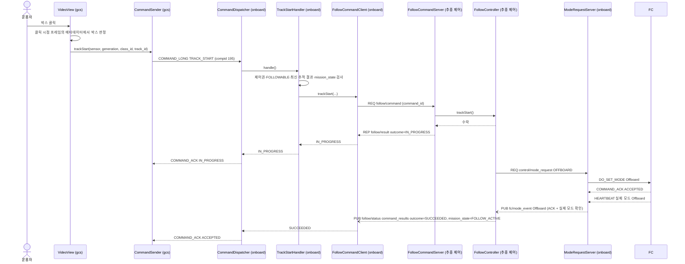
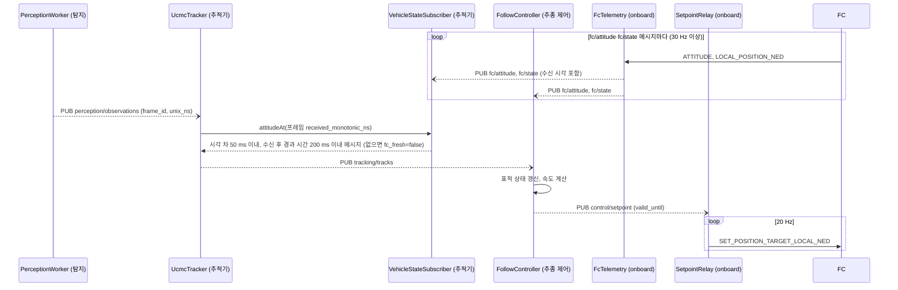
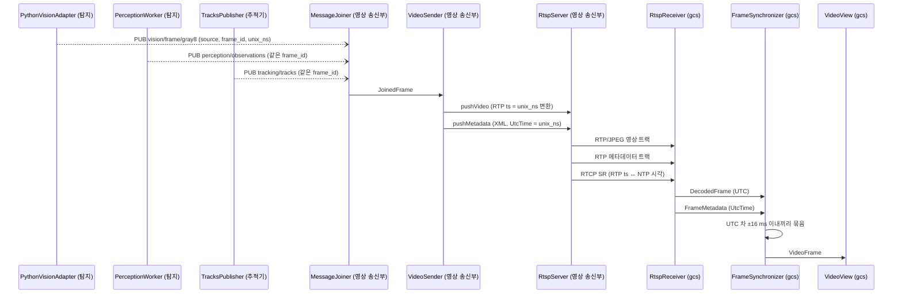
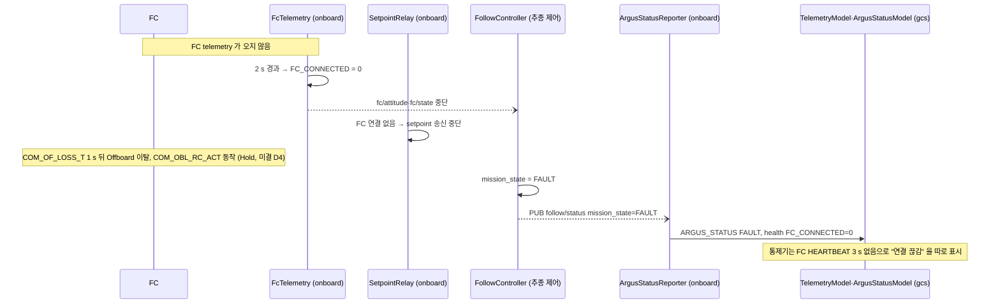

# Sequence Diagram — 주요 시나리오

| 항목 | 내용 |
|---|---|
| 참조 문서 | `docs/spec/icd.md` 4·6장, `docs/spec/process_interfaces.md` 5·6장, `docs/spec/video.md` 4~6장 |
| 표기 | Mermaid `sequenceDiagram`. 참여자 이름은 Class Diagram 의 클래스 이름이다(괄호 안은 프로세스). `->>` 호출·송신, `-->>` 응답, `--)` 발행(PUB). 시간은 위에서 아래로 |
| 범위 | 시나리오 4개: 1. 박스 클릭 → 추종 시작, 2. 추종 1주기, 3. 영상 프레임 1장 송신·수신, 4. FC telemetry 두절 |

## 1. 박스 클릭 → 추종 시작 (TRACK_START)

- 첫 결과는 REP 응답(`follow/result`)에서 받는다. 사전 검사(형식·세션·기한)에서 거부된 요청은 `command_results` 에 남지 않을 수 있기 때문이다 (#32).
- 이후 진행은 `follow/status.command_results` 에서 같은 command_id 를 찾는다. `outcome` 과 ACK 의 대응: IN_PROGRESS → IN_PROGRESS, SUCCEEDED → ACCEPTED, REJECTED → DENIED, FAILED → FAILED.
- 통제기가 ACK 를 1 s 안에 받지 못해 다시 보내면(`icd.md` 4.1), onboard 는 같은 command_id 로 요청한다. 추종 제어는 재실행하지 않고 저장된 결과를 돌려준다.
- onboard 검사(조건 ①③④⑤)에서 거부되면 추종 제어로 보내지 않고 바로 `COMMAND_ACK DENIED` + `STATUSTEXT` 로 답한다.
- Offboard 진입 전부터 setpoint 가 2 Hz 이상 와야 PX4 가 Offboard 에 들어간다 (`icd.md` 2장). 그 흐름은 2절.

## 2. 추종 1주기

- 추적기와 추종 제어는 FC 에 직접 보내지 않는다. FC 로 가는 것은 모두 onboard 를 거친다 (`process_interfaces.md` 2.1).
- `SetpointRelay` 는 받은 최신 setpoint 를 20 Hz 로 보낸다. `valid_until` 이 지나면 4절과 같이 속도 0 과 Hold 요청.

## 3. 영상 프레임 1장 송신·수신

- 세 토픽은 도착 순서가 보장되지 않는다. `MessageJoiner` 는 대기 시간 안에 짝이 모두 오지 않으면 버린다. 영상 프레임이 없는 탐지·추적 결과는 보내지 않는다 (`process_interfaces.md` 5.3).
- 영상 패킷을 먼저 보내고 메타데이터를 보낸다 (`video.md` 5장).
- 메타데이터가 늦게 오면 통제기는 프레임을 박스 없이 표시하고, 늦게 온 메타데이터는 버린다 (`video.md` 6장).

## 4. FC telemetry 두절 (추종 중)

- 링크가 다시 연결되어도 추종을 자동으로 재개하지 않는다. FAULT 에서는 운용자의 명시적 TRACK_STOP 을 받고 최신 FC 상태·FC 실제 Hold·RC 비개입을 확인한 뒤에만 HOLD_WAIT 로 돌아간다 (`icd.md` 6장, `state_machine.md`).
- onboard 는 추종 제어의 보고와 관계없이 FC 상태를 스스로 확인해 위험한 송신을 막는다 (`icd.md` 6.6).
- 경로가 FC → mavlink-router → onboard 이므로 mavlink-router 가 멈춰도 같은 흐름이 된다. 이때는 통제기 링크도 함께 끊긴다.

## 검토 필요 사항

1. 해소 (0.3): 1절의 Offboard 진입 실패(요청 실패, ACK 실패, 실제 모드 확인 시간 초과)는 outcome=FAILED → ACK FAILED, `mission_state` FAULT (`icd.md` 4.2).
2. 해소 (0.3): TRACK_START 는 FC 가 실제 Hold 이거나 유효한 Position 인계를 거쳤을 때만 수락 (`icd.md` 4.2 ⑥).
3. 2절: `ctl` 이 `fc/attitude` 를 프레임 시각에 맞춰 쓰는지, 최신 메시지를 쓰는지는 추적·추종 담당의 내부 설계.
4. 4절: FC telemetry 두절 때 `mission_state` 를 FAULT 로 바꾸는 주체. ICD 6.2 는 onboard 의 health 와 setpoint 중단만 정하고, `mission_state` 는 추종 제어가 정한다(`state_machine.md`). 그림은 추종 제어가 `fc/*` 중단을 보고 FAULT 로 바꾸는 것으로 가정했다. 판단 시간(2 s)을 추종 제어도 같은 값으로 쓰는지 확인 필요.

## 변경 이력

| 버전 | 날짜 | 내용 |
|---|---|---|
| 0.1 | 2026-10-19 | 초안 (#31) |
| 0.2 | 2026-10-19 | 탐지 쪽 참여자를 실제 클래스 이름으로 (`PerceptionWorker`, `PythonVisionAdapter`, #33 리뷰) |
| 0.3 | 2026-10-19 | 추적·추종 담당 리뷰 반영(#33): Offboard 진입 확인은 ACK + 실제 모드(1절), FC 표본은 프레임의 호스트 단조 시각으로 고르고 시각 차 50 ms·수신 후 경과 시간 200 ms(2절), FAULT 복구 조건과 onboard 독립 감시(4절), "FC 표본" 을 "fc/attitude·fc/state 메시지" 로 |
