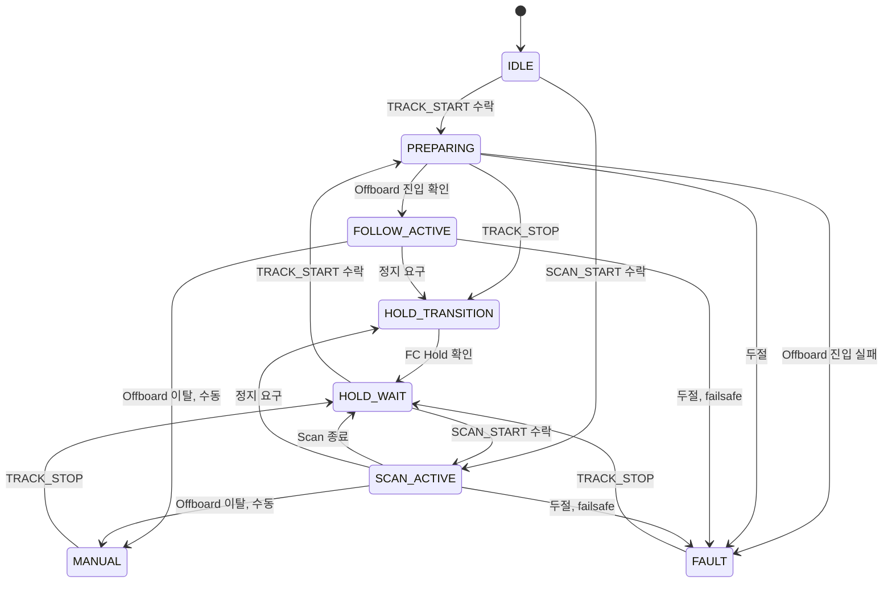
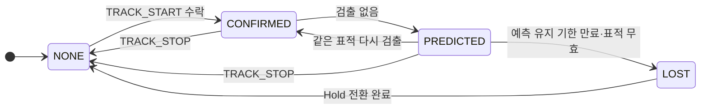

# State Machine Diagram — 임무 상태와 표적 상태의 transition

| 항목 | 내용 |
|---|---|
| 참조 문서 | `common/mavlink/message_definitions/argus.xml` (`ARGUS_MISSION_STATE`, `ARGUS_TARGET_STATE`), `docs/spec/icd.md` 4장 (명령), 6장 (두절), `docs/spec/process_interfaces.md` 6장 |
| 주체 | 두 상태 모두 추종 제어가 정하고 `follow/status` 로 onboard 에 주며, onboard 가 `ARGUS_STATUS` 로 통제기에 그대로 옮긴다 (`icd.md` 3.1) |
| 표기 | transition 라벨은 UML `event [guard] / effect`. 그림에는 event 만, guard·effect·출처는 표에. 규약에 event 가 없는 transition 은 `[미결]` |

## 1. `ARGUS_MISSION_STATE`

| 상태 | 뜻 (`argus.xml`) | FC 모드 |
|---|---|---|
| IDLE | 추종·Scan 없음. 표적 선택 대기 | 임의 |
| PREPARING | TRACK_START 수락 뒤 Offboard 진입·확인 중 | → Offboard |
| FOLLOW_ACTIVE | 추종 중, setpoint 20 Hz | Offboard |
| HOLD_TRANSITION | 추종·Scan 을 끝내고 Hold 로 전환 중 | → Hold |
| HOLD_WAIT | FC 가 Hold 인 것을 확인하고 대기. 자동으로 추종을 재개하지 않는다 | Hold |
| SCAN_ACTIVE | yaw 스캔 중 | Hold 또는 Offboard [미결 E3, `icd.md`] |
| MANUAL | 조종사(RC) 또는 통제기가 모드를 바꿔 추종이 끝남 | 조종사·통제기가 정한 모드 |
| FAULT | FC 두절, 추종 제어 두절, Offboard 진입 실패 등 고장으로 멈춤 | FC failsafe 에 따름 |

transition 의 event [guard] / effect:

| transition | event | guard | effect | 출처 |
|---|---|---|---|---|
| IDLE·HOLD_WAIT → PREPARING | TRACK_START 수신 | `icd.md` 4.2 조건 ①~⑥ 충족 (⑥ FC 실제 Hold 또는 유효한 Position 인계) | ACK IN_PROGRESS | `icd.md` 4.2 |
| PREPARING → FOLLOW_ACTIVE | Offboard 진입 확인 | DO_SET_MODE 의 ACK 와 HEARTBEAT 로 확인한 실제 모드가 모두 Offboard | ACK ACCEPTED | `icd.md` 4.2 |
| PREPARING → FAULT | Offboard 진입 실패 | 모드 요청 실패, ACK 실패, 실제 모드 확인 시간 초과 중 하나 | ACK FAILED | `icd.md` 4.2 |
| PREPARING → HOLD_TRANSITION | TRACK_STOP 수신 | — | Hold 요청 | #33 리뷰 (추적·추종 담당) |
| IDLE·HOLD_WAIT → SCAN_ACTIVE | SCAN_START 수신 | 조건 충족, FC Hold | ACK IN_PROGRESS | `icd.md` 4.2 |
| SCAN_ACTIVE → HOLD_WAIT | yaw 회전량 도달, timeout, 추적 후보 발견 | — | 정지, ACK ACCEPTED | `icd.md` 4.2 |
| FOLLOW_ACTIVE → HOLD_TRANSITION | TRACK_STOP 수신, 통제기 HEARTBEAT 3 s 없음, target_state → LOST | — | Hold 요청 | `icd.md` 4.2, 6.1, 아키텍처 문서 2.7·2.11 |
| SCAN_ACTIVE → HOLD_TRANSITION | TRACK_STOP 수신, 통제기 HEARTBEAT 3 s 없음 | — | Hold 요청 | `icd.md` 4.2, 6.1 |
| HOLD_TRANSITION → HOLD_WAIT | FC Hold 확인 | — | ACK ACCEPTED | `icd.md` 4.2 Sequence Diagram |
| FOLLOW_ACTIVE·SCAN_ACTIVE → MANUAL | Offboard 이탈 | 원인이 조종사 RC 또는 통제기 모드 변경 | — | `icd.md` 4.3, 아키텍처 문서 2.11·2.20 |
| PREPARING·FOLLOW_ACTIVE·SCAN_ACTIVE → FAULT | FC telemetry 2 s 없음, `follow/status` 3 s 없음, setpoint 유효 시간 초과, Offboard 이탈 | Offboard 이탈은 원인이 failsafe 일 때 (PREPARING 제외) | 속도 0, Hold 요청 | `icd.md` 6.2, 6.4, 4.3, `process_interfaces.md` 6장 |
| MANUAL·FAULT → HOLD_WAIT | 운용자의 명시적 TRACK_STOP 수신 | 최신 FC 상태, FC 실제 Hold, RC 비개입을 모두 확인 | — (추종은 다시 시작하지 않는다. 다시 추종하려면 표적을 새로 고르고 TRACK_START) | `icd.md` 6장 |

## 2. `ARGUS_TARGET_STATE`

| transition | event | guard | effect | 출처 |
|---|---|---|---|---|
| NONE → CONFIRMED | TRACK_START 수락 | 표적이 최신 검출과 연결됨 | — | `icd.md` 4.2 |
| CONFIRMED → PREDICTED | 검출 없음 | 선택된 표적이 있고 그 표적의 마지막 상태 기록을 보관 중이며, 추종 제어 내부 단계가 GAP_HOLD·REACQUIRE·CONFIRM(검출이 끊긴 뒤 같은 표적을 다시 찾는 동안의 단계) 중 하나 | 예측으로 유지. 수평·yaw 출력 0, 고도는 기존 정책 | `argus.xml`, #33 리뷰 (추적·추종 담당) |
| PREDICTED → CONFIRMED | 같은 표적 다시 검출 | 다시 검출한 관측이 연속 확인 조건을 충족 | — | `argus.xml`, #33 리뷰 |
| PREDICTED → LOST | 예측 유지 기한 만료, 또는 선택 표적과 그 표적 기록이 무효가 됨 (무효가 되는 조건은 추종 제어 내부 구현) | 기한은 마지막으로 검증된 실제 관측 기준이며, 반복 조회나 빈 프레임 수신으로 늘리지 않는다. 기한 값은 `icd.md` 미결 E4 | 추종 제어가 Hold 요청 | `argus.xml`, `icd.md` 부록 B, #33 리뷰 |
| CONFIRMED·PREDICTED → NONE | TRACK_STOP 을 수락(ICD 4.2 조건 통과)해 표적 선택에 적용함 | — | 표적 선택 해제. Hold 전환 완료를 기다리지 않는다 | `icd.md` 4.2, #33 리뷰 |
| LOST → NONE | Hold 전환 완료 | — | — | `argus.xml` |

- TRACK_STOP 뒤에는 `target_state` NONE 과 `mission_state` HOLD_TRANSITION 이 함께 보고될 수 있다. 표적 해제는 TRACK_STOP 을 적용한 때, 기체 정지 완료는 FC 실제 Hold 를 확인해 `mission_state` 가 HOLD_WAIT 가 된 때다.
- PREDICTED 보고와 제어 허가는 별개다. PREDICTED 여도 `fc/attitude`·`fc/state` 메시지 조건(프레임 시각과의 차 50 ms 이내, 수신 후 200 ms 이내), RC 개입, FC 제어 명령 송신권, 명령 유효 기한 검사는 그대로 적용한다.
- LOST 가 되면 추종 제어가 Hold 로 전환한다. 그래서 `mission_state` 의 FOLLOW_ACTIVE → HOLD_TRANSITION 조건에 target_state LOST 가 들어간다.

## 3. 검토 필요 사항

- 해소 (0.2): 앞의 미결 A(PREPARING 에서 Offboard 진입 실패 뒤 상태)는 FAULT, 미결 B(MANUAL·FAULT 의 복구)는 명시적 TRACK_STOP 과 안전 조건 확인 뒤 HOLD_WAIT 로 정했다 (`icd.md` 4.2·6장, #33·#36 리뷰).
- 해소 (0.2): 미결 C(표적 상태가 NONE 이 되는 시점)는 TRACK_STOP 을 적용한 때, 미결 D(PREDICTED 유지 조건)는 선택 표적과 그 표적 기록 보관 + 같은 표적을 다시 찾는 단계 + 예측 유지 기한 이내로 정했다 (2절, #33 리뷰).
- `follow/status` 의 `target_phase` 는 이 두 상태와 별개 필드다 (`process_interfaces.md` 5.1.2). 값이 확정되면 이 문서에 추가한다.

## 변경 이력

| 버전 | 날짜 | 내용 |
|---|---|---|
| 0.1 | 2026-10-16 | 초안 (#31) |
| 0.2 | 2026-10-19 | 추적·추종 담당 리뷰 반영(#33): Offboard 진입 확인은 ACK + 실제 모드, 실패는 FAULT, PREPARING 중 TRACK_STOP, MANUAL·FAULT 복구는 TRACK_STOP + 안전 조건 → HOLD_WAIT. 미결 A·B 해소, C·D 추가 후 해소(표적 NONE 시점, PREDICTED 유지 조건) |
