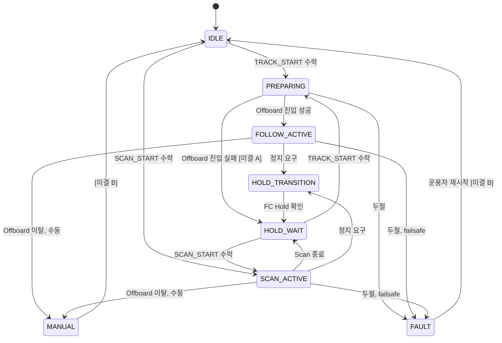
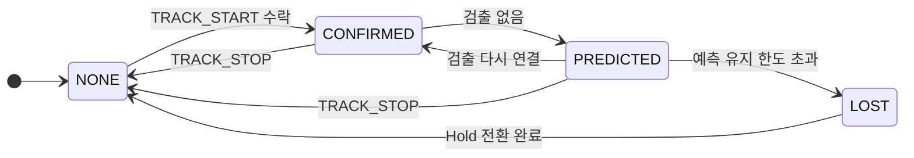

# State Machine Diagram — 임무 상태와 표적 상태의 transition

| 항목 | 내용 |
|---|---|
| 참조 문서 | `common/mavlink/message_definitions/argus.xml` (`ARGUS_MISSION_STATE`, `ARGUS_TARGET_STATE`), `docs/spec/icd.md` 4장 (명령), 6장 (두절), `docs/spec/process_interfaces.md` 6장 |
| 주체 | 두 상태 모두 추종 제어가 정하고 `follow/status` 로 onboard 에 주며, onboard 가 `ARGUS_STATUS` 로 통제기에 그대로 옮긴다 (`icd.md` 3.1) |
| 표기 | transition 라벨은 UML `event [guard] / effect`. 그림에는 event 만, guard·effect·출처는 표에. 규약에 event 가 없는 transition 은 `[미결]` |

## 1. `ARGUS_MISSION_STATE`

| 상태 | 뜻 (`argus.xml`) | FC 모드 |
|---|---|---|
| IDLE | 추종·Scan 없음. 표적 선택 대기 | 임의 |
| PREPARING | TRACK_START 수락 뒤 Offboard 진입·확인 중 | → Offboard |
| FOLLOW_ACTIVE | 추종 중, setpoint 20 Hz | Offboard |
| HOLD_TRANSITION | 추종·Scan 을 끝내고 Hold 로 전환 중 | → Hold |
| HOLD_WAIT | FC 가 Hold 인 것을 확인하고 대기. 자동으로 추종을 재개하지 않는다 | Hold |
| SCAN_ACTIVE | yaw 스캔 중 | Hold 또는 Offboard [미결 E3, `icd.md`] |
| MANUAL | 조종사(RC) 또는 통제기가 모드를 바꿔 추종이 끝남 | 조종사·통제기가 정한 모드 |
| FAULT | FC 두절, 추종 제어 두절 등 고장으로 멈춤 | FC failsafe 에 따름 |

transition 의 event [guard] / effect:

| transition | event | guard | effect | 출처 |
|---|---|---|---|---|
| IDLE·HOLD_WAIT → PREPARING | TRACK_START 수신 | `icd.md` 4.2 조건 ①~⑤ 충족 | ACK IN_PROGRESS | `icd.md` 4.2 |
| PREPARING → FOLLOW_ACTIVE | Offboard 진입 성공 | — | ACK ACCEPTED | `icd.md` 4.2 Sequence Diagram |
| PREPARING → HOLD_WAIT | Offboard 진입 실패 | — | ACK FAILED. 도착 상태는 **[미결 A]** | `icd.md` 4.2 |
| IDLE·HOLD_WAIT → SCAN_ACTIVE | SCAN_START 수신 | 조건 충족, FC Hold | ACK IN_PROGRESS | `icd.md` 4.2 |
| SCAN_ACTIVE → HOLD_WAIT | yaw 회전량 도달, timeout, 추적 후보 발견 | — | 정지, ACK ACCEPTED | `icd.md` 4.2 |
| FOLLOW_ACTIVE → HOLD_TRANSITION | TRACK_STOP 수신, 통제기 HEARTBEAT 3 s 없음, target_state → LOST | — | Hold 요청 | `icd.md` 4.2, 6.1, 아키텍처 문서 2.7·2.11 |
| SCAN_ACTIVE → HOLD_TRANSITION | TRACK_STOP 수신, 통제기 HEARTBEAT 3 s 없음 | — | Hold 요청 | `icd.md` 4.2, 6.1 |
| HOLD_TRANSITION → HOLD_WAIT | FC Hold 확인 | — | ACK ACCEPTED | `icd.md` 4.2 Sequence Diagram |
| FOLLOW_ACTIVE·SCAN_ACTIVE → MANUAL | Offboard 이탈 | 원인이 조종사 RC 또는 통제기 모드 변경 | — | `icd.md` 4.3, 아키텍처 문서 2.11·2.20 |
| PREPARING·FOLLOW_ACTIVE·SCAN_ACTIVE → FAULT | FC telemetry 2 s 없음, `follow/status` 3 s 없음, setpoint 유효 시간 초과, Offboard 이탈 | Offboard 이탈은 원인이 failsafe 일 때 (PREPARING 제외) | 속도 0, Hold 요청 | `icd.md` 6.2, 6.4, 4.3, `process_interfaces.md` 6장 |
| MANUAL → IDLE | 규약에 없음 **[미결 B]** | — | — | `argus.xml` |
| FAULT → IDLE | 운용자 재시작 (규약에 없음 **[미결 B]**) | 복구 뒤 | — | `argus.xml` |

## 2. `ARGUS_TARGET_STATE`

| transition | event | guard | effect | 출처 |
|---|---|---|---|---|
| NONE → CONFIRMED | TRACK_START 수락 | 표적이 최신 검출과 연결됨 | — | `icd.md` 4.2 |
| CONFIRMED → PREDICTED | 검출 없음 | — | 예측으로 유지 | `argus.xml` |
| PREDICTED → CONFIRMED | 검출이 다시 연결됨 | — | — | `argus.xml` |
| PREDICTED → LOST | 예측 유지 한도 초과 | 한도는 `system_architecture.md` 2.7, 값은 `icd.md` 미결 E4 | 추종 제어가 Hold 요청 | `argus.xml`, `icd.md` 부록 B |
| CONFIRMED·PREDICTED → NONE | TRACK_STOP 수신 | — | Hold 전환 완료 뒤 | `icd.md` 4.2 Sequence Diagram |
| LOST → NONE | Hold 전환 완료 | — | — | `argus.xml` |

- LOST 가 되면 추종 제어가 Hold 로 전환한다. 그래서 `mission_state` 의 FOLLOW_ACTIVE → HOLD_TRANSITION 조건에 target_state LOST 가 들어간다.

## 3. 검토 필요 사항

- **[미결 A]** PREPARING 에서 Offboard 진입에 실패하면(ACK FAILED) 어느 상태로 가는지 규약에 없다. HOLD_WAIT 로 가정해 그렸다. 진입 전이라 FC 는 이전 모드 그대로일 수 있으므로 IDLE 일 수도 있다. → `icd.md` 4.2 에 명시 필요.
- **[미결 B]** MANUAL·FAULT → IDLE transition 의 event 가 규약에 없다. `argus.xml` 은 "복구 뒤 운용자가 다시 시작" 이라고만 한다. TRACK_STOP 수신, 또는 FC 연결·`follow/status` 회복과 FC Hold 확인 중 무엇으로 할지 정해야 한다. → `icd.md` 부록 B 와 `follow/status` 규약에 명시 필요.
- `follow/status` 의 `target_phase` 는 이 두 상태와 별개 필드다 (`process_interfaces.md` 5.1.2). 값이 확정되면 이 문서에 추가한다.

## 변경 이력

| 버전 | 날짜 | 내용 |
|---|---|---|
| 0.1 | 2026-10-16 | 초안 (#31) |
