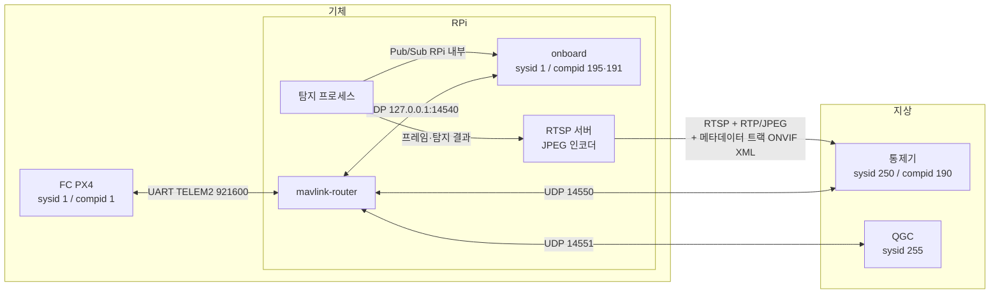
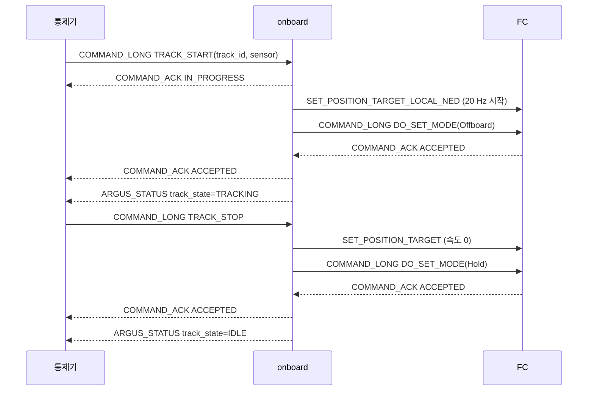

# ICD — 통신 규약 (Interface Control Document)

| 항목 | 내용 |
|---|---|
| 문서 버전 | 0.1 (팀 검토 전 초안) |
| 패킷 형식 | `common/mavlink/message_definitions/argus.xml` (argus dialect) + 표준 `common.xml` |
| 대상 독자 | 추종 제어 담당(onboard control), 탐지 담당(onboard vision), 통제기 담당(gcs) |
| 상태 표기 | 값 뒤의 **[미결 n]** 은 7장의 검토 항목 번호 |

## 0. 범위

이 문서가 정하는 것
- 통신에 참여하는 노드와 그 식별자, 노드 사이의 링크와 포트
- 어떤 메시지를 누가 누구에게 어떤 주기로 보내는지
- 명령의 조건, 절차, 응답
- 제어권 규칙과 통신 두절 판단·동작

이 문서가 정하지 않는 것
- 메시지·필드의 바이트 형식과 값의 의미 → `argus.xml` 과 생성 헤더
- 추종 제어 알고리즘과 onboard 상태 전이 → `docs/design/system_architecture.md`
- 탐지 모델
- 영상 전송 규약 → `docs/video.md` (#20)
- RPi 안 탐지 프로세스 → onboard 전달(Pub/Sub) → `docs/design/system_architecture.md`
- FC(PX4) 파라미터 값 → 배포 문서

## 1. 구성과 전송

### 1.1 노드와 식별자

| 노드 | 실행 위치 | MAVLink sysid | compid | 역할 |
|---|---|---|---|---|
| FC | 기체 비행 제어기 (PX4 v1.16) | 1 | 1 (MAV_COMP_ID_AUTOPILOT1) | 비행 제어, 텔레메트리 |
| onboard: 명령·setpoint (MAVSDK) | RPi, 추종 프로그램 | 1 | 195 (MAV_COMP_ID_PATHPLANNER, MAVSDK 보조 컴퓨터 기본값) | 통제기 명령 처리, ARGUS_* 송신, FC 로 setpoint·모드 요청 |
| onboard: FC 관측·TIMESYNC (FC_RX) | RPi, 추종 프로그램 | 1 | 191 (MAV_COMP_ID_ONBOARD_COMPUTER) | FC 텔레메트리 수신, TIMESYNC 요청. 명령·setpoint 는 보내지 않는다 |
| 탐지 프로세스 | RPi, 별도 프로세스 | MAVLink 노드 아님 | — | 카메라 프레임 추론, 결과를 RPi 내부 Pub/Sub 으로 onboard 와 RTSP 송신부에 전달 |
| 통제기 | 운용자 노트북 (gcs) | 250 | 190 (MAV_COMP_ID_MISSIONPLANNER) | 감시, 명령, 가상 조종 |
| QGC | 운용자 노트북 (선택) | 255 | 190 | PX4 파라미터·보정 전용. 비행 명령은 보내지 않는다 |

- 기체 안의 FC 와 onboard 는 같은 sysid 1 을 쓰고 compid 로 구분한다 (MAVLink 관례: 한 기체 = 한 sysid).
- 통제기 sysid 250 은 제어권을 가진 유일한 통제기다 (5장).
- onboard 는 한 프로그램이지만 MAVLink 식별자를 둘 쓴다. TIMESYNC 응답을 자기 요청과 맞추려면 보낸 쪽 compid 가 MAVSDK 와 달라야 한다 (`docs/design/system_architecture.md` 1.8·1.9). 통제기가 onboard 에 보내는 명령은 `target_component = 195`.

### 1.2 링크



| 링크 | 전송 | 주소·포트 | 내용 |
|---|---|---|---|
| FC ↔ RPi | UART (PX4 TELEM2), 921600 bps | `/dev/ttyAMA0` | 모든 MAVLink 트래픽. RPi 쪽은 mavlink-router 만 연다 |
| RPi 라우터 ↔ onboard | UDP, RPi 안 | `127.0.0.1:14540` | onboard 가 FC·통제기와 주고받는 모든 메시지 |
| RPi 라우터 ↔ 통제기 | UDP, Wi-Fi | RPi `:14550` (서버) | 통제기가 먼저 보내면 라우터가 그 주소로 응답 |
| RPi 라우터 ↔ QGC | UDP, Wi-Fi | RPi `:14551` | QGC 전용. 라우터가 QGC 의 명령을 FC 로 보내지 않도록 필터 |
| 탐지 프로세스 → RTSP 서버 | RPi 안 | `docs/video.md` | 카메라 프레임과 프레임별 탐지 결과 |
| RTSP 서버 → 통제기 | RTSP 요청 + RTP/UDP, Wi-Fi | `docs/video.md` | JPEG 영상 트랙 + ONVIF XML 메타데이터 트랙. 프레임 대응은 `docs/video.md` |

- mavlink-router 가 FC 의 UART 를 혼자 차지하고, 받은 패킷을 다른 모든 엔드포인트로 중계한다. 그래서 onboard 와 통제기는 서로의 메시지도 받는다 (sysid·compid 로 걸러 쓴다).
- 프로토콜은 **MAVLink 2** 만 쓴다. 메시지 id 45000 번대는 MAVLink 1 로 보낼 수 없다. 서명(signing)은 쓰지 않는다 [미결 D1].

## 2. 표준 메시지 사용 목록

| 메시지 (id) | 송신 → 수신 | 주기 | 용도 |
|---|---|---|---|
| HEARTBEAT (0) | 모든 MAVLink 노드 → 전체 | 1 Hz | 생존·비행 모드·armed 상태. 통제기는 `custom_mode` 로 PX4 모드를 해석한다 (부록 A) |
| SYS_STATUS (1) | FC → 전체 | 1 Hz | 센서 상태, 배터리 |
| GPS_RAW_INT (24) | FC → 전체 | 1 Hz | 위성 수, fix 종류 |
| ATTITUDE (30) | FC → 전체 | 10 Hz | 자세 |
| GLOBAL_POSITION_INT (33) | FC → 전체 | 5 Hz | 위치·고도·속도 |
| VFR_HUD (74) | FC → 전체 | 5 Hz | 대기속도, 고도, 상승률, 방위 |
| BATTERY_STATUS (147) | FC → 전체 | 1 Hz | 전압·잔량 |
| STATUSTEXT (253) | FC, onboard → 전체 | 이벤트 | 사람이 읽는 상태 문구. onboard 는 추종 상태 변화·거부 이유를 보낸다 |
| COMMAND_LONG (76) | 통제기 → FC 또는 onboard | 이벤트 | 명령 (4장). `target_component` 로 FC(1)·onboard(195) 구분 |
| COMMAND_ACK (77) | FC, onboard → 통제기 | 응답 | 명령 결과 (4장) |
| SET_POSITION_TARGET_LOCAL_NED (84) | onboard → FC | 20 Hz | Offboard 속도 setpoint. 추종 중에만 보낸다 |
| MANUAL_CONTROL (69) | 통제기 → FC | 20 Hz | 가상 조종 (조이스틱 대체). 켜져 있는 동안만 |
| VIDEO_STREAM_INFORMATION (269) | RPi → 통제기 (송신 컴포넌트는 `docs/video.md`) | 요청 시 (MAV_CMD_REQUEST_MESSAGE) | RTSP 주소, 해상도, fps 알림. `type` = `VIDEO_STREAM_TYPE_RTSP`(0), `encoding` = `VIDEO_STREAM_ENCODING_UNKNOWN`(0) (MAVLink 에 JPEG 값이 없음. 코덱은 RTSP 의 SDP 로 알림) |
| PARAM_* , MISSION_* | QGC ↔ FC | — | QGC 전용. 통제기·onboard 는 쓰지 않는다 |

- FC 텔레메트리 주기는 PX4 가 TELEM2 스트림 설정으로 정한다. 통제기는 위 주기를 **기대값**으로 쓰고, 두 배 이상 늦으면 "지연" 으로 표시한다.
- PX4 는 Offboard 진입 전부터 setpoint 가 2 Hz 이상 와야 Offboard 에 들어가고 유지한다. setpoint 가 끊긴 뒤 `COM_OF_LOSS_T` (기체 FC 1.0 s, PX4 v1.16 기본값과 같음, 2026-10-06 FC 에서 읽음)가 지나면 `COM_OBL_RC_ACT` 동작으로 Offboard 를 빠져나간다. onboard 는 추종 중 20 Hz 를 유지한다.
- `COM_OBL_RC_ACT` 는 5(Hold)로 설정한다. 2026-10-06 FC 에서 읽은 값은 0(Position)이었으므로 기체 FC 에 적용됐는지 확인이 필요하다 [미결 D4].

## 3. argus dialect

### 3.1 송수신 규칙

| 메시지 (id) | 송신 → 수신 | 주기 | 수신자가 하는 일 |
|---|---|---|---|
| ARGUS_STATUS (45000) | onboard → 통제기 | 1 Hz, 그리고 `track_state`·`health`·`active_sensor` 가 바뀌면 즉시 1회 | 통제기: 추종 상태·연결 상태 표시. 6.1 의 두절 판단에 사용 |
| ARGUS_DETECTION (45001) | onboard → 통제기 [미결 B6] | 센서마다 추론 프레임마다 (최대 15 Hz [미결 B1]) | 통제기: 바운딩 박스 표시 [미결 B6] |
| ARGUS_SENSOR_STATUS (45002) | onboard → 통제기 | 센서마다 1 Hz, `flags` 가 바뀌면 즉시 1회 | 통제기: 센서별 상태 표시, FOLLOWABLE 로 표적 선택 가능 여부 결정 |

- `ARGUS_DETECTION` 의 역할은 다시 정한다: 프레임별 탐지 결과는 RPi 내부 Pub/Sub(탐지 프로세스 → onboard)과 영상 메타데이터 트랙(→ 통제기, `docs/video.md`)으로 전달하므로, 메시지를 삭제하거나 추종 표적 정보만 남긴다 (#21). 아래 `ARGUS_DETECTION` 내용과 3.2·3.3 은 그 결정 전까지의 값이다 [미결 B6].
- onboard 는 탐지 프로세스에서 받은 `ARGUS_DETECTION` 을 **그대로** 통제기에 중계한다 (필드를 바꾸지 않는다). 통제기용 전송률 제한은 두지 않는다 [미결 B1].
- 객체가 없는 프레임도 `count = 0` 으로 보낸다. 통제기는 이것으로 "탐지는 살아 있고 객체만 없음" 을 구분한다.
- `time_usec` 는 그 프레임의 촬영 시각(노출 시각), RPi `CLOCK_MONOTONIC` 기준이다. 탐지 프로세스가 받은 시각이 아니다.
- `frame_id` 는 센서별 프레임 순번이다. 카메라에서 받은 프레임마다 1 씩 증가하며 추론을 건너뛴 프레임도 센다.
- 통제기가 영상 위에 그리는 바운딩 박스는 영상 메타데이터 트랙의 값을 쓴다 (`docs/video.md`).

### 3.2 좌표 규약

```text
(0,0) ─────────────── x ──▶ img_w
  │   ┌──────────┐
  │   │ box      │ box_x, box_y: 왼쪽 위 (px)
  y   │    ●     │ box_w, box_h: 너비·높이 (px)
  │   └──────────┘
  ▼
img_h

err_x = (표적 중심 x - img_w/2) / (img_w/2)   → 왼쪽 끝 -1, 중심 0, 오른쪽 끝 +1
err_y = (표적 중심 y - img_h/2) / (img_h/2)   → 위쪽 끝 -1, 중심 0, 아래쪽 끝 +1
```

- 모든 좌표는 **추론 입력 영상**(`img_w × img_h`) 기준이다. 카메라 원본과 크기가 다르면 탐지 프로세스가 변환해서 보낸다.
- `err_x`·`err_y` 는 추종 중인 표적(`target_id`)에 대해서만 값이 있고, 그 프레임에 표적이 없으면 NaN 이다. 제어는 이 두 값만 쓰고 픽셀 좌표는 쓰지 않는다 [미결 A2].

### 3.3 class_id 표

`ARGUS_DETECTION.class_id` 의 의미는 (센서, `model_ver`) 로 정해진다. 탐지 담당이 모델을 낼 때 이 표를 갱신한다.

| 센서 | model_ver | class_id | 이름 | 비고 |
|---|---|---|---|---|
| IR | 1 | — | — | 탐지 담당이 채운다 [미결 B5] |
| 공통 | — | 255 | 미정의 | 표에 없는 클래스 |

통제기는 표에 없는 (센서, model_ver) 를 받으면 `class_id` 숫자를 그대로 표시한다.

## 4. 명령과 응답

### 4.1 공통 규칙

- 명령은 `COMMAND_LONG` 으로 보내고, 수신자는 `COMMAND_ACK` 로 답한다. `target_system = 1`, `target_component` 는 FC 가 1, onboard 가 195.
- 통제기는 ACK 가 **1 초** 안에 오지 않으면 같은 명령을 다시 보내고, 3 회 뒤에도 없으면 "응답 없음" 으로 표시한다. `confirmation` 필드를 재전송 횟수로 올린다.
- `COMMAND_ACK.result` 의 뜻: ACCEPTED 실행함 / IN_PROGRESS 진행 중(뒤에 최종 결과가 한 번 더 온다) / DENIED 조건 불충족(재시도해도 같음) / TEMPORARILY_REJECTED 지금은 안 됨(나중에 가능) / FAILED 시도했으나 실패 / UNSUPPORTED 모르는 명령.
- onboard 는 DENIED·FAILED 때 이유를 `STATUSTEXT` 로 같이 보낸다.

### 4.2 추종 명령 (onboard 가 받는다)

| 명령 | param | 조건 | 결과 |
|---|---|---|---|
| MAV_CMD_ARGUS_TRACK_START (45000) | p1 track_id (1 이상, 운용자가 고른 객체), p2 sensor | ① 보낸 sysid 가 제어권 통제기(250) ② FC armed 이고 비행 중 ③ p2 센서의 FOLLOWABLE = 1 ④ p1 이 onboard 가 받은 p2 센서의 최신 탐지 결과에 있음 (0 이면 DENIED. 최신의 기준 시간은 아키텍처 문서 2.3) ⑤ 추종 중이 아님 | 조건 불충족 → DENIED. 충족 → IN_PROGRESS 를 먼저 보내고 Offboard 진입 성공 시 ACCEPTED, 실패 시 FAILED |
| MAV_CMD_ARGUS_TRACK_STOP (45001) | 없음 | 보낸 sysid 가 제어권 통제기 | 추종 중이면 추종을 끝내고 Hold 로 바꾼 뒤 ACCEPTED. 추종 중이 아니어도 ACCEPTED |



- 추종 중에 받은 TRACK_START 는 DENIED 다. 표적을 바꾸려면 TRACK_STOP(Hold) 뒤 다시 선택한다 (아키텍처 문서 2.14).
- 추종 중 표적을 잃었을 때의 onboard 동작(상태 전환 시간, Hold 전환)은 `docs/design/system_architecture.md` 2.7·2.11 을 따른다. 통제기는 `ARGUS_STATUS.track_state` 로만 본다 [미결 E1].

### 4.3 비행 명령 (FC 가 받는다, 통제기 → FC 직접)

| 명령 | 비고 |
|---|---|
| MAV_CMD_COMPONENT_ARM_DISARM (400) | p1 1 시동 / 0 시동 끔. 통제기는 Position 모드에서 위치 추정이 없으면 보내지 않는다 (GPS 없는 실내) |
| MAV_CMD_NAV_TAKEOFF (22) | p7 고도. PX4 Takeoff 모드 |
| MAV_CMD_NAV_LAND (21) | |
| MAV_CMD_NAV_RETURN_TO_LAUNCH (20) | |
| MAV_CMD_DO_SET_MODE (176) | PX4 모드 변경 (부록 A 의 번호). Hold, Position, Altitude, Stabilized |

- 이 명령들은 onboard 를 거치지 않는다. onboard 는 추종 중에 모드가 Offboard 에서 벗어난 것을 HEARTBEAT 로 알아채면 추종을 `RELEASING` → `IDLE` 로 끝낸다.
- 추종 중(onboard 가 Offboard 유지)에 통제기가 모드를 바꾸면 추종이 끝난다. 통제기는 그 전에 확인 창을 띄운다.

## 5. 제어권과 송신 규칙

- **제어권**은 sysid 250 통제기 하나가 가진다. onboard 는 다른 sysid 가 보낸 TRACK_START/STOP 을 DENIED 로 거부하고 `ARGUS_STATUS.control_sysid` 에 250 을 넣는다.
- 통제기 두 대가 동시에 붙는 경우는 지원하지 않는다 [미결 D2].
- onboard 는 통제기의 HEARTBEAT 를 받아 `ARGUS_HEALTH_GCS_LINK` 를 유지한다 (6.1).
- 모든 송신자는 MAVLink 2 의 `seq` 를 1 씩 올린다. 수신자는 송신자(sysid, compid)별 `seq` 빈칸으로 손실률을 센다. 라우터 때문에 "자기에게 오지 않는 메시지" 도 빈칸으로 보이므로, 링크 품질은 HEARTBEAT 수신률(1 Hz 기대)로 판단한다.

## 6. 통신 두절 판단과 동작

| 구간 | 판단 기준 | 두절 시 동작 |
|---|---|---|
| 6.1 통제기 → onboard | 통제기 HEARTBEAT 가 **3 초** 없음 | `ARGUS_HEALTH_GCS_LINK = 0`. 추종 중이면 TRACK_STOP 과 같은 절차로 Hold. 다시 받으면 플래그만 복구(추종은 자동 재개하지 않음) |
| 6.2 onboard → FC | FC 텔레메트리(HEARTBEAT 포함)가 **2 초** 없음 | `ARGUS_HEALTH_FC_CONNECTED = 0`. 추종 중이면 setpoint 송신 중단(FC 가 Offboard failsafe 로 Hold) |
| 6.3 탐지 → onboard | 추종 중인 센서의 탐지 결과(RPi 내부 Pub/Sub)가 끊김. 판단 시간은 아키텍처 문서 2.7(TTL) | onboard 동작은 아키텍처 문서 2.7·2.11. 통제기는 `track_state` 변화로 표시. 센서 상태 `CAMERA_OK`·`INFERENCE_OK` 는 탐지 프로세스 보고대로 |
| 6.4 FC 자체 failsafe | RC 두절, 데이터링크 두절, 배터리 | PX4 파라미터(배포 문서). 통제기는 HEARTBEAT 모드 변화와 STATUSTEXT 로 표시만 한다 |

- 통제기 화면의 "연결 끊김" 표시: FC HEARTBEAT 3 초 없음 (통제기 기준). onboard 의 6.1 과 독립이다.
- 두절 시간 값은 Wi-Fi 끊김 길이 측정 뒤 조정한다 [미결 D3].

## 7. 검토 필요 사항

| 번호 | 항목 | 선택지 / 현재 값 | 담당 |
|---|---|---|---|
| A1 | 카메라 화각·장착각 | 측정 중. 값이 나오면 제어가 err → 각도 변환에 사용 | 통제기·제어 |
| A2 | 오차 단위 | 현재 정규화 좌표(-1~+1). EO 도입 시 각도(rad)로 바꿀지 | 제어 |
| A3 | 추종 속도·거리 제한 | 최대 속도, 접근 거리. 제어 설계값 | 제어 |
| A4 | 거리 추정 방식 | 바운딩 박스 크기 vs 센서 융합 | 제어·탐지 |
| B1 | 탐지 결과 상한 | 프레임당 객체 10 개, 15 Hz 가 충분한지 (MAVLink 2 본문 178 바이트) | 탐지 |
| B2 | 시각 기준 | `time_usec` 는 촬영 시각(RPi `CLOCK_MONOTONIC`)으로 정함. 남은 것: RPi 시계와 FC 시계(`time_boot_ms`)의 차이를 `TIMESYNC` 로 구해 촬영 순간의 FC 자세(`ATTITUDE`)를 찾는 방법과, `TIMESYNC` 를 주고받는 주체(아키텍처 문서 1.9) | 제어·탐지 |
| B3 | 센서 상태 항목 | flags 4 개 외에 필요한 것 (온도, 프레임 드롭) | 탐지 |
| B4 | EO 카메라 역할 | 탐지만 / 탐지+추적 / 탐지+추적+추종 (장착 후 결정) | 전체 |
| B5 | class_id 표 | IR 모델 v1 클래스 목록 | 탐지 |
| B6 | ARGUS_DETECTION 역할 | 삭제 vs 추종 표적 정보만 남김 (#21). 결정 뒤 3.1·3.2·3.3 수정 | 통제기·제어·탐지 |
| C | 영상 전송 | RTSP + RTP/JPEG + ONVIF XML 메타데이터 트랙으로 정함. 세부(RTSP 서버, 통제기 수신, 포트, 시각 변환)는 `docs/video.md` (#20) | 통제기·탐지 |
| D1 | MAVLink 서명 | 미사용 유지 vs 통제기-RPi 구간 서명 | 통제기 |
| D2 | 통제기 두 대 | 예비 통제기 인계 절차 | 통제기 |
| D3 | 두절 시간 | 6 장 값(3 s / 2 s) 현장 측정 뒤 확정 | 전체 |
| D4 | Offboard 끊김 동작 | `COM_OBL_RC_ACT` = 5(Hold) 가 기체 FC 에 적용됐는지 확인 | 통제기 |
| E1 | 추종 상태 값 | `ARGUS_TRACK_STATE` 를 아키텍처 문서의 상태 모델(pending, priming, Confirmed·Predicted·Lost, Hold 대기, Scan)에 맞추기. 통제기가 구분할 상태 목록 대기 | 제어·통제기 |

## 부록 A. PX4 비행 모드 해석 (`HEARTBEAT.custom_mode`)

PX4 는 `custom_mode` 32 비트 안에 주 모드와 부 모드를 넣는다: `main_mode = (custom_mode >> 16) & 0xFF`, `sub_mode = (custom_mode >> 24) & 0xFF`. `MAV_CMD_DO_SET_MODE` 는 p1 = `base_mode`(MAV_MODE_FLAG_CUSTOM_MODE_ENABLED = 1), p2 = main_mode, p3 = sub_mode 로 보낸다.

| main_mode | 이름 | sub_mode (AUTO 일 때) | 이름 |
|---|---|---|---|
| 1 | Manual | 1 | Ready |
| 2 | Altitude | 2 | Takeoff |
| 3 | Position | 3 | Hold (Loiter) |
| 4 | Auto | 4 | Mission |
| 5 | Acro | 5 | Return (RTL) |
| 6 | Offboard | 6 | Land |
| 7 | Stabilized | 8 | Follow Target |
| | | 9 | Precision Land |

통제기 화면 이름: Manual, Stabilized, Altitude, Position, Offboard, Hold, Return, Land, Takeoff, Mission.

## 변경 이력

| 버전 | 날짜 | 내용 |
|---|---|---|
| 0.1 | 2026-10-13 | 팀 검토 전 초안. 통신 참여 프로그램과 연결 구간, 메시지 주기, 추종 명령 절차, 두절 판단, 미결 항목 A1~E1 |
