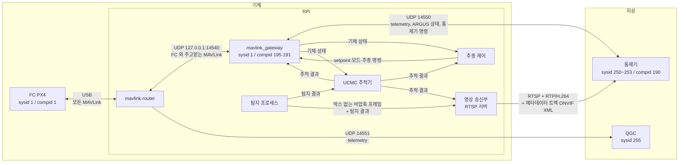
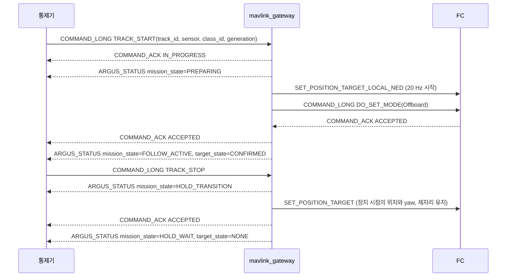

# ICD — 통신 규약 (Interface Control Document)

| 항목 | 내용 |
|---|---|
| 문서 버전 | 0.7 (팀 검토 전 초안) |
| 패킷 형식 | `common/mavlink/message_definitions/argus.xml` (argus dialect) + 표준 `common.xml` |
| 대상 독자 | 추적·추종 담당(onboard control), 탐지 담당(onboard vision), 통제기 담당(gcs) |
| 상태 표기 | 값 뒤의 **[미결 n]** 은 7장의 검토 항목 번호 |

## 0. 범위

이 문서가 정하는 것
- 통신에 참여하는 노드와 그 식별자, 노드 사이의 링크와 포트
- 어떤 메시지를 누가 누구에게 어떤 주기로 보내는지
- 명령의 조건, 절차, 응답
- 제어권 규칙과 통신 두절 판단·동작

이 문서가 정하지 않는 것
- 메시지·필드의 바이트 형식과 값의 의미 → `argus.xml` 과 생성 헤더
- 추종 제어 알고리즘과, 임무 상태(`mission_state`)·표적 상태(`target_state`)가 바뀌는 조건과 순서 → `docs/design/system_architecture.md`
- 탐지 모델
- 영상 전송 규약, 영상 메타데이터의 박스·클래스 형식 → `docs/spec/video.md` (#20)
- RPi 안 프로세스 사이 통신(ZeroMQ 토픽, REQ/REP) → `docs/spec/process_interfaces.md`
- FC(PX4) 파라미터 값 → 배포 문서

## 1. 구성과 전송

### 1.1 노드와 식별자

| 노드 | 실행 위치 | MAVLink sysid | compid | 역할 |
|---|---|---|---|---|
| FC | 기체 비행 제어기 (PX4 v1.16) | 1 | 1 (MAV_COMP_ID_AUTOPILOT1) | 비행 제어, telemetry |
| mavlink_gateway: 명령, setpoint (compid 195) | RPi, mavlink_gateway 프로세스 | 1 | 195 (MAV_COMP_ID_PATHPLANNER) | 통제기 명령 처리, ARGUS_* 송신, FC 로 setpoint, 모드 요청. MAVLink 는 생성 C 헤더를 직접 사용하며 MAVSDK 는 사용하지 않는다 |
| mavlink_gateway: FC 관측·TIMESYNC (FC_RX) | RPi, mavlink_gateway 프로세스 | 1 | 191 (MAV_COMP_ID_ONBOARD_COMPUTER) | telemetry 수신, TIMESYNC 요청. 명령·setpoint 는 보내지 않는다 |
| 탐지 프로세스 | RPi, 별도 프로세스 | MAVLink 노드 아님 | — | 카메라 프레임 추론. 탐지 결과를 추적기와 영상 송신부에 발행 |
| UCMC 추적기 | RPi, 별도 프로세스 | MAVLink 노드 아님 | — | 탐지 결과에 track_id 부여, 추적 결과(`tracking/tracks`) 발행. FC 자세·위치는 mavlink_gateway 에서 받는다 |
| 추종 제어 | RPi, 별도 프로세스 | MAVLink 노드 아님 | — | 추종·스캔 판단, 속도 setpoint 계산. FC 로 보내는 것은 모두 mavlink_gateway 를 거친다 |
| 영상 송신부 | RPi, 별도 프로세스 | MAVLink 노드 아님 | — | RTSP 영상·메타데이터 송신 (`docs/spec/video.md`) |
| 통제기 | 운용자 노트북 (gcs) | 250~253 (통제기마다 다르게) | 190 (MAV_COMP_ID_MISSIONPLANNER) | 감시, 명령, 가상 조종 |
| QGC | 운용자 노트북 (선택) | 255 | 190 | PX4 파라미터·보정 전용. 비행 명령은 보내지 않는다 |

- 기체 안의 FC 와 mavlink_gateway 는 같은 sysid 1 을 쓰고 compid 로 구분한다 (MAVLink 관례: 한 기체 = 한 sysid).
- 통제기는 sysid 250~253 중 하나를 사용하고, 통제기마다 다른 값을 설정한다 (MAVLink: system id 는 네트워크 안에서 유일해야 한다). 겹치지 않게 설정하는 것은 운용 조건이며, 겹치면 mavlink_gateway 가 경고한다 (5.1). 제어권은 이 가운데 한 대가 가진다 (5장).
- **FC 와 MAVLink 로 통신하는 RPi 프로세스는 mavlink_gateway 하나이다.** 추적기·추종 제어·영상 송신부는 FC 와 직접 통신하지 않고, FC 데이터는 mavlink_gateway 가 RPi 내부 토픽으로 넘겨준다 (`docs/spec/process_interfaces.md`).
- mavlink_gateway 는 한 프로세스지만 MAVLink 식별자를 둘 쓴다. TIMESYNC 응답을 자기 요청과 맞추려면 보낸 쪽 compid 가 MAVSDK 와 달라야 한다 (`docs/design/system_architecture.md` 1.8·1.9). 통제기가 mavlink_gateway 에 보내는 명령은 `target_component = 195`.

### 1.2 링크

| 링크 | 전송 | 주소·포트 | 내용 |
|---|---|---|---|
| FC ↔ RPi | USB (CDC-ACM) | `/dev/ttyACM0` | 모든 MAVLink 트래픽. RPi 쪽은 mavlink-router 만 연다 |
| RPi 라우터 ↔ mavlink_gateway | UDP, RPi 안 | `127.0.0.1:14540` | mavlink_gateway 가 FC 와 주고받는 모든 메시지. 통제기의 메시지 중 5.2 의 조건을 통과한 것도 이 경로로 FC 에 보낸다 |
| mavlink_gateway ↔ 통제기 | UDP, Wi-Fi | RPi `:14550` (mavlink_gateway 가 연다) | 통제기가 먼저 보내면 mavlink_gateway 가 그 주소로 응답한다. 통제기 여러 대가 접속할 수 있다. FC 의 telemetry 와 `ARGUS_STATUS` 는 접속한 모든 통제기에 같게 보내고, COMMAND_ACK 와 STATUSTEXT 응답은 명령을 보낸 통제기에만 보낸다 (5.1) |
| RPi 라우터 ↔ QGC | UDP, Wi-Fi | RPi `:14551` | QGC 전용. 비행 중에는 라우터가 QGC(sysid 255)가 보낸 패킷을 모두 폐기하므로 QGC 는 telemetry 만 수신한다. 파라미터, 보정은 정비 절차(`onboard/config/mavlink-router/README.md`)로 |
| mavlink_gateway ↔ 추적기·추종 제어, 탐지 → 추적기·영상 송신부 | ZeroMQ, RPi 안 | `docs/spec/process_interfaces.md` | 기체 상태, 탐지·추적 결과, 추종 명령·setpoint·모드 요청 |
| 영상 송신부 → 통제기 | RTSP 요청 + RTP/UDP, Wi-Fi | `docs/spec/video.md` | H.264 영상 트랙(박스 없는 비압축 프레임을 영상 송신부가 인코딩) + ONVIF XML 메타데이터 트랙(`tracking/tracks` 의 추적 박스). 통제기가 메타데이터로 박스를 그린다. 동기화 방법은 `docs/spec/video.md` 4장 |

- mavlink-router 가 FC 의 USB 장치를 혼자 차지하고, 받은 패킷을 다른 모든 엔드포인트로 중계한다. 통제기는 라우터에 연결하지 않는다. mavlink_gateway 가 라우터에서 받은 FC 의 telemetry 를 통제기에 전달하고, 통제기의 메시지는 5.2 의 조건을 확인한 뒤 FC 로 전달한다.
- mavlink-router 설정 파일은 `onboard/config/mavlink-router/main.conf`(비행)와 `config.d/qgc-maintenance.conf`(정비 때만 설치)다. 시동, 이륙, 모드 변경, 보정 명령이 모두 `COMMAND_LONG` 한 메시지로 가므로 라우터는 메시지 id 로 비행 명령만 골라 차단할 수 없고, 보낸 쪽 sysid 로 QGC 의 입력을 모두 차단한다. 통제기(sysid 250~253)의 메시지는 라우터를 거치지 않고 mavlink_gateway 가 받아 제어권과 5.2 의 조건으로 검사한다.
- 프로토콜은 **MAVLink 2** 만 쓴다. 메시지 id 45000 번대는 MAVLink 1 로 보낼 수 없다. 서명(signing)은 쓰지 않는다 [미결 D1].

## 2. 표준 메시지 사용 목록

| 메시지 (id) | 송신 → 수신 | 주기 | 용도 |
|---|---|---|---|
| HEARTBEAT (0) | 모든 MAVLink 노드 → 전체 | 1 Hz | 생존·비행 모드·armed 상태. 통제기는 `custom_mode` 로 PX4 모드를 해석한다 (부록 A) |
| SYS_STATUS (1) | FC → 전체 | 1 Hz | 센서 상태, 배터리 |
| GPS_RAW_INT (24) | FC → 전체 | 1 Hz | 위성 수, fix 종류 |
| ATTITUDE (30) | FC → 전체 | **30 Hz 이상** | 자세. mavlink_gateway 가 ATTITUDE 메시지마다 수신 시각을 붙여 추적기·추종 제어에 넘긴다. 2026-10-15 기체 실측 약 100 Hz 수신 |
| LOCAL_POSITION_NED (32) | FC → 전체 | 30 Hz | local NED 위치·속도. 추적기의 지면 투영. 2026-10-15 기체 실측 약 30 Hz 수신 |
| GLOBAL_POSITION_INT (33) | FC → 전체 | 30 Hz | 위치·고도·속도. 2026-10-15 실측에서 미수신 → 스트림 설정 확인 [미결 D5] |
| DISTANCE_SENSOR (132) | FC → 전체 | 30 Hz (센서가 있을 때) | 지면 기준 높이(하향 거리). 추적기가 쓴다. 2026-10-15 실측에서 미수신 → 센서 유무·스트림 설정 확인 [미결 D5] |
| VFR_HUD (74) | FC → 전체 | 5 Hz | 대기속도, 고도, 상승률, 방위 |
| BATTERY_STATUS (147) | FC → 전체 | 1 Hz | 전압·잔량 |
| STATUSTEXT (253) | FC, mavlink_gateway → 전체 | 이벤트 | 사람이 읽는 상태 문구. mavlink_gateway 는 임무 상태 변화·거부 이유를 보낸다 |
| TIMESYNC (111) | mavlink_gateway(191) ↔ FC | mavlink_gateway 가 주기적으로 요청 | RPi 시계와 FC `time_boot_ms` 의 차이 (아키텍처 문서 1.9) |
| COMMAND_LONG (76) | 통제기 → FC 또는 mavlink_gateway | 이벤트 | 명령 (4장). `target_component` 로 FC(1)·mavlink_gateway(195) 구분. FC 로 가는 명령은 mavlink_gateway 가 검사한 뒤 전달 (5.2) |
| COMMAND_ACK (77) | FC, mavlink_gateway → 통제기 | 응답 | 명령 결과 (4장) |
| SET_POSITION_TARGET_LOCAL_NED (84) | mavlink_gateway → FC | 20 Hz | Offboard 속도 setpoint 와 yaw 회전 속도(추종, Scan), 위치 setpoint(제자리 유지). Offboard 진입 전부터 보내고, 정지한 뒤에도 제자리 유지 중에는 계속 보낸다 (4.2) |
| MANUAL_CONTROL (69) | 통제기 → FC | 20 Hz | 가상 조종 (조이스틱 대체). 켜져 있는 동안만. mavlink_gateway 가 검사한 뒤 전달 (5.2) |
| VIDEO_STREAM_INFORMATION (269) | RPi → 통제기 (송신 컴포넌트는 `docs/spec/video.md`) | 요청 시 (MAV_CMD_REQUEST_MESSAGE) | RTSP 주소, 해상도, fps 알림. `type` = `VIDEO_STREAM_TYPE_RTSP`(0), `encoding` = `VIDEO_STREAM_ENCODING_H264`(1) (JPEG 를 선택한 경우 MAVLink 에 JPEG 값이 없어 `VIDEO_STREAM_ENCODING_UNKNOWN`(0). 통제기는 코덱을 RTSP `DESCRIBE` 응답의 SDP `a=rtpmap` 에서 읽는다, `docs/spec/video.md` 1장) |
| PARAM_* , MISSION_* | QGC ↔ FC | — | QGC 전용. 통제기·mavlink_gateway 는 쓰지 않는다 |

- telemetry 주기는 PX4 가 USB 연결의 MAVLink 스트림 설정으로 정한다. RPi 쪽 프로세스는 `SET_MESSAGE_INTERVAL` 을 보내지 않는다. 통제기는 위 주기를 **기대값**으로 쓰고, 두 배 이상 늦으면 "지연" 으로 표시한다.
- 자세·위치·거리 30 Hz 는 추적기의 요구값이다 (프레임 시각과 가장 가까운 FC 메시지(ATTITUDE, LOCAL_POSITION_NED 등) 시각의 차가 50 ms 이내여야 한다). 2026-10-15 기체 실측(FC·카메라 동시 수신)에서 자세 약 100 Hz, local 위치 약 30 Hz 가 들어오고, 영상 1,787 프레임 전부에서 프레임 시각과 50 ms 이내의 FC 메시지가 있었으며 추적기가 그 메시지를 고른 시점에서 그 메시지의 호스트 수신 시각을 뺀 값이 200 ms 를 넘지 않았다. 이 결과는 읽기 전용 계측이며, 실제 추적·추종 실행이나 거리 센서를 포함한 지면 투영까지 검증한 것은 아니다. 거리·전역 위치는 들어오지 않았다 [미결 D5]. 30 Hz 메시지 네 개의 전송량은 약 5 kB/s 다.
- PX4 는 Offboard 진입 전부터 setpoint 가 2 Hz 이상 와야 Offboard 에 들어가고 유지한다. setpoint 가 끊긴 뒤 `COM_OF_LOSS_T` (기체 FC 1.0 s, PX4 v1.16 기본값과 같음, 2026-10-06 FC 에서 읽음)가 지나면 `COM_OBL_RC_ACT` 동작으로 Offboard 를 빠져나간다. mavlink_gateway 는 추종 중 20 Hz 를 유지한다.
- `COM_OBL_RC_ACT` 는 5(Hold)로 설정한다. 2026-10-06 FC 에서 읽은 값은 0(Position)이었으므로 기체 FC 에 적용됐는지 확인이 필요하다 [미결 D4].

## 3. argus dialect

### 3.1 송수신 규칙

| 메시지 (id) | 송신 → 수신 | 주기 | 수신자가 하는 일 |
|---|---|---|---|
| ARGUS_STATUS (45000) | mavlink_gateway → 통제기 | 1 Hz, 그리고 `mission_state`·`target_state`·`health`·`active_sensor` 가 바뀌면 즉시 1회 | 통제기: 임무 상태·표적 상태·연결 상태 표시. 6.1 의 두절 판단에 사용 |
| ARGUS_SENSOR_STATUS (45001) | mavlink_gateway → 통제기 | 센서마다 1 Hz, `flags` 가 바뀌면 즉시 1회 | 통제기: 센서별 상태 표시, FOLLOWABLE 로 표적 선택 가능 여부 결정 |

- `ARGUS_STATUS` 의 필드: `mission_state`(부록 B, 8개), `target_state`(부록 B, 4개), `target_id`·`target_generation`(선택된 표적. 없으면 0), `active_sensor`, `health`, `control_sysid`(제어권을 가진 통제기의 sysid. 없으면 0, 5.1), `time_boot_ms`, `cpu_temp`, `scan_yaw_done_rad`(스캔 중 지금까지 회전한 yaw, rad. 스캔 중이 아니면 NaN), `scan_remaining_s`(스캔이 끝나기까지 남은 시간, s. p3 timeout 과 남은 회전량 중 먼저 오는 쪽. 스캔 중이 아니거나 모르면 NaN). 값은 추종 제어가 mavlink_gateway 에 주는 상태를 그대로 옮긴다. 통제기는 `mission_state` 가 SCAN_ACTIVE 이고 값이 NaN 이 아닐 때만 두 스캔 값을 진행 막대와 남은 시간으로 표시한다. 이 두 필드는 확장 필드라 보내지 않는 송신자의 값이 MAVLink 2 규칙으로 0 으로 복원되므로, 0 을 "남은 시간 0 초" 로 읽지 않는다.
- 프레임별 탐지 결과(ARGUS_DETECTION, 45001)는 MAVLink 로 보내지 않고 삭제한다. ARGUS_SENSOR_STATUS 를 45002 에서 45001 로 당긴다 (#21). 1.0 확정 뒤에는 메시지 id 를 재사용·변경하지 않는다. mavlink_gateway·추종 제어는 RPi 내부 토픽으로, 통제기는 영상 메타데이터 트랙(`docs/spec/video.md`)으로 받는다.
- `ARGUS_SENSOR_STATUS.flags` 의 TRACKING 은 그 센서의 탐지 결과에 추적기가 track_id 를 붙인다는 뜻이다. FOLLOWABLE 센서만 표적 선택이 가능하다.
- 통제기가 영상 위에 그리는 바운딩 박스와 운용자가 고르는 표적은 영상 메타데이터 트랙의 추적 결과(`tracking/tracks` 기준)다. 표적의 식별자는 (sensor, generation, class_id, track_id) 네 값이다.

### 3.2 좌표·클래스

바운딩 박스 좌표, 영상 크기, class_id 와 모델 버전의 대응은 영상 메타데이터에 실리므로 `docs/spec/video.md` 에서 정한다. 추종 제어가 쓰는 위치 오차는 RPi 안의 값이라 이 문서의 범위 밖이다.

## 4. 명령과 응답

### 4.1 공통 규칙

- 명령은 `COMMAND_LONG` 으로 보내고, 수신자는 `COMMAND_ACK` 로 답한다. `target_system = 1`, `target_component` 는 FC 가 1, mavlink_gateway 가 195. mavlink_gateway 는 `target_system` 이 1 이 아니거나 `target_component` 가 195 가 아닌 명령(0 포함)을 응답 없이 폐기한다 (0 은 FC 와 mavlink_gateway 가 모두 응답하므로 허용하지 않는다). `COMMAND_INT` 로 온 argus 명령에는 MAV_RESULT_COMMAND_LONG_ONLY 로 답한다.
- 통제기가 FC 로 보내는 명령(4.3)도 mavlink_gateway 가 받는다. mavlink_gateway 는 5.2 의 조건을 만족하면 FC 로 전달하고, 만족하지 않으면 FC 로 전달하지 않고 직접 답한다 (제어권 없음과 상태 조건 모두 TEMPORARILY_REJECTED. 제어권 없음은 STATUSTEXT "제어권 없음" 을 함께 보낸다).
- **명령 번호**: 4.2 의 argus 명령은 `param7` 이 명령 번호이다. 통제기는 명령을 보낼 때마다 번호를 1 증가시킨다 (16,777,215 를 넘으면 0). 시작값은 통제기 기동 시각(ms)을 16,777,216 으로 나눈 나머지다. 0 에서 시작하면 통제기 재시작 뒤 첫 명령이 mavlink_gateway 가 보관한 이전 번호와 겹쳐 재전송으로 처리될 수 있다. 재전송 시에는 동일한 번호로 보낸다. 사용하지 않는 param 은 NaN 으로 보낸다 (MAVLink COMMAND_LONG 의 빈 param 규칙). mavlink_gateway 는 이 번호로 재전송과 새 명령을 구분한다 (아래 재전송 판단).
- `COMMAND_ACK` 의 `target_system`, `target_component` 는 명령을 보낸 쪽의 sysid, compid 이다. 수신자는 두 필드가 자신의 sysid, compid 이고 `command` 가 기다리는 MAV_CMD 와 같은 ACK 만 처리한다. 이유: 통제기(compid 190)와 mavlink_gateway(195)가 모두 FC 에 DO_SET_MODE 를 보내고 FC 의 ACK 는 모두 라우터를 거쳐 mavlink_gateway 에 도착하므로, mavlink_gateway 는 두 필드로 자기 명령의 ACK 와 통제기에 전달할 ACK 를 나눈다.
- 통제기는 ACK 가 **1 초** 안에 오지 않으면 같은 명령을 다시 보내고, 3 회 뒤에도 없으면 "응답 없음" 으로 표시한다. `confirmation` 필드에 재전송 횟수를 기록한다 (mavlink_gateway 는 읽지 않는다). 같은 compid 에 같은 MAV_CMD 의 응답을 기다리는 동안에는 새 명령을 보내지 않는다 (화면에서 차단).
- IN_PROGRESS 응답의 `progress` 는 진행 백분율(0~100)이고, 모르면 255 다 (MAVLink `COMMAND_ACK.progress`). 4.2 의 명령별 뜻을 따른다.
- mavlink_gateway 는 진행 중인 명령의 IN_PROGRESS 를 **1 초**마다 다시 보낸다 (진행률이 바뀌면 바로). 통제기는 마지막 IN_PROGRESS 뒤 **3 초** 안에 다음 ACK 가 없으면 "응답 없음" 으로 표시한다.
- **재전송 판단**: mavlink_gateway 는 (보낸 sysid, compid, MAV_CMD) 마다 마지막으로 받은 명령 번호와 그 최종 ACK 를 다음 명령이 올 때까지 보관한다. 새로 받은 번호를 보관한 번호와 비교한다. 같으면 재전송이다: handler 를 부르지 않고, 진행 중이면 IN_PROGRESS 를, 완료 뒤면 보관한 최종 ACK 를 다시 보낸다 (TRACK_START 는 두 번 실행하면 결과가 달라진다). 보관한 번호보다 오래된 번호면 늦게 도착한 재전송으로 보고 응답 없이 폐기한다. 더 새 번호면 새 명령이다. 번호의 새로움은 24 비트 순환 비교로 정한다: 두 번호의 차이가 8,388,608 (2^23) 미만이면 큰 쪽이 새것이고, 이상이면 작은 쪽이 새것이다. 보관 기록은 마지막 명령 뒤 60 초가 지나면 지운다 (표 정리용. 재전송 판단은 번호로만 한다).
- mavlink_gateway 는 명령을 동시에 하나만 처리한다. 진행 중(PREPARING, HOLD_TRANSITION, SCAN_ACTIVE)에 번호가 다른 명령을 받으면 다음과 같이 답한다. 같은 MAV_CMD, 또는 다른 시작 명령(TRACK_START, SCAN_START)은 handler 를 부르지 않고 TEMPORARILY_REJECTED (MAVLink command protocol: 진행 중 같은 명령은 바쁨, 병렬 처리를 지원하지 않으면 새 명령도 바쁨). 시작 명령이 진행 중일 때 받은 TRACK_STOP 은 받는다: 진행 중이던 명령의 최종 ACK 를 CANCELLED 로 보낸 뒤 TRACK_STOP 을 처리한다. 정지 명령은 진행 중인 시작 명령을 취소하는 반대 동작이므로 바쁨으로 거부하지 않는다. 통제기는 ACK 의 `command` 로 어느 명령의 결과인지 구분한다. 진행 중인 시작 명령을 새 내용으로 바꾸려면 끝난 뒤 다시 보낸다. `COMMAND_CANCEL` 은 사용하지 않는다 (MAVLink 정의가 "Work in Progress" 로 표시한 메시지이고 PX4, ArduPilot, MAVSDK, QGroundControl 이 구현하지 않는다).
- IN_PROGRESS 를 받은 뒤에는 통제기가 재전송하지 않으므로, 그 뒤의 최종 ACK 가 유실되면 통제기는 위 3 초 규칙으로 "응답 없음" 을 표시한다. 운용자는 실제 상태를 `ARGUS_STATUS` 의 `mission_state` 로 확인한다.
- `COMMAND_ACK.result` 의 뜻: ACCEPTED 실행함 / IN_PROGRESS 진행 중(뒤에 최종 결과가 한 번 더 온다) / DENIED 값이 잘못됨(재시도해도 같음) / TEMPORARILY_REJECTED 상태 때문에 지금은 안 됨(나중에 가능) / FAILED 시도했으나 실패 / CANCELLED 진행 중에 받은 TRACK_STOP 으로 취소됨 / UNSUPPORTED 모르는 명령. 4.2 의 조건 중 상태 조건(비행 중, FOLLOWABLE, `mission_state`, FC 모드)은 TEMPORARILY_REJECTED, 값 조건(트랙 없음, generation 불일치, 매개변수 범위)은 DENIED 이다. 제어권 없음은 제어권을 얻으면 같은 명령이 성공하므로 상태 조건과 같이 TEMPORARILY_REJECTED 로 답하고, 원인을 구분할 수 있도록 STATUSTEXT "제어권 없음" 을 함께 보낸다. MAVLink 의 `MAV_RESULT_NOT_IN_CONTROL` 은 사용하지 않는다 (MAVLink 정의가 work in progress 로 표시한 값이고 PX4, ArduPilot, QGroundControl 의 배포 버전이 구현하지 않는다. 아래 `COMMAND_CANCEL` 과 같은 이유).
- mavlink_gateway 는 DENIED, FAILED 와 제어권 없음의 TEMPORARILY_REJECTED 때 이유를 `STATUSTEXT` 로 같이 보낸다.
- 명령 매개변수는 float 다. 정수 값(track_id, generation 등)은 2^24−1 = 16,777,215 까지만 정확하게 전달되므로, 그 범위를 넘는 값은 쓰지 않는다.
- mavlink_gateway 는 아래 명령의 제어권·매개변수 범위 검사를 하고, 표적 존재·상태·FC 조건 검사와 실행은 추종 제어가 한다 (`docs/spec/process_interfaces.md`).

### 4.2 추종·Scan 명령 (mavlink_gateway 가 받는다)

| 명령 | param | 조건 | 결과 |
|---|---|---|---|
| MAV_CMD_ARGUS_TRACK_START (45000) | p1 track_id (1~16,777,215), p2 sensor (ARGUS_SENSOR), p3 class_id, p4 generation (1~16,777,215). 운용자가 영상에서 고른 박스의 값. p7 명령 번호 (4.1) | ① 보낸 통제기가 제어권을 가짐 (5.1) ② FC armed 이고 비행 중 ③ p2 센서의 FOLLOWABLE = 1 ④ (p4, p3, p1) 이 p2 센서의 최신 추적 결과에 있음. 최신 = 탐지 결과의 프레임 시각이 명령 수신 시각 기준 **250 ms 이내**인 CONFIRMED 트랙 (아키텍처 문서 2.3). generation 이 다르면 추적기가 재시작된 것이므로 DENIED ⑤ `mission_state` 가 IDLE 또는 HOLD_WAIT ⑥ 기체가 정지 상태(아래 "정지 상태" 항목). Position 모드라는 것만으로는 허용하지 않는다. Position 모드에서 조종을 넘기는 절차는 후속 항목이다 [E5] | ① 불충족 → TEMPORARILY_REJECTED (STATUSTEXT "제어권 없음"). ④ 불충족 → DENIED. ②③⑤⑥ 불충족 → TEMPORARILY_REJECTED. 충족 → IN_PROGRESS 를 먼저 보내고(`mission_state` PREPARING) Offboard 진입이 성공하면 ACCEPTED(FOLLOW_ACTIVE). 성공은 DO_SET_MODE 의 ACK 와 HEARTBEAT 로 확인한 실제 모드가 모두 Offboard 일 때다. 요청 실패, ACK 실패, 실제 모드 확인 시간 초과는 FAILED(`mission_state` FAULT). 진행 중(PREPARING)에 TRACK_STOP 을 받으면 CANCELLED (4.1) |
| MAV_CMD_ARGUS_TRACK_STOP (45001) | p7 명령 번호 (4.1) | 보낸 통제기가 제어권을 가짐 (5.1) | 불충족 → TEMPORARILY_REJECTED (STATUSTEXT "제어권 없음"). TRACK_START 또는 SCAN_START 가 진행 중이어도 받는다 (4.1). IN_PROGRESS 를 먼저 보내고(HOLD_TRANSITION), 추종 또는 스캔을 끝내고 기체가 정지 상태인 것을 확인하면 ACCEPTED (HOLD_WAIT). 둘 다 아니면 바로 ACCEPTED. 먼저 IN_PROGRESS 를 보내는 이유: 정지의 확인(Hold 전환의 DO_SET_MODE ACK 와 HEARTBEAT, 또는 제자리 유지의 시작)이 4.1 의 재전송 기한(1 초)에 걸릴 수 있다 [미결 E7] |
| MAV_CMD_ARGUS_SCAN_START (45002) | p1 yaw_range_rad (0 초과 ~ 2π), p2 yaw_rate_rad_s (0 제외, 절댓값 ≤ 75 deg/s 상당. 양수 = 시계 방향), p3 timeout_s (> p1 / \|p2\|). NaN 이면 mavlink_gateway 설정 기본값(2π, 10 deg/s 상당, 60 s). p7 명령 번호 (4.1) | ① 보낸 통제기가 제어권을 가짐 (5.1) ② FC armed 이고 비행 중 ③ `mission_state` 가 IDLE 또는 HOLD_WAIT 이고 기체가 정지 상태 ④ 매개변수가 범위 안 | ① 불충족 → TEMPORARILY_REJECTED (STATUSTEXT "제어권 없음"). ④ 불충족 → DENIED. ②③ 불충족 → TEMPORARILY_REJECTED. 충족 → IN_PROGRESS(SCAN_ACTIVE). 실제 yaw 회전량이 p1 에 이르거나 p3 가 지나면 정지하고 ACCEPTED(HOLD_WAIT). 추적 후보를 찾으면 그 자리에서 정지하고 ACCEPTED. 진행 중에 TRACK_STOP 을 받으면 CANCELLED (4.1). 운용자가 TRACK_START 로 선택해야 추종이 시작된다. IN_PROGRESS 의 `progress` 는 회전한 yaw / p1 × 100 이다 (`follow/status` 의 `scan_progress_deg`). TRACK_START·TRACK_STOP 의 IN_PROGRESS 는 `progress` 255 다. 진행 단계는 `ARGUS_STATUS.mission_state` 로 확인한다 |

- Offboard 진입 전의 setpoint: mavlink_gateway 는 FC 모드가 Offboard 가 아닌 동안에도 추종 제어의 setpoint 를 FC 로 보낸다 (PX4 는 Offboard 가 아닌 동안 받은 setpoint 를 비행에 쓰지 않는다). Offboard 진입 요청은 setpoint 를 1 초 이상 연속으로 보내고 있고 마지막 송신이 0.2 초 이내일 때만 받아들인다. 그렇지 않으면 FC 가 전환을 거부한다. 두 값은 기체 시험에서 쓴 값이다 [미결 E11].
- 추종 중에 받은 TRACK_START 는 TEMPORARILY_REJECTED 이다 (⑤ 불충족). 표적을 바꾸려면 TRACK_STOP(정지) 뒤 다시 선택한다 (아키텍처 문서 2.14).
- 추종 중 표적을 잃었을 때의 mavlink_gateway 동작(예측 유지 시간, 정지)은 `docs/design/system_architecture.md` 2.7·2.11 을 따른다. 통제기는 `target_state`(CONFIRMED → PREDICTED → LOST)와 `mission_state` 변화로만 본다.
- **정지 상태**: FC 모드가 Hold 이거나, FC 모드가 Offboard 이면서 mavlink_gateway 가 제자리 유지 setpoint 를 보내고 있는 상태다 (`fc/state` 의 `offboard_hover`, `docs/spec/process_interfaces.md` 5.1). 이 문서의 "정지" 는 기체를 이 상태로 만드는 것을 뜻한다.
  - FC 모드가 Offboard 일 때의 정지는 **Offboard 제자리 유지**로 한다. FC 의 모드를 바꾸지 않고, mavlink_gateway 가 정지 시점의 local 위치(x, y, z)와 yaw 를 목표로 하는 `SET_POSITION_TARGET_LOCAL_NED`(`MAV_FRAME_LOCAL_NED`)를 20 Hz 로 보낸다. GPS 가 없는 환경에서는 PX4 가 Hold 진입을 거절하기 때문이다 (기체 시험, 2026-11-09 과 2026-11-12). 속도 0 이 아니라 위치를 목표로 하는 이유는 속도 0 이 위치를 고정하지 않기 때문이다.
  - FC 모드가 Offboard 가 아닐 때는 mavlink_gateway 가 FC 로 아무것도 보내지 않는다. mavlink_gateway 가 제어하고 있지 않은 기체의 모드를 바꾸면 조종사의 조종을 방해하기 때문이다. 이때 정지 상태인지는 FC 모드가 Hold 인지로 판단한다.
  - Offboard 진입 명령을 보내고 FC 의 전환을 기다리는 중에 정지해야 하면, mavlink_gateway 는 그 진입 요청을 취소하고 속도 0 setpoint 를 바로 보내기 시작한다. FC 가 Offboard 로 바뀌는 시점에 setpoint 가 이미 도착하고 있게 하기 위해서다. FC 가 Offboard 로 바뀌면 제자리 유지로 바꾼다.
  - 제자리 유지의 목표는 자세와 local 위치 값이 최신(받은 뒤 0.2 초 이내)일 때만 정한다. 최신이 아니면 속도 0 setpoint 를 보내고, 값이 최신이 되면 제자리 유지로 바꾼다. 속도 0 을 보내는 동안은 정지 상태가 아니다 (`offboard_hover` = false). 이 경우의 착륙은 E10.
  - 제자리 유지와 속도 0 setpoint 는 FC 연결 두절(6.2)로 판단한 동안에도 계속 보낸다. 멈추면 PX4 가 1 초 뒤 failsafe 로 넘어가기 때문이다. 추종 제어의 속도 setpoint 는 그동안 보내지 않고, mavlink_gateway 가 바로 제자리 유지로 바꾼다.
  - Offboard 진입 명령을 보내고 FC 의 전환을 기다리는 중에 다음 중 하나가 일어난 경우에도 mavlink_gateway 는 그 진입 요청을 취소하고 속도 0 setpoint 를 바로 보낸다: 추종 제어의 유효한 setpoint 가 없음, FC 의 HEARTBEAT 를 3 초 넘게 받지 못함(6.2), FC 가 진입 명령을 거부함(COMMAND_ACK), 확인 시간 초과, 진입 명령의 송신 실패, FC 연결이 다시 됨(`fc_epoch` 변경). FC 가 이미 Offboard 로 바뀌었거나 확인 시간 안에 바뀔 수 있기 때문이다. Offboard 인 HEARTBEAT 를 받으면 제자리 유지로 바꾼다. 이 속도 0 setpoint 는 진입 확인 시간이 지난 뒤에 받은 HEARTBEAT 로 FC 가 Offboard 가 아님을 확인한 때에 멈춘다. 확인 시간 전에 받은 HEARTBEAT 는 FC 가 아직 전환하지 않은 때의 값일 수 있으므로 이 판단에 쓰지 않으며, HEARTBEAT 를 받지 못하는 동안에는 멈추지 않는다. 이 경우는 진입이 이루어지지 않은 것이므로 아래의 "요청 없이 Offboard 를 벗어난 경우" 로 처리하지 않는다. 속도 0 을 보내는 동안의 새 진입 요청은 거부한다.
  - FC 연결이 다시 된 경우(`fc_epoch` 변경, `docs/spec/process_interfaces.md` 3장) mavlink_gateway 는 FC 제어 명령 송신권과 진행 중인 Offboard 진입 요청을 폐기한다. mavlink_gateway 가 FC 를 Offboard 로 제어하던 중이었으면 제자리 유지 setpoint(위치 값이 최신이 아니면 속도 0)는 새 연결의 첫 HEARTBEAT 를 받을 때까지 계속 보낸다 (진입 명령을 보내고 전환을 기다리던 중이었으면 위 항목을 따른다). 연결이 다시 된 것만으로는 FC 가 Offboard 를 벗어났는지 알 수 없고, FC 로부터의 수신만 끊긴 동안 FC 는 Offboard 인 채 mavlink_gateway 의 setpoint 를 받고 있었을 수 있기 때문이다. 첫 HEARTBEAT 의 모드가 Offboard 이면 제자리 유지를 이어 가고 다음 항목의 처리를 하지 않는다. Offboard 가 아니면 그때 setpoint 를 멈추고 다음 항목과 같이 처리한다. 어느 경우에도 다시 추종하려면 새 TRACK_START 가 필요하다. 첫 HEARTBEAT 를 기다리는 시간에는 상한을 두지 않는다 (PX4 는 Offboard 가 아닌 동안 받은 setpoint 를 비행에 쓰지 않는다).
  - mavlink_gateway 가 진입시키지 않았는데 FC 가 Offboard 인 것을 HEARTBEAT 로 안 경우(mavlink_gateway 프로세스가 비행 중 다시 시작함, 외부가 FC 를 Offboard 로 바꿈) mavlink_gateway 는 제자리 유지 setpoint 를 보내기 시작한다. Offboard 인 FC 에 setpoint 가 도착하지 않으면 PX4 가 failsafe 로 넘어가기 때문이다.
  - 제자리 유지 중에 받은 Offboard 진입 요청은 진입 명령 없이 받아들인다. 수락한 뒤에 받은 setpoint 만 FC 로 보내며, 그 첫 setpoint 를 받을 때까지는 제자리 유지를 이어 간다. 진입 확인 시간(3 초) 동안 setpoint 가 오지 않으면 그 세션의 FC 제어 명령 송신권을 폐기한다.
  - mavlink_gateway 가 setpoint 송신을 끝내는 것은 FC 가 Offboard 가 아님을 HEARTBEAT 로 확인한 경우뿐이다. 수신이 끊기거나 연결이 다시 된 것만으로는 끝내지 않는다.
  - FC 가 mavlink_gateway 의 요청 없이 Offboard 를 벗어나면(조종사나 통제기의 모드 전환, FC 의 failsafe) mavlink_gateway 는 setpoint 와 명령을 모두 멈추고, 운용자의 명시적 TRACK_STOP 을 받기 전까지 다시 보내지 않는다 (6장).
  - `mission_state` 의 이름 HOLD_TRANSITION, HOLD_WAIT 는 그대로 쓴다. Hold 모드만이 아니라 정지 상태를 뜻한다.
- Scan 의 yaw 회전은 Offboard 상태에서 `SET_POSITION_TARGET_LOCAL_NED` 의 yaw 회전 속도로 수행한다. Hold 상태에서 절대 heading 을 요청하는 방식(`MAV_CMD_DO_REPOSITION` 의 yaw)은 사용하지 않는다. GPS 가 없는 환경에서는 PX4 가 Hold 진입을 거절하기 때문이다 (기체 시험, 2026-11-12. PX4 v1.16 의 Hold 는 local 위치와 global 위치 추정을 모두 요구한다). PX4 는 위치, 속도, 가속도 값이 모두 없는 setpoint 를 폐기하므로 yaw 회전 속도는 속도 값과 함께 보낸다. 정지 절차와 감시 시간은 E3.

### 4.3 비행 명령 (FC 가 받는다, mavlink_gateway 가 검사한 뒤 전달)

| 명령 | 비고 |
|---|---|
| MAV_CMD_COMPONENT_ARM_DISARM (400) | p1 1 시동 / 0 시동 끔. 통제기는 Position 모드에서 위치 추정이 없으면 보내지 않는다 (GPS 없는 실내) |
| MAV_CMD_NAV_TAKEOFF (22) | p7 고도. PX4 Takeoff 모드 |
| MAV_CMD_NAV_LAND (21) | |
| MAV_CMD_NAV_RETURN_TO_LAUNCH (20) | |
| MAV_CMD_DO_SET_MODE (176) | PX4 모드 변경 (부록 A 의 번호). Hold, Position, Altitude, Stabilized |

- 통제기는 이 명령을 `target_component = 1` 로 보내고, mavlink_gateway 가 5.2 의 조건을 확인한 뒤 FC 로 전달한다. FC 의 COMMAND_ACK 는 mavlink_gateway 가 그 명령을 보낸 통제기에 전달한다. FC 로 전달하는 메시지 전체와 조건은 5.2.
- mavlink_gateway 는 추종·스캔 중에 모드가 Offboard 에서 벗어난 것을 HEARTBEAT 로 알아채면 추종을 끝내고 `mission_state` 를 MANUAL(조종사·통제기가 모드를 바꾼 경우) 또는 FAULT 로 보고한다. 분류 규칙은 아키텍처 문서 2.11·2.20.
- 추종 중(mavlink_gateway 가 Offboard 유지)에 통제기가 모드를 바꾸면 추종이 끝난다. 통제기는 그 전에 확인 창을 띄운다.

### 4.4 제어권 명령 (mavlink_gateway 가 받는다)

| 명령 | 매개변수 | 응답 |
|---|---|---|
| MAV_CMD_ARGUS_REQUEST_OPERATOR_CONTROL (45010) | p1 동작 (0 해제, 1 요청), p2 와 p3 은 사용하지 않음(NaN, MAVLink 32100 의 넘겨받기 허용, 대기 시간 자리), p4 요청하는 통제기의 sysid (0 이면 보낸 통제기. MAVLink 32100 과 같음), p7 명령 번호 | p4 가 0 도 보낸 통제기의 sysid 도 아니면 DENIED. 요청: 부여하면 ACCEPTED, 5.1 의 거부 조건이면 TEMPORARILY_REJECTED. 해제: 제어권을 가진 통제기가 보내면 ACCEPTED, 아니면 DENIED |
| MAV_CMD_ARGUS_END_RC_OVERRIDE (45011) | p7 명령 번호 | 5.4 의 조건을 모두 확인하면 ACCEPTED 뒤 제자리 유지 시작. 조건 불충족 TEMPORARILY_REJECTED, 제어권 없음 TEMPORARILY_REJECTED (STATUSTEXT "제어권 없음") |

- 명령 번호, 재전송 판단은 4.1 과 같다.
- 제어권을 가진 통제기에 넘겨줄지 묻는 절차는 없다. mavlink_gateway 가 5.1 의 조건으로 부여하거나 거부한다. 따라서 비행 중에는 제어권을 가진 통제기가 두절(6.1)된 뒤에만 다른 통제기에 넘어간다.

## 5. 제어권과 송신 규칙

### 5.1 제어권

- 제어권은 통제기 하나가 가진다. 통제기는 sysid 로 구분한다. mavlink_gateway 는 통제기마다 sysid 와 마지막으로 받은 (IP 주소, UDP 포트)를 기억하고, 제어권을 가진 통제기의 sysid 를 기억한다.
- mavlink_gateway 는 sysid 250~253, compid 190 이고 HEARTBEAT 의 type 이 MAV_TYPE_GCS 인 송신자만 통제기로 인정한다. 그 밖의 패킷은 폐기한다.
- sysid 겹침: 같은 sysid 의 HEARTBEAT 를 다른 (IP 주소, UDP 포트)에서 받으면 sysid 가 겹친 것으로 보고, 두 주소 모두에 STATUSTEXT(MAV_SEVERITY_WARNING) "통제기 sysid N 중복" 을 보낸다. 패킷은 막지 않는다. 겹친 통제기끼리는 제어권 표시와 명령 응답을 구분할 수 없으므로 운용자가 한쪽의 sysid 를 바꿔야 한다.
- 제어권의 부여: 제어권을 가진 통제기가 없고, 진행 중인 명령과 추종, 스캔, mavlink_gateway 의 setpoint 송신이 없을 때, 처음 HEARTBEAT 를 보낸 통제기에 부여한다.
- 제어권의 요청: 제어권이 없는 통제기는 `MAV_CMD_ARGUS_REQUEST_OPERATOR_CONTROL`(4.4)로 제어권을 요청한다. mavlink_gateway 는 다음 경우에 거부한다 (TEMPORARILY_REJECTED).
  - 제어권을 가진 통제기의 HEARTBEAT 가 3 초 이내에 있었고 기체가 비행 중인 경우
  - 명령이 진행 중이거나 추종, 스캔 중인 경우
  - 착륙 잠금 상태인 경우 (5.3)
- 제어권이 없는 통제기: FC 의 telemetry 와 `ARGUS_STATUS` 는 받는다. 명령을 보내면 mavlink_gateway 가 TEMPORARILY_REJECTED (STATUSTEXT "제어권 없음") 로 답하고 FC 로 전달하지 않는다.
- mavlink_gateway 는 `ARGUS_STATUS.control_sysid` 에 제어권을 가진 통제기의 sysid 를 넣어 모든 통제기에 같게 보낸다 (없으면 0). 통제기는 이 값을 자기 sysid 와 비교해 제어권 여부를 표시하고, 제어권이 없으면 명령 버튼을 막고 "제어권 없음" 을 표시한다 (MAVLink `CONTROL_STATUS.gcs_main` 과 같은 방식).

### 5.2 FC 로 전달하는 메시지

mavlink_gateway 는 제어권을 가진 통제기가 보낸 아래 메시지만 FC 로 전달한다. 그 밖의 메시지는 전달하지 않는다. 명령이면 제어권이 없는 통제기에는 TEMPORARILY_REJECTED (STATUSTEXT "제어권 없음"), 제어권을 가진 통제기에는 DENIED 로 답한다.

| 메시지 | 전달 조건 |
|---|---|
| HEARTBEAT | 항상 |
| MAV_CMD_COMPONENT_ARM_DISARM (400) | `param2` 가 0 (강제 시동, 강제 시동 끔은 거부). mavlink_gateway 가 setpoint 를 보내는 중이 아님 |
| MAV_CMD_NAV_TAKEOFF (22), MAV_CMD_NAV_RETURN_TO_LAUNCH (20) | 전역 위치가 유효함. mavlink_gateway 가 setpoint 를 보내는 중이 아님. 조종사 개입 중이 아님 |
| MAV_CMD_NAV_LAND (21) | 항상. 다른 명령의 처리를 기다리지 않고 바로 전달 (5.3) |
| MAV_CMD_DO_SET_MODE (176) | 모드가 Position, Altitude, Stabilized 중 하나. mavlink_gateway 가 setpoint 를 보내는 중이면 FC 가 새 모드를 보고한 뒤에 송신을 멈춤 |
| MAV_CMD_DO_SET_HOME (179), MAV_CMD_PREFLIGHT_REBOOT_SHUTDOWN (246) | 지상이고 시동이 꺼져 있음 |
| PARAM_REQUEST_READ | 항상 |
| PARAM_SET | 지상이고 시동이 꺼져 있음. 추종, 스캔 중이 아님 |
| MANUAL_CONTROL | FC 모드가 Position, Altitude, Stabilized 중 하나. mavlink_gateway 가 setpoint 를 보내는 중이 아님. 조종사 개입 중이 아님 |
| MAV_CMD_REQUEST_MESSAGE (512) | 항상 |

- 통제기의 HOLD 는 FC 로 전달하지 않고 mavlink_gateway 가 제자리 유지로 처리한다 (4.2 정지 명령과 같은 동작).
- FC 의 COMMAND_ACK 는 제어권을 가진 통제기에만 전달한다.

### 5.3 착륙 잠금

- 통제기의 착륙 명령을 전달하면 mavlink_gateway 는 착륙 잠금 상태가 된다. 진행 중인 명령을 취소하고 setpoint 송신을 멈춘다.
- 착륙 잠금 상태에서는 착륙 외의 명령을 모두 거부한다.
- 잠금은 다음 두 경우에 푼다.
  - 기체가 지상에 있고 시동이 꺼진 것을 확인한 경우
  - 조종사가 조종기로 기체를 넘겨받은 뒤, 통제기가 5.4 의 복귀 절차를 마친 경우. 이유: 조종사가 착륙을 취소하고 기체를 다시 띄웠을 때, 통제기가 착륙할 때까지 명령을 보낼 수 없게 되는 것을 막기 위함
- 잠금 중에도 조종사의 조종기 입력에는 영향이 없다.

### 5.4 조종사(RC)의 개입과 통제기로의 복귀

- 조종사의 개입이 항상 우선한다. mavlink_gateway 는 FC 가 조종사의 개입을 알리거나(STATUSTEXT) Offboard 에서 벗어난 것을 보면 "조종사 개입 중" 으로 판정하고 setpoint 송신을 멈춘다.
- 조종사 개입 중에는 착륙을 제외한 통제기의 명령을 거부한다.
- 통제기가 기체를 다시 넘겨받으려면 `MAV_CMD_ARGUS_END_RC_OVERRIDE`(4.4)를 보낸다. mavlink_gateway 는 아래 조건을 모두 확인한 뒤 제자리 유지를 시작한다.
  - FC 모드가 실제로 Hold 또는 Position
  - 스틱 4축이 FC 의 RC 보정값(`RCn_TRIM` ± `RCn_DZ`) 안에서 설정값으로 정한 시간 이상 유지됨
  - RC 수신기 정상, 위치와 자세 추정 유효
  - 진행 중인 명령, 착륙, 추종, 스캔 없음
- 절차 중 조종사의 개입이나 모드 이탈이 보이면 바로 포기하고 FC 로 모드 명령을 보내지 않는다.
- 넘겨받은 뒤의 상태는 제자리 유지이다. 추종은 추종 시작 명령을 새로 받아야 시작한다.

### 5.5 송신 규칙

- 통제기 제어권과 별개로, FC 로 setpoint·모드를 보낼 **FC 제어 명령 송신권**은 mavlink_gateway 가 관리한다. 다른 소유자가 있으면 추종 시작을 거부하고, 세션 변경·RC 개입·권한 폐기 뒤에는 이전 권한으로 보낼 수 없다 (`docs/spec/process_interfaces.md` 6장).
- mavlink_gateway 는 제어권을 가진 통제기의 HEARTBEAT 를 받아 `ARGUS_HEALTH_GCS_LINK` 를 유지한다 (6.1).
- 모든 송신자는 MAVLink 2 의 `seq` 를 1 씩 올린다. 수신자는 송신자(sysid, compid)별 `seq` 빈칸으로 손실률을 센다. 라우터 때문에 "자기에게 오지 않는 메시지" 도 빈칸으로 보이므로, 링크 품질은 HEARTBEAT 수신률(1 Hz 기대)로 판단한다.

## 6. 통신 두절 판단과 동작

| 구간 | 판단 기준 | 두절 시 동작 |
|---|---|---|
| 6.1 통제기 → mavlink_gateway | 제어권을 가진 통제기의 HEARTBEAT 가 **3 초** 없음. 제어권이 없는 통제기의 HEARTBEAT 는 판단에 사용하지 않는다 | `ARGUS_HEALTH_GCS_LINK = 0`. 추종, 스캔 중이면 TRACK_STOP 과 같은 절차로 정지. 다시 받으면 플래그만 복구(추종은 자동 재개하지 않음). 두절 동안 다른 통제기는 5.1 의 요청으로 제어권을 가져갈 수 있다 |
| 6.2 FC → mavlink_gateway | ⓐ ATTITUDE 가 **0.5 초** 없음 ⓑ HEARTBEAT 가 **3 초** 없음 | ⓐ: FC 연결 두절. `ARGUS_HEALTH_FC_CONNECTED = 0`. 추종 중이면 추종 제어의 속도 setpoint 는 보내지 않고, 제자리 유지 setpoint 로 바꾸어 계속 보낸다 (FC 로부터의 수신만 끊긴 경우 FC 는 Offboard 인 채 mavlink_gateway 의 setpoint 를 받고 있을 수 있다). FC 제어 명령 송신권은 폐기한다. ⓑ: FC 의 모드를 알 수 없는 것으로 보고 ⓐ 와 같이 제자리 유지로 바꾼다. Offboard 진입을 기다리는 중이면 진입을 취소한다(4.2). 다시 받았을 때의 동작은 4.2 의 정지 상태 항목 |
| 6.3 추적 → 추종 제어 | 추종 중인 센서의 추적 결과(`tracking/tracks`)가 끊김. 판단 시간은 아키텍처 문서 2.7(TTL) | 추종 제어 동작은 아키텍처 문서 2.7·2.11. 통제기는 `target_state`·`mission_state` 변화로 표시. 센서 상태 `CAMERA_OK`·`INFERENCE_OK` 는 탐지 프로세스 보고대로 |
| 6.4 추종 제어 → mavlink_gateway | ⓐ 추종 중 setpoint 의 유효 시간(`valid_until`)이 지남 ⓑ 추종 제어 상태 보고가 **3 초** 없음 ⓒ Scan 중 추종 제어의 setpoint 가 감시 시간 동안 없음 | ⓐ 즉시: mavlink_gateway 가 setpoint 전달을 멈추고 정지한다. ⓑ: 추종 제어가 멈춘 것으로 보고 추종·스캔 중이면 정지한다. ⓐ·ⓑ 는 `mission_state` FAULT 보고, 복구 뒤 자동 재개 없음 (`docs/spec/process_interfaces.md` 6장). ⓒ: mavlink_gateway 가 독립적으로 회전을 멈추고 자동으로 다시 시작하지 않는다. 감시 시간과 정지 절차는 E3 |
| 6.5 FC 자체 failsafe | RC 두절, 데이터링크 두절, 배터리 | PX4 파라미터(배포 문서). 통제기는 HEARTBEAT 모드 변화와 STATUSTEXT 로 표시만 한다 |
| 6.6 mavlink_gateway 독립 감시 | 추종 제어의 상태 보고와 관계없이 mavlink_gateway 가 FC 상태·RC 개입·유효 시간을 스스로 확인 | 위험한 송신을 막는다. RC 개입이 항상 우선한다. 오래된 정상 상태 보고로 FAULT 를 덮어쓰지 않는다 (`docs/spec/process_interfaces.md` 6장) |

- mavlink_gateway 가 멈추면 통제기의 메시지가 FC 에 도달하지 않는다. 이때는 조종사의 조종기와 FC 의 자체 동작에 의존한다 (setpoint 두절 시 `COM_OBL_RC_ACT`, 통제기 HEARTBEAT 두절 시 `NAV_DLL_ACT`).
- 통제기 화면의 "연결 끊김" 표시: FC HEARTBEAT 3 초 없음 (통제기 기준). mavlink_gateway 의 6.1 과 독립이다.
- 6.2 의 판단 기준을 둘로 나눈 이유: ATTITUDE 는 30 Hz 이상(2장)으로 오므로 1 Hz 인 HEARTBEAT 보다 FC 연결 두절을 빨리 알 수 있다. 두절 동안 mavlink_gateway 는 기체 상태를 모르는 채 추종 제어의 setpoint 를 전달하게 되므로, 그 시간을 0.5 초(PX4 의 RC 입력 두절 기준 `COM_RC_LOSS_T` 의 기본값과 같음)로 줄인다. FC 의 모드는 HEARTBEAT 로만 알 수 있으므로 ⓑ 를 따로 둔다. 3 초는 통제기 화면의 "연결 끊김" 기준과 같다.
- 한쪽 방향만 끊긴 경우와 두 방향이 함께 끊긴 경우: 두 방향이 함께 끊기면 FC 는 setpoint 를 받지 못해 `COM_OF_LOSS_T`(1.0 s, 2장) 뒤 스스로 Offboard 를 빠져나간다. FC → mavlink_gateway 방향만 끊기면 FC 는 Offboard 인 채 setpoint 를 계속 받으므로, mavlink_gateway 가 보내는 제자리 유지 setpoint 로 기체가 멈춘다.
- 6.2 ⓐ 로 두절이 판단되면 진행 중인 추종이 끝나고, 다시 추종하려면 운용자가 표적을 새로 골라야 한다. 따라서 정상 비행 중 ATTITUDE 수신 공백은 0.5 초보다 충분히 짧아야 한다.
- 6.1 의 두절 시간 값은 Wi-Fi 끊김 길이 측정 뒤 조정한다 [미결 D3].
- FAULT·MANUAL 에서의 복구: 통신이나 조건이 회복된 것만으로는 복구하지 않는다. 운용자의 명시적 TRACK_STOP 을 받고, 최신 FC 상태·기체의 정지 상태·RC 비개입을 확인한 뒤 HOLD_WAIT 로 돌아간다. 다시 추종하려면 표적을 새로 고르고 TRACK_START 를 보내야 한다.

## 7. 검토 필요 사항

| 번호 | 항목 | 선택지 / 현재 값 | 담당 |
|---|---|---|---|
| A1 | 카메라 화각·장착각 | 측정 중. 값이 나오면 추종 제어의 거리·각도 계산에 사용 | 통제기·제어 |
| A3 | 추종 속도·거리 제한 | 최대 속도, 접근 거리. 제어 설계값 | 제어 |
| A4 | 거리 추정 방식 | 바운딩 박스 크기 vs 지면 투영 | 제어·탐지 |
| B2 | 시각 기준 | 영상 프레임 시각은 RPi 수신 시각(노출 시각은 카메라 SDK 가 주지 않음). RPi 시계와 FC `time_boot_ms` 의 차이는 mavlink_gateway(FC_RX) 가 `TIMESYNC` 로 구해 FC 메시지마다 넘긴다. 노출 시각 적용은 제조사 타임스탬프 정의 확인 뒤 | 제어·탐지 |
| B3 | 센서 상태 항목 | flags 4 개 외에 필요한 것 (온도, 프레임 드롭) | 탐지 |
| B4 | EO 카메라 역할 | 탐지만 / 탐지+추적 / 탐지+추적+추종 (장착 후 결정) | 전체 |
| B5 | class_id 표 | IR 모델 v1 클래스 목록 (`docs/spec/video.md`) | 탐지 |
| C | 영상 전송 | RTSP + RTP/H.264 + ONVIF XML 메타데이터 트랙으로 정함. 영상 소스는 박스 없는 비압축 프레임(`vision/frame/gray8`)이며 영상 송신부가 H.264 로 인코딩한다 (#28, #74). 남은 항목(RTSP 서버, 통제기 수신, 포트, Extension 요소 이름 등)은 `docs/spec/video.md` 9장 | 통제기·탐지 |
| D1 | MAVLink 서명 | 미사용 유지 vs 통제기-RPi 구간 서명. mavlink_gateway 의 14550 은 같은 Wi-Fi 의 어느 장치든 보낼 수 있어 지금은 기체와 통제기만 있는 사설 Wi-Fi 라는 운용 조건에 의존한다. 서명을 사용하면 키가 없는 장치의 명령을 FC 와 mavlink_gateway 가 거부한다 | 통제기 |
| D2 | 통제기 여러 대 | 해소: 여러 대가 접속하고(sysid 250~253, 통제기마다 다르게) 제어권은 한 대만 가진다. 제어권이 없는 통제기는 화면만 표시한다. 요청과 인계 절차는 4.4, 5.1 | 통제기 |
| D3 | 두절 시간 | 6.1 의 값(3 s)은 현장에서 Wi-Fi 끊김 길이를 측정한 뒤 확정. 6.2 ⓐ 의 0.5 s 는 탐지, 추적, 영상 송신을 모두 실행한 상태에서 ATTITUDE 최대 공백을 측정해 확인 | 전체 |
| D4 | Offboard 끊김 동작 | `COM_OBL_RC_ACT` 의 값. 지금 규약은 5(Hold)이지만 GPS 가 없는 환경에서는 PX4 가 Hold 를 실행할 수 없어 다음 동작(RTL, Land, Descend 순)으로 넘어간다 (PX4 v1.16 의 failsafe 처리). 값의 후보는 Position(조종기 연결과 local 위치 추정이 유효할 때 조종사에게 넘김)과 Land 이며 기체 시험으로 정한다. 정한 값이 기체 FC 에 적용됐는지도 확인 | 통제기 |
| D5 | FC 메시지 30 Hz | 자세(약 100 Hz)·local 위치(약 30 Hz)는 2026-10-15 실측 확인. GLOBAL_POSITION_INT·DISTANCE_SENSOR 가 들어오지 않은 원인(PX4 의 USB 연결 스트림 설정, 거리 센서 유무) 확인 뒤 설정 | 통제기·제어 |
| D6 | 최종 ACK 보관 시간 | 해소 (0.7): 시간이 아니라 번호 기준으로 보관한다 (다음 명령까지, 더 오래된 번호는 폐기. 4.1 재전송 판단). 링크 지연 측정 조건이 없어졌다. 60 초 상한은 표 정리용 | 통제기 |
| E3 | Scan 의 정지 절차와 감시 시간 | Scan 의 yaw 회전 방식은 Offboard 상태의 yaw 회전 속도 setpoint 로 정했다 (4.2). 남은 항목: Scan 을 멈출 때 yaw 를 유지하는 방법, Scan 중 setpoint 가 없을 때의 감시 시간(6.4 ⓒ), yaw 회전 속도의 상한, Scan 시작 조건 ③(FC 모드가 Hold)을 GPS 가 없는 환경에 적용하는 방법. 기체 시험으로 정한다 | 통제기·제어 |
| E4 | `target_state` PREDICTED 표시 | enum 에는 둔다. 통제기 화면에서 CONFIRMED 와 구분해 보일지(의견 차이 있음) | 통제기 |
| E5 | Position 모드에서 조종을 넘기는 절차 (후속) | 지금 TRACK_START 는 기체가 정지 상태일 때만 허용하고 ①~⑤ 와 FC 제어 명령 송신권 검사는 그대로다 (4.2, 5장). Position 모드에서 조종을 넘기는 절차는 통제기가 보낼 요청 형식이 아직 없으므로 후속 항목으로 두고, 지원할 때 준비·취소·유효 시간·RC 개입 처리를 함께 정한다 | 통제기·제어 |
| E6 | 규약에 없는 임무 상태 변화 | 해소 (0.2): Offboard 요청·ACK 실패, 실제 모드 확인 시간 초과는 FAULT (4.2). MANUAL·FAULT 의 복구는 6장 아래 항목 | — |
| E7 | TRACK_STOP 의 IN_PROGRESS | stop 요청에 추종 제어가 outcome IN_PROGRESS 를 먼저 돌려주고 정지 확인 뒤 SUCCEEDED 로 바꿔야 한다 (`process_interfaces.md` 7장 12). 합의 전까지 4.2 의 TRACK_STOP 결과는 제안이다 | 통제기·제어 |
| E8 | 스캔 남은 시간 | `ARGUS_STATUS.scan_remaining_s` 의 값은 추종 제어가 `follow/status` 에 넣어 줘야 한다 (`process_interfaces.md` 7장 13). 그 전까지 mavlink_gateway 는 NaN 을 보낸다 | 통제기·제어 |
| E9 | 추종 제어 거부의 MAV_RESULT 대응 | `sequence.md` 1절의 REJECTED → DENIED 는 임시다. 추종 제어의 거부가 값 조건(DENIED)인지 상태 조건(TEMPORARILY_REJECTED)인지 통제기가 구분하려면 `FollowOutcome` 을 둘로 나누어야 한다 (`follow/result` 스키마 변경). 추적/추종 담당 답을 받은 뒤 결정 | 제어, 통제기 |
| E10 | 제자리 유지를 시작할 수 없을 때의 착륙 | 정지해야 하는데 자세나 local 위치 값이 최신이 아니면 mavlink_gateway 는 속도 0 setpoint 를 보낸다 (4.2). PX4 는 속도 추정이 유효하지 않으면 속도 setpoint 도 받아들이지 않고 `COM_OBL_RC_ACT` 동작으로 넘어가므로, 속도 0 은 정지를 보장하지 않는다. 기체 시험에서는 이 경우 착륙했다. 착륙 명령(`MAV_CMD_NAV_LAND`)을 mavlink_gateway 가 보낼지, 그 판단 조건과 `mission_state` 보고를 정해야 한다 | 통제기·제어 |
| E11 | Offboard 진입 조건과 추정의 유효 여부 | ① Offboard 진입 전 setpoint 송신 시간(1 초)과 송신 간격 상한(0.2 초), 제자리 유지에 쓰는 값의 경과 시간 상한(0.2 초), Offboard 진입 확인 시간(3 초), setpoint 하나를 다시 보내는 시간의 상한(1 초)은 기체 시험과 구현의 값이며 규약 값으로 확정해야 한다. ② PX4 는 위치 추정이 유효하지 않은 동안에도 LOCAL_POSITION_NED 를 보내므로, mavlink_gateway 는 값을 최근에 받았는지만 알고 추정이 유효한지는 알 수 없다. 추정의 유효 여부와 비행 여부(`in_air`)를 알리는 FC 메시지를 2장에 추가할지 정해야 한다. HEARTBEAT 로는 비행 여부를 알 수 없어 mavlink_gateway 의 `FlightStatus.in_air`(`fc/state` 의 in_air)는 지금 항상 false 이다. PX4 의 `EXTENDED_SYS_STATE`(245) 의 `landed_state` 를 2장의 수신 메시지에 넣는 안이 있다. 4.2 의 TRACK_START, SCAN_START 조건 ②(비행 중)를 판단하려면 이 값이 필요하다. ③ `control/setpoint` 에는 세션 값이 없어, 추종 제어가 새 세션으로 다시 시작하면 이전 세션의 송신권으로 새 세션의 setpoint 가 보내진다. `control/setpoint` 에 `session_id` 를 넣을지 정해야 한다 (`process_interfaces.md` 6장). ④ 기체 테스트로 확인할 것: FC 가 Offboard 가 아닌 동안 받은 setpoint 를 비행에 쓰지 않는지, 기체 기준 속도(`MAV_FRAME_BODY_NED`)를 FC 가 yaw 만으로 회전시키는지. ⑤ Offboard 진입 실패(FC 의 거부, 확인 시간 초과)가 요청한 쪽에 전달되지 않는다. `fc/mode_event`(`FlightModeEvent`)에 실패를 나타내는 값이 없어, 요청한 쪽은 완료 이벤트가 오지 않는 것으로만 알 수 있다. 4.2 의 FAILED 응답에 필요하므로 통제기 통신을 구현할 때 처리한다 (`process_interfaces.md` 7장 1). ⑥ Offboard 진입 전에 추종 제어의 setpoint 를 미리 보내는 중에 외부(조종사, 통제기)가 FC 를 Offboard 로 바꾸면, mavlink_gateway 가 그 변경을 HEARTBEAT(1 Hz)로 알아채기 전까지 최대 1 초 동안 FC 는 송신권을 가진 세션이 없는 setpoint 를 따라 비행한다. 알아챈 뒤에는 그 setpoint 를 보내지 않고 제자리 유지로 바꾼다. 이 시간을 줄일지(FC 모드를 더 자주 받는 방법), 운용 절차로 금지할지 정해야 한다. ⑦ mavlink_gateway 는 속도 setpoint 의 값이 유한한지만 확인하고 크기는 제한하지 않는다. 상한을 mavlink_gateway 에 둘지 PX4 파라미터에만 맡길지 정해야 한다. ⑧ mavlink_gateway 는 HEARTBEAT(1 Hz)를 받은 뒤 3 초 이내인 경우에만 FC 의 비행 상태를 최신으로 본다. HEARTBEAT 를 연속으로 세 번 받지 못하면 추종 제어의 속도 setpoint 를 보내지 않고 제자리 유지로 바꾸므로 여유가 HEARTBEAT 두 번이다. 이 값(6.2 ⓑ 의 3 초와 같음)을 기체 테스트에서 HEARTBEAT 의 최대 공백을 측정한 뒤 조정할지 정해야 한다. ⑨ Offboard 진입이 취소된 뒤(FC 의 거부, 확인 시간 초과 등)에는 진입 확인 시간이 지나 FC 가 Offboard 가 아님을 HEARTBEAT 로 확인할 때까지(3~4 초) mavlink_gateway 가 속도 0 을 보내며 새 진입 요청을 거부하고, 그 뒤에도 setpoint 를 다시 1 초 동안 보낸 다음에야 진입 요청을 받는다. 이 대기 시간을 줄일지 정해야 한다 | 통제기·제어 |

## 부록 A. PX4 비행 모드 해석 (`HEARTBEAT.custom_mode`)

PX4 는 `custom_mode` 32 비트 안에 주 모드와 부 모드를 넣는다: `main_mode = (custom_mode >> 16) & 0xFF`, `sub_mode = (custom_mode >> 24) & 0xFF`. `MAV_CMD_DO_SET_MODE` 는 p1 = `base_mode`(MAV_MODE_FLAG_CUSTOM_MODE_ENABLED = 1), p2 = main_mode, p3 = sub_mode 로 보낸다.

| main_mode | 이름 | sub_mode (AUTO 일 때) | 이름 |
|---|---|---|---|
| 1 | Manual | 1 | Ready |
| 2 | Altitude | 2 | Takeoff |
| 3 | Position | 3 | Hold (Loiter) |
| 4 | Auto | 4 | Mission |
| 5 | Acro | 5 | Return (RTL) |
| 6 | Offboard | 6 | Land |
| 7 | Stabilized | 8 | Follow Target |
| | | 9 | Precision Land |

통제기 화면 이름: Manual, Stabilized, Altitude, Position, Offboard, Hold, Return, Land, Takeoff, Mission.

## 부록 B. 임무 상태와 표적 상태 (`ARGUS_STATUS`)

상태가 바뀌는 조건과 순서는 `docs/design/system_architecture.md` 2장이 정한다. 여기에는 통제기가 구분해 표시해야 하는 값과 뜻만 둔다. enum 번호는 `argus.xml` 이 정한다.

| `mission_state` | 뜻 | 통제기 표시 |
|---|---|---|
| IDLE | 추종·스캔 없음. 표적 선택 대기 | 선택 가능 |
| PREPARING | TRACK_START 수락 뒤 Offboard 진입·확인 중 | 진행 중 |
| FOLLOW_ACTIVE | 추종 중 (Offboard, setpoint 20 Hz) | 추종 중 |
| HOLD_TRANSITION | 추종·스캔 을 끝내고 정지하는 중 | 전환 중 |
| HOLD_WAIT | 기체가 정지 상태인 것을 확인하고 대기. 자동으로 추종을 재개하지 않는다 | 선택 가능 |
| SCAN_ACTIVE | yaw 스캔 중 | 스캔 중 |
| MANUAL | 조종사(RC) 또는 통제기가 모드를 바꿔 추종이 끝남. 복구 조건은 6장 | 수동 |
| FAULT | FC 두절, 추종 제어 두절, Offboard 진입 실패 등 고장으로 멈춤. 복구 조건은 6장 | 경고 |

| `target_state` | 뜻 |
|---|---|
| NONE | 선택된 표적 없음 |
| CONFIRMED | 선택된 표적이 최신 실제 검출과 연결됨 |
| PREDICTED | 실제 검출 없이 예측으로 표적을 유지 중 (유지 한도는 아키텍처 문서 2.7) [미결 E4] |
| LOST | 예측 한도를 넘어 표적을 잃음. 추종 제어가 Hold 로 전환한다 |

## 변경 이력

| 버전 | 날짜 | 내용 |
|---|---|---|
| 0.1 | 2026-10-13 | 팀 검토 전 초안. 통신 참여 프로그램과 연결 구간, 메시지 주기, 추종·스캔 명령 절차, 임무·표적 상태(부록 B), 두절 판단, 미결 항목 |
| 0.2 | 2026-10-19 | #30 리뷰 답변 반영(#32): 2장 200 ms 의 기준 시점과 계측 범위, 6.4 ⓒ 를 FC 로 보내기 전 `valid_until_monotonic_ns` 검사로 한정하고 보낸 뒤 회전 중 새 heading 요청이 오지 않는 경우는 E3 으로, 7장 E5·E6 추가, 4.2 TRACK_START 조건 ⑥(FC 실제 Hold, Position 모드에서 조종을 넘기는 절차는 E5)과 Offboard 성공·실패 조건, 5장 FC 제어 명령 송신권, 6.6 onboard 독립 감시, FAULT·MANUAL 복구 조건, E3 회전 중 새 heading 요청이 오지 않을 때 onboard 독립 정지, E5 를 "Position 모드에서 조종을 넘기는 절차" 로 좁힘, E6 해소, 4.2 ⑥ 을 FC 실제 Hold 만으로 확정하고 E5 를 후속 항목으로, "FC 표본" 을 "FC 메시지" 로 |
| 0.3 | 2026-10-26 | 1.1 onboard 행의 MAVSDK 표기 제거(onboard 는 생성 C 헤더 사용), 1.2 QGC 행과 mavlink-router 설정 파일 bullet(비행 중 QGC 입력 차단, 정비 절차), 7장 D1 에 14550 노출과 서명의 효과 (#42) |
| 0.4 | 2026-10-25 | 4.1 에 `progress`, IN_PROGRESS 1 초 재송신과 통제기 3 초 대기, 진행 중 같은 명령 TEMPORARILY_REJECTED, 최종 ACK 4 초 보관과 재송신, ACK 유실 처리. 4.2 TRACK_STOP 결과를 IN_PROGRESS → ACCEPTED 로(E7), SCAN_START `progress`. 3.1 `ARGUS_STATUS` 에 `scan_yaw_done_rad`·`scan_remaining_s`(E8). 7장 E7·E8 추가 (#40) |
| 0.5 | 2026-10-29 | 4.1 `ARGUS_STATUS` 의 `scan_yaw_done_rad`, `scan_remaining_s` 표시 조건(SCAN_ACTIVE 이고 NaN 이 아닐 때)과 확장 필드 0 복원 주의 (#40 리뷰) |
| 0.6 | 2026-11-07 | 4.1 명령 번호(`param7`)와 재전송 판단, 진행 중 재전송에 IN_PROGRESS 재송신, 동시에 하나 처리와 번호가 다른 명령 TEMPORARILY_REJECTED, `COMMAND_ACK` 대상 필드 확인, 통제기의 같은 MAV_CMD 응답 대기 중 송신 금지, target 불일치 폐기, `COMMAND_INT` 와 `COMMAND_CANCEL`, DENIED 와 TEMPORARILY_REJECTED 구분. 4.2 세 명령에 p7, 조건별 결과 값. 7장 D6. 머리말과 0장, 부록 B 의 #21 문구 정리 (#61) |
| 0.7 | 2026-11-08 | #62 리뷰 반영: 4.1 진행 중 TRACK_STOP 수신과 CANCELLED, 값 비교 삭제, 번호 시작값 시각 기반, 보관을 번호 기준으로(D6 해소), 빈 param NaN. 4.2 세 명령의 결과 열에 CANCELLED 와 진행 중 TRACK_STOP 수신. 7장 E9 추가 |
