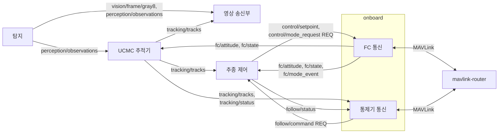

# RPi 프로세스 구성과 인터페이스

| 항목 | 내용 |
|---|---|
| 문서 버전 | 0.9 (팀 검토 전 초안) |
| 범위 | RPi 안 프로세스 구성, 프로세스 사이 메시지(ZeroMQ), onboard 안 C++ 인터페이스 |
| 관련 문서 | `docs/spec/icd.md` (FC·통제기 MAVLink), `docs/spec/video.md` (영상 전송, #20), `docs/design/system_architecture.md` (추적·추종 설계) |
| 상태 표기 | **[미결 n]** 은 7장 검토 항목 번호 |

## 1. 범위

이 문서가 정하는 것
- RPi 에서 실행되는 프로세스와 각 프로세스의 책임
- 프로세스 사이 메시지(ZeroMQ + MessagePack)의 이름, 방식(PUB/SUB 또는 REQ/REP), 발행자·구독자, 주기, 필드
- onboard 프로세스 안 C++ 인터페이스의 역할과 계약

이 문서가 정하지 않는 것
- FC·통제기와 주고받는 MAVLink 메시지 → `docs/spec/icd.md`
- 영상·메타데이터 RTSP 전송 → `docs/spec/video.md`
- 탐지·추적·추종 알고리즘과 상태 전이 → `docs/design/system_architecture.md`

## 2. 프로세스 구성

### 2.1 결정: 추종 제어는 별도 프로세스 (안 B)

| 프로세스 | 책임 | 담당 |
|---|---|---|
| 탐지 | 카메라 입력, 추론, 오버레이 JPEG | 탐지 |
| UCMC 추적기 | 프레임 사이 객체 연결, track_id·generation 부여 | 추적·추종 |
| 추종 제어 | 추종·Scan 판단, 속도 setpoint 계산, 임무·표적 상태 관리 | 추적·추종 |
| onboard | FC 통신(MAVLink, 단일 소유), 통제기 통신, 명령 중재 | 통신 |
| 영상 송신부 | RTSP 영상·메타데이터 송신 (5.3) | 통신 |
| mavlink-router | FC UART 와 로컬·통제기 UDP 중계 | 통신 (설정) |

- **FC 링크는 onboard 하나만 사용한다.** 다른 프로세스는 FC 데이터를 onboard 의 토픽으로 받고, FC 로 보낼 것(setpoint, 모드, heading)은 onboard 에 요청한다. 사례: PX4 의 `mavlink` 모듈, MAVROS·px4_ros_com, Aerostack2 `platform` 노드.
- 추종 제어 코드는 4장의 C++ 인터페이스에만 의존하고, 통신 담당이 그 인터페이스의 ZeroMQ 어댑터를 제공한다. 프로세스 배치를 바꿔도(onboard 안으로 합쳐도) 추종 제어 코드는 바뀌지 않는다 (의존 역전).

### 2.2 검토한 대안 (안 A: 추종 제어를 onboard 안에)

| 기준 | 안 A (onboard 안) | 안 B (별도 프로세스, 채택) |
|---|---|---|
| setpoint 경로 | 프로세스 안. 지연·손실 없음 | 로컬 ZeroMQ. 손실·지연은 6장 규칙으로 처리 |
| 고장 격리 | 추종 제어 고장 = onboard 고장 | 추종 제어가 멈추면 onboard 가 감지해 Hold |
| 담당 독립성 | 빌드·배포·재시작이 묶임 | 독립 |
| 정의할 것 | C++ 인터페이스 | C++ 인터페이스 + 메시지 + 두절·시간 초과 처리(6장) |
| 사례 | PX4·ArduPilot (한 실행 파일 안 모듈) | MAVROS·px4_ros_com 의 제어 노드, Aerostack2 의 controller 노드 |

담당 독립성과 고장 격리, 그리고 현재 구현(추적기·추종 제어가 이미 별도 C++ 프로세스)에 맞춰 안 B 로 정했다 (2026-10-15).

## 3. 공통 규칙

- 전송: ZeroMQ + MessagePack. 주기적으로 갱신되는 값(상태, 속도, 추적 결과)은 **PUB/SUB**, 수락·실패 확인이 필요한 요청(추종 시작·종료, 모드·heading 요청)은 **REQ/REP**. REQ/REP 는 중복 실행과 오래된 명령 실행을 막는다.
- multipart 구성: `[0] 토픽`, `[1] MessagePack 본문`, 필요하면 `[2] 바이너리`.
- 공통 필드: 모든 메시지에 `schema`(`argus.<영역>.<이름>.vN`), `source`(카메라 원본 식별 문자열. MAVLink 의 `ARGUS_SENSOR` enum 과의 대응표는 onboard 설정), `seq`, RPi `CLOCK_MONOTONIC` 기준 `*_monotonic_ns`.
- 요청(REQ) 공통 필드: `command_id`(요청마다 고유), `session_id`(요청자 세션), `seq`, `fc_epoch`(요청을 만들 때 onboard 가 `fc/attitude`·`fc/state` 에 발행하고 있는 현재 값, 아래), `valid_until_monotonic_ns`(이 시각이 지나면 실행하지 않음). 받는 쪽은 이 값들을 결과에 그대로 남긴다. 응답(REP): 같은 `command_id`, `result`(ACCEPTED·REJECTED·FAILED), `reason`.
- `fc_epoch`: FC 연결의 epoch(uint64). onboard 가 FC 와 연결을 새로 맺거나 FC 재부팅을 감지할 때마다 1 증가시킨다. `fc/attitude`·`fc/state` 메시지와 요청이 같은 FC 연결·같은 FC 부팅 구간에서 나온 것인지 확인하는 데 쓴다. 추적기 `generation` 과 같은 방식이지만 세는 대상(추적기 재시작이 아니라 FC 연결·FC 부팅)이 다르다. FC 시각, MAVLink 패킷 번호와도 다르다.
  - onboard(FC 통신)가 1 증가시키는 때: FC 연결을 새로 구성하거나 다시 연결할 때, FC 부팅 후 경과 시간(`time_boot_ms`)이 직전 메시지보다 작아져 FC 재부팅을 감지하고 보관 중인 FC 데이터를 지울 때. 메시지마다, 일반 모드 변경마다 바꾸지 않는다.
  - onboard 가 다시 시작하면 처음 값부터 다시 셀 수 있으므로 `onboard_session` 과 함께 비교한다.
  - 받는 쪽은 세션과 `fc_epoch` 를 검사한다. 값이 바뀌면 바뀌기 전 구간의 `fc/attitude`·`fc/state` 메시지, FC 제어 명령 송신권(6장), 진행 중 요청을 이어 쓰지 않는다.
  - 오래된 요청의 `fc_epoch` 만 최신 값으로 바꿔 다시 보내지 않는다. 바뀐 `fc_epoch` 의 `fc/attitude`·`fc/state` 메시지를 받아 조건을 다시 확인한 뒤 새 요청(새 `command_id`)으로 보낸다.
- 모드 요청은 **수락**(REP)과 **실제 전환 완료**(이벤트 토픽)를 구분한다.
- 버전: 필드 추가는 같은 버전, 필드 삭제·의미 변경은 `vN` 증가. 받는 쪽은 모르는 필드를 무시한다 (`tracking/tracks` v5 수신기는 이미 그렇게 동작).
- 단위: 각도 rad, 각속도 rad/s, 거리 m, 속도 m/s. 좌표는 NED, 기체 기준은 FRD. 기존 메시지에 남아 있는 deg·cm·ms 값(`tracking/tracks` 의 `ground_pose` 등)은 받는 쪽(onboard)이 받을 때 rad·m·s 로 바꾼다. `follow/status` 의 `scan_config` 는 SI 필드(`yaw_rate_rad_s`, `sweep_rad`, `timeout_s`)를 쓴다 (5.1.2).
- 영상 해상도: IR 카메라 영상은 640×480 (image_width 640, image_height 480). 박스 좌표는 이 원본 픽셀 기준이다.
- 정수 범위: `track_id`·`generation` 은 1~16,777,215 (2^24−1). MAVLink 명령 매개변수(float)로 손실 없이 전달하기 위한 범위다. `frame_id`·`fc_epoch` 는 uint64.
- 시계: 프로세스 사이 시각은 RPi `CLOCK_MONOTONIC`. UTC 는 영상 메타데이터(`docs/spec/video.md`)에서만 쓴다.

## 4. onboard C++ 인터페이스

`system_architecture.md` 의 `IVehiclePort` 하나를 용도별로 나눈다 (인터페이스 분리). 추적기는 상태 읽기만, 추종 제어는 넷 모두 쓴다.

| 인터페이스 | 구현 | 사용 | 내용 |
|---|---|---|---|
| `IVehicleState` | onboard FC 통신 (ZeroMQ 어댑터) | 추종 제어, 추적기 | 기체 상태 스냅샷과 자세·위치 메시지 (5.1 `fc/attitude`·`fc/state` 와 같은 값) |
| `IVelocitySetpointSender` | onboard FC 통신 (ZeroMQ 어댑터) | 추종 제어 | FRD 전진·우측·하강 속도(m/s), yaw 회전 속도(rad/s), 유효 시간. 매 주기 호출, 즉시 반환 |
| `IModeControl` | onboard FC 통신 (ZeroMQ 어댑터) | 추종 제어 | Offboard 진입, Hold 전환, Hold 상태 절대 heading 요청. 수락은 동기 응답, 전환 완료·Offboard 이탈은 이벤트 |
| `IFollowCommand` | 추종 제어 (ZeroMQ 어댑터) | onboard 통제기 통신 | 추종 시작(sensor, generation, class_id, track_id, label)·종료·Scan 시작, 수락·거부 응답, 임무·표적 상태 |

- 구현을 기체 FC, SITL, 테스트용 가짜로 바꿔도 같은 계약을 지킨다.
- 새 행동(예: Scan)은 `IFollowCommand` 의 명령 종류 추가로 넣고 FC 통신 코드는 바꾸지 않는다.
- 계약(사전·사후 조건, 시간 제한)은 인터페이스 확정 뒤 헤더 주석과 테스트로 적는다.

## 5. 메시지

### 5.1 PUB/SUB

| 토픽 | 발행 → 구독 | 주기 | 필드 |
|---|---|---|---|
| `vision/frame/gray8` | 탐지 → 영상 송신부 | 최대 30 FPS | `argus.vision.frame.v1`. 박스를 그리지 않은 **비압축** 8 비트 흑백 프레임 640×480 (Double Plateau 전처리 직후, 레터박스 전. 탐지 결과·추적 결과의 박스와 같은 픽셀 좌표계). multipart `[토픽][MessagePack 헤더][픽셀 바이트]`. 헤더는 `vision/overlay/jpeg` 와 같은 구성(source, session_id, frame_id, seq, unix_ns, received_monotonic_ns, width, height) + encoding("gray8"), stride(640), preprocess. IR 입력일 때만 발행. frame_id 는 탐지 결과(`perception/observations`)와 같다. 탐지 쪽 미리보기 송신 소켓(Python → C++ 어댑터)은 SNDHWM 4, 어댑터의 미리보기 수신은 rcvhwm 4 다. 한 프레임에 메시지가 최대 3개(gray8, overlay, npu_input) 연달아 나가므로 최소 3에 여유 1칸을 두었고, 더 키우면 오래된 프레임이 쌓여 지연되므로 4로 제한한다. 그래도 막히면 프레임을 버리므로, 모든 탐지 결과에 같은 frame_id 의 프레임이 있지는 않다. RTSP 영상 트랙의 소스이며 전송 코덱(JPEG 등) 인코딩은 영상 송신부가 한다. 설정으로 켜고 끔(기본 꺼짐), FPS 상한 설정 가능. 전송 경로는 기존 버스 (7장 3) |
| `vision/overlay/jpeg` | 탐지 → 지상 미리보기 (영상 송신부는 구독하지 않음) | 최대 15 FPS | `argus.vision.overlay.v1` (기존). 탐지 박스·라벨이 그려진 JPEG. RTSP 에는 쓰지 않는다. 통제기가 RTSP 로 바뀐 뒤 끌 수 있게 당분간 유지 |
| `vision/npu_input/jpeg` | 탐지 → (진단용, 현재 구독자 없음) | 최대 30 FPS | `argus.vision.npu_input.v1`. Hailo 입력 640×640 레터박스 영상(lb_scale, lb_pad_x, lb_pad_y 포함). 박스 좌표계가 원본 픽셀과 다르다 |
| `perception/observations` | 탐지 → 추적기, 영상 송신부 | 최대 30 FPS | `argus.perception.observations.v2` (기존). track_id 는 null. 추론한 프레임마다 발행하며 객체가 없으면 `detections: []` 로 보낸다. 큐에서 버린 프레임은 발행하지 않으므로 frame_id 는 건너뛸 수 있다 |
| `tracking/tracks` | 추적기 → 추종 제어, onboard, 영상 송신부 | 탐지 결과 프레임마다 (고정 주기 아님) | `argus.tracking.tracks.v5` (기존, 5.1.1) |
| `tracking/status` | 추적기 → onboard | 1 Hz | `argus.tracking.status.v1` (5.1.3). generation, fc_fresh, cmc_valid, fps. `ARGUS_SENSOR_STATUS` 보고에 사용 |
| `fc/attitude` | onboard → 추적기, 추종 제어 | FC ATTITUDE 메시지마다, **30 Hz 이상** | roll·pitch·yaw(rad), 각속도(rad/s), fc_time_boot_ms, received_monotonic_ns(원수신 시각. 재발행 시각으로 덮어쓰지 않음), fc_time_monotonic_ns(TIMESYNC 변환, 무효면 null), timesync_valid, fc_epoch(3장). 필드 이름은 **[미결 7]** |
| `fc/state` | onboard → 추적기, 추종 제어 | 30 Hz 이상 | local NED 위치·속도(m, m/s), 하향 거리(m), 위치(lat·lon·고도), 비행 모드, armed, in_air, 메시지별 원수신 시각, fc_epoch(3장). 추적기가 쓰는 것은 자세·local NED 위치·하향 거리. 필드 이름은 **[미결 7]** |
| `control/setpoint` | 추종 제어 → onboard | 20 Hz | forward·right·down(m/s), yaw_rate(rad/s), seq, valid_until_monotonic_ns |
| `follow/status` | 추종 제어 → onboard | 1 Hz + 변경 시 | `argus.follow.status.v1` (5.1.2). 임무 상태(8개), 표적 상태(4개), 선택 표적, 명령 결과, Scan 진행. `ARGUS_STATUS` 보고에 사용 |
| `fc/mode_event` | onboard → 추종 제어 | 변경 시 | 실제 비행 모드, 직전 모드 요청의 command_id, Offboard 이탈 원인(조종사 전환·failsafe 등) **[미결 1]** |

- 엔드포인트(기본값, 모두 RPi 안 `tcp://127.0.0.1`): FC 상태 PUB(`fc/attitude`, `fc/state`) **6370** onboard bind. 제어·상태 PUB(`control/setpoint`, `follow/status`) **6372** 추종 제어 bind. `tracking/tracks`·`tracking/status` 는 기존 6357 추적기 bind. 탐지 토픽은 기존 버스 5556. `fc/mode_event` 의 발행 엔드포인트는 **[미결 1]**.
- 보간용 이력(프레임 시각에 맞춘 FC 자세)은 받는 쪽이 보관한다. onboard 는 FC 메시지를 그대로 넘긴다.
- `tracking/tracks` 가 없어도(입력 부재, 프레임 시각에 맞는 `fc/attitude`·`fc/state` 메시지 없음, 지면 투영 실패) 영상 송신부는 영상을 계속 보낸다.

#### 5.1.1 `tracking/tracks` v5 필드 (2026-10-15 기준)

| 필드 | 형 | 뜻 |
|---|---|---|
| schema, source, frame_id | string, string, uint64 | `argus.tracking.tracks.v5`. source·frame_id 는 프레임·탐지 결과 메시지와 같은 값. 세 메시지를 묶는 키 |
| fc_epoch, generation | uint64, uint64 | generation 은 추적기 재시작·초기화마다 1 증가하는 영구 저장 카운터. 1~16,777,215 |
| sample_monotonic_ns, motion_sample_ns, clock_domain, timestamp_source | int64, int64, string, string | 시각과 그 출처. `exposure_monotonic_ns` 는 null, `exposure_time_valid` 는 false (노출 시각 없음) |
| image_width, image_height, coordinate_frame | int, int, "camera_pixel" | 640, 480. 박스 좌표 기준 (원본 영상 픽셀) |
| ground_pose | [N, E, D, roll, pitch, yaw] | m, deg |
| tracks[] | | 아래 |
| tracks[].track_id | int64 (1~16,777,215) | 프로세스 공통 카운터. 재시작 시 1 부터 (generation 으로 구분) |
| tracks[].class_id, label, confidence | int32, string, float | |
| tracks[].x1, y1, x2, y2 | float | 원본 영상 픽셀 |
| tracks[].state | string | 현재 "CONFIRMED" 만 발행. PREDICTED 발행은 필요 시 확장 **[미결 6]** |
| tracks[].real_detection, last_real_detection_monotonic_ns | bool, int64 | |
| tracks[].ground, ground_anchor | [N, E, varN, covNE, varE, alignment_ms], [anchor_y, height_m] | 지면 투영 |

- 트랙이 없으면 `tracks: []`. 메시지 자체가 없을 수도 있다 (입력 부재, 프레임 시각에 맞는 `fc/attitude`·`fc/state` 메시지 없음).
- 지정 표적 표시(`designated`)는 이 메시지에 없다. 지정 표적은 `follow/status` 가 제공한다.

#### 5.1.2 `follow/status` v1 필드 (2026-10-16 기준)

| 필드 | 형 | 뜻 |
|---|---|---|
| schema, source, clock_domain | string | `argus.follow.status.v1`, `argus-follow-controller`, `host_monotonic` |
| controller_session, client_session, session_id, onboard_session, uid | string | `controller_session`: 추종 제어 프로세스가 시작할 때 만드는 세션. 추종 제어 재시작 감지에 쓴다. `client_session`: 추종 제어가 onboard 에 요청할 때의 세션. `session_id`: 이 메시지 발행자의 세션. 지금은 세 값이 같다. `onboard_session`: 상대 onboard 의 세션. `uid`: 설정된 대상 FC 의 UID 이며, 이 값만으로 연결이 확인됐다는 뜻은 아니다 |
| fc_epoch, seq, received_monotonic_ns | uint64, uint64, int64 | |
| status.mission_state | enum | IDLE, PREPARING, FOLLOW_ACTIVE, HOLD_TRANSITION, HOLD_WAIT, SCAN_ACTIVE, MANUAL, FAULT → `ARGUS_STATUS.mission_state` |
| status.target_state | enum | NONE, CONFIRMED, PREDICTED, LOST → `ARGUS_STATUS.target_state` |
| status.target_phase, recovery_reason, ambiguous, mission, reason, active | enum·string·bool | 추종 제어 내부 세부 상태(target_phase: UNSELECTED, LOCKED, GAP_HOLD, REACQUIRE, CONFIRM, LOST). MAVLink 로는 보내지 않고, 거부·실패 이유는 `STATUSTEXT` 에 쓸 수 있다 |
| status.selected | object 또는 null | 선택 표적: generation, track_id, class_id, label, sensor(문자열) → `ARGUS_STATUS.target_id`·`target_generation`, `active_sensor`(변환표) |
| status.command_results[] | array (최대 32) | 최근 명령 결과: command_id(string 또는 uint64), action(`track_start`·`stop`·`search`), outcome, request_accepted (5.2.1), reason, generation·track_id·class_id·sensor. pending·accepted·result(`pending`·`accepted`·`failed`)는 호환용. onboard 는 자기 command_id 의 결과를 찾아 `COMMAND_ACK` 로 옮긴다. 전체 최대 32개만 보관한다. 32개가 차면 완료된 기록부터 지우고 진행 중(IN_PROGRESS)인 기록은 남긴다. 32개를 넘겨 보관하지는 않는다. outcome·request_accepted 는 이전 생산자와의 호환 때문에 schema 에서 선택 필드다 |
| status.command_epoch, command_sent | uint64, bool | |
| status.scan_state, scan_state_name, scan_config{yaw_rate_rad_s, sweep_rad, timeout_s}, scan_progress_deg, heading_stop_pending | | Scan 진행. `yaw_rate_rad_s` 는 부호 포함(양수 = 시계 방향). 같은 값의 `rate_deg_s`·`timeout_ms` 는 호환용 |

#### 5.1.3 `tracking/status` v1 필드 (2026-10-15 기준)

| 필드 | 형 | 뜻 |
|---|---|---|
| schema, source, clock_domain | string | `argus.tracking.status.v1`, `pi-ucmc`, `host_monotonic` |
| seq, published_monotonic_ns | uint64, int64 | |
| generation | uint64 (1~16,777,215) | 현재 추적기 세대 |
| fc_fresh, cmc_valid | bool | FC 데이터 최신 여부, 카메라 회전 보상 유효 여부. `ARGUS_SENSOR_STATUS.flags` 에 넣을지는 #21 후속 |
| fps | number | 처리 FPS |

### 5.2 REQ/REP

| 요청 | 요청자 → 응답자 | 내용 | 응답 |
|---|---|---|---|
| `follow/command` | onboard → 추종 제어 | action(`track_start`·`stop`·`search`. search = Scan), track_start 는 sensor·generation·class_id·track_id·label(onboard 가 최신 `tracking/tracks` 에서 보완), search 는 yaw 범위·yaw 속도·제한 시간(NaN 은 기본값), stop 은 reason(운용자·링크 두절·onboard 판단) | `follow/result` (5.2.1). 이후 진행은 `follow/status` 의 command_results |
| `control/mode_request` | 추종 제어 → onboard | mode(OFFBOARD·HOLD), 또는 HOLD 상태 절대 heading(rad, NED) | 수락·거부. 실제 전환 완료는 `fc/mode_event` |

- 엔드포인트(기본값): `control/mode_request` 는 onboard RPC REP **6371** (onboard bind), `follow/command` 는 추종 명령 REP **6373** (추종 제어 bind). `control/mode_request` 의 schema·필드와 두 요청의 타임아웃은 추적·추종 쪽 구현과 함께 고정한다 **[미결 1]**.
- 검사 분담: 제어권·매개변수 범위 검사는 onboard, 표적 존재·상태·FC 조건 검사는 추종 제어. 추종 제어는 FC 가 실제로 Hold 일 때 track_start 를 수락한다. Position 모드라는 것만으로는 수락하지 않으며, Position 모드에서 조종을 넘기는 절차는 아직 정의되지 않았다 (`docs/spec/icd.md` 4.2 ⑥, E5).

#### 5.2.1 `follow/result` v1·v2 필드 (2026-10-16 기준)

`follow/command` 의 응답이다. schema 는 `argus.follow.result.v1`·`argus.follow.result.v2`.

| 필드 | 형 | 뜻 |
|---|---|---|
| command_id | string 또는 uint64 | 요청의 command_id |
| outcome | enum | IN_PROGRESS·SUCCEEDED·REJECTED·FAILED (아래 표). 진행·완료 판단에 쓴다 |
| request_accepted | bool | 요청을 처음에 수락했는지. 수락 뒤 실행이 실패해도 true 로 남는다 |
| reason | string | 사람이 읽는 이유. 판정에는 쓰지 않고 `STATUSTEXT` 에 옮길 수 있다 |
| result, pending, accepted | | 호환용. v1 result 는 `pending`·`accepted`·`failed`, v2 result 는 `ACCEPTED`·`REJECTED`·`FAILED` |

| outcome | request_accepted | 뜻 | onboard 의 `COMMAND_ACK` |
|---|---|---|---|
| IN_PROGRESS | true | 요청을 수락하고 진행 중 | IN_PROGRESS |
| SUCCEEDED | true | 완료. Scan 은 시간 제한으로 끝나도 실제 Hold·회전 정지를 확인한 뒤 SUCCEEDED | ACCEPTED |
| REJECTED | false | 수락 전 조건·입력 불충족으로 거부 | DENIED |
| FAILED | true | 수락 뒤 실행 실패, 취소, RC·모드 개입 | FAILED |

- onboard 는 첫 결과를 REP 응답에서 받는다. 형식·세션·`valid_until_monotonic_ns` 를 보는 사전 검사에서 거부된 요청은 응답으로만 알려지고 `command_results` 에는 남지 않을 수 있기 때문이다. 이후 진행은 `follow/status.command_results` 에서 같은 command_id 로 찾는다.
- 같은 command_id 로 다시 요청하면 추종 제어는 재실행하지 않고 저장된 결과를 돌려준다. 단 세션·`valid_until_monotonic_ns`·명령 내용 검사는 다시 하므로, 같은 command_id 로 내용이 바뀐 요청이나 stop 뒤에 온 예전 track_start 는 거부될 수 있다. 그래서 통제기가 `COMMAND_LONG` 을 재전송하면(`docs/spec/icd.md` 4.1) onboard 는 같은 command_id 와 같은 내용으로 요청한다.
- outcome 이 없는 응답(이전 생산자)에는 이 표의 규칙을 적용하지 않는다.

### 5.3 영상 송신부 (통신 담당, 별도 프로세스)

- 구독: `vision/frame/gray8`(박스 없는 비압축 프레임, 30 FPS), `perception/observations`, `tracking/tracks`. 세 메시지를 `(source, frame_id)` 로 묶는다. 같은 frame_id 의 프레임이 없는 탐지 결과가 있을 수 있으므로(5.1) 짝이 없는 탐지·추적 결과는 버린다. 선택된 표적 표시가 필요하면 `follow/status` 도 구독한다.
- 박스가 그려진 영상을 쓰지 않는 이유: 탐지 박스가 이미 그려져 있어 통제기가 메타데이터의 추적 박스를 그리면 박스가 두 겹으로 보이고 위치도 다르다. 또 15 FPS 라 탐지 결과 둘 중 하나만 같은 frame_id 의 영상이 있어 메타데이터도 15 FPS 로 묶인다. 박스는 통제기가 메타데이터로만 그린다.
- 전송 코덱 인코딩(JPEG, 필요하면 H.264 등)은 영상 송신부가 한다. 탐지 프로세스는 프레임과 박스만 내고 전송 방식을 모른다(단일 책임). 그래서 코덱 추가·품질 변경은 송신부의 설정과 인코더 구현 추가로 끝나고 탐지 코드는 바뀌지 않으며(개방-폐쇄), 비압축 프레임이 있어 압축 손실 측정과 수신기 테스트도 할 수 있다. 비용: 640×480 8 비트 흑백 307 KB/프레임, 30 FPS 약 9 MB/s (RPi 안 ZeroMQ 로 충분). 송신부 JPEG 인코딩은 프레임당 1~2 ms.
- 메시지 결합: 세 토픽의 메시지를 같은 `(source, frame_id)` 끼리 한 프레임으로 묶는다. 보관 개수와 대기 시간을 제한하고, 도착 순서는 보장되지 않으므로 기다리되 시간 안에 나머지 메시지가 오지 않으면 버린다. 재연결·재시작(`session_id` 변경) 때 보관 중인 메시지를 비운다. 영상 프레임이 없는 탐지·추적 결과는 보내지 않는다.
- 전송: RTSP 세션 하나에 영상 트랙(RTP/JPEG)과 메타데이터 트랙(ONVIF XML). 세부는 `docs/spec/video.md` (#20).
- 시각: 영상 프레임과 메타데이터 모두 JPEG 의 `unix_ns` 를 쓴다 (RPi 수신 시각. 노출 시각이 아님).
- 메타데이터의 박스: 운용자가 클릭해 고를 수 있어야 하므로 `tracking/tracks` 의 트랙 기준으로 보낸다. 영상에 그려진 탐지 박스와 위치가 다를 수 있다. 추적 결과가 없는 프레임은 박스 없이 보낸다.
- 운용자 선택: 통제기는 클릭한 트랙의 sensor, generation, class_id, track_id 를 `TRACK_START` 매개변수로 보낸다 (`docs/spec/icd.md` 4.2, #21).

## 6. 두절·시간 초과 판단과 동작

- setpoint 유효 시간: `control/setpoint` 의 `valid_until_monotonic_ns` 가 지나도록 새 값이 없으면 onboard 가 속도 0 을 보내고 Hold 를 요청한다.
- 상태 보고 두절 판단: onboard 는 `follow/status`(1 Hz) 가 3 초 동안 오지 않으면 추종 제어가 멈춘 것으로 보고, 추종·Scan 중이면 Hold 로 전환하고 `mission_state` FAULT 를 보고한다 (`docs/spec/icd.md` 6.4).
- 요청 대응: REQ/REP 응답이 정해진 시간 안에 오지 않으면 실패로 본다. `valid_until_monotonic_ns` 가 지난 요청은 실행하지 않고 REJECTED 로 답한다.
- FC 제어 명령 송신권: FC 로 setpoint·모드·heading 을 보낼 권한은 onboard 가 관리한다. 통제기 제어권(sysid 250, `docs/spec/icd.md` 5장)과는 별개다. 다른 소유자가 송신권을 가지고 있으면 추종 제어의 시작 요청을 거부하고(reason "another writer owns FC"), 세션 변경·RC 개입·권한 폐기 뒤에는 이전 권한으로 보낼 수 없다.
- onboard 독립 감시: onboard 는 추종 제어가 정상이라고 보고해도 FC 상태·RC 개입·유효 시간을 스스로 확인해 위험한 송신을 막는다. RC 개입이 항상 우선하고, 오래된 정상 상태 보고로 FAULT 를 덮어쓰지 않는다.
- Scan 회전 감시: heading 요청의 실행 기한(FC 로 보내기 전 검사)과, 회전 중 다음 heading 요청을 기다리는 감시 시간은 따로 둔다. 회전 중 감시 시간 안에 추종 제어의 새 heading 요청이 오지 않으면 onboard 가 독립적으로 회전을 멈추고 자동으로 다시 시작하지 않는다. 감시 시간과 FC 정지 명령 방식은 기체 시험으로 정한다 (`docs/spec/icd.md` E3).
- 재시작: 추적기가 재시작하면 generation 이 바뀌므로, 이전 generation 의 표적을 가리키는 명령은 REJECTED. 추종 제어·onboard 재시작 시 상대는 `follow/status` 의 `controller_session`, `fc/mode_event` 의 세션 식별자 변화로 알아챈다.

## 7. 검토 필요 사항

1. `control/mode_request` 요청·응답과 `fc/mode_event` 의 schema 이름·필드 고정, 두 REQ/REP 의 타임아웃, `fc/mode_event` 의 발행 엔드포인트. `follow/command` 의 응답(`follow/result`)과 거부·실패 구분(outcome)은 5.2 에 반영함. — 추적/추종, 통신
2. 해소 (0.8): `follow/status` 발행 주기(1 Hz + 변경 시), 세션 필드의 뜻, `scan_config` SI 필드를 5.1·5.1.2 에 반영함. — 추적/추종
3. 해소 (0.8): `vision/frame/gray8` 의 전송 경로는 기존 버스(5555/5556)로 확정. — 탐지
   - 측정(2026-10-19, drone Pi 5): 전송 경로만 따로 잰 결과 기존 버스(Python PUSH → 어댑터 → XSUB/XPUB 프록시 → SUB)는 버림 0, 지연 p50 1.5 ms 로 IPC 직결(p50 0.4 ms)과 약 1 ms 차이.
   - 탐지·추적·추종을 함께 켜고 gray8 끔/켬을 5회씩 120 초 비교: 탐지·추적 30 FPS, gray8·overlay·npu_input 버림 0, `perception/observations` 지연 p50 0.85 → 0.95 ms, 카메라 수신 → `tracking/tracks` 도착 p50 25.0 → 26.3 ms, CPU 코어 하나 기준 +24 %p(Pi 전체의 약 6 %).
   - 조건: 카메라 대신 RAW14 녹화 재생, FC 대신 가상 기체(MAVLink 연결 없음), 영상 송신부 없음. 추적기는 gray8 을 구독하지 않아 gray8 은 프록시에서 걸러졌다. 영상 송신부를 구현하면 gray8 을 실제로 받는 구독자가 생기므로 같은 방법으로 다시 측정한다.
4. Hold 상태 절대 heading 요청을 onboard 가 FC 에 어떻게 보낼지. `MAV_CMD_DO_REPOSITION` yaw 를 우선 검토하되 PX4 v1.16 Hold 에서 유지·회전·정지 동작을 확인. Offboard 방식이면 진입·유지·종료 절차를 함께 정한다. `docs/spec/icd.md` E3. — 통신, 추적/추종
5. `fc/attitude`·`fc/state` 30 Hz 가 PX4 TELEM2 스트림 설정으로 나오는지, 프레임 시각과 가장 가까운 `fc/attitude`·`fc/state` 메시지의 시각 차가 50 ms 이내로 유지되는지 기체에서 측정. 자세 약 100 Hz·local 위치 약 30 Hz 는 확인됨, 하향 거리·전역 위치는 미수신. `docs/spec/icd.md` D5. — 통신, 추적/추종
6. PREDICTED 트랙 발행 확장 여부 (통제기 화면에 예측 위치를 보일 필요가 생길 때). — 통제기, 추적/추종
7. `fc/attitude`·`fc/state` 필드 이름 확정. 단위(rad·m·m/s)와 항목(자세, local NED 위치, 하향 거리, 메시지별 원수신 시각)은 합의됨. — 통신, 추적/추종
8. 해소 (0.8): 추종 제어의 거부 이유 "another writer owns FC" 는 onboard 가 관리하는 FC 제어 명령 송신권을 다른 소유자가 가진 경우다 (6장). — 추적/추종, 통신
9. 해소 (0.8): `fc_epoch` 는 FC 연결의 epoch(FC 와 새로 연결하거나 FC 재부팅을 감지할 때마다 1 증가)이고, 요청에는 onboard 가 발행하는 현재 값을 넣는다 (3장). — 추적/추종, 통신
10. 버스 프록시(XSUB 5555 / XPUB 5556)의 담당과 실행 방식. 탐지 토픽(`perception/observations`, `vision/frame/gray8` 등)이 모두 이 프록시를 지나는데, 누가 실행하고 관리하는지(별도 프로세스인지, 어느 프로세스 안인지, 죽으면 어떻게 되는지)가 정해져 있지 않다. — 통신, 탐지
11. RPi 안 토픽 연결 방식 통일 여부. 지금은 직접 연결(발행자가 bind: 6370, 6372, 6357)과 프록시(탐지 토픽: 5555 / 5556)가 섞여 있어, 구독자가 주소를 여러 개 알아야 한다. 선택지는 (가) 모든 토픽을 직접 연결하고 이름과 기본 주소를 `onboard/libs/protocol` 한 곳에서 관리, (나) 모든 토픽을 프록시로, (다) 지금처럼 유지. (가) 를 제안한다. 프로세스와 포트가 고정된 한 기기 안에서는 데이터를 직접 연결하고 주소 표를 한 곳에 두는 방식이 일반적이고(openpilot 의 서비스 표, ROS 2 의 직접 연결), 프록시가 SPOF가 되어 멈추면 탐지 토픽 전체가 끊기는 문제가 없어진다. 다만 탐지 쪽 발행 코드를 바꿔야 한다. — 통신, 탐지, 추적/추종

## 변경 이력

| 버전 | 날짜 | 내용 |
|---|---|---|
| 0.1 | 2026-10-15 | 제안 초안. 프로세스 구성 두 안, 공통 규칙, C++ 인터페이스, 토픽, 두절·시간 초과 처리 |
| 0.2 | 2026-10-15 | 5.3 영상 송신부 추가 |
| 0.3 | 2026-10-15 | 안 B 확정. 요청은 REQ/REP 로, 모드 수락·완료 구분, Hold heading 요청 추가. `control/target`·`designated` 삭제(지정 표적은 `follow/status`). `tracking/tracks` v5 실제 필드, generation·track_id 범위, FC 표본 30 Hz. 7장 갱신 |
| 0.4 | 2026-10-15 | 리뷰 반영: 영상 소스를 박스 없는 JPEG 토픽으로, `perception/observations` 빈 프레임 발행·frame_id 건너뜀, `vision/npu_input/jpeg` 추가, IR 640×480 확정, 엔드포인트 6370~6373, FC 필드·단위 합의, 7장 갱신 |
| 0.5 | 2026-10-15 | `follow/status`·`tracking/status` 실제 schema 반영(5.1.2·5.1.3), `follow/command` action·result 이름을 구현에 맞춤, 단위 변환 규칙 보완, 7장 1·2 갱신 |
| 0.6 | 2026-10-15 | 영상 소스를 비압축 프레임 토픽으로 바꾸고 전송 코덱 인코딩을 영상 송신부로 (5.1·5.3·7장 3) |
| 0.7 | 2026-10-16 | 비압축 프레임 토픽을 `vision/frame/gray8` 로 확정(schema·헤더·픽셀 정의, 기본 꺼짐), overlay 는 지상 미리보기용으로 당분간 유지, 7장 3 을 전송 경로 확인으로 교체 |
| 0.8 | 2026-10-19 | #26 리뷰 답변 반영(#32): `follow/command` 응답 `follow/result` 와 outcome·request_accepted, ACK 대응, 첫 결과는 응답에서·재전송은 같은 command_id 규칙(5.2), `command_results` 보관 규칙·세션 필드·`scan_config` SI 필드(5.1.2), `follow/status` 주기 확정, `vision/frame/gray8` 전송 경로를 기존 버스로 확정하고 송신 SNDHWM·rcvhwm 4 (5.1, 측정 결과), command_id 를 uint64 로, `command_results` 보관 규칙 정정, 재전송 때 세션·기한·내용 재검사(5.2.1), 요청 공통 필드에 `fc_epoch`(3장), FC 제어 명령 송신권·onboard 독립 감시·Scan 회전 중 heading 요청이 끊길 때의 독립 정지(6장), 7장 1 갱신·2·3·8 해소·9 추가, 2.1 그림의 화살표를 onboard 안 FC 통신·통제기 통신에 직접 연결, `fc_epoch` 정의와 증가 조건·검사 규칙(3장), `fc/attitude`·`fc/state` 에 `fc_epoch` 추가(5.1), 7장 9 해소, "FC 표본" 을 "FC 메시지"·"`fc/attitude`·`fc/state` 메시지" 로 |
| 0.9 | 2026-10-25 | 4장 `IVelocitySetpoint` → `IVelocitySetpointSender` (값 타입 `VelocitySetpoint` 와 구분, #39), 7장 10(버스 프록시 담당), 11(토픽 연결 방식 통일) 추가, 7장 담당 표기를 담당 이름 안은 "/", 담당끼리는 ", " 로 |
